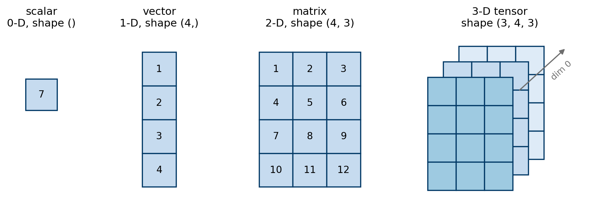

# About this notebook

This notebook is inspired by the official [PyTorch tutorial on tensors](https://pytorch.org/tutorials/beginner/basics/tensorqs_tutorial.html). The official tutorial assumes that you already know NumPy and Python very well and therefore explains rather little. Here, we go through the same material more slowly, add more explanation, and point out the pitfalls that you are most likely to meet when you later build machine learning models.

By the end of this notebook you should be able to:

- create tensors from Python lists, NumPy arrays and factory functions such as `torch.zeros()` and `torch.rand()`;
- inspect the three most important attributes of a tensor: its shape, its data type and its device;
- index, slice, reshape and join tensors;
- perform element-wise arithmetic, matrix multiplication, broadcasting and aggregation;
- move data between NumPy and PyTorch and understand when memory is shared and why data types matter.

## Background

PyTorch is an open-source machine learning library based on the earlier Lua library Torch. It was originally developed by Meta AI (formerly Facebook AI Research) and is used for applications such as computer vision, natural language processing and scientific machine learning. Together with frameworks such as TensorFlow and JAX, it is one of the most popular deep learning frameworks, and it is particularly dominant in research. As the prefix **Py** suggests, the main interface of PyTorch is Python. Under the hood, however, most of the heavy computation is implemented in C++ (and in CUDA for NVIDIA GPUs) for performance, and PyTorch also offers a C++ interface called LibTorch.

In September 2022, Meta transferred the governance of PyTorch to the newly founded *PyTorch Foundation*, which is part of the Linux Foundation. This makes PyTorch a vendor-neutral project whose development is shared by many companies and research institutions, which is good news for its long-term stability.

# Tensors

In simple terms, a tensor is a specialised data structure that is very similar to an array or a matrix. Tensors are also a mathematical tool used throughout physics and engineering: if you study general relativity, quantum mechanics, fluid mechanics or solid mechanics, you will certainly meet them. It is therefore no surprise that they appear in machine learning too.

In mathematics, a tensor is an algebraic object that describes a multilinear relationship between sets of algebraic objects related to a vector space. A matrix, for example, represents a linear mapping from one vector space to another. Once we choose a basis, a tensor can be represented by a multi-dimensional array of numbers. Of course, nobody learns a complex mathematical concept just by reading Wikipedia, but here is the [Wikipedia article](https://en.wikipedia.org/wiki/Tensor) for your own interest.

::: {.callout-important}
## How we think about tensors in this course

Although the tensor is a deep mathematical concept, in this course (and in most engineering applications of machine learning) it is safe to view a tensor simply as a **multi-dimensional array**, just like a NumPy `ndarray`. We assume that you are reasonably familiar with NumPy. You will see that tensors and `ndarray`s are very similar but not identical: tensors can live on a GPU, and they can record the operations applied to them so that derivatives can be computed automatically (the topic of the next notebook).
:::

{#fig-tensor-ranks width="95%"}

## Creating tensors

We create a tensor in much the same way as we create a NumPy array. We can also create a tensor from an existing NumPy array.

```{python}
import torch
import numpy as np

print(f"PyTorch version: {torch.__version__}")
```

```{python}
data = [[1, 2], [3, 4]]
x_data = torch.tensor(data)     # compare with x = np.array(data)
print(x_data)
```

```{python}
np_array = np.array(data)               # create a NumPy array
x_np = torch.from_numpy(np_array)       # convert the NumPy array to a tensor
print(x_np)
```

PyTorch also provides the familiar *factory functions* from NumPy. Note that PyTorch calls the shape of a tensor its `size`, so the keyword argument is `size` rather than `shape`. You can also simply pass the dimensions as positional arguments, e.g. `torch.ones(2, 3)`.

```{python}
# keyword argument "size"; NumPy uses "shape"
ones_tensor = torch.ones(size=(2, 3))
zeros_tensor = torch.zeros((2, 3))          # the keyword is optional
rand_tensor = torch.rand(size=(2, 3))       # uniform random numbers in [0, 1)
randn_tensor = torch.randn(2, 3)            # standard normal random numbers

shape = (2, 3)
two_tensor = 2 * torch.ones(size=shape)     # multiplication by a scalar is element-wise

print(f"ones_tensor =\n{ones_tensor}\n")
print(f"zeros_tensor =\n{zeros_tensor}\n")
print(f"rand_tensor =\n{rand_tensor}\n")
print(f"randn_tensor =\n{randn_tensor}\n")
print(f"two_tensor =\n{two_tensor}")
```

Two more factory functions that we will use a lot in the coming notebooks are `torch.arange()` (evenly spaced values with a given *step*) and `torch.linspace()` (a given *number* of evenly spaced values between two end points).

```{python}
print(torch.arange(0, 10, 2))           # start, end (exclusive), step
print(torch.linspace(0, 1, steps=5))    # start, end (inclusive), number of points
```

Just like in NumPy, there are `torch.ones_like()`, `torch.zeros_like()` and `torch.rand_like()`. These functions create a new tensor with the same shape (and, unless you say otherwise, the same data type) as the tensor you pass in. For example, `torch.ones_like(x)` creates a tensor filled with $1$ whose shape is taken from `x`.

```{python}
# We can specify the data type explicitly. Converting floating-point values to an
# integer type truncates them towards zero: 4.4 -> 4, 5.6 -> 5, 6.5 -> 6.
x = torch.tensor([[1, 2, 4], [4.4, 5.6, 6.5]], dtype=torch.int16)
x_ones = torch.ones_like(x)

# rand_like() would inherit the integer dtype of x, but random numbers in [0, 1)
# cannot be integers, so we must ask for a floating-point dtype explicitly.
x_rand = torch.rand_like(x, dtype=torch.float32)

print(f"x =\n{x}\n")
print(f"x_ones =\n{x_ones}\n")
print(f"x_rand =\n{x_rand}")
```

```{python}
# What happens if we forget the dtype?
# (We catch the error so that the notebook keeps running.)
try:
    torch.rand_like(x)
except RuntimeError as err:
    print(f"RuntimeError: {err}")
```

## Attributes of a tensor

A tensor has many attributes. The three that you will use most often are its **shape**, its **data type** (`dtype`) and the **device** on which it is stored.

```{python}
tensor = torch.rand(3, 4)
print(f"Shape of tensor: {tensor.shape}")
print(f"Datatype of tensor: {tensor.dtype}")
print(f"Device tensor is stored on: {tensor.device}")
```

### CPU or GPU?

A tensor can be stored in the main memory and processed by the CPU, or stored in GPU memory and processed by the GPU. If the tensor lives on the CPU, its device is `cpu`; if it lives on an NVIDIA GPU, its device is `cuda` (more precisely `cuda:0` for the first GPU). Apple-silicon Macs offer a GPU backend called `mps`.

By default, tensors are created on the CPU. A common and portable pattern is to choose the best available device once, at the beginning of a script, and then either create tensors directly on that device or move them there with the `.to()` method. Keep in mind that copying large tensors between devices can be expensive in terms of time and memory.

```{python}
# Choose the best available device. This cell runs on every machine:
# it uses an NVIDIA GPU if there is one, then an Apple-silicon GPU, otherwise the CPU.
if torch.cuda.is_available():
    device = "cuda"
elif torch.backends.mps.is_available():
    device = "mps"
else:
    device = "cpu"
print(f"Using device: {device}")

# create the tensor directly on the device
tensor = torch.rand(size=(3, 4), device=device)
print(f"Device tensor is stored on: {tensor.device}")

tensor_cpu = torch.rand(3, 4)                      # created on the CPU ...
tensor_moved = tensor_cpu.to(device)               # ... and copied to the chosen device
print(f"Device of the copy: {tensor_moved.device}")
```

::: {.callout-note}
Two tensors must be on the same device to take part in the same operation. Adding a CPU tensor to a CUDA tensor raises an error. This is why, in later notebooks, we move both the model and the data to the same `device`.
:::

# Operations on tensors

Hundreds of tensor operations, including arithmetic, linear algebra, matrix manipulation (transposing, indexing, slicing), sampling and more, are described comprehensively in the [PyTorch documentation](https://pytorch.org/docs/stable/torch.html). We will go through the most basic and most commonly used ones, and it is best to learn them by example. To read the documentation of a function inside Jupyter, use `help(torch.cat)` or the question-mark syntax `torch.cat?`.

## Indexing and slicing

Indexing and slicing work exactly as in NumPy. The ellipsis `...` stands for "all the remaining dimensions", so `tensor[..., -1]` selects the last entry along the last dimension, whatever the number of dimensions is.

```{python}
tensor = torch.ones((4, 4))
print(f"First row: {tensor[0]}")
print(f"First column: {tensor[:, 0]}")
print(f"Last column: {tensor[..., -1]}")
```

```{python}
# Change all the values in the second column to 0
tensor[:, 1] = 0
print(tensor)
```

## Reshaping tensors

We often need to change the shape of a tensor without changing its data. For example, a logistic regression model expects each image to be a flat vector, whereas the image itself is stored as a $28 \times 28$ grid of pixels. The most useful functions are:

- `reshape()` and `view()`: give the tensor a new shape with the same number of elements. One dimension may be given as `-1`, which means "work out this dimension for me". `view()` never copies data and therefore only works on tensors stored contiguously in memory; `reshape()` copies only when necessary, so it always works.
- `flatten()`: turn a tensor into a 1-D tensor (or flatten only some of its dimensions).
- `squeeze()` and `unsqueeze()`: remove dimensions of size $1$, or insert a new dimension of size $1$.
- `.T`: the transpose of a 2-D tensor.

```{python}
x = torch.arange(12)            # tensor([0, 1, ..., 11]) with shape (12,)
A = x.reshape(3, 4)             # shape (3, 4)
B = x.view(4, 3)                # shape (4, 3), shares the data with x
C = A.reshape(-1, 2)            # -1 is inferred: shape (6, 2)
print(f"A.shape = {A.shape}, B.shape = {B.shape}, C.shape = {C.shape}")
print(f"A =\n{A}\n")

img = torch.rand(1, 28, 28)     # e.g. one grayscale image: (channels, height, width)
print(f"img.squeeze().shape   = {img.squeeze().shape}")     # drop the size-1 dimension
print(f"img.flatten().shape   = {img.flatten().shape}")     # one long vector
print(f"A.unsqueeze(0).shape  = {A.unsqueeze(0).shape}")    # new leading dimension
print(f"A.T.shape             = {A.T.shape}")               # transpose
```

## Joining tensors

We can use `torch.cat()` to concatenate a sequence of tensors along an *existing* dimension. A subtly different operation is `torch.stack()`, which joins tensors along a *new* dimension. It is always good to have a look at the documentation at some point:

- [torch.cat](https://pytorch.org/docs/stable/generated/torch.cat.html)
- [torch.stack](https://pytorch.org/docs/stable/generated/torch.stack.html)

```{python}
t1 = torch.cat([tensor, tensor, tensor], dim=1)     # join along the columns
print(f"torch.cat:   {tensor.shape} x 3 -> {t1.shape}")
print(t1)

t2 = torch.stack([tensor, tensor, tensor], dim=0)   # create a new leading dimension
print(f"\ntorch.stack: {tensor.shape} x 3 -> {t2.shape}")
```

## Arithmetic operations

Just like in NumPy, all standard arithmetic operators act **element-wise**.

```{python}
a = torch.tensor([1, 2, 3])
b = torch.tensor([4, 5, 6])
print(f"a + b = {a + b}")
print(f"a - b = {a - b}")
print(f"a * b = {a * b}")
print(f"a / b = {a / b}")
```

Each operator also exists as a method (and as a function in the `torch` namespace). The operators are usually more convenient, but you will see both styles in other people's code.

```{python}
print(f"a + b = {a.add(b)}")
print(f"a - b = {a.sub(b)}")
print(f"a * b = {a.mul(b)}")
print(f"a / b = {a.div(b)}")
```

Matrix multiplication between two 2-D tensors is written with the `@` operator or the `matmul()` method. Be careful: `*` is the element-wise product, **not** matrix multiplication.

```{python}
a = torch.tensor([[1, 2, 3], [4, 5, 6]], dtype=torch.float32)   # shape (2, 3)
# shape (3, 4), float32 by default
b = torch.ones(size=(3, 4))
print(f"a @ b =\n{a.matmul(b)}\n")
print(f"a @ b =\n{a @ b}")
```

Both operands of a matrix multiplication must have the **same data type**. If we had written `a = torch.tensor([[1, 2, 3], [4, 5, 6]])` without a `dtype`, PyTorch would have inferred an integer type, and the product with the floating-point tensor `b` would fail. We will come back to this pitfall at the end of the notebook.

```{python}
a_int = torch.tensor([[1, 2, 3], [4, 5, 6]])      # dtype inferred as torch.int64
try:
    a_int @ b
except RuntimeError as err:
    print(f"RuntimeError: {err}")
```

## Broadcasting

As in NumPy, an element-wise operation between two tensors of *different* shapes is still possible if the shapes are compatible. PyTorch compares the shapes from the last dimension backwards: two dimensions are compatible if they are equal or if one of them is $1$ (a missing dimension counts as $1$). The smaller tensor is then (virtually) repeated, or *broadcast*, to match the larger one. Broadcasting is used all the time in machine learning code, for example to standardise features (notebook 3) or to normalise probabilities (notebook 4).

```{python}
X = torch.tensor([[1., 2., 3.],
                  [4., 5., 6.]])                # shape (2, 3)

col_mean = X.mean(dim=0)                        # shape (3,): one mean per column
print(f"X - col_mean =\n{X - col_mean}\n")      # (2, 3) - (3,) -> (2, 3)

row_sum = X.sum(dim=1, keepdim=True)            # shape (2, 1): one sum per row
print(f"row_sum.shape = {row_sum.shape}")
# (2, 3) / (2, 1) -> (2, 3): every row now sums to 1
print(f"X / row_sum =\n{X / row_sum}")
```

## Aggregation

By now you have probably noticed that a lot of PyTorch mirrors NumPy, so we will stop repeating "just like in NumPy". As with the arithmetic operations, aggregations can be called as methods of a tensor or as functions in the `torch` namespace. The argument `dim` plays the role of NumPy's `axis`: the given dimension is *collapsed*.

```{python}
x = torch.ones(size=(2, 3, 4))
print(f"torch.sum(x) = {torch.sum(x)}")
print(f"x.sum()      = {x.sum()}\n")

# Aggregation along a particular dimension: dimension 2 (of size 4) disappears
print(f"x.sum(dim=2) =\n{x.sum(dim=2)}")
print(f"x.sum(dim=2).shape = {x.sum(dim=2).shape}\n")

y = torch.tensor([[0.1, 0.7, 0.2],
                  [0.5, 0.3, 0.2]])
print(f"y.max(dim=1).values = {y.max(dim=1).values}")
# index of the largest entry in each row
print(f"y.argmax(dim=1)     = {y.argmax(dim=1)}")
```

**Single-element tensors.** If a tensor contains exactly one element, for example after summing all its values, we can convert it to a plain Python number with `item()`. We will use this all the time to print the value of a loss function.

```{python}
x = torch.ones(size=(2, 3))
agg = x.sum()
agg_item = agg.item()
print(agg, "--", type(agg))
print(agg_item, "--", type(agg_item))
```

**In-place operations.** Operations that store their result in the operand itself are called *in-place* operations. They are denoted by a trailing underscore `_`. For example, `x.copy_(y)` and `x.t_()` change `x`.

```{python}
x = torch.ones(size=(2, 3))
x.add_(5)       # in-place: equivalent to x += 5
print(x)

x = torch.ones(size=(2, 3))
x += 5
print(x)
```

::: {.callout-warning}
In-place operations save some memory, but they overwrite values that automatic differentiation may still need, and they immediately lose the history of the tensor. Their use is therefore discouraged in model code. We will meet one legitimate use, updating the parameters inside `torch.no_grad()`, in notebook 3.
:::

# Bridge with NumPy

A tensor on the CPU and a NumPy array can **share the same underlying memory**. In that case, changing one also changes the other.

## From a tensor to a NumPy array

```{python}
x_torch = torch.ones(5)                 # a PyTorch tensor
x_numpy = x_torch.numpy()               # a NumPy array sharing the same memory

# repr() shows the "developer" representation,
# str() (used by print) the "user" representation
print(f"x_torch {type(x_torch)} = {repr(x_torch)}")
print(f"x_numpy {type(x_numpy)} = {repr(x_numpy)}\n")
print(f"repr(x_numpy) = {repr(x_numpy)}")
print(f"str(x_numpy)  = {str(x_numpy)}")
```

A change in the tensor is reflected in the NumPy array:

```{python}
x_torch.add_(1)
print(f"x_torch = {repr(x_torch)}")
print(f"x_numpy = {repr(x_numpy)}")
```

## From a NumPy array to a tensor

`torch.from_numpy()` also shares memory, so a change in the NumPy array is reflected in the tensor. By contrast, `torch.tensor()` always **copies** the data.

```{python}
y_numpy = 2 * np.ones(5)
y_torch = torch.from_numpy(y_numpy)     # shares memory with y_numpy
y_copy = torch.tensor(y_numpy)          # an independent copy

np.add(y_numpy, 1, out=y_numpy)         # in-place: y_numpy += 1

print(f"y_numpy = {y_numpy}")
print(f"y_torch = {y_torch}")           # changed as well
print(f"y_copy  = {y_copy}")            # unchanged
```

## Default data types in NumPy and PyTorch

If you look carefully at the outputs above, you will notice that the default floating-point type in NumPy is `float64` (double precision), whereas the default in PyTorch is `float32` (single precision). Conversions keep the data type:

- a NumPy array created with default settings is `float64`, so `torch.from_numpy()` produces a `float64` tensor;
- a tensor created with default settings is `float32`, so `.numpy()` produces a `float32` array.

```{python}
x_numpy = np.random.rand(3, 2)
x_torch = torch.from_numpy(x_numpy)
print(f"x_numpy.dtype = {x_numpy.dtype}")
print(f"x_torch.dtype = {x_torch.dtype}\n")

x_torch = torch.rand(size=(3, 2))
x_numpy = x_torch.numpy()
print(f"x_torch.dtype = {x_torch.dtype}")
print(f"x_numpy.dtype = {x_numpy.dtype}")
```

For element-wise operations, PyTorch silently *promotes* the result to the "larger" type:

```{python}
x = torch.rand(size=(3, 2))                     # float32
y = torch.from_numpy(np.ones(shape=(3, 2)))     # float64
print((x + y).dtype)                            # promoted to float64
```

**But** matrix multiplication, and therefore every `nn.Linear` layer, does *not* promote: it requires both operands to have the same type. The parameters of a PyTorch model are `float32` by default, so feeding a model with `float64` data that came straight from NumPy is one of the most common errors in practice. The remedy is to convert the data explicitly, either with `.float()` (or `.to(torch.float32)`) on the tensor, or with `.astype(np.float32)` on the NumPy array before the conversion.

```{python}
W = torch.rand(size=(2, 4))                     # float32, like the weights of a model
X = torch.from_numpy(np.random.rand(3, 2))      # float64, straight from NumPy
try:
    X @ W
except RuntimeError as err:
    print(f"RuntimeError: {err}")

print(f"After conversion: {(X.float() @ W).dtype}")
```

# Summary

The table below collects the most important correspondences between NumPy and PyTorch that we met in this notebook.

| Task | NumPy | PyTorch |
|:-----|:------|:--------|
| create from a list | `np.array(data)` | `torch.tensor(data)` |
| shape | `a.shape` | `t.shape` or `t.size()` |
| dimension argument | `axis=0` | `dim=0` |
| change the data type | `a.astype(np.float32)` | `t.float()` or `t.to(torch.float32)` |
| join along an existing axis | `np.concatenate` | `torch.cat` |
| join along a new axis | `np.stack` | `torch.stack` |
| matrix product | `a @ b` | `t @ u` |
| convert | `torch.from_numpy(a)` (shared memory) | `t.numpy()` (shared memory, CPU only) |
| default float type | `float64` | `float32` |

The two features that make tensors more than NumPy arrays are that they can live on a GPU (`device`) and that they can record the operations applied to them in order to compute derivatives automatically. The second feature, **automatic differentiation**, is the topic of the next notebook.
