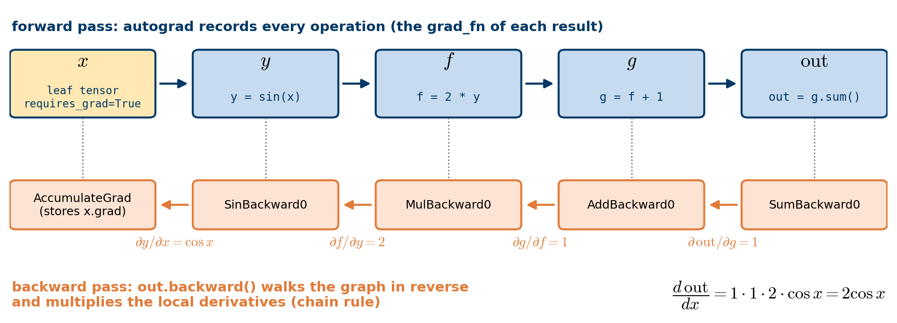

# Fundamentals of automatic differentiation

PyTorch's automatic differentiation engine, `torch.autograd`, is a large part of what makes PyTorch flexible and fast for building machine learning models. It computes the partial derivatives (gradients) of a complicated computation quickly and with very little effort from us. This is the operation at the heart of training neural networks by backpropagation.

The power of autograd comes from the fact that it traces your computation *dynamically, at run time*. If your model contains `if` statements, or loops whose lengths are only known at run time, the computation is still traced correctly and you still get correct gradients. Combined with the fact that models are written in ordinary Python, this gives far more flexibility than frameworks that rely on a static analysis of a rigidly structured model.

By the end of this notebook you should be able to:

- explain what a computational graph is and how autograd uses it;
- compute gradients with `backward()` and read them from the `.grad` attribute;
- explain why gradients accumulate and how to reset them;
- check automatic derivatives against symbolic ones computed with SymPy;
- switch off gradient tracking with `detach()` and `torch.no_grad()`.

## Forward and backward propagation

To train a prediction model, whether a simple linear regression model or a deep neural network, we repeat two steps:

- **Forward propagation.** The model makes its best guess of the output. In linear regression, the forward pass computes the linear combination of the input features using the weights and the bias of the model. In a deep neural network, the input data run through each layer of the network in turn. The forward pass ends with the evaluation of the loss function, which measures how wrong the guess is.
- **Backward propagation (backprop).** The model computes how the loss changes when each of its parameters changes, i.e. the derivatives of the loss with respect to the parameters (the *gradients*). It does so by traversing the computation backwards, from the loss to the parameters. An optimiser such as gradient descent then uses these gradients to adjust the parameters. For an intuitive walkthrough of backprop, watch this [video from 3Blue1Brown](https://www.youtube.com/watch?v=tIeHLnjs5U8).

## What do we need autograd for?

A machine learning model is a function with inputs, outputs and adjustable parameters. For this discussion, we treat the input as an $n$-dimensional vector $\mathbf{x} = (x_1, \ldots, x_n)$. We use boldface letters such as $\mathbf{x}$ rather than arrows such as $\vec{x}$ for vectors; this is common in many branches of mathematics and does not change anything in the discussion. We collect all learnable parameters (weights and biases) of the model in a vector $\boldsymbol{\theta}$. The model $\mathbf{M}$ is then a vector-valued function (in general, a model can have any number of outputs)

$$
\hat{\mathbf{y}} = \mathbf{M}(\mathbf{x}; \boldsymbol{\theta}).
$$

During training, the quantity we care about is the loss. For a given example with target $\mathbf{y}$, the loss

$$
L(\boldsymbol{\theta}) = \ell\big(\mathbf{M}(\mathbf{x}; \boldsymbol{\theta}), \mathbf{y}\big)
$$

is a *scalar* function that expresses how far the prediction of the model is from the ideal output. Training means adjusting the parameters $\boldsymbol{\theta}$ so that the loss becomes small for a wide variety of inputs. Gradient descent does this iteratively,

$$
\boldsymbol{\theta} \;\longleftarrow\; \boldsymbol{\theta} - \alpha \, \frac{\partial L}{\partial \boldsymbol{\theta}},
$$

where $\alpha$ is the learning rate. Note that the derivative is taken with respect to the **parameters**, not the input data: the data are given, and the parameters are what we can change. By the chain rule,

$$
\frac{\partial L}{\partial \boldsymbol{\theta}}
= \frac{\partial \ell}{\partial \hat{\mathbf{y}}} \, \frac{\partial \hat{\mathbf{y}}}{\partial \boldsymbol{\theta}}
= \frac{\partial \ell}{\partial \hat{\mathbf{y}}} \, \frac{\partial \mathbf{M}(\mathbf{x}; \boldsymbol{\theta})}{\partial \boldsymbol{\theta}}.
$$

The first factor is usually easy to compute. The second factor is where things become complicated, because a deep neural network is a long composition of functions. Expanding it with the chain rule produces products of local derivatives of every weight multiplication, every activation function and every other operation in the model, and the number of possible paths through the computation grows very quickly with the depth of the network.

This is where autograd comes in. During the forward pass, it records every operation in a **computational graph**: every tensor computed in your model remembers its input tensors and the function used to create it. Every PyTorch operation also knows how to compute its own local derivative. During the backward pass, autograd walks through the graph from the loss back to the parameters and multiplies the local derivatives together, reusing intermediate results instead of enumerating paths. This procedure, called *reverse-mode automatic differentiation*, gives the derivatives with respect to *all* parameters at a cost comparable to a single forward pass.

```{python}
# SymPy is only used to obtain reference results. If it is missing, install it with
# pip install sympy
import sympy as sp
import torch
import numpy as np
import matplotlib.pyplot as plt
```

# A very simple example

We create an input tensor of evenly spaced values on the interval $[0, 2\pi]$ and specify `requires_grad=True`. Most functions that create tensors, including `torch.linspace()`, accept this optional argument. Setting the flag tells autograd to record, from now on, every computation that involves `x`.

```{python}
#| label: fig-sine
#| fig-cap: "The function y = sin(x) on the tensor x."
x = torch.linspace(0, 2 * np.pi, steps=50, requires_grad=True)
y = torch.sin(x)

plt.figure(figsize=(4, 2.8))
plt.plot(x.detach(), y.detach())
plt.xlabel("x"); plt.ylabel("sin(x)")
plt.grid(True)
plt.show()
```

Why `detach()`? Matplotlib converts its input to NumPy arrays, but a tensor that requires gradients cannot be converted directly, because NumPy knows nothing about the computational graph. `detach()` returns a tensor with the same values that is cut off from the graph (we discuss it in detail at the end of the notebook). Without it, we get the following error:

```{python}
try:
    x.numpy()       # this is what plt.plot(x, y) tries to do internally
except RuntimeError as err:
    print(f"RuntimeError: {err}")
```

Let us have a closer look at the tensor `y`. When we print it, we see an indicator that it is tracking its computation history:

```{python}
print(y)
```

The attribute `grad_fn=<SinBackward0>` tells us that, during the backward pass, autograd will have to differentiate the sine function to propagate gradients back to the inputs of this tensor. To understand this better, let us perform a few more computations.

```{python}
f = 2 * y
print(f)
g = f + 1
print(g)
```

Finally, we compute a single-element output by summing the entries of `g`. When you call `.backward()` on a tensor without arguments, the tensor must contain a single element, which is exactly the situation of a loss function.

```{python}
out = g.sum()
print(out)
```

The figure below shows the computational graph that autograd has just recorded. The top row is the forward pass. Each result carries a `grad_fn` (bottom row) that knows the local derivative of the operation that created it.

{#fig-graph width="100%"}

Each `grad_fn` lets you walk the computation all the way back to its inputs through its `next_functions` property. `next_functions` is a tuple of pairs, so we index into it with `[0][0]` to move one step back.

```{python}
print(f"g.grad_fn: {g.grad_fn}")
print(f"g.grad_fn.next_functions: {g.grad_fn.next_functions}\n")

# AddBackward0  (g = f + 1)
print(g.grad_fn)
# MulBackward0  (f = 2 * y)
print(g.grad_fn.next_functions[0][0])
# SinBackward0  (y = sin(x))
print(g.grad_fn.next_functions[0][0].next_functions[0][0])
# AccumulateGrad (x)
print(g.grad_fn.next_functions[0][0].next_functions[0][0].next_functions)

print(f"\nf.grad_fn: {f.grad_fn}")
print(f"y.grad_fn: {y.grad_fn}")
print(f"x.grad_fn: {x.grad_fn}")
```

If you examine the output carefully, it all makes sense. Let us rewrite the operations we have defined:

$$
y = \sin(x), \quad f = 2 y, \quad g = f + 1 \qquad\Longrightarrow\qquad g = 2 \sin(x) + 1.
$$

The tensor `g` was created by an addition (`AddBackward0`), `f` by a multiplication (`MulBackward0`) and `y` by the sine function (`SinBackward0`). The tensor `x` has `grad_fn = None`: it was created directly by us and has no history. Such a tensor is called a **leaf** of the computational graph. The `AccumulateGrad` node that sits behind `SinBackward0` is responsible for storing the final derivative in the attribute `x.grad`. As its name suggests, it *accumulates* (adds up) the gradient; we will see why this matters later.

With all this machinery in place, how do we get the derivatives out? We call the `backward()` method on the output and then read the `grad` attribute of the input:

```{python}
out.backward()
print(x.grad)
```

Let us interpret this result. Since $\mathrm{out} = \sum_k g(x_k)$ and $g(x) = 2\sin(x) + 1$, the derivative of $\mathrm{out}$ with respect to $x_k$ is $g'(x_k) = 2\cos(x_k)$. This is exactly what we obtain:

```{python}
#| label: fig-grad-sine
#| fig-cap: "The gradient computed by autograd coincides with the analytical derivative 2 cos(x)."
plt.figure(figsize=(4, 2.8))
plt.plot(x.detach(), x.grad, 'k-', linewidth=3, label='x.grad')
plt.plot(x.detach(), 2 * torch.cos(x.detach()), '--', linewidth=3, label='2 cos(x)')
plt.xlabel("x")
plt.grid(True); plt.legend()
plt.show()
```

::: {.callout-note}
## Only leaf tensors store gradients

By default, gradients are stored only for leaf tensors that have `requires_grad=True`. The intermediate tensors `y`, `f` and `g` are not leaves, so `f.grad` is `None` (and PyTorch prints a warning if you access it). If you really need the gradient with respect to an intermediate tensor, call `f.retain_grad()` before calling `backward()`. In a neural network, the leaves are the learnable parameters, which is exactly what we need for training.
:::

::: {.callout-warning}
## One forward pass per backward pass

If you run the cell containing `out.backward()` a second time, you get an error. To save memory, autograd frees the intermediate values of the computational graph as soon as `backward()` has used them. To call `backward()` again, you must first rebuild the graph by repeating the forward computation. We study this, and the accumulation of gradients, in detail in the next example.
:::

# A less simple example

Consider a function of three variables,

$$
f(x, y, z) = \sin(x y) + \cos(y z) + \sin(x z) + x y + y z + x z.
$$

Its gradient is

$$
\nabla f = \begin{bmatrix}
\dfrac{\partial f}{\partial x} \\[12pt]
\dfrac{\partial f}{\partial y} \\[12pt]
\dfrac{\partial f}{\partial z}
\end{bmatrix} =
\begin{bmatrix}
y \cos(x y) + z \cos(x z) + y + z \\[12pt]
x \cos(x y) - z \sin(y z) + x + z \\[12pt]
x \cos(x z) - y \sin(y z) + x + y
\end{bmatrix}.
$$

We want to evaluate $f$ and $\nabla f$ at the two points $\mathbf{a}^{(1)} = (1, 1, 1)$ and $\mathbf{a}^{(2)} = (1, 2, 3)$. We first compute reference values with *symbolic* differentiation and then compute the same quantities with *automatic* differentiation in PyTorch.

## Reference values with symbolic differentiation (SymPy)

Before we turn to automatic differentiation, let us take the opportunity to learn something new in Python. The library **SymPy** lets us define a function and perform mathematical operations on it *symbolically*, just as we would with pen and paper. This notebook is not about SymPy, so please refer to the [official website](https://www.sympy.org/en/index.html) and the [documentation](https://docs.sympy.org/latest/index.html) if you want to learn more. The following code is fairly self-explanatory.

```{python}
x, y, z = sp.symbols("x, y, z")
f_sym = sp.sin(x*y) + sp.cos(y*z) + sp.sin(x*z) + x*y + y*z + x*z
df_dx = sp.diff(f_sym, x)
df_dy = sp.diff(f_sym, y)
df_dz = sp.diff(f_sym, z)
df = [df_dx, df_dy, df_dz]
print(df)
```

In Jupyter, an expression on the last line of a cell is displayed with nice mathematical formatting:

```{python}
df_dx
```

There are two ways to evaluate $f$ and $\nabla f$ at given points:

- the method `subs()` substitutes numerical values for the symbolic variables;
- the function `lambdify()` creates an ordinary Python function from a symbolic expression. This function accepts NumPy arrays as arguments.

```{python}
a = [[(x, 1), (y, 1), (z, 1)],      # the point a1 = (1, 1, 1)
     [(x, 1), (y, 2), (z, 3)]]      # the point a2 = (1, 2, 3)
names = ['df_dx', 'df_dy', 'df_dz']
print(f"f(a1) = {f_sym.subs(a[0])}  -----  f(a2) = {f_sym.subs(a[1])}")
for i in range(len(df)):
    print(f"{names[i]}(a1) = {df[i].subs(a[0])}  -----  "
          f"{names[i]}(a2) = {df[i].subs(a[1])}")
```

SymPy keeps exact expressions such as `sin(1)`. To obtain floating-point numbers, we call the method `evalf()`:

```{python}
print(f"f(a1) = {f_sym.subs(a[0]).evalf()}  -----  f(a2) = {f_sym.subs(a[1]).evalf()}")
grad_f = []
for i in range(len(df)):
    grad_f.append([float(df[i].subs(a[0]).evalf()), float(df[i].subs(a[1]).evalf())])
    print(f"{names[i]}(a1) = {grad_f[i][0]:.10f}  -----  "
          f"{names[i]}(a2) = {grad_f[i][1]:.10f}")
```

Now let us use `lambdify()`. The resulting functions accept NumPy arrays, so we can evaluate both points at once. The results are identical to the ones above.

```{python}
f_np = sp.lambdify([x, y, z], f_sym)
x_np, y_np, z_np = np.array([1., 1.]), np.array([1., 2.]), np.array([1., 3.])

df_np = [sp.lambdify([x, y, z], df[i]) for i in range(len(df))]

print(f"f(a) = {f_np(x_np, y_np, z_np)}")
for i in range(len(df)):
    print(f"{names[i]}(a) = {df_np[i](x_np, y_np, z_np)}")
```

These numbers are our reference values.

## Automatic differentiation in PyTorch

First of all, **automatic differentiation is not symbolic differentiation**. Symbolic differentiation manipulates formulas; automatic differentiation computes the *numerical values* of the derivatives at specific points, efficiently and exactly up to floating-point round-off. This is why we must give the tensors `x`, `y` and `z` concrete values. We usually need the gradient at many points, not just one, and PyTorch handles this naturally: we store the coordinates of all points in tensors with several entries. Here, the $k$-th entries of `x`, `y` and `z` are the coordinates of the point $\mathbf{a}^{(k)}$.

Computing `f` from these tensors is the **forward pass**. Note that we set `requires_grad=True` explicitly. This is essential: by default, `requires_grad` is `False`, and autograd would not record anything.

Note also that the names `x`, `y` and `z` now refer to tensors again; the SymPy symbols are no longer needed.

```{python}
x = torch.tensor([1., 1.], requires_grad=True)
y = torch.tensor([1., 2.], requires_grad=True)
z = torch.tensor([1., 3.], requires_grad=True)
f = torch.sin(x*y) + torch.cos(y*z) + torch.sin(x*z) + x*y + y*z + x*z
print(f)    # the values match the symbolic computation above
```

The last operation used to compute `f` was an addition, hence `grad_fn=<AddBackward0>`. To see a different `grad_fn`, let us look at a smaller component of $f$, namely $f_1 = \sin(x y)$:

```{python}
f1 = torch.sin(x * y)
print(f1)
```

Here `grad_fn=<SinBackward0>` says that the last operation in the computation of `f1` was the sine function.

Computing the gradient of $f$ in PyTorch is very easy: we call `backward()` on `f`, and autograd stores the derivatives in the `grad` attribute of each leaf tensor. There is one subtlety, however. The tensor `f` is not a scalar but a vector with one entry per point, $\mathbf{f} = (f(\mathbf{a}^{(1)}), f(\mathbf{a}^{(2)}))$, so "the derivative of `f`" is a Jacobian matrix rather than a vector. In this case, `backward()` needs an argument `gradient`: a tensor $\mathbf{v}$ with the same shape as `f`. PyTorch then computes the **vector-Jacobian product** $\mathbf{v}^{\top} \dfrac{\partial \mathbf{f}}{\partial \mathbf{x}}$ (and the same for `y` and `z`).

Why does $\mathbf{v} = (1, 1)$ give us what we want? The value $f(\mathbf{a}^{(k)})$ depends only on the $k$-th entries $x_k$, $y_k$, $z_k$. The Jacobian $\partial \mathbf{f} / \partial \mathbf{x}$ is therefore *diagonal*,

$$
\frac{\partial \mathbf{f}}{\partial \mathbf{x}} =
\begin{bmatrix}
\dfrac{\partial f}{\partial x}(\mathbf{a}^{(1)}) & 0 \\[10pt]
0 & \dfrac{\partial f}{\partial x}(\mathbf{a}^{(2)})
\end{bmatrix},
\qquad
\begin{bmatrix} 1 & 1 \end{bmatrix} \frac{\partial \mathbf{f}}{\partial \mathbf{x}}
= \Big[\, \dfrac{\partial f}{\partial x}(\mathbf{a}^{(1)}), \; \dfrac{\partial f}{\partial x}(\mathbf{a}^{(2)}) \,\Big],
$$

and multiplying by a vector of ones simply picks out the derivative at each point. Notebook 5 discusses vector-Jacobian products in much more detail.

```{python}
f.backward(gradient=torch.tensor([1., 1.]))
print(f"x.grad = {x.grad}")
print(f"y.grad = {y.grad}")
print(f"z.grad = {z.grad}\n")
print(f"SymPy reference (rows: d/dx, d/dy, d/dz; columns: a1, a2):\n{np.array(grad_f)}")
```

The results match the symbolic computation.

### Calling `backward()` twice

If we call `f.backward()` once more, we get an error:

```{python}
try:
    f.backward(gradient=torch.tensor([1., 1.]))
except RuntimeError as err:
    print(f"RuntimeError: {err}")
```

When we compute `f`, autograd builds the computational graph and keeps the intermediate values needed for the backward pass. As soon as `backward()` has used them, autograd frees them to save memory. To call `backward()` again, we must therefore recompute `f`, i.e. rebuild the graph. (You can keep the graph alive with `f.backward(..., retain_graph=True)`, but this is rarely necessary.) The general rule is: **one forward pass for every backward pass**. For this reason, it is good practice to put the forward computation and the call to `backward()` in the same code cell, which can then be run again and again:

```{python}
f = torch.sin(x*y) + torch.cos(y*z) + torch.sin(x*z) + x*y + y*z + x*z
f.backward(gradient=torch.tensor([1., 1.]))
print(f"x.grad = {x.grad}")
print(f"y.grad = {y.grad}")
print(f"z.grad = {z.grad}")
```

### Gradients accumulate

If you compare these values with the reference values, you will notice that they are now **twice** as large as the correct values. Run the cell above again, and they become three times, four times as large, and so on. The reason is the `AccumulateGrad` node we saw earlier: every call to `backward()` *adds* the new gradient to whatever is already stored in `.grad`.

This behaviour is deliberate. It is convenient when a tensor is used in several places of a computation, and it allows the gradients of several mini-batches to be accumulated before a parameter update. But it also means that we must **reset the gradients** before each new backward pass. There are two ways to do this:

- `x.grad.zero_()` sets the stored gradient to zero in place;
- `x.grad = None` deletes the stored gradient.

Note that `x.grad = 0` does *not* work, because `grad` must be either a tensor or `None`. In a training loop, we will let the optimiser reset all gradients for us with `optimizer.zero_grad()` (notebook 3).

```{python}
# or: x.grad, y.grad, z.grad = None, None, None
x.grad.zero_(); y.grad.zero_(); z.grad.zero_()

f = torch.sin(x*y) + torch.cos(y*z) + torch.sin(x*z) + x*y + y*z + x*z
f.backward(gradient=torch.tensor([1., 1.]))
print(f"x.grad = {x.grad}")
print(f"y.grad = {y.grad}")
print(f"z.grad = {z.grad}")
```

### Aggregating before the backward pass

Equivalently, we can first aggregate `f` into a scalar and then call `backward()` without arguments, as in `f.sum().backward()`. Because $\sum_k f(\mathbf{a}^{(k)})$ depends on $x_k$ only through the $k$-th term, its derivative with respect to $x_k$ is exactly $\partial f / \partial x (\mathbf{a}^{(k)})$. This is the same computation as `backward(gradient=torch.ones_like(f))`.

Let us also compare the result with the SymPy reference functions created with `lambdify()`.

```{python}
x.grad, y.grad, z.grad = None, None, None
f = torch.sin(x*y) + torch.cos(y*z) + torch.sin(x*z) + x*y + y*z + x*z
f.sum().backward()

print(f"x.grad = {x.grad}")
print(f"y.grad = {y.grad}")
print(f"z.grad = {z.grad}\n")

# Reference values from the lambdified SymPy expressions, evaluated in double precision
coord_np = tuple(t.detach().numpy().astype(np.float64) for t in (x, y, z))
df_val = [df_np[j](*coord_np) for j in range(len(df_np))]
print(f"df_dx = {df_val[0]}")
print(f"df_dy = {df_val[1]}")
print(f"df_dz = {df_val[2]}")
```

The derivatives look correct. Let us compute the differences to see whether they are *identical*:

```{python}
print(f"x.grad - df_dx = {x.grad.numpy() - df_val[0]}")
print(f"y.grad - df_dy = {y.grad.numpy() - df_val[1]}")
print(f"z.grad - df_dz = {z.grad.numpy() - df_val[2]}")
```

There are tiny differences of the order of $10^{-7}$. They are not caused by automatic differentiation itself: our tensors are stored in single precision (`float32`), which has about seven significant decimal digits, whereas the NumPy reference is computed in double precision (`float64`). The differences are therefore just floating-point round-off. `np.allclose()` confirms that the values agree within a sensible tolerance:

```{python}
print(f"x.grad == df_dx: {np.allclose(x.grad.numpy(), df_val[0])}")
print(f"y.grad == df_dy: {np.allclose(y.grad.numpy(), df_val[1])}")
print(f"z.grad == df_dz: {np.allclose(z.grad.numpy(), df_val[2])}")
```

To confirm that the precision is the cause, we repeat the computation in double precision. The differences now vanish, or at most drop to the order of $10^{-16}$, the round-off level of `float64`.

```{python}
x64 = torch.tensor([1., 1.], dtype=torch.float64, requires_grad=True)
y64 = torch.tensor([1., 2.], dtype=torch.float64, requires_grad=True)
z64 = torch.tensor([1., 3.], dtype=torch.float64, requires_grad=True)
f64 = (torch.sin(x64*y64) + torch.cos(y64*z64) + torch.sin(x64*z64)
       + x64*y64 + y64*z64 + x64*z64)
f64.sum().backward()

print(f"x.grad - df_dx = {x64.grad.numpy() - df_val[0]}")
print(f"y.grad - df_dy = {y64.grad.numpy() - df_val[1]}")
print(f"z.grad - df_dz = {z64.grad.numpy() - df_val[2]}")
```

# Switching off gradient tracking

Recording the computational graph costs memory and time, and sometimes it is simply wrong to record an operation. Typical examples are plotting or converting to NumPy, evaluating a trained model, and, most importantly, **updating the parameters** in gradient descent: the update $\boldsymbol{\theta} \leftarrow \boldsymbol{\theta} - \alpha \, \partial L / \partial \boldsymbol{\theta}$ must not itself become part of the graph. PyTorch offers two tools:

- `t.detach()` returns a new tensor with the same values (and the same memory) as `t`, but cut off from the graph;
- inside a `with torch.no_grad():` block, no operation is recorded at all.

```{python}
a = torch.tensor([1., 2., 3.], requires_grad=True)

b = a * 2
print(f"b.requires_grad = {b.requires_grad}")      # True: b is part of the graph

c = b.detach()
print(f"c.requires_grad = {c.requires_grad}")      # False: same values, no history

with torch.no_grad():
    d = a * 2
print(f"d.requires_grad = {d.requires_grad}")      # False: nothing was recorded
```

PyTorch even refuses to modify a leaf tensor that requires gradients in place while the graph is being recorded, because this would corrupt the history. Inside `torch.no_grad()`, the same update is allowed. This is exactly the pattern we will use to implement gradient descent by hand in the next notebook.

```{python}
loss = (a ** 2).sum()
loss.backward()                         # a.grad = 2a = [2, 4, 6]
lr = 0.1

try:
    a -= lr * a.grad                    # not allowed while autograd is recording
except RuntimeError as err:
    print(f"RuntimeError: {err}\n")

with torch.no_grad():
    a -= lr * a.grad                    # allowed: this update is not recorded
print(f"a after one gradient-descent step: {a}")
```

# Summary

- Setting `requires_grad=True` on a tensor (default: `False`) tells autograd to record every operation involving it in a **computational graph**. Each resulting tensor stores the operation that created it in `grad_fn`.
- Calling `backward()` on a scalar traverses the graph in reverse, applies the chain rule and stores $\partial(\text{output})/\partial(\text{leaf})$ in the `.grad` attribute of every leaf tensor that requires gradients.
- For a non-scalar output, `backward(gradient=v)` computes a vector-Jacobian product. When every output entry depends only on the corresponding input entries, `v = torch.ones_like(output)`, or equivalently `output.sum().backward()`, gives the derivative at every point.
- The graph is freed after `backward()`: use **one forward pass per backward pass**.
- Gradients **accumulate** in `.grad`; reset them with `.grad.zero_()`, `.grad = None` or, later, `optimizer.zero_grad()`.
- Use `detach()` or `torch.no_grad()` for computations that must not be recorded, such as plotting and parameter updates.

In the next notebook, we put all of this to work and train linear regression models in PyTorch.
