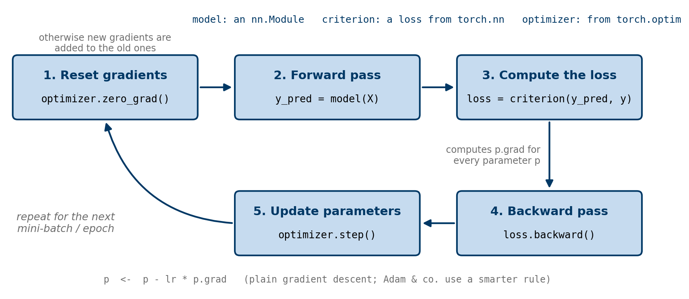

# Linear regression

Linear regression models the relationship between a scalar response (the dependent variable) and one or more explanatory variables (the independent variables) as a linear function. A model with exactly one independent variable is called **simple linear regression**; a model with more than one independent variable is called **multiple linear regression**. Linear regression is a supervised learning method: it learns from a labelled dataset a linear function that can then be used to make predictions on new data.

You already know how to build and train linear regression models with scikit-learn. The purpose of this notebook is not to learn linear regression again, but to use it as a simple, well-understood example for learning **how models are built and trained in PyTorch**. We proceed in three steps:

1. we implement gradient descent by hand, using autograd only to compute the gradients;
2. we rewrite the same model the "PyTorch way", with `nn.Module`, a loss function from `torch.nn` and an optimiser from `torch.optim`;
3. we apply the same machinery to polynomial regression and to a custom nonlinear model.

## Terminology

We are given a dataset $\mathcal{D} = \{(\mathbf{x}^{(1)}, y^{(1)}), \ldots, (\mathbf{x}^{(m)}, y^{(m)})\}$, where $\mathbf{x}^{(i)} = (x_{1}^{(i)}, \ldots, x_{n}^{(i)})$ is the vector of independent variables and $y^{(i)}$ is the corresponding dependent variable. A linear regression model assumes that the relationship between $\mathbf{x}$ and $y$ is linear. In machine learning, one data point $(\mathbf{x}^{(i)}, y^{(i)})$ is called an *example* or a *sample*; $\mathbf{x}^{(i)}$ is the *input* and $y^{(i)}$ is its *label* or *target*. The components $x_1, \ldots, x_n$ of $\mathbf{x}$ are called *features*. The dataset $\mathcal{D}$ therefore has $m$ examples and $n$ features.

In a typical machine learning workflow, we split a dataset into two or three smaller datasets:

- **training set**: used to fit the parameters of the model;
- **validation set**: used to measure how well the model has been trained, to choose hyperparameters and to decide whether more training is needed;
- **test set**: used at the very end to estimate how well the model performs on unseen data.

We do not always need three subsets. If training is fast and we do not need to tune hyperparameters, a training set and a test set are enough. In this notebook, we work with synthetic, noise-free data, so we simply use the whole dataset for training.

## Formulation

### The model

A linear regression model for a problem with $n$ features takes the form

$$
f_{\mathbf{w}, b}(\mathbf{x}) = f(\mathbf{x}; \mathbf{w}, b) = \sum_{j=1}^{n} w_j x_j + b = \mathbf{w} \cdot \mathbf{x} + b = w_1 x_1 + \cdots + w_n x_n + b,
$$

where $\mathbf{w} = (w_1, \ldots, w_n)$ is the weight vector and $b$ is the bias (intercept) of the model, and the dot denotes the dot product of two vectors. If we define $x_0 = 1$ and $w_0 = b$, we can also write the model as

$$
f(\mathbf{x}; \mathbf{w}, b) = \sum_{j=0}^{n} w_j x_j = w_0 x_0 + w_1 x_1 + \cdots + w_n x_n.
$$

The weights $w_1, \ldots, w_n$ and the bias $b$ are the **model parameters**. We will see that PyTorch treats the parameters of every machine learning model, however simple or complex, in the same unified way.

### The loss function

Our goal is to find values of $\mathbf{w}$ and $b$ for which the model predicts the labels of the dataset as well as possible. To this end, we define a loss function that measures the mean squared error between the predictions and the true labels:

$$
L(\mathbf{w}, b) = \frac{1}{2m} \sum_{i=1}^{m} \big(f(\mathbf{x}^{(i)}; \mathbf{w}, b) - y^{(i)}\big)^2.
$$

We then seek the parameters that minimise the loss,

$$
\mathbf{w}^{\ast}, b^{\ast} = \operatorname*{arg\,min}_{\mathbf{w}, b} \, L(\mathbf{w}, b),
$$

that is, $\mathbf{w}^{\ast}$ and $b^{\ast}$ are the values of the parameters at which the loss attains its minimum.

::: {.callout-note}
## Loss or cost?

In the lectures, I call this function the *cost function* and mention that it is also called the *loss function* in the literature. Since the PyTorch community and the PyTorch documentation call it the loss function, we use that name here; it will make it easier for you to read other tutorials. Note also that the factor $\frac{1}{2}$ is only a convenience that makes the gradient look neater. It does not change the minimiser, and PyTorch's built-in `nn.MSELoss` (used later) omits it.
:::

### Training by gradient descent

Training a linear regression model means running a gradient-based method to minimise the loss. In its simplest form, gradient descent repeatedly updates the parameters according to

$$
\begin{aligned}
\mathbf{w} &\;\longleftarrow\; \mathbf{w} - \alpha \, \frac{\partial L}{\partial \mathbf{w}}, \\[8pt]
b &\;\longleftarrow\; b - \alpha \, \frac{\partial L}{\partial b},
\end{aligned}
$$

where $\alpha > 0$ is the learning rate. Computing the derivatives of the loss with respect to the parameters is usually the hardest part of this procedure. Thanks to the autograd engine from the previous notebook, it becomes almost trivial in PyTorch. Moreover, plain gradient descent is only one of many ways to minimise a loss function: PyTorch provides optimisers that implement more efficient algorithms, such as Adam.

# Linear regression with plain gradient descent

Let us implement gradient descent for linear regression in PyTorch. You will see that it is surprisingly easy. We generate a dataset with a random number generator and an exact linear mapping,

$$
y = \sum_{j=1}^{n} w_j^{\text{ref}} x_j + b^{\text{ref}}.
$$

We deliberately do not add noise to the data. In theory, a perfectly trained linear regression model then reproduces the data exactly, and the loss can reach its minimum value of zero:

$$
\min_{\mathbf{w}, b} L(\mathbf{w}, b) = 0.
$$

We use $n = 11$ features and the reference parameters

$$
\mathbf{w}^{\text{ref}} = (-5, -4, \ldots, 4, 5), \qquad b^{\text{ref}} = \frac{5}{2},
$$

i.e. $w_j^{\text{ref}} = j - 6$ for $j = 1, \ldots, 11$. The features are drawn uniformly from $[0, 1)$.

```{python}
import torch
import numpy as np
import matplotlib.pyplot as plt
```

```{python}
# seed the global random number generator for reproducibility
torch.manual_seed(42)

n_samples, n_features = 2000, 11
w_ref = torch.linspace(-5, 5, n_features)       # (-5, -4, ..., 5)
b_ref = torch.tensor([2.5])
X_data = torch.rand(size=(n_samples, n_features))
y_data = X_data @ w_ref + b_ref

print(f"X_data.shape = {X_data.shape}")
print(f"y_data.shape = {y_data.shape}")
print(f"w_ref.shape  = {w_ref.shape}")
print(f"b_ref.shape  = {b_ref.shape}")
```

We define the model parameters as two tensors `w` and `b` with `requires_grad=True`: `w` is a one-dimensional tensor with $n = 11$ entries and `b` is a one-dimensional tensor with a single entry. We need `requires_grad=True` because we want autograd to compute the derivatives of the loss with respect to these tensors and store them in `w.grad` and `b.grad`.

The input data form an $m \times n$ two-dimensional tensor $\mathbf{X}$, whose $i$-th row is $\mathbf{x}^{(i)}$. The model makes predictions for all examples at once with the forward computation

$$
f(\mathbf{X}; \mathbf{w}, b) = \mathbf{X} \mathbf{w} + b,
$$

where $\mathbf{X}\mathbf{w}$ is a matrix-vector product and the scalar $b$ is broadcast to every entry. This can be slightly confusing, because `w` is a one-dimensional tensor rather than a column vector. PyTorch handles it the way we would expect: it takes the dot product of every row of $\mathbf{X}$ with $\mathbf{w}$, and the result is again a one-dimensional tensor. This is equivalent to multiplying $\mathbf{X}$ by $\mathbf{w}$ written as a column vector and then flattening the resulting column into a one-dimensional tensor.

```{python}
# A small illustration of the point above
X = torch.ones(size=(4, 3))
w = torch.ones(3)
w_column = w.reshape((-1, 1))

Xw = X @ w                      # shape (4,)
Xw_column = X @ w_column        # shape (4, 1)
print(f"Xw = {Xw}")
print(f"Xw_column =\n{Xw_column}")
```

## One forward pass and one backward pass

Before running gradient descent, let us compute the loss function (forward pass) and its gradient (backward pass), namely $\partial L / \partial w_j$ and $\partial L / \partial b$, for a single step.

People sometimes use the term *forward pass* only for computing the model output from the input data. In this course, we include the evaluation of the loss in the forward pass, because the backward pass computes the derivatives of the **loss** with respect to the model parameters, not the derivatives of the model output. In any case, `backward()` is very flexible and can be called on any scalar you need.

We do this somewhat tedious step to convince ourselves that the formula from the lectures is correct.

```{python}
# Initialise all parameters with 1 so that the result is easy to check by hand.
w = torch.ones(n_features, requires_grad=True)
b = torch.ones(1, requires_grad=True)

def model(X, w, b):
    """Linear regression model: one prediction per row of X."""
    return X @ w + b

# Forward pass: predictions and loss
y_pred = model(X_data, w, b)
loss = 1 / (2 * n_samples) * torch.sum((y_pred - y_data) ** 2)

# Backward pass
loss.backward()     # That's it ... nothing more!

print(f"w.grad = {w.grad}")
print(f"b.grad = {b.grad}")
```

From the lectures, we know that the gradient of the loss function is

$$
\begin{aligned}
\frac{\partial L}{\partial w_j} &= \frac{1}{m} \sum_{i=1}^{m} \big(f(\mathbf{x}^{(i)}) - y^{(i)}\big)\, x_j^{(i)}, \\[12pt]
\frac{\partial L}{\partial b} &= \frac{1}{m} \sum_{i=1}^{m} \big(f(\mathbf{x}^{(i)}) - y^{(i)}\big),
\end{aligned}
$$

or, in matrix form, $\partial L / \partial \mathbf{w} = \frac{1}{m} \mathbf{X}^{\top} (\hat{\mathbf{y}} - \mathbf{y})$. Let us verify that autograd agrees. We use `detach()` because this check should not become part of the computational graph.

```{python}
residual = (y_pred - y_data).detach()
# the same as X_data.T @ residual / n_samples
dL_dw = residual @ X_data / n_samples
dL_db = residual.sum() / n_samples

print(f"dL_dw = {dL_dw}")
print(f"dL_db = {dL_db}\n")
print(f"dL_dw - w.grad = {dL_dw - w.grad}")
print(f"dL_db - b.grad = {dL_db - b.grad}")
```

Apart from tiny differences, here of the order of $10^{-6}$ or smaller, the results agree. The differences arise because the two computations add up the same `float32` numbers in a different order, and floating-point addition is not exactly associative. They are round-off errors, not mistakes.

## The training loop

We now know how to perform one forward pass and one backward pass. Let us put them together in a training loop that implements plain gradient descent. Three details deserve attention:

- the parameter update must not be recorded by autograd, so we perform it inside `torch.no_grad()` (see notebook 2);
- the update is done *in place* (`w -= ...`), so that `w` remains the same leaf tensor with `requires_grad=True`;
- because gradients accumulate, we reset them to zero after each update.

```{python}
#| label: fig-gd-first
#| fig-cap: "Parameters after 500 epochs of gradient descent with learning rate 0.01, plotted against the reference parameters."
# Seeding the random number generator makes the result reproducible: running this
# cell again gives exactly the same result, although w and b are initialised randomly.
torch.manual_seed(42)
w = torch.rand(n_features, requires_grad=True)
b = torch.rand(1, requires_grad=True)

epochs = 500
lr = 0.01
for epoch in range(epochs):
    # Forward pass: predictions and mean squared error
    y_pred = model(X_data, w, b)
    loss = 0.5 / n_samples * (y_pred - y_data).pow(2).sum()

    # Backward pass
    loss.backward()

    # Gradient-descent update (not recorded by autograd)
    with torch.no_grad():
        w -= lr * w.grad
        b -= lr * b.grad

        # Reset the gradients before the next iteration. Otherwise the
        # gradients of all iterations would be accumulated in w.grad and b.grad.
        w.grad.zero_()
        b.grad.zero_()

# A perfectly trained model would place all points on the diagonal w = w_ref.
plt.figure(figsize=(4, 3.5))
plt.scatter(w_ref, w.detach(), marker='x', color='r', label='$w_j$')
plt.scatter(b_ref, b.detach(), marker='o', color='b', label='$b$')
plt.plot([-5, 5], [-5, 5], 'k--')
plt.xlabel("reference value"); plt.ylabel("trained value")
plt.title(f"loss = {loss.item():6.5f}")
plt.legend(); plt.grid(True)
plt.show()
```

The result is not good enough: the parameters $(\mathbf{w}, b)$ are still far from the reference parameters $(\mathbf{w}^{\text{ref}}, b^{\text{ref}})$. Either we have not trained for enough epochs, or the learning rate is too small, or both. Let us wrap the training loop in a function of the number of epochs and the learning rate, and run it with several values. The function also records the loss in every epoch, so that we can compare the convergence histories.

```{python}
#| label: fig-gd-lr
#| fig-cap: "Trained versus reference parameters after 250 epochs for four learning rates."
def execute_gradient_descent(epochs, lr):
    torch.manual_seed(42)
    w = torch.rand(n_features, requires_grad=True)
    b = torch.rand(1, requires_grad=True)
    history = []
    for epoch in range(epochs):
        y_pred = model(X_data, w, b)
        loss = 0.5 / n_samples * (y_pred - y_data).pow(2).sum()
        loss.backward()
        with torch.no_grad():
            w -= lr * w.grad
            b -= lr * b.grad
            w.grad.zero_()
            b.grad.zero_()
        history.append(loss.item())
    return w.detach(), b.detach(), history

lr_list = [0.01, 0.05, 0.1, 0.5]
epochs = 250
histories = {}

plt.figure(figsize=(12, 3))
for i, lr in enumerate(lr_list):
    w, b, history = execute_gradient_descent(epochs=epochs, lr=lr)
    histories[lr] = history
    plt.subplot(1, 4, i + 1)
    plt.scatter(w_ref, w, marker='x', color='r', label='$w_j$')
    plt.scatter(b_ref, b, marker='o', color='b', label='$b$')
    plt.plot([-5, 5], [-5, 5], 'k--')
    plt.title(f"lr = {lr}, loss = {history[-1]:.2e}", fontsize=10)
    plt.legend(); plt.grid(True)
plt.tight_layout()
plt.show()
```

```{python}
#| label: fig-gd-history
#| fig-cap: "Loss histories of gradient descent for four learning rates (logarithmic scale)."
plt.figure(figsize=(5, 3.5))
for lr, history in histories.items():
    plt.semilogy(history, label=f"lr = {lr}")
plt.xlabel("epoch"); plt.ylabel("loss")
plt.legend(); plt.grid(True, which="both", alpha=0.4)
plt.show()
```

With a well-chosen learning rate, the result is much better, even with fewer epochs than before. The learning rate cannot be increased indefinitely, though. For this dataset, gradient descent becomes unstable for learning rates slightly above $0.5$: try `lr = 1.0` and you will see the loss blow up to `inf` or `nan`. Choosing the learning rate by hand is tedious, which is one of the reasons for using the more robust optimisers provided by PyTorch, as we do next.

# Linear regression the PyTorch way

The implementation above works. But when we build more complex models, such as deep, convolutional or recurrent neural networks, this "manual" style quickly becomes painful. We would have to write long code for the many mathematical operations in the network, we could not take advantage of standard building blocks, and we would have to implement every optimisation algorithm ourselves. In this section, we rebuild the linear regression model with the object-oriented tools provided by PyTorch.

When building neural networks, we usually arrange the computation in *layers*, some of which have learnable parameters that are optimised during training. In TensorFlow, packages such as Keras provide this higher-level abstraction; in PyTorch, the `torch.nn` package serves the same purpose. It defines a set of **modules**, which roughly correspond to the layers of a neural network. A module receives input tensors and computes output tensors, and it may hold internal state such as tensors containing learnable parameters. The `nn` package also defines a set of commonly used loss functions.

## Three key components

You may have noticed that the optimisation algorithm is independent of the model. On the one hand, there is the **model**, which takes input data and makes predictions with some mathematical function governed by learnable parameters. Even a linear regression model can be viewed as a (very shallow) neural network. On the other hand, there is the **optimisation** of a loss function that reflects the aim of the task, such as regression or classification. An optimiser can minimise any function of many variables, as long as it can evaluate the function and its gradient; it does not care how the function was defined. It therefore makes sense to treat the model, the loss and the optimiser as separate objects.

In PyTorch, building and training a machine learning model thus consists of three key components:

1. define the model as a subclass of `torch.nn.Module`;
2. define a loss function (from `torch.nn`) and an optimiser (from `torch.optim`);
3. train the model in a loop like the one shown in the figure below.

We will build much more complex networks and learn many more building blocks later in the course. For now, let us focus on these three components and illustrate them with multiple linear regression.

{#fig-training-loop width="95%"}

```{python}
import torch.nn as nn
```

## Building a model by subclassing `nn.Module`

`torch.nn.Module` is the base class for all models and layers in PyTorch. One of its most important behaviours is that it **registers parameters**. Learnable weights are stored as instances of `torch.nn.Parameter`, a subclass of `torch.Tensor` with `requires_grad=True`. When a `Parameter`, or a module that contains parameters such as `nn.Linear`, is assigned as an attribute of a `Module`, it is automatically added to that module's list of parameters, which we can access with the method `parameters()`.

A model has two parts: the constructor `__init__()`, which creates the layers and other components, and the method `forward()`, which describes the computation. We pass the number of features to the constructor, so that the same class can be reused later.

```{python}
class LinearRegression(nn.Module):

    def __init__(self, n_features):
        super().__init__()
        # A fully connected (linear) layer computing  x @ W.T + b  with one output
        self.fc = nn.Linear(in_features=n_features, out_features=1, bias=True)

    def forward(self, x):
        x = self.fc(x)          # shape (m, 1)
        return x.flatten()      # shape (m,), like y_data
```

We create the model by calling the class, and we make predictions by calling the model object itself, as in `model(X)`. Internally, this calls `forward()`; always use `model(X)` rather than `model.forward(X)`, because the former also runs some bookkeeping that PyTorch needs. Printing the model shows its structure.

```{python}
torch.manual_seed(42)
model = LinearRegression(n_features)
print(f"Model:\n{model}\n")
print(f"Fully connected layer: {model.fc}\n")
print(f"Weight of the linear layer (shape {tuple(model.fc.weight.shape)}):")
print(f"{model.fc.weight}\n")
print(f"Bias of the linear layer:\n{model.fc.bias}")
```

Note the shape of the weight: `nn.Linear(in_features, out_features)` stores its weight as a matrix of shape `(out_features, in_features)`, here $(1, 11)$, and computes $\mathbf{X}\mathbf{W}^{\top} + \mathbf{b}$. PyTorch has also initialised the weights and the bias with small random numbers.

Because we used `nn.Linear`, our model automatically knows all its learnable parameters. The method `parameters()` returns them as a *generator*, an iterable object that produces its elements one at a time. To see the parameters, we iterate over it, for example in a list comprehension. The method `named_parameters()` also returns their names.

```{python}
print(f"model.parameters() = {model.parameters()}\n")
for name, p in model.named_parameters():
    print(f"{name}: shape {tuple(p.shape)}, requires_grad = {p.requires_grad}")
```

## Defining the optimiser and the loss function

The package `torch.optim` provides many optimisers for training machine learning models. The most commonly used methods are already available, and the interface is general enough that more sophisticated methods can easily be added.

To use an optimiser, we construct an optimiser object that holds the current state of the optimisation and updates the parameters based on their gradients. When constructing it, we pass an iterable of the parameters to optimise (tensors with `requires_grad=True`, typically `model.parameters()`), followed by optimiser-specific options such as the learning rate or the weight decay. Two examples:

```python
optimizer = torch.optim.SGD(model.parameters(), lr=0.01, momentum=0.9)   # stochastic gradient descent
optimizer = torch.optim.Adam([var1, var2], lr=0.0001)
```

There is a lot more to say about `torch.optim`; interested readers can consult the [documentation](https://pytorch.org/docs/stable/optim.html).

For our linear regression model, we use the *Adam* optimiser and the mean squared error loss `nn.MSELoss()`.

```{python}
optimizer = torch.optim.Adam(model.parameters(), lr=0.25)
criterion = nn.MSELoss()
print(f"optimizer = {optimizer}")
print(f"criterion = {criterion}")
```

The loss object `criterion` is called like a function, `criterion(prediction, target)`. By convention, the prediction comes first and the target second. As mentioned earlier, `nn.MSELoss` computes the *mean* of the squared errors, without the factor $\frac{1}{2}$:

```{python}
a = torch.arange(10.)               # predictions (note the dot: floating-point values)
b = torch.linspace(0, 5, 10)        # targets
mse = (a - b).pow(2).sum() / a.shape[0]
mse_nn = criterion(a, b)
print(f"mse    = {mse}")
print(f"mse_nn = {mse_nn}")
print(f"mse == mse_nn: {torch.isclose(mse, mse_nn).item()}")
```

## Training the model

The training loop follows the five steps of the figure above. Compared with our manual implementation, two lines change:

- the parameters are updated by `optimizer.step()`;
- the gradients are reset by `optimizer.zero_grad()`.

To understand why this works, recall that we registered the model's parameters with the optimiser when we constructed it:

```python
optimizer = torch.optim.Adam(model.parameters(), lr=0.25)
```

Therefore, although we do not mention the parameters explicitly in `optimizer.step()` and `optimizer.zero_grad()`, the optimiser knows them and acts on them. The learning rate was also set when the optimiser was constructed.

::: {.callout-tip}
## Where to put `zero_grad()`

`optimizer.zero_grad()` can be called at the beginning of each iteration (as here) or right after `optimizer.step()`. What matters is that the gradients are reset *between* two calls to `backward()`. Calling it first is a safe habit, because it also discards any gradients left over from computations done before the loop.
:::

```{python}
epochs = 1000
loss_history = []
for epoch in range(epochs):
    optimizer.zero_grad()                   # 1. reset the gradients
    y_pred = model(X_data)                  # 2. forward pass
    loss = criterion(y_pred, y_data)        # 3. loss
    loss.backward()                         # 4. backward pass
    optimizer.step()                        # 5. update the parameters
    loss_history.append(loss.item())

print(f"final loss = {loss_history[-1]:.3e}")
```

```{python}
#| label: fig-adam
#| fig-cap: "Training with Adam: loss history (left) and trained versus reference parameters (right)."
print(f"model.fc.weight =\n{model.fc.weight.data}")
print(f"model.fc.bias = {model.fc.bias.data}")

plt.figure(figsize=(9, 3.2))
plt.subplot(1, 2, 1)
plt.semilogy(loss_history)
plt.xlabel("epoch"); plt.ylabel("MSE loss"); plt.grid(True, alpha=0.4)

plt.subplot(1, 2, 2)
w_trained = model.fc.weight.detach().flatten()
plt.scatter(w_ref, w_trained, marker='x', color='r', label='$w_j$')
plt.scatter(b_ref, model.fc.bias.detach(), marker='o', color='b', label='$b$')
plt.plot([-5, 5], [-5, 5], 'k--')
plt.xlabel("reference value"); plt.ylabel("trained value")
plt.legend(); plt.grid(True)
plt.tight_layout()
plt.show()
```

The trained parameters agree with the reference parameters to many digits.

# Polynomial regression

Polynomial regression is linear regression with polynomial features. Assume that we are given a dataset $\mathcal{D} = \{(x^{(i)}, y^{(i)})\}_{i=1}^{m}$ with a scalar input $x^{(i)}$. A polynomial regression model of degree $n$ for this one-dimensional input reads

$$
P(x) = w_0 + w_1 x + \cdots + w_n x^{n} = w_0 + \sum_{j=1}^{n} w_j x^{j}.
$$

If we define new features $x_j = x^{j}$ for $j = 1, \ldots, n$, the polynomial $P(x)$ becomes a linear regression model with $n$ features. That's it for the theory; it is as simple as that!

**Problem description.** Again, we generate a dataset, this time from the one-dimensional function

$$
f(x) = \exp(\sin(x)), \qquad x \in [-\pi, \pi],
$$

and we build a polynomial regression model with a user-defined degree.

**Why feature scaling?** If we train a linear regression model on the raw polynomial features, a gradient-based optimiser converges very slowly. As explained in the lectures, the reason is that the polynomial features have very different ranges: if $x$ runs from $-\pi$ to $\pi$, then $x^2$ runs from $0$ to $\pi^2 \approx 9.9$, $x^3$ from $-\pi^3$ to $\pi^3 \approx 31$, and $x^{10}$ up to $\pi^{10} \approx 93\,648$. For the optimiser to remain stable, we would have to choose a tiny learning rate, which makes the whole optimisation slow. We therefore *standardise* each feature, i.e. subtract its mean and divide by its standard deviation, before training.

You already know how to do polynomial regression in scikit-learn, so the code below needs little explanation.

```{python}
#| label: fig-poly-data
#| fig-cap: "Data generated from f(x) = exp(sin(x))."
# Generate data from the one-dimensional function f(x) = exp(sin(x))
x = torch.linspace(-torch.pi, torch.pi, 200)
y = torch.exp(torch.sin(x))

plt.figure(figsize=(4, 2.8))
plt.scatter(x, y, marker='.')
plt.xlabel("x"); plt.ylabel("y")
plt.grid(True)
plt.show()
```

```{python}
degree = 10                                                 # user-defined degree
# polynomial features x, x^2, ..., x^10
X = torch.stack([x**j for j in range(1, degree + 1)], dim=1)

# one standard deviation and one mean per feature
std_X, mean_X = torch.std_mean(X, dim=0)
# standardisation (broadcasting, see notebook 1)
X_scaled = (X - mean_X) / std_X

print(f"X.shape        = {X.shape}")
print(f"std_X.shape    = {std_X.shape}")
print(f"mean_X.shape   = {mean_X.shape}")
print(f"X_scaled.shape = {X_scaled.shape}")
```

Since polynomial regression *is* linear regression on polynomial features, we can simply reuse our `LinearRegression` class with `degree` input features. We train it with Adam on the scaled features.

```{python}
torch.manual_seed(42)
poly_model = LinearRegression(n_features=degree)
optimizer = torch.optim.Adam(poly_model.parameters(), lr=0.01)
criterion = nn.MSELoss()

epochs = 10_000
print_every = epochs // 10
for epoch in range(epochs):
    optimizer.zero_grad()
    y_pred = poly_model(X_scaled)
    loss = criterion(y_pred, y)
    loss.backward()
    optimizer.step()

    if (epoch + 1) % print_every == 0:
        print(f"epoch {epoch + 1:>6d}: loss = {loss.item():.3e}")
```

Let us compare the polynomial regression model trained with PyTorch with its counterpart from scikit-learn. Unlike our PyTorch model, scikit-learn's `LinearRegression` does not use a gradient-based method at all: it solves the least-squares problem *directly* with a linear-algebra solver. It therefore does not need feature scaling to converge. The raw features are badly scaled, however, so we pass them in double precision (`float64`) to keep the round-off errors of the solver small.

```{python}
#| label: fig-poly-compare
#| fig-cap: "Polynomial regression of degree 10 trained with PyTorch (Adam on standardised features) and scikit-learn (direct least-squares solver)."
from sklearn.linear_model import LinearRegression as SklearnLinearRegression
from sklearn.preprocessing import PolynomialFeatures

x_np = x.numpy().astype(np.float64).reshape((-1, 1))
y_np = y.numpy().astype(np.float64)
X_poly = PolynomialFeatures(degree=degree, include_bias=False).fit_transform(x_np)

sk_model = SklearnLinearRegression().fit(X_poly, y_np)
y_sk = sk_model.predict(X_poly)

with torch.no_grad():
    y_torch = poly_model(X_scaled)

print(f"MSE (PyTorch, Adam)        = {torch.mean((y_torch - y)**2).item():.3e}")
print(f"MSE (scikit-learn, direct) = {np.mean((y_sk - y_np)**2):.3e}")

plt.figure(figsize=(5, 3.5))
plt.scatter(x, y, marker='.', color='gray', label='data')
plt.plot(x, y_sk, 'b-', linewidth=3, alpha=0.5, label='scikit-learn')
plt.plot(x, y_torch, 'r--', label='PyTorch')
plt.xlabel("x"); plt.ylabel("y")
plt.legend(); plt.grid(True)
plt.show()
```

Both models fit the data very well. The direct solver reaches a smaller error, because it finds the exact minimiser of the least-squares problem, whereas Adam would need more iterations to get as close. The strength of the PyTorch approach is not this particular problem but its generality: exactly the same code trains models for which no direct solver exists, as the next example shows.

# A custom nonlinear model

We often want a model that represents a specific mathematical function, rather than a standard layer. This example revisits one of the tasks in Exercise Assignment 1. Let us recall the task.

You are given a dataset generated by the Python function below, and the hidden function that generated the data is revealed. Our task is to build a regression model that mimics the hidden function and is governed by a set of learnable parameters. We need to define an appropriate loss function and use a gradient-based method to find the learnable parameters. This time, we solve the task with PyTorch.

```{python}
# This is the function given in the exercise.
x_range = 3

def generate_data(student_id, level, size):
    np.random.seed(student_id)      # use your student ID
    x_uniform = np.linspace(0, x_range, size)
    x_noise = np.random.normal(loc=0, scale=0.0, size=size)
    x_data = x_uniform + 0 * x_noise

    def hidden_func(x):
        return 2 / np.exp(4 * (x - x_range/2)**2) + 2

    y_exact = hidden_func(x_data)
    y_noise_add = level * (2*np.random.random(size) - 1)
    y_noise_mult = np.random.normal(loc=1, scale=0.005, size=size)
    y_data = y_exact * y_noise_mult + y_noise_add

    data = np.vstack((x_data, y_data)).T
    return data, hidden_func

# Generate the dataset with NumPy ...
data, hidden_func = generate_data(student_id=42, level=0.1, size=200)

# ... and convert it to PyTorch tensors. We convert to float32 first. Otherwise
# the tensors would be float64 (NumPy's default), while the parameters of our
# model are float32, and mixing the two leads to errors or silent type
# promotion (see notebook 1).
x = torch.from_numpy(data[:, 0].astype(np.float32))
y = torch.from_numpy(data[:, 1].astype(np.float32))
```

The hidden function is $h(x) = 2 \exp\big(-4 (x - 1.5)^2\big) + 2$, a Gaussian bump on top of a constant. We therefore choose the model

$$
f(x; a, b, c, r) = a \exp\big(-b (x - r)^2\big) + c
$$

with four learnable scalar parameters $a$, $b$, $c$ and $r$. Unlike linear regression, this model depends *nonlinearly* on its parameters, so there is no closed-form solution, but gradient-based training works just the same.

In the constructor `__init__()` of the class `CustomModel`, we declare `self.a`, `self.b`, `self.c` and `self.r` as learnable parameters by wrapping them in `nn.Parameter(...)`. If we simply wrote

```python
self.a = torch.rand(())     # a scalar tensor (shape ())
```

then `self.a` would be an ordinary attribute of the object, not a learnable parameter of the model: the optimiser would never see it. By writing

```python
self.a = nn.Parameter(torch.rand(()))
```

we tell the model that `self.a` must be treated as a learnable parameter. To illustrate this point, the class below also defines an attribute `self.junk` without `nn.Parameter`, and we check which tensors appear in `parameters()`.

```{python}
class CustomModel(nn.Module):

    def __init__(self):
        super().__init__()
        self.a = nn.Parameter(torch.rand(()))
        self.b = nn.Parameter(torch.rand(()))
        self.c = nn.Parameter(torch.rand(()))
        self.r = nn.Parameter(torch.rand(()))
        # NOT a parameter: you won't see it in parameters()
        self.junk = torch.rand(())

    def forward(self, x):
        return self.a * torch.exp(-self.b * (x - self.r)**2) + self.c

torch.manual_seed(42)
cmodel = CustomModel()
for name, p in cmodel.named_parameters():
    print(f"{name} = {p.item():.4f}")
print(f"cmodel.junk = {cmodel.junk:.4f}   (exists, but is not a learnable parameter)")
```

We use the mean squared error loss and train the model with Adam. A learning rate that is too large makes Adam oscillate around the minimum (try `lr=0.25`), so we use a moderate value.

```{python}
criterion = nn.MSELoss()
optimizer = torch.optim.Adam(cmodel.parameters(), lr=0.1)

epochs = 2000
print_every = epochs // 10
for epoch in range(epochs):
    optimizer.zero_grad()
    y_pred = cmodel(x)
    loss = criterion(y_pred, y)
    loss.backward()
    optimizer.step()

    if (epoch + 1) % print_every == 0:
        print(f"epoch {epoch + 1:>5d}: loss = {loss.item():.4e}")
```

```{python}
#| label: fig-custom
#| fig-cap: "The trained custom model recovers the hidden function from noisy data."
trained = ", ".join(f"{n} = {p.item():.3f}" for n, p in cmodel.named_parameters())
print(f"trained parameters:  {trained}")
print("hidden function:     a = 2, b = 4, c = 2, r = 1.5")

x_fine = torch.linspace(0, x_range, 300)
plt.figure(figsize=(5, 3.8))
plt.scatter(x, y, marker='.', s=10, label='data points')
with torch.no_grad():
    plt.plot(x_fine, cmodel(x_fine), 'r-', label='trained model')
plt.plot(x_fine, hidden_func(x_fine.numpy()), 'k--', linewidth=1,
         label='hidden function')
plt.xlabel("x"); plt.ylabel("y")
plt.legend(); plt.grid(True)
plt.show()
```

The trained parameters are very close to those of the hidden function. The remaining differences are caused by the noise in the data.

# Summary

- With autograd, gradient descent for linear regression takes only a few lines: forward pass, `loss.backward()`, update inside `torch.no_grad()`, reset the gradients.
- The PyTorch way separates three components: a **model** (a subclass of `nn.Module` whose learnable parameters are `nn.Parameter`s, often inside layers such as `nn.Linear`), a **loss function** from `torch.nn` and an **optimiser** from `torch.optim`.
- Every model in this course is trained with the same loop:

```python
for epoch in range(epochs):
    optimizer.zero_grad()               # reset the gradients
    y_pred = model(X)                   # forward pass
    loss = criterion(y_pred, y)         # loss
    loss.backward()                     # backward pass
    optimizer.step()                    # update the parameters
```

- Polynomial regression is linear regression on polynomial features, which should be scaled before gradient-based training.
- Any differentiable model, such as our custom Gaussian model, can be trained in exactly the same way.

In the next notebook, we apply the same recipe to classification with logistic regression.
