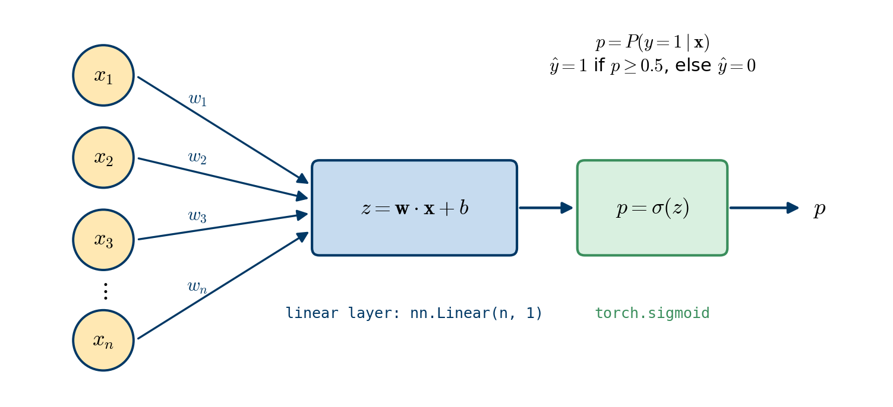
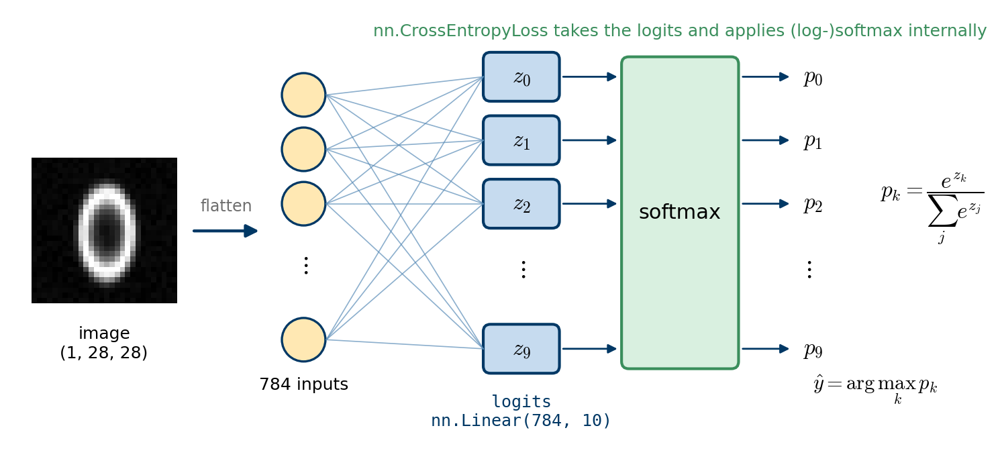

# Logistic regression

In this notebook, we revisit logistic regression for binary and multi-class classification and implement the models in PyTorch. We study three classification problems of increasing difficulty:

1. binary classification of data points in the plane;
2. binary classification of electrocardiogram (ECG) signals;
3. classification of images of handwritten digits from $0$ to $9$ (MNIST).

Along the way, we learn how to handle real datasets in PyTorch with `Dataset` and `DataLoader`, how to train on mini-batches, and which loss function PyTorch expects for which kind of model output.

## Logistic regression for binary classification

In statistics, the logistic model (or logit model) models the *log-odds* of an event as a linear combination of one or more independent variables. Logistic regression estimates the parameters of this model, i.e. the coefficients of the linear combination. In binary logistic regression, the dependent variable takes one of two values, labelled $0$ and $1$, while the independent variables can be discrete or continuous.

### Notation

We are given a dataset $\mathcal{D} = \{(\mathbf{x}^{(1)}, y^{(1)}), \ldots, (\mathbf{x}^{(m)}, y^{(m)})\}$ with $m$ examples. Each input $\mathbf{x}^{(i)} = (x_{1}^{(i)}, \ldots, x_{n}^{(i)})$ has $n$ features, and each label $y^{(i)}$ is either $0$ or $1$.

### Formulation

The logistic regression model combines a linear layer with the sigmoid function $\sigma(z) = 1 / (1 + e^{-z})$. The probability that an example $\mathbf{x}$ belongs to class $1$ is modelled as

$$
p(\mathbf{x}) = P(y = 1 \mid \mathbf{x}) = \sigma(\mathbf{w} \cdot \mathbf{x} + b) = \frac{1}{1 + \exp\big(-(\mathbf{w} \cdot \mathbf{x} + b)\big)},
$$

where the weights $\mathbf{w} = (w_1, \ldots, w_n)$ and the bias $b$ are the learnable parameters. Logistic regression is a *linear* model in the sense that its core is the linear combination $z = \mathbf{w} \cdot \mathbf{x} + b$; its decision boundary is the hyperplane $z = 0$.

The final prediction $\hat{y}$ is $1$ if $p(\mathbf{x}) \geq 0.5$ and $0$ otherwise, which is equivalent to $\hat{y} = 1$ if and only if $z \geq 0$.

To find the parameters, we minimise the *binary cross-entropy* (negative log-likelihood) loss, which penalises confident wrong predictions heavily and rewards correct ones:

$$
L(\mathbf{w}, b) = -\frac{1}{m}\sum_{i=1}^{m} \Big[ y^{(i)} \log p(\mathbf{x}^{(i)}) + \big(1 - y^{(i)}\big) \log\big(1 - p(\mathbf{x}^{(i)})\big) \Big].
$$

Its derivatives with respect to the parameters are easy to compute:

$$
\begin{aligned}
\frac{\partial L}{\partial w_j} &= \frac{1}{m}\sum_{i=1}^{m} \big[p(\mathbf{x}^{(i)}) - y^{(i)}\big]\, x_{j}^{(i)}, \\[8pt]
\frac{\partial L}{\partial b} &= \frac{1}{m}\sum_{i=1}^{m} \big[p(\mathbf{x}^{(i)}) - y^{(i)}\big].
\end{aligned}
$$

We will not implement these formulas: as in the previous notebook, autograd computes the gradient for us when we call `backward()` on the loss.

{#fig-logreg width="85%"}

```{python}
import numpy as np
import matplotlib.pyplot as plt
import torch
import torch.nn as nn
import torch.nn.functional as F
from tqdm import tqdm       # progress bars (optional, just for convenience)
```

Let us plot the sigmoid function. It maps any real number $z$ to the interval $(0, 1)$, so its output can be interpreted as a probability, and $\sigma(0) = 0.5$.

```{python}
#| label: fig-sigmoid
#| fig-cap: "The sigmoid function."
z = torch.linspace(-10, 10, 500)
plt.figure(figsize=(4, 2.8))
plt.plot(z, torch.sigmoid(z))
plt.axhline(0.5, color='gray', linestyle=':')
plt.xlabel("z"); plt.ylabel(r"$\sigma(z)$")
plt.grid(True)
plt.show()
```

# Example 1: points in the plane

In this first example, we generate two-dimensional data points and label them with an elliptical decision boundary. An ellipse centred at the origin with semi-axes $r_1$ and $r_2$ is described by the equation

$$
\frac{x_1^2}{r_1^2} + \frac{x_2^2}{r_2^2} = 1,
$$

and can be parameterised as

$$
x_1(t) = r_1 \cos t, \qquad x_2(t) = r_2 \sin t, \qquad t \in [0, 2\pi).
$$

Indeed, $x_1(t)^2 / r_1^2 + x_2(t)^2 / r_2^2 = \cos^2 t + \sin^2 t = 1$.

We assign the label $1$ to the points inside the ellipse and the label $0$ to the points outside. To make the problem less trivial, we move the centre of the ellipse to the point $\mathbf{c} = (c_1, c_2)$ and rotate it by an angle $\theta$. The rotated and translated ellipse is described by

$$
E(x_1, x_2) = \frac{\big[(x_1 - c_1) \cos\theta + (x_2 - c_2) \sin\theta \big]^2}{r_1^2} + \frac{\big[(x_1 - c_1) \sin\theta - (x_2 - c_2)\cos\theta \big]^2}{r_2^2} = 1.
$$

The points inside the ellipse satisfy $E(x_1, x_2) \leq 1$ and the points outside satisfy $E(x_1, x_2) > 1$.

However complicated the expression $E(x_1, x_2)$ looks, for fixed $\theta$, $\mathbf{c}$, $r_1$ and $r_2$ it is just a *quadratic* function of $x_1$ and $x_2$. If we use logistic regression with second-order polynomial features $x_1$, $x_2$, $x_1^2$, $x_1 x_2$ and $x_2^2$, the decision boundary of the model is

$$
\mathcal{B}(x_1, x_2) := w_1 x_1 + w_2 x_2 + w_3 x_1^2 + w_4 x_1 x_2 + w_5 x_2^2 + b = 0,
$$

which is also a quadratic curve. It is therefore reasonable to expect the decision boundary of the trained model to fit the ellipse closely.

::: {.callout-note}
## Separability in a higher-dimensional feature space

We know for certain that some ellipse classifies our data perfectly, because the data were labelled by such an ellipse. In other words, the data become *linearly separable* after the feature mapping

$$
\Phi: (x_1, x_2) \mapsto (x_1, x_2, x_1^2, x_1 x_2, x_2^2).
$$

In this five-dimensional feature space, the mapped data points are perfectly separated by a *hyperplane*. A hyperplane generalises a straight line in 2-D and a plane in 3-D to higher dimensions; we add the prefix "hyper" because we can no longer draw it. We discuss the consequences of this observation after training the model.
:::

## Generating the data

```{python}
#| label: fig-ellipse-data
#| fig-cap: "Synthetic data labelled by a rotated and translated ellipse."
torch.manual_seed(42)
X = torch.randn(size=(500, 2))
c = torch.tensor([0.25, 0.25])          # centre
r = torch.tensor([1.5, 1.0])            # semi-axes r1, r2
theta = torch.tensor(torch.pi / 4)      # rotation angle

u = (X[:, 0] - c[0]) * torch.cos(theta) + (X[:, 1] - c[1]) * torch.sin(theta)
v = (X[:, 0] - c[0]) * torch.sin(theta) - (X[:, 1] - c[1]) * torch.cos(theta)
mask = u**2 / r[0]**2 + v**2 / r[1]**2 <= 1         # True inside the ellipse
y = mask.float()                                    # labels: 1 inside, 0 outside
n_samples = X.shape[0]

# Points on the ellipse, for plotting
t = torch.linspace(0, 2 * torch.pi, 200)
ct, st = torch.cos(theta), torch.sin(theta)
xx = c[0] + r[0] * torch.cos(t) * ct - r[1] * torch.sin(t) * st
yy = c[1] + r[0] * torch.cos(t) * st + r[1] * torch.sin(t) * ct

plt.figure(figsize=(5, 4))
plt.scatter(X[mask, 0], X[mask, 1], marker='o', color='r', s=10,
            label='class 1 (inside)')
plt.scatter(X[~mask, 0], X[~mask, 1], marker='x', color='b', s=10,
            label='class 0 (outside)')
plt.plot(xx, yy, 'k--', label='ellipse')
plt.xlabel("$x_1$"); plt.ylabel("$x_2$")
plt.axis('equal'); plt.legend(fontsize=8); plt.grid(True)
plt.show()
```

## Building and training the model

We proceed in four steps:

1. construct the second-order polynomial features from the "linear" features $x_1$ and $x_2$;
2. define the logistic regression model as a subclass of `nn.Module`;
3. define the loss function and the optimiser;
4. train the model by running the optimisation algorithm.

For step 1, we borrow `PolynomialFeatures` from scikit-learn, which you already know. It works on NumPy arrays, so we convert the result back to a `float32` tensor. The method `get_feature_names_out()` confirms the order of the features.

```{python}
from sklearn.preprocessing import PolynomialFeatures

poly = PolynomialFeatures(degree=2, include_bias=False)
X_poly = torch.from_numpy(poly.fit_transform(X.numpy()).astype(np.float32))

print(f"features: {poly.get_feature_names_out(['x1', 'x2'])}")
print(f"X_poly.shape = {X_poly.shape}")
```

The model consists of a linear layer with one output, followed by the sigmoid function:

$$
p = \sigma\Big(\sum_{j=1}^{n} w_{j} x_{j} + b\Big) = \sigma(\mathbf{w} \cdot \mathbf{x} + b) = P(y = 1 \mid \mathbf{x}),
\qquad
\hat{y} = \begin{cases} 1, & p \geq 0.5, \\ 0, & p < 0.5. \end{cases}
$$

```{python}
class LogisticRegression(nn.Module):
    def __init__(self, n_features):
        super().__init__()
        self.lin = nn.Linear(in_features=n_features, out_features=1)

    def forward(self, x):
        z = self.lin(x)             # shape (N, 1)
        p = torch.sigmoid(z)        # probabilities P(y = 1 | x)
        return p.flatten()          # shape (N,), like the labels

torch.manual_seed(0)
model = LogisticRegression(n_features=X_poly.shape[1])
print(f"model =\n{model}")
```

Let us check that the model works as expected. We create a small dataset of $20$ random data points with $5$ features each, i.e. a tensor of shape $(20, 5)$, and feed it into the model. Since the model has one output per data point and flattens it, we expect a one-dimensional tensor with $20$ entries.

```{python}
X_rand = torch.rand(20, X_poly.shape[1])
p_rand = model(X_rand)
print(f"p_rand.shape = {p_rand.shape}")
```

Now we train the model with the binary cross-entropy loss `nn.BCELoss()` and the Adam optimiser. Since the dataset is small, every iteration uses all $500$ data points (*full-batch* training). We print the loss at ten evenly spaced epochs.

```{python}
EPOCHS = 5000
criterion = nn.BCELoss()
optimizer = torch.optim.Adam(model.parameters(), lr=0.1)
print_every = EPOCHS // 10

for epoch in range(EPOCHS):
    optimizer.zero_grad()
    p = model(X_poly)                   # forward pass: probabilities
    loss = criterion(p, y)
    loss.backward()                     # backward pass
    optimizer.step()

    if epoch == 0 or (epoch + 1) % print_every == 0:
        print(f"Epoch [{epoch + 1:>4d} / {EPOCHS}]: loss = {loss.item():.5f}")
```

After training, we make predictions with the rule $\hat{y} = 1$ if $p \geq 0.5$ and compute the accuracy, i.e. the fraction of correctly classified points. Since we only evaluate the model, we switch off gradient tracking.

```{python}
with torch.no_grad():
    p = model(X_poly)
y_pred = (p >= 0.5).float()
accuracy = (y_pred == y).float().mean()
print(f"accuracy = {accuracy:.4f}")
```

## Discussion

**Accuracy.** As explained in the remark above, a perfect accuracy of $100\%$ is achievable. If you do not see it, the model simply needs more training. I deliberately used a moderate learning rate to show this. If you run the training cell again (without re-creating the model), the loss keeps decreasing, because the optimiser continues from the current parameters. Alternatively, you can retrain from scratch with more epochs or a larger learning rate. Eventually you should see an accuracy of $100\%$.

**Growing weights.** Let us look at the trained parameters.

```{python}
w = model.lin.weight.detach().numpy().flatten()
b = model.lin.bias.detach().numpy()
print(f"w = {w}")
print(f"b = {b}")
```

The weights are large. This is a direct consequence of the separability. When a hyperplane separates the data perfectly, multiplying all parameters $(\mathbf{w}, b)$ by a factor larger than $1$ leaves the decision boundary unchanged but pushes every probability closer to $0$ or $1$, which *always* decreases the loss. The loss can therefore approach zero, but it never reaches its infimum: the parameters keep growing for as long as we train, and the sigmoid becomes steeper and steeper. In practice, this is prevented by *regularisation*, for example an $L_2$ penalty on the weights (in PyTorch: the `weight_decay` option of the optimiser).

**Decision boundary.** The decision boundary is given by $p = \sigma(\mathbf{w} \cdot \mathbf{x} + b) = 0.5$, or equivalently $\mathbf{w} \cdot \mathbf{x} + b = 0$, where $\mathbf{x} = (x_1, x_2, x_1^{2}, x_1 x_2, x_2^2)$. We evaluate this expression on a grid and draw its zero level set on top of the data and the true ellipse. Hopefully, they look alike.

```{python}
#| label: fig-ellipse-boundary
#| fig-cap: "Decision boundary of the trained logistic regression model (black) and the true ellipse (yellow, dashed)."
x1 = np.linspace(-2.0, 2.5, 200)
x2 = np.linspace(-1.5, 2.0, 200)
X1, X2 = np.meshgrid(x1, x2)
Z = w[0]*X1 + w[1]*X2 + w[2]*X1**2 + w[3]*X1*X2 + w[4]*X2**2 + b

plt.figure(figsize=(6, 5))
plt.contour(X1, X2, Z, levels=[0], colors='k', linewidths=2)
plt.scatter(X[mask, 0], X[mask, 1], marker='o', color='r', s=10,
            label='class 1 (inside)')
plt.scatter(X[~mask, 0], X[~mask, 1], marker='x', color='b', s=10,
            label='class 0 (outside)')
plt.plot(xx, yy, 'y--', linewidth=2, label='true ellipse')
# legend entry for the contour
plt.plot([], [], 'k-', linewidth=2, label='decision boundary')
plt.xlabel("$x_1$"); plt.ylabel("$x_2$")
plt.axis('equal'); plt.legend(fontsize=8, loc='lower right'); plt.grid(True)
plt.show()
```

# Example 2: binary classification of ECG signals

In this example, we revisit a problem from the first assignment of the course ENG4200. We are given a set of electrocardiogram (ECG) recordings, each labelled as *normal* or *abnormal*, and our task is to predict whether a given ECG is normal. You solved this problem with scikit-learn; here we build the binary classification model in PyTorch. If you have already explored this dataset with scikit-learn, you can skim the first part.

## Reading and exploring the data

The file `data/ecg/ecg.csv` contains one ECG per row: $140$ time samples followed by the label in the last column. In this version of the dataset (which originates from the ECG5000 dataset), label $1$ denotes a normal and label $0$ an abnormal heartbeat. As in notebook 3, we convert the data to `float32` tensors.

```{python}
data = np.loadtxt('./data/ecg/ecg.csv', delimiter=',')
# all columns except the last one
X = torch.from_numpy(data[:, :-1].astype(np.float32))
y = torch.from_numpy(data[:, -1].astype(np.float32))    # the last column: labels
n_samples, n_features = X.shape
labels, counts = torch.unique(y, return_counts=True)

print(f"n_samples  = {n_samples}")
print(f"n_features = {n_features}")
print(f"classes    = {labels.tolist()}, counts = {counts.tolist()}")
print(f"fraction of class 1 = {counts[1] / n_samples:.3f}")
```

The classes are not perfectly balanced: about $58\%$ of the recordings belong to class $1$. A trivial classifier that always predicts class $1$ would therefore already reach an accuracy of about $58\%$. This is the baseline that our model must beat clearly.

Let us plot a few randomly chosen ECGs.

```{python}
#| label: fig-ecg-samples
#| fig-cap: "Eight randomly chosen ECG recordings with their labels (1 = normal, 0 = abnormal)."
nrows, ncols = 2, 4
rng = np.random.default_rng(seed=42)        # for reproducibility
plt.figure(figsize=(9, 3.8))
for i in range(nrows * ncols):
    idx = rng.integers(low=0, high=n_samples)
    plt.subplot(nrows, ncols, i + 1)
    plt.plot(X[idx])                        # the 140 samples (without the label)
    plt.title(f"label = {int(y[idx])}", fontsize=10)
    plt.grid(True)
plt.tight_layout()
plt.show()
```

## Splitting the data: `Dataset` and `random_split`

Next, we split the dataset into a training set and a test set. There are two ways to do this:

1. keep the data in NumPy arrays, split them with `train_test_split()` from scikit-learn, and convert the resulting arrays to tensors;
2. stay entirely in PyTorch and use the function `random_split()` from the module `torch.utils.data`.

We use the second option. First, we wrap the tensors in a `TensorDataset` from `torch.utils.data`, which pairs each input with its label.

```{python}
dataset = torch.utils.data.TensorDataset(X, y)
print(f"len(dataset) = {len(dataset)}")
```

A single data point is retrieved by indexing. Each data point is a tuple `(x, y)`, where `x` is the input and `y` is the label.

```{python}
idx = 123
x_i, y_i = dataset[idx]
print(f"type(dataset[idx]) = {type(dataset[idx])}")
print(f"x_i.shape = {x_i.shape}")
print(f"y_i = {y_i}")
```

```{python}
# Split the dataset in the proportion 80% / 20%.
# A seeded generator makes the split reproducible.
generator = torch.Generator().manual_seed(42)
train_set, test_set = torch.utils.data.random_split(dataset, [0.8, 0.2],
                                                    generator=generator)

print(f"train_set: {type(train_set).__name__} with {len(train_set)} examples")
print(f"test_set:  {type(test_set).__name__} with {len(test_set)} examples")
```

`train_set` and `test_set` are `Subset` objects: lightweight views that store indices into the original `dataset` instead of copying the data.

## Loading data in mini-batches: `DataLoader`

A `DataLoader` wraps a dataset and provides an iterable over it. It takes care of *batching* (grouping data points into mini-batches), *shuffling* and, optionally, loading data in parallel. In this example, we use mini-batches of $64$ data points. We shuffle the training set, so that the mini-batches differ from epoch to epoch, but not the test set, where the order does not matter.

```{python}
train_dataloader = torch.utils.data.DataLoader(train_set, batch_size=64, shuffle=True)
test_dataloader = torch.utils.data.DataLoader(test_set, batch_size=64, shuffle=False)

print(f"number of training batches = {len(train_dataloader)}")
print(f"number of test batches     = {len(test_dataloader)}")
```

```{python}
# Load one batch from the training set
# iter() creates an iterator, next() returns its first element
batch = next(iter(train_dataloader))
print(f"type(batch) = {type(batch)}")
print(f"len(batch)  = {len(batch)}")
```

A batch is a list of two elements: the first contains the inputs and the second contains the labels.

```{python}
X_batch, y_batch = batch
print(f"X_batch.shape = {X_batch.shape}")
print(f"y_batch.shape = {y_batch.shape}")
```

## Building and training the model

The model is exactly the same as in the first example; only the number of input features changes. We can therefore reuse the class `LogisticRegression`.

```{python}
torch.manual_seed(42)
model = LogisticRegression(n_features)

p_batch = model(X_batch)                # feed one batch into the model
print(f"p_batch.shape = {p_batch.shape}")
```

Instead of relying on `nn.BCELoss()`, we can also implement the binary cross-entropy loss directly from its formula. Both give the same value:

```{python}
p_batch = model(X_batch)

# Loss computed from the formula in the lectures
loss_eqn = -torch.mean(y_batch * torch.log(p_batch)
                       + (1 - y_batch) * torch.log(1 - p_batch))

# Loss computed by PyTorch
criterion = nn.BCELoss()
loss = criterion(p_batch, y_batch)

print(f"loss_eqn = {loss_eqn.item()}")
print(f"loss     = {loss.item()}")
print(f"loss_eqn == loss: {torch.allclose(loss_eqn, loss)}")
```

::: {.callout-tip}
## `BCELoss` versus `BCEWithLogitsLoss`

`nn.BCELoss` expects *probabilities*, i.e. the output of the sigmoid. For very confident predictions, $p$ can be rounded to exactly $0$ or $1$ in floating-point arithmetic, and $\log p$ becomes $-\infty$. PyTorch therefore also offers `nn.BCEWithLogitsLoss`, which takes the raw linear output $z$ (the *logit*) and combines the sigmoid and the logarithm in a numerically stable way. In practice, `BCEWithLogitsLoss` is the recommended choice; we use `BCELoss` here because it mirrors the formula from the lectures.
:::

### Training on mini-batches

Now we train the model. In each epoch, the inner loop runs over all mini-batches of the training set, and every mini-batch leads to one parameter update. We also accumulate the loss and the number of correct predictions, so that we can report the average training loss and the training accuracy of each epoch. The progress bar from `tqdm` is not necessary; it just makes waiting more pleasant.

Calling `model.train()` before training and `model.eval()` before evaluation is a good habit. It makes no difference for logistic regression, but it matters for layers such as dropout and batch normalisation, which behave differently during training and evaluation.

```{python}
#| warning: false
EPOCHS = 50
print_every = EPOCHS // 5
optimizer = torch.optim.Adam(model.parameters(), lr=0.01)
history = {"loss": [], "accuracy": []}

model.train()
for epoch in tqdm(range(EPOCHS)):
    total_loss, n_correct = 0.0, 0
    for X_batch, y_batch in train_dataloader:
        optimizer.zero_grad()
        p_batch = model(X_batch)                # forward pass
        loss = criterion(p_batch, y_batch)
        loss.backward()                         # backward pass
        optimizer.step()

        # sum of the losses in the batch
        total_loss += loss.item() * len(y_batch)
        n_correct += ((p_batch >= 0.5).float() == y_batch).sum().item()

    history["loss"].append(total_loss / len(train_set))
    history["accuracy"].append(n_correct / len(train_set))
    if (epoch + 1) % print_every == 0:
        print(f"epoch {epoch + 1:>3d}: average loss = {history['loss'][-1]:.5f}, "
              f"accuracy = {history['accuracy'][-1]:.5f}")
```

```{python}
#| label: fig-ecg-history
#| fig-cap: "Average training loss and training accuracy per epoch for the ECG classifier."
plt.figure(figsize=(9, 3))
plt.subplot(1, 2, 1)
plt.plot(range(1, EPOCHS + 1), history["loss"])
plt.xlabel("epoch"); plt.ylabel("average training loss"); plt.grid(True)
plt.subplot(1, 2, 2)
plt.plot(range(1, EPOCHS + 1), history["accuracy"])
plt.xlabel("epoch"); plt.ylabel("training accuracy"); plt.grid(True)
plt.tight_layout()
plt.show()
```

Note that the accuracy computed during an epoch is slightly "stale": each mini-batch is evaluated with the parameters *before* its own update. This is a common and cheap way to monitor training.

### Evaluating the model on the test set

We now evaluate the accuracy of the predictions on the test set, which the model has never seen during training.

```{python}
model.eval()
n_correct = 0
with torch.no_grad():
    for X_batch, y_batch in test_dataloader:
        p_batch = model(X_batch)                    # probabilities P(y = 1 | x)
        y_pred = (p_batch >= 0.5).float()           # predictions
        n_correct += (y_pred == y_batch).sum().item()

test_accuracy = n_correct / len(test_set)
print(f"test accuracy = {test_accuracy:.4f}")
```

The model is far better than the $58\%$ baseline. Finally, let us look at the learned weights. Each of the $140$ weights multiplies one time sample of the ECG, so we can plot the weight vector like a signal and compare it with the average normal and abnormal ECGs. Large positive weights mark time samples where a high value is evidence for a *normal* heartbeat; large negative weights mark samples where a high value is evidence for an *abnormal* one.

```{python}
#| label: fig-ecg-weights
#| fig-cap: "Average ECG of each class (left) and the learned weight vector (right)."
w = model.lin.weight.detach().flatten()
print(f"w.shape = {w.shape}")

plt.figure(figsize=(9, 3))
plt.subplot(1, 2, 1)
plt.plot(X[y == 1].mean(dim=0), label='normal (1)')
plt.plot(X[y == 0].mean(dim=0), label='abnormal (0)')
plt.title("average ECG per class", fontsize=10)
plt.xlabel("time sample"); plt.legend(); plt.grid(True)
plt.subplot(1, 2, 2)
plt.plot(w, color='k')
plt.title("learned weights", fontsize=10)
plt.xlabel("time sample"); plt.xticks(np.arange(0, 141, 20)); plt.grid(True)
plt.tight_layout()
plt.show()
```

# Example 3: multi-class logistic regression (MNIST)

We now classify images of handwritten digits from the MNIST dataset with a simple multinomial (softmax) logistic regression model. Let us first recap the theory.

## Recap of multinomial logistic regression

We are given a dataset $\mathcal{D} = \{ (\mathbf{x}^{(1)}, y^{(1)}), \ldots, (\mathbf{x}^{(m)}, y^{(m)}) \}$ with

- input features $\mathbf{x}^{(i)} = (x_{1}^{(i)}, \ldots, x_{n}^{(i)})$, where $n$ is the number of features;
- labels $y^{(i)} \in \{1, \ldots, C\}$, where $C$ is the number of classes.

(In code, and for MNIST, the classes are numbered $0, \ldots, C-1$, here $0, \ldots, 9$. The mathematics is the same.)

The probability that $\mathbf{x}$ belongs to class $k$, written $P(y = k \mid \mathbf{x})$, is computed with the *softmax* function. Given $C$ real numbers $z_1, \ldots, z_C$, the softmax function returns $C$ numbers

$$
\operatorname{softmax}(z_1, \ldots, z_C)_k = \frac{\exp(z_k)}{\sum_{j=1}^{C} \exp(z_j)}, \qquad k = 1, \ldots, C,
$$

which are positive and sum to $1$. The multinomial logistic regression model has the following learnable parameters:

- $C$ weight vectors $\mathbf{w}_1, \mathbf{w}_2, \ldots, \mathbf{w}_C$, each of dimension $n$;
- $C$ biases $b_1, \ldots, b_C$.

A linear layer, i.e. $C$ linear regression models side by side, computes the *logits*

$$
z_k = \mathbf{w}_k \cdot \mathbf{x} + b_k, \qquad k = 1, \ldots, C,
$$

and these are passed through the softmax function. (The softmax step is sometimes called a "layer", in quotation marks, because it has no learnable parameters.) The probability that an input $\mathbf{x}$ belongs to class $k$ is therefore

$$
P(y = k \mid \mathbf{x}) = \frac{\exp(\mathbf{w}_{k} \cdot \mathbf{x} + b_k)}{\sum_{j=1}^{C} \exp(\mathbf{w}_j \cdot \mathbf{x} + b_j)}.
$$

To determine the parameters, we minimise the *cross-entropy* loss

$$
L(\mathbf{W}, \mathbf{b}) = -\frac{1}{m}\sum_{i=1}^{m} \sum_{k=1}^{C} \delta_{k, y^{(i)}} \log P(y = k \mid \mathbf{x}^{(i)}), \tag{1}
$$

where the parameters are collected in the weight matrix and the bias vector

$$
\mathbf{W} = \begin{bmatrix}
\mathbf{w}_{1}^{\top} \\
\mathbf{w}_{2}^{\top} \\
\vdots \\
\mathbf{w}_{C}^{\top}
\end{bmatrix} = \begin{bmatrix}
w_{11} & w_{12} & \cdots & w_{1n} \\
w_{21} & w_{22} & \cdots & w_{2n} \\
\vdots & \vdots & \ddots & \vdots \\
w_{C1} & w_{C2} & \cdots & w_{Cn}
\end{bmatrix} \in \mathbb{R}^{C \times n}, \qquad \mathbf{b} = (b_{1}, b_{2}, \ldots, b_{C}),
$$

and $\delta_{k, j}$ is the Kronecker delta,

$$
\delta_{k, j} = \begin{cases}
    1, & k = j, \\
    0, & k \neq j.
\end{cases}
$$

Note that $\mathbf{W}$ has exactly the shape $(C, n)$ = `(out_features, in_features)` of the weight of `nn.Linear(n, C)`.

The loss (1) contains two sums, but the inner sum has only one non-zero term: the one with $k = y^{(i)}$. We can write it more compactly with *one-hot encoding*. If $y = k$, we represent the label by the vector $\mathbf{y} \in \mathbb{R}^{C}$ whose entries are all $0$ except for a $1$ in position $k$:

$$
y = k \qquad\longrightarrow\qquad \mathbf{y} = (0, \ldots, 0, \underbrace{1}_{\text{position } k}, 0, \ldots, 0).
$$

By construction, the $k$-th entry of the one-hot vector $\mathbf{y}^{(i)}$ is $y_{k}^{(i)} = \delta_{k, y^{(i)}}$ for all $i$ and $k$. We also collect the predicted probabilities for example $i$ in a vector,

$$
\mathbf{p}^{(i)} = \big(p_{1}^{(i)}, \ldots, p_{C}^{(i)}\big), \qquad p_{k}^{(i)} = P(y = k \mid \mathbf{x}^{(i)}).
$$

With these definitions, the loss (1) becomes

$$
L(\mathbf{W}, \mathbf{b}) = -\frac{1}{m}\sum_{i=1}^{m} \sum_{k=1}^{C} y_{k}^{(i)} \log p_k^{(i)}. \tag{2}
$$

Applying the logarithm element-wise to the vector $\mathbf{p}^{(i)}$, the inner sum is just a dot product, $\sum_{k=1}^{C} y_{k}^{(i)} \log p_{k}^{(i)} = \mathbf{y}^{(i)} \cdot \log \mathbf{p}^{(i)}$, so

$$
L(\mathbf{W}, \mathbf{b}) = -\frac{1}{m} \sum_{i=1}^{m} \mathbf{y}^{(i)} \cdot \log \mathbf{p}^{(i)}. \tag{3}
$$

We will use formula (3) to implement the loss function by hand and compare it with PyTorch's built-in loss.

{#fig-softmax width="95%"}

## Loading and exploring the MNIST data

The **MNIST database** (Modified National Institute of Standards and Technology database) is a large collection of $28 \times 28$ grayscale images of handwritten digits, widely used for training and testing machine learning models. It can be downloaded with `torchvision.datasets`. The first time you run the next cell, about $50$ MB are downloaded into the folder `./data/MNIST`; afterwards, the local copy is used.

The argument `transform=transforms.ToTensor()` converts each image into a `float32` tensor with pixel values in $[0, 1]$.

```{python}
from torchvision import datasets, transforms

mnist_train = datasets.MNIST(root="./data", train=True,
                             transform=transforms.ToTensor(), download=True)
mnist_test = datasets.MNIST(root="./data", train=False,
                            transform=transforms.ToTensor(), download=True)
```

```{python}
print(f"mnist_train = {mnist_train}\n")
print(f"mnist_test = {mnist_test}\n")
n_train, n_test = len(mnist_train), len(mnist_test)
print(f"n_train = {n_train}")
print(f"n_test  = {n_test}")
```

The variables `mnist_train` and `mnist_test` are not tensors but *dataset objects*, which load and transform the data points when we ask for them. A single data point is accessed by indexing, just like an element of a list. The first data point, `mnist_train[0]`, is a tuple of two objects: a tensor of shape $(1, 28, 28)$ and an integer label.

PyTorch stores images in the *channels-first* layout $(C, H, W)$: number of colour channels, height and width. A grayscale image has a single channel ($C = 1$), an RGB colour image has three ($C = 3$). A batch of $N$ images is stored in a tensor of shape $(N, C, H, W)$.

```{python}
image, label = mnist_train[0]
print(f"len(mnist_train[0]) = {len(mnist_train[0])}")
print(f"image.shape = {image.shape}, image.dtype = {image.dtype}")
print(f"pixel range = [{image.min():.1f}, {image.max():.1f}]")
print(f"label = {label}")
```

```{python}
#| label: fig-mnist-samples
#| fig-cap: "Random images from the MNIST training set with their labels."
# Visualise some random training images
rng = np.random.default_rng(seed=0)
plt.figure(figsize=(8, 6))
for i in range(12):
    # image: (1, 28, 28), label: int
    image, label = mnist_train[rng.integers(0, n_train)]
    plt.subplot(3, 4, i + 1)
    # image[0] has shape (28, 28)
    plt.imshow(image[0], cmap='gray')
    plt.title(f"label = {label}")
    plt.axis('off')
plt.tight_layout()
plt.show()
```

We now wrap the datasets in data loaders, which deliver the images in mini-batches of $60$. We also display the first mini-batch of the training set and save the figure to the folder `figures`.

```{python}
#| label: fig-mnist-batch
#| fig-cap: "The first mini-batch of 60 training images."
import os
os.makedirs("./figures", exist_ok=True)

# for reproducibility: comment this line out to see the effect of shuffling
torch.manual_seed(42)
train_loader = torch.utils.data.DataLoader(mnist_train, batch_size=60, shuffle=True)
test_loader = torch.utils.data.DataLoader(mnist_test, batch_size=1000, shuffle=False)

images, labels = next(iter(train_loader))
print(f"images.shape = {images.shape}")     # (N, C, H, W)
print(f"labels.shape = {labels.shape}")

nrows, ncols = 5, 12
plt.figure(figsize=(10, 5))
for i in range(nrows * ncols):
    plt.subplot(nrows, ncols, i + 1)
    # other colour maps: "gray", "winter", "plasma", ...
    plt.imshow(images[i, 0], cmap='magma')
    plt.axis('off')
plt.savefig('./figures/table_of_digits.png')
plt.show()
```

## Building the model

The model is defined in almost the same way as the binary logistic regression model. There are two differences. First, the model has $C = 10$ outputs, one logit per class, so a batch of $N$ images produces an output of shape $(N, 10)$. Second, the inputs are images of shape $(1, 28, 28)$, which we flatten into vectors of $28 \times 28 = 784$ features. We do the flattening inside `forward()` with `x.flatten(start_dim=1)`, which keeps the batch dimension and flattens everything else; this way, the model accepts batches of images directly.

Note that the model returns the **logits** $z_k$, not the probabilities. The reason will become clear when we discuss the loss function.

```{python}
class MNISTLogisticRegression(nn.Module):
    def __init__(self, n_features=28 * 28, n_classes=10):
        super().__init__()
        self.lin = nn.Linear(n_features, n_classes)

    def forward(self, x):
        # (N, 1, 28, 28) -> (N, 784); (N, 784) stays (N, 784)
        x = x.flatten(start_dim=1)
        return self.lin(x)              # logits, shape (N, 10)

torch.manual_seed(42)
model_digits = MNISTLogisticRegression()
print(f"The model:\n{model_digits}\n")
for name, p in model_digits.named_parameters():
    print(f"{name}: shape {tuple(p.shape)}")
```

## Computing the loss function

Let us compute the loss function for one batch of images in several ways and check that they agree:

1. with the formula derived above;
2. with the object `nn.CrossEntropyLoss` from the module `torch.nn`;
3. with the function `cross_entropy()` from the module `torch.nn.functional`.

We first flatten the images and build the one-hot encoded labels with `F.one_hot()`.

```{python}
X_batch = images.reshape(-1, 28 * 28)                   # (60, 784)
y_onehot = F.one_hot(labels, num_classes=10)            # (60, 10)
print(f"X_batch.shape  = {X_batch.shape}")
print(f"y_onehot.shape = {y_onehot.shape}")
print(f"labels[0]   = {labels[0]}")
print(f"y_onehot[0] = {y_onehot[0]}")
```

```{python}
z = model_digits(X_batch)               # logits
print(f"z.shape = {z.shape}")           # (N, 10)
```

We compute the probabilities from the logits in two ways: from the definition of the softmax function and with `F.softmax()`. Mathematically, the results are identical. Numerically, they may differ in the last digits.

```{python}
# broadcasting: (N, 10) / (N, 1)
p_eqn = torch.exp(z) / torch.sum(torch.exp(z), dim=1, keepdim=True)
p = F.softmax(z, dim=1)
print(f"p_eqn.shape = {p_eqn.shape}, p.shape = {p.shape}")
print(f"each row sums to 1: {torch.allclose(p.sum(dim=1), torch.ones(p.shape[0]))}")
print(f"p_eqn == p (up to round-off): {torch.allclose(p_eqn, p)}")
print(f"largest difference: {(p_eqn - p).abs().max().item():.2e}")
```

The differences are of the order of $10^{-8}$, which is round-off at the level of single precision (the machine epsilon of `float32` is about $1.2 \times 10^{-7}$). `F.softmax()` uses a numerically safer algorithm: it subtracts the largest logit before exponentiating, which gives the same result mathematically but avoids overflow when the logits are large.

Now we compute the loss of the batch with formula (3). We also compute it in a second way, by picking out the log-probability of the correct class in each row with *advanced indexing*. The two results agree.

```{python}
m = X_batch.shape[0]

# (a) Formula (3): dot product of the one-hot labels with the log-probabilities
loss_eqn_a = -1 / m * torch.sum(torch.sum(y_onehot * torch.log(p), dim=1), dim=0)
print(f"loss_eqn_a = {loss_eqn_a.item()}")

# (b) Pick log p[i, labels[i]] for each row i, then average
loss_eqn_b = torch.mean(-torch.log(p)[torch.arange(m), labels])
print(f"loss_eqn_b = {loss_eqn_b.item()}")
print(f"loss_eqn_a - loss_eqn_b = {(loss_eqn_a - loss_eqn_b).item():.2e}")
```

It is much easier to use the class `nn.CrossEntropyLoss` or the function `F.cross_entropy()`:

```{python}
criterion = nn.CrossEntropyLoss(reduction='mean')
logits = model_digits(images)               # the model also accepts unflattened images
print(f"logits.shape = {logits.shape}")
print(f"labels.shape = {labels.shape}\n")

loss_a = criterion(logits, labels)
loss_b = F.cross_entropy(logits, labels)
print(f"loss_a = {loss_a.item()}")
print(f"loss_b = {loss_b.item()}")
print(f"loss_a - loss_b = {(loss_a - loss_b).item()}")
```

::: {.callout-important}
## `nn.CrossEntropyLoss` expects logits and integer labels

`nn.CrossEntropyLoss` (and `F.cross_entropy`) takes the **raw logits** $z$ and the **integer class labels**, not probabilities and not one-hot vectors. Internally, it applies a numerically stable log-softmax and then picks the entry of the correct class. If you apply `softmax` in your model *and* use `nn.CrossEntropyLoss`, the softmax is applied twice: training still runs, but the loss is wrong and learning is slower. This is why `MNISTLogisticRegression` returns logits. To obtain probabilities for interpretation, apply `F.softmax(logits, dim=1)` separately.

Note the contrast with the binary case above, where `nn.BCELoss` expects probabilities (and `nn.BCEWithLogitsLoss` expects logits).
:::

## Training the model

We have seen several ways to compute the loss function. For training, we use `F.cross_entropy()`. One epoch consists of $60\,000 / 60 = 1\,000$ mini-batches, i.e. $1\,000$ parameter updates.

This time we use plain *stochastic gradient descent* (`torch.optim.SGD`): gradient descent in which each update uses the gradient of one mini-batch. Adam would reach a similar accuracy, but it adapts the step size of every parameter individually. The pixels near the border of MNIST images are almost always black, so their weights receive tiny, rare gradients, which Adam scales up. This makes the weight images at the end of the notebook harder to interpret. Try it yourself by replacing the optimiser with `torch.optim.Adam(model_digits.parameters(), lr=1e-3)`.

```{python}
#| warning: false
optimizer = torch.optim.SGD(model_digits.parameters(), lr=0.1)
EPOCHS = 10
loss_history = []

model_digits.train()
for epoch in tqdm(range(EPOCHS)):
    total_loss = 0.0
    for images, labels in train_loader:
        optimizer.zero_grad()
        logits = model_digits(images)               # forward pass
        loss = F.cross_entropy(logits, labels)
        loss.backward()                             # backward pass
        optimizer.step()                            # update the parameters
        total_loss += loss.item() * len(labels)
    loss_history.append(total_loss / n_train)

print(f"average training loss per epoch: {np.round(loss_history, 4)}")
```

We evaluate the model on the test set. The predicted class is the one with the largest probability, $\hat{y} = \arg\max_k p_k$. Since the softmax function is increasing, this is the same as the class with the largest logit, so we could even skip the softmax.

```{python}
def evaluate(model, loader):
    """Return the classification accuracy of `model` on the data in `loader`."""
    model.eval()
    n_correct = 0
    with torch.no_grad():
        for images, labels in loader:
            prob = F.softmax(model(images), dim=1)
            y_pred = torch.argmax(prob, dim=1)
            n_correct += (y_pred == labels).sum().item()
    return n_correct / len(loader.dataset)

print(f"Test accuracy: {evaluate(model_digits, test_loader):.4f}")
```

About $92\%$ of the test images are classified correctly, which is good for such a simple linear model; a convolutional neural network, which we will meet later in the course, reaches more than $99\%$. Let us look at the predictions for some *test* images. Wrong predictions are shown in red, with the true label in brackets.

```{python}
#| label: fig-mnist-pred
#| fig-cap: "Predictions on test images. Misclassified digits are shown in red with the true label in brackets."
images, labels = next(iter(test_loader))
with torch.no_grad():
    y_pred = model_digits(images).argmax(dim=1)

nrows, ncols = 3, 6
plt.figure(figsize=(10, 6))
for i in range(nrows * ncols):
    plt.subplot(nrows, ncols, i + 1)
    plt.imshow(images[i, 0], cmap='magma')
    correct = (y_pred[i] == labels[i]).item()
    title = f"predict: {y_pred[i].item()}"
    if not correct:
        title += f" ({labels[i].item()})"
    plt.title(title, fontsize=12, color='k' if correct else 'r')
    plt.axis('off')
plt.tight_layout()
plt.savefig('./figures/digit_prediction_result.png')
plt.show()

n_wrong = (y_pred != labels).sum().item()
print(f"misclassified in this batch of {len(labels)}: {n_wrong}")
```

## Visualising the weight vectors

Finally, let us visualise the weight vector $\mathbf{w}_k$ of each class. Each $\mathbf{w}_k$ has $28 \times 28 = 784$ entries, one per pixel, so we can reshape it into a $28 \times 28$ tensor and display it as an image. We use a diverging colour map: red for positive and blue for negative weights.

You will see that each weight vector reveals the shape of the digit it is responsible for. The reason is simple. Suppose that $\mathbf{x}$ is an image of the digit $0$. During training, the model learns to make the probability $P(y = 0 \mid \mathbf{x})$ large and the other probabilities small. By the definition of the softmax function, it does so by making the logit $z_0 = \mathbf{w}_0 \cdot \mathbf{x} + b_0$ large compared with the other logits. The dot product $\mathbf{w}_0 \cdot \mathbf{x}$ is large when $\mathbf{w}_0$ has large positive entries at the pixels that are bright in typical images of a $0$, and negative entries where other digits tend to be bright, such as the centre of the image. The weight vector therefore looks like a blurred template of the digit. The same argument applies to all other digits. The templates of $0$ and $1$ are particularly easy to recognise; for some other digits, you need a little imagination, because a single linear template per class cannot capture all the different ways of writing a digit. This is one reason why more expressive models, such as neural networks, perform better.

```{python}
#| label: fig-mnist-weights
#| fig-cap: "The ten learned weight vectors, reshaped to 28 x 28 images (red: positive, blue: negative)."
W = model_digits.lin.weight.detach()           # shape (10, 784)
vmax = W.abs().max()

plt.figure(figsize=(10, 4.5))
for digit in range(10):
    plt.subplot(2, 5, digit + 1)
    plt.imshow(W[digit].view(28, 28), cmap='seismic', vmin=-vmax, vmax=vmax)
    plt.title(f"digit = {digit}")
    plt.axis('off')
plt.tight_layout()
plt.show()
```

# Summary

- Binary logistic regression in PyTorch is an `nn.Linear` layer with one output followed by `torch.sigmoid`; multinomial logistic regression is an `nn.Linear` layer with $C$ outputs followed by softmax.
- `TensorDataset`, `random_split` and `DataLoader` from `torch.utils.data` turn tensors into datasets that can be split, shuffled and loaded in mini-batches. `torchvision.datasets` provides standard datasets such as MNIST.
- Training on mini-batches adds an inner loop over the data loader, but each iteration is the same five-step loop as in notebook 3.
- Choose the loss function to match the model output:

| model output | loss function | target |
|:-------------|:--------------|:-------|
| probability $p$ (after sigmoid) | `nn.BCELoss` | float labels $0$ / $1$ |
| logit $z$ (no sigmoid) | `nn.BCEWithLogitsLoss` | float labels $0$ / $1$ |
| logits $z_1, \ldots, z_C$ (no softmax) | `nn.CrossEntropyLoss` | integer class labels |

- Use `model.eval()` together with `torch.no_grad()` when evaluating a model, and `model.train()` before training.
