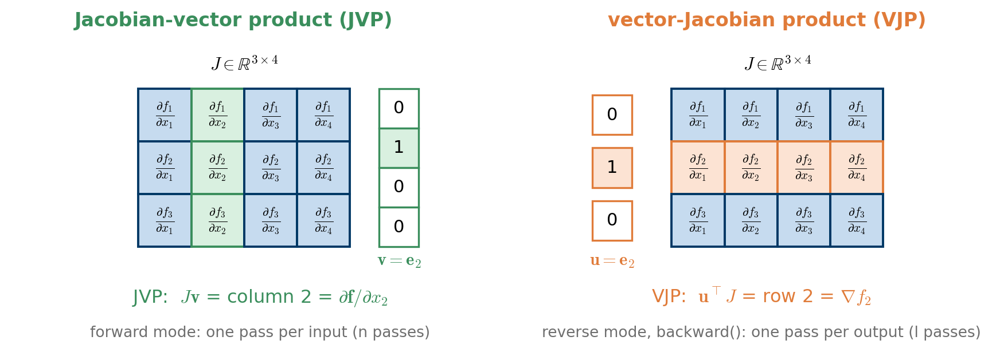

::: {.callout-note}
## Acknowledgement

This notebook is largely based on material prepared by my former student [Minh Vu Chau](https://www.linkedin.com/in/minh-vu-chau/).
:::

# Goal

In notebook 2, we called `f.backward(gradient=torch.tensor([1., 1.]))` on a tensor `f` with two entries and promised to explain later what the argument `gradient` means. This notebook keeps that promise. We will see that

- `backward(gradient=u)` computes a **vector-Jacobian product (VJP)** $\mathbf{u}^{\top} J$, which is the basic operation of reverse-mode automatic differentiation (backpropagation);
- the closely related **Jacobian-vector product (JVP)** $J \mathbf{v}$ is the basic operation of forward-mode automatic differentiation;
- both products can be used to assemble a full Jacobian matrix, column by column (JVP) or row by row (VJP), without ever writing down a derivative by hand.

## The Jacobian

Consider a function $\mathbf{f}: \mathbb{R}^{n} \to \mathbb{R}^{l}$ with input $\mathbf{x} = (x_1, \ldots, x_n)$ and output $\mathbf{y} = \mathbf{f}(\mathbf{x}) = (f_1(\mathbf{x}), \ldots, f_l(\mathbf{x}))$. Its Jacobian matrix collects all first-order partial derivatives:

$$
J_{\mathbf{f}}(\mathbf{x}) = \frac{\partial \mathbf{f}}{\partial \mathbf{x}} =
\begin{bmatrix}
\dfrac{\partial f_1}{\partial x_1} & \cdots & \dfrac{\partial f_1}{\partial x_n} \\
\vdots & \ddots & \vdots \\
\dfrac{\partial f_l}{\partial x_1} & \cdots & \dfrac{\partial f_l}{\partial x_n}
\end{bmatrix} \in \mathbb{R}^{l \times n}.
$$

Row $i$ of $J$ is the gradient $\nabla f_i$ of the $i$-th output; column $j$ is the derivative $\partial \mathbf{f} / \partial x_j$ of all outputs with respect to the $j$-th input.

**Batches.** In machine learning, we usually evaluate a function on a whole batch of $b$ inputs at once, stored as the rows of a matrix $\mathbf{X} \in \mathbb{R}^{b \times n}$, and obtain the outputs as the rows of $\mathbf{Y} = \mathbf{f}(\mathbf{X}) \in \mathbb{R}^{b \times l}$. If every output row depends only on the corresponding input row (as is the case for all functions in this notebook), we are interested in one Jacobian per row, i.e. in a tensor of shape $(b, l, n)$:

$$
\mathbf{J} = \big[J_{\mathbf{f}}(\mathbf{x}^{(1)}), \ldots, J_{\mathbf{f}}(\mathbf{x}^{(b)})\big] \in \mathbb{R}^{b \times l \times n}.
$$

## Two products with the Jacobian

Computing and storing a full Jacobian is often unnecessary and expensive. Automatic differentiation is instead built on two cheaper operations:

- The **Jacobian-vector product (JVP)** multiplies $J$ by a vector $\mathbf{v} \in \mathbb{R}^{n}$ from the right:
$$
J \mathbf{v} = \sum_{j=1}^{n} v_j \frac{\partial \mathbf{f}}{\partial x_j} \in \mathbb{R}^{l}.
$$
This is a weighted sum of the **columns** of $J$, i.e. the directional derivative of $\mathbf{f}$ in the direction $\mathbf{v}$. With $\mathbf{v} = \mathbf{e}_j$ (the $j$-th unit vector), it returns column $j$. Forward-mode AD computes JVPs; one JVP costs about as much as one evaluation of $\mathbf{f}$, so building the full Jacobian requires $n$ passes.
- The **vector-Jacobian product (VJP)** multiplies $J$ by a vector $\mathbf{u} \in \mathbb{R}^{l}$ from the left:
$$
\mathbf{u}^{\top} J = \sum_{i=1}^{l} u_i \nabla f_i = \left( \sum_{i=1}^{l} u_i \frac{\partial f_i}{\partial x_1}, \; \ldots, \; \sum_{i=1}^{l} u_i \frac{\partial f_i}{\partial x_n} \right) \in \mathbb{R}^{n}.
$$
This is a weighted sum of the **rows** of $J$. With $\mathbf{u} = \mathbf{e}_i$, it returns row $i$, the gradient of $f_i$. Reverse-mode AD (backpropagation) computes VJPs, and building the full Jacobian requires $l$ passes.

If we replace $\mathbf{v}$ by the identity matrix $I_n$, i.e. compute the JVPs with all unit vectors, we recover the whole Jacobian, $J I_n = J$; the same holds for VJPs with $I_l$.

This also explains why machine learning relies on reverse mode. The loss is a *scalar* ($l = 1$) that depends on millions of parameters ($n$ huge). A single VJP with $u = 1$ gives the entire gradient, whereas forward mode would need millions of JVPs.

{#fig-jvp-vjp width="95%"}

```{python}
import torch
import numpy as np
import matplotlib.pyplot as plt
```

# Warm-up: `backward(gradient=u)` is a VJP

Let us start with the simplest possible function, the identity $\mathbf{f}(\mathbf{x}) = \mathbf{x}$, whose Jacobian is the identity matrix. Calling `backward` with a vector $\mathbf{u}$ should therefore return $\mathbf{u}^{\top} I = \mathbf{u}^{\top}$ in `x.grad`:

```{python}
x = torch.tensor([1., 2., 3., 4., 5.], requires_grad=True)
f = x                                               # identity: J = I
f.backward(gradient=torch.tensor([1., 1., 0., 0., 0.]))
print(f"x.grad = {x.grad}")                         # = u
```

Next, the element-wise square $\mathbf{f}(\mathbf{x}) = (x_1^2, \ldots, x_n^2)$. Each output depends only on the corresponding input, so the Jacobian is diagonal, $J = \operatorname{diag}(2x_1, \ldots, 2x_n)$, and $\mathbf{u}^{\top} J = (2x_1 u_1, \ldots, 2x_n u_n)$. With $\mathbf{u} = (1, \ldots, 1)$, we obtain all the derivatives $2x_k$ at once. This is exactly the situation of notebook 2.

```{python}
x = torch.tensor([1., 2., 3., 4., 5.], requires_grad=True)
f = x ** 2                                          # J = diag(2x)
f.backward(gradient=torch.ones_like(f))             # u = (1, ..., 1)
print(f"x.grad = {x.grad}")                         # = 2x
```

Finally, a linear map $\mathbf{f}(\mathbf{x}) = A\mathbf{x}$ with a matrix $A \in \mathbb{R}^{3 \times 2}$. Its Jacobian is $J = A$, which is *not* diagonal. The VJP $\mathbf{u}^{\top} A$ equals $(A^{\top}\mathbf{u})^{\top}$, and with $\mathbf{u} = \mathbf{e}_2$ we obtain the second row of $A$:

```{python}
A = torch.tensor([[1., 2.],
                  [3., 4.],
                  [5., 6.]])
x = torch.tensor([0.5, -1.0], requires_grad=True)
f = A @ x                                           # J = A, shape (3, 2)

u = torch.tensor([0., 1., 0.])                      # u = e_2
f.backward(gradient=u)
print(f"x.grad  = {x.grad}")
print(f"A.T @ u = {A.T @ u}   (the second row of A)")
```

# Example: a vector field in the plane

We now study a function that takes a batch of 2-D inputs $\mathbf{X} \in \mathbb{R}^{b \times 2}$ and returns a batch of 2-D outputs $\mathbf{f}(\mathbf{X}) \in \mathbb{R}^{b \times 2}$, where each output row is computed from the corresponding input row $(x_1, x_2)$:

$$
f_1(x_1, x_2) = x_1^3 + 0.1\, x_1 x_2^2, \qquad
f_2(x_1, x_2) = x_2^3 + 0.5\, x_2 x_1^2.
$$

For each row, $\mathbf{f}(x_1, x_2) = \big(f_1(x_1, x_2), f_2(x_1, x_2)\big)$. In code, `X[:, 0]` holds the values of $x_1$ and `X[:, 1]` the values of $x_2$ for all rows.

```{python}
def function_2d(X):
    """Vector-valued function f: R^2 -> R^2, applied to every row of X, shape (b, 2)."""
    x1, x2 = X[:, 0], X[:, 1]
    f1 = x1**3 + 0.1 * x1 * x2**2
    f2 = x2**3 + 0.5 * x2 * x1**2
    return torch.stack((f1, f2), dim=1)     # shape (b, 2)
```

To get a feeling for this function, we evaluate it on a grid and plot both components and the vector field $(f_1, f_2)$.

```{python}
#| label: fig-field
#| fig-cap: "The two components of the example function and the corresponding vector field."
g = torch.linspace(-2, 2, 41)
G1, G2 = torch.meshgrid(g, g, indexing='xy')                # grid of (x1, x2) values
X_grid = torch.stack((G1.flatten(), G2.flatten()), dim=1)   # shape (41*41, 2)
F_grid = function_2d(X_grid)
F1 = F_grid[:, 0].reshape(G1.shape)
F2 = F_grid[:, 1].reshape(G1.shape)

fig, axs = plt.subplots(1, 3, figsize=(12, 3.6))
for ax, F, name in zip(axs[:2], [F1, F2], ["$f_1(x_1, x_2)$", "$f_2(x_1, x_2)$"]):
    cs = ax.contourf(G1, G2, F, levels=20, cmap='viridis')
    fig.colorbar(cs, ax=ax)
    ax.set_title(name)
s = slice(None, None, 4)                                    # every 4th grid point
M = torch.hypot(F1, F2) + 1e-12                             # length of the vectors
# arrows of unit length show the direction; the colour shows the magnitude
axs[2].quiver(G1[s, s], G2[s, s], (F1 / M)[s, s], (F2 / M)[s, s], M[s, s],
              cmap='viridis')
axs[2].set_title("direction of $(f_1, f_2)$")
for ax in axs:
    ax.set_xlabel("$x_1$"); ax.set_ylabel("$x_2$"); ax.set_aspect('equal')
plt.tight_layout()
plt.show()
```

## The Jacobian of the example

Differentiating by hand, we obtain the Jacobian

$$
J_{\mathbf{f}}(x_1, x_2) =
\begin{bmatrix}
\dfrac{\partial f_1}{\partial x_1} & \dfrac{\partial f_1}{\partial x_2} \\[10pt]
\dfrac{\partial f_2}{\partial x_1} & \dfrac{\partial f_2}{\partial x_2}
\end{bmatrix}
=
\begin{bmatrix}
3 x_1^2 + 0.1\, x_2^2 & 0.2\, x_1 x_2 \\[4pt]
x_1 x_2 & 3 x_2^2 + 0.5\, x_1^2
\end{bmatrix}.
$$

We implement this formula as a reference for the automatic computations below. The function returns a tensor of shape $(b, 2, 2)$ whose entry `[k, i, j]` is $\partial f_i / \partial x_j$ evaluated at row $k$.

```{python}
def jacobian_reference(X):
    """
    Analytical Jacobian of function_2d.

    Args:
        X (torch.Tensor): tensor of shape (b, 2); each row holds one input (x1, x2).

    Returns:
        torch.Tensor: shape (b, 2, 2), where J[k, i, j] = d f_i / d x_j at row k.
    """
    x1, x2 = X[:, 0], X[:, 1]
    # gradient of f1
    row1 = torch.stack([3 * x1**2 + 0.1 * x2**2, 0.2 * x1 * x2], dim=1)
    # gradient of f2
    row2 = torch.stack([x1 * x2, 3 * x2**2 + 0.5 * x1**2], dim=1)
    return torch.stack([row1, row2], dim=1)
```

## The Jacobian column by column with JVPs

Following the theory above, we obtain the columns of the Jacobian from JVPs with the unit vectors $\mathbf{v}_1 = (1, 0)^{\top}$ and $\mathbf{v}_2 = (0, 1)^{\top}$:

$$
J_{\mathbf{f}} \begin{bmatrix} 1 \\ 0 \end{bmatrix}
= \begin{bmatrix} \dfrac{\partial f_1}{\partial x_1} \\[10pt] \dfrac{\partial f_2}{\partial x_1} \end{bmatrix}
= \begin{bmatrix} 3 x_1^2 + 0.1\, x_2^2 \\[4pt] x_1 x_2 \end{bmatrix},
\qquad
J_{\mathbf{f}} \begin{bmatrix} 0 \\ 1 \end{bmatrix}
= \begin{bmatrix} \dfrac{\partial f_1}{\partial x_2} \\[10pt] \dfrac{\partial f_2}{\partial x_2} \end{bmatrix}
= \begin{bmatrix} 0.2\, x_1 x_2 \\[4pt] 3 x_2^2 + 0.5\, x_1^2 \end{bmatrix}.
$$

PyTorch computes JVPs with `torch.autograd.functional.jvp(func, inputs, v)`, which returns the pair `(func(inputs), J v)`. We handle the whole batch at once: the tangent `v` has the same shape $(b, n)$ as the input, with a $1$ in column $j$ of *every* row. Because the rows do not interact, the JVP of the batched function then contains, in row $k$, the $j$-th column of the Jacobian at row $k$. We store it in the slice `[:, :, j]` of the result.

```{python}
def jacobian_via_jvp(inputs, func):
    """
    Batched Jacobian, column by column, with Jacobian-vector products.

    Args:
        inputs (torch.Tensor): tensor of shape (b, n).
        func: function mapping a (b, n) tensor to a (b, l) tensor, row by row.

    Returns:
        torch.Tensor: shape (b, l, n), where J[k, i, j] = d f_i / d x_j at row k.
    """
    outputs = func(inputs)
    b, l = outputs.shape
    n = inputs.shape[1]
    jacobian = torch.zeros((b, l, n), dtype=inputs.dtype)

    for j in range(n):                      # one JVP per input dimension
        v = torch.zeros_like(inputs)
        v[:, j] = 1.0                       # unit vector e_j in every row
        _, jvp_result = torch.autograd.functional.jvp(func, inputs, v=v)
        jacobian[:, :, j] = jvp_result      # column j of every Jacobian
    return jacobian
```

## The Jacobian row by row with VJPs (`backward`)

Equivalently, we can obtain the rows of the Jacobian from VJPs with the unit vectors $\mathbf{u}_i = \mathbf{e}_i$ in the *output* space. This is exactly what `backward(gradient=u)` computes, so we can reuse everything we know from notebook 2. Note the two details from that notebook: we must keep the graph alive with `retain_graph=True` because we call `backward()` several times on the same output, and we must reset the accumulated gradient after each call.

```{python}
def jacobian_via_vjp(inputs, func):
    """
    Batched Jacobian, row by row, with vector-Jacobian products computed by backward().
    Same arguments and return value as jacobian_via_jvp.
    """
    inputs = inputs.clone().detach().requires_grad_(True)
    outputs = func(inputs)
    b, l = outputs.shape
    n = inputs.shape[1]
    jacobian = torch.zeros((b, l, n), dtype=inputs.dtype)

    for i in range(l):                      # one VJP per output dimension
        u = torch.zeros_like(outputs)
        u[:, i] = 1.0                       # unit vector e_i in every row
        outputs.backward(gradient=u, retain_graph=True)
        # row i (the gradient of f_i) of every Jacobian
        jacobian[:, i, :] = inputs.grad
        inputs.grad = None                  # gradients accumulate: reset them
    return jacobian
```

## Comparison

We evaluate the three versions on a batch of $b = 50$ points and check that they agree.

```{python}
b = 50
x1 = torch.linspace(-1, 2, b)
x2 = torch.linspace(-2, 1, b)
X = torch.stack((x1, x2), dim=1)                # shape (50, 2), float32

jac_ref = jacobian_reference(X)
jac_jvp = jacobian_via_jvp(X, function_2d)
jac_vjp = jacobian_via_vjp(X, function_2d)

print(f"shape of the Jacobians: {tuple(jac_ref.shape)}")
print(f"JVP == reference: {torch.allclose(jac_jvp, jac_ref)}")
print(f"VJP == reference: {torch.allclose(jac_vjp, jac_ref)}\n")
print(f"Jacobian at the first point x = {X[0].tolist()}:\n{jac_vjp[0]}")
```

# Built-in tools

In practice, you rarely need to write these loops yourself. PyTorch offers ready-made functions; here are the most useful ones.

- `torch.autograd.functional.jacobian(func, inputs)` computes the *full* Jacobian of `func` with respect to all of its inputs. For a batched function, this includes the (zero) derivatives of each output row with respect to every *other* input row, so the result has shape $(b, l, b, n)$. This is wasteful for large batches.
- The module `torch.func` provides composable function transforms in the style of JAX: `jacrev` (Jacobian by reverse mode, i.e. VJPs), `jacfwd` (by forward mode, i.e. JVPs) and `vmap`, which vectorises a function written for a *single* input over a batch. Combining them gives exactly the per-row Jacobians we computed by hand.

```{python}
#| warning: false
from torch.func import jacrev, jacfwd, vmap

def f_single(x):
    """The same function for a single input x of shape (2,)."""
    return function_2d(x.unsqueeze(0)).squeeze(0)

jac_rev = vmap(jacrev(f_single))(X)     # per-row Jacobians via reverse mode
jac_fwd = vmap(jacfwd(f_single))(X)     # per-row Jacobians via forward mode
print(f"jacrev: shape {tuple(jac_rev.shape)}, "
      f"equal to reference: {torch.allclose(jac_rev, jac_ref)}")
print(f"jacfwd: shape {tuple(jac_fwd.shape)}, "
      f"equal to reference: {torch.allclose(jac_fwd, jac_ref)}")

jac_full = torch.autograd.functional.jacobian(function_2d, X)
print(f"\nautograd.functional.jacobian: shape {tuple(jac_full.shape)}")
```

::: {.callout-note}
## True forward mode

`torch.autograd.functional.jvp` computes the JVP with the so-called *double-backward trick*, i.e. with two reverse-mode passes, which is not the most efficient way. For genuine forward-mode differentiation, use `torch.func.jvp` (or `jacfwd`, as above). For the small examples in this notebook, the difference does not matter.
:::

# Summary

| | Jacobian-vector product (JVP) | vector-Jacobian product (VJP) |
|:--|:--|:--|
| computes | $J\mathbf{v}$, a weighted sum of the **columns** of $J$ | $\mathbf{u}^{\top} J$, a weighted sum of the **rows** of $J$ |
| with a unit vector | column $j$: $\partial \mathbf{f} / \partial x_j$ | row $i$: $\nabla f_i$ |
| mode of AD | forward mode | reverse mode (backpropagation) |
| passes for the full Jacobian | $n$ (number of inputs) | $l$ (number of outputs) |
| PyTorch | `torch.func.jvp`, `torch.func.jacfwd`, `torch.autograd.functional.jvp` | `backward(gradient=u)`, `torch.autograd.grad`, `torch.func.jacrev` |

For a scalar loss ($l = 1$), a single VJP, namely `loss.backward()` with the implicit $u = 1$, gives the gradient with respect to all parameters. This is why reverse-mode automatic differentiation is the workhorse of deep learning.
