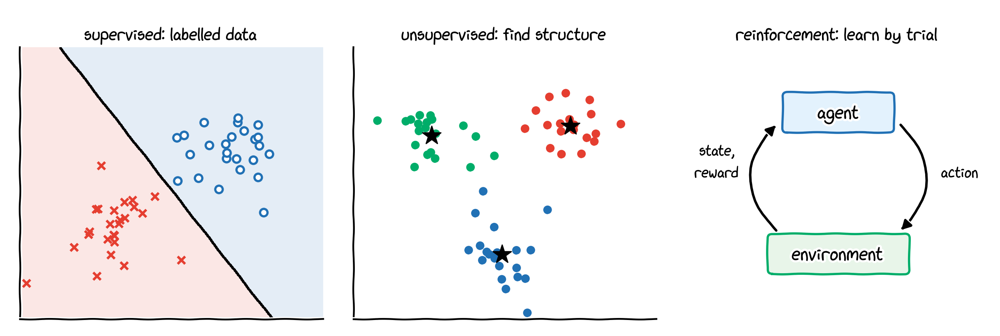
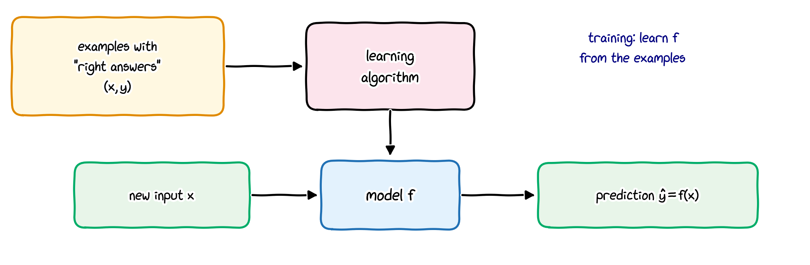
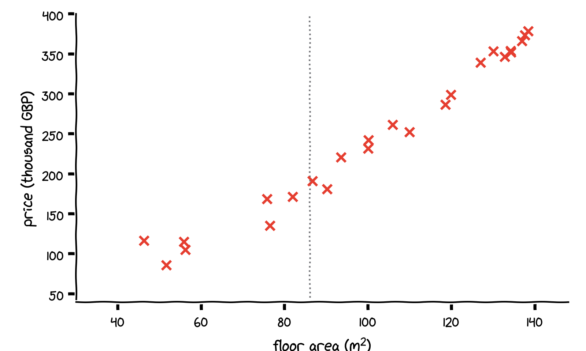
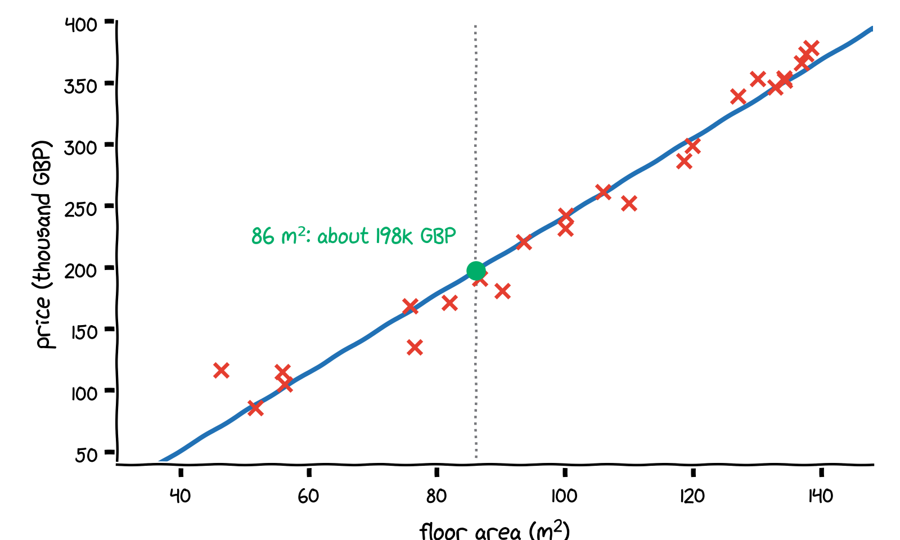
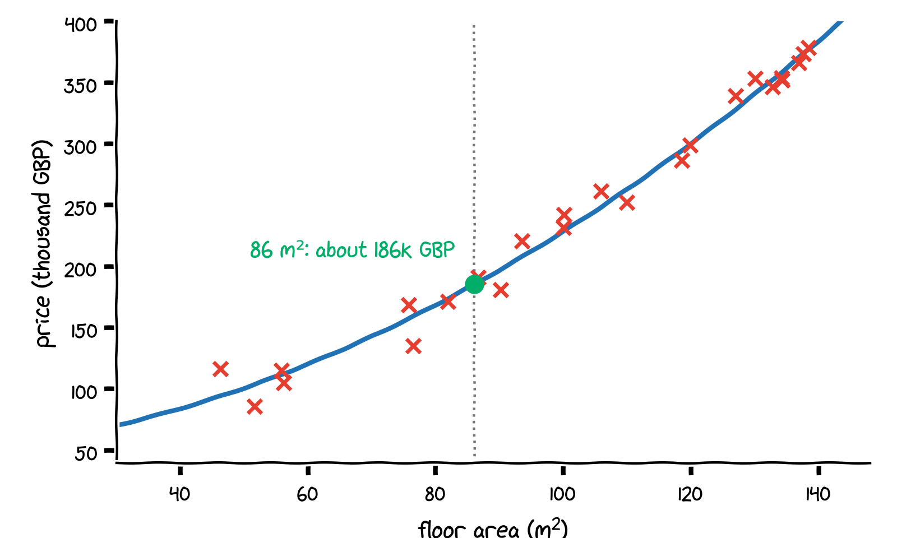
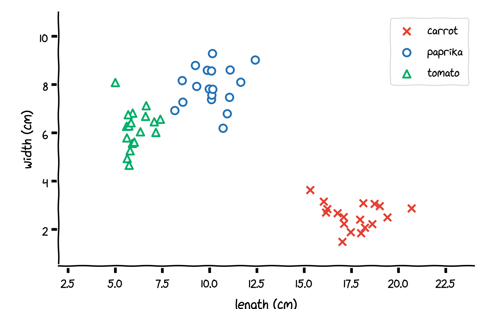
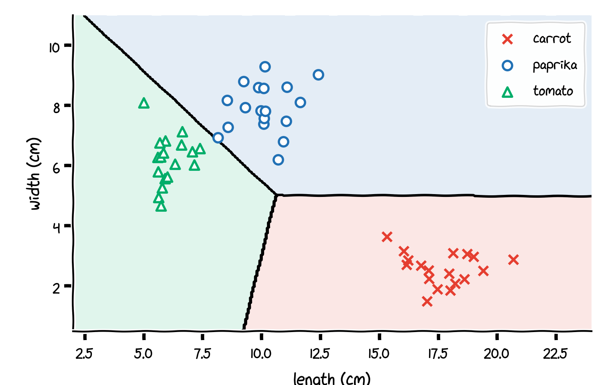
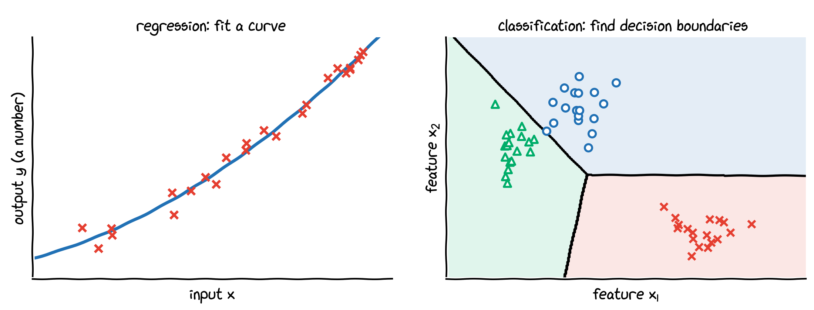
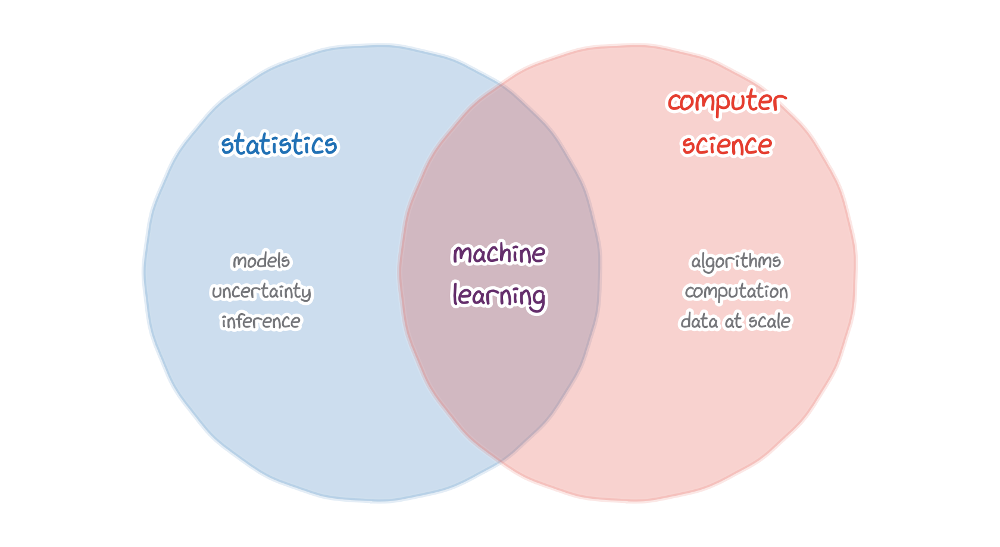
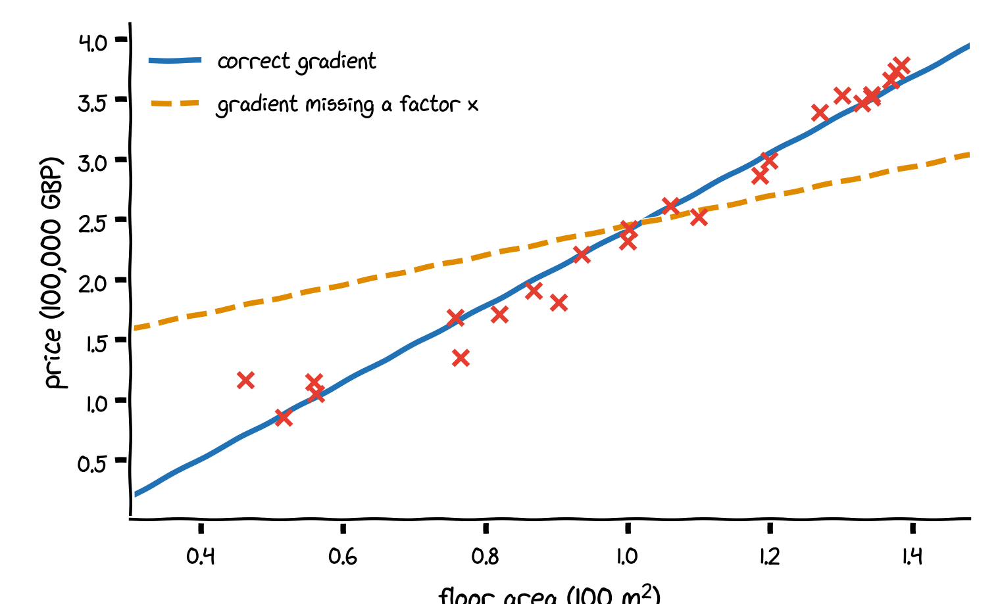

## This lecture

By the end of this lecture you should be able to

- explain what **machine learning** is, and where the term comes from;
- distinguish **supervised**, **unsupervised** and **reinforcement** learning;
- describe **supervised learning** as learning from examples with "right answers";
- tell a **regression** problem from a **classification** problem;
- discuss some honest **criticisms** of the current hype around AI, and explain why **mathematics and programming** still matter when AI tools can write code.

# What is machine learning?

## Where the term comes from

- The term **machine learning** is credited to **Arthur Samuel**, an IBM researcher, who used it in his 1959 paper on a computer program that learned to play checkers (draughts).

- He described it as the
  "programming of a digital computer to behave in a way which, if done by human beings or animals, would be described as involving the process of learning".

- A shorter description is often attributed to him: machine learning is "the field of study that gives computers the ability to learn without being explicitly programmed". This exact sentence does not appear in his 1959 paper; it is a later paraphrase.

::: small
A. L. Samuel (1959), Some studies in machine learning using the game of checkers, *IBM Journal of Research and Development* 3(3), 210–229.
:::

## A more precise definition

::: {.callout-note title="Tom Mitchell (1997)"}
"A computer program is said to learn from experience $E$ with respect to some class of tasks $T$ and performance measure $P$, if its performance at tasks in $T$, as measured by $P$, improves with experience $E$."
:::

. . .

Example, a spam filter:

| | |
|:---|:---|
| task $T$ | classify incoming emails as spam or not spam |
| experience $E$ | a collection of emails that users have labelled as spam or not spam |
| performance $P$ | the fraction of emails that are classified correctly |

. . .

**Traditional programming**: people write the rules. **Machine learning**: the program learns them from examples.

## Three kinds of machine learning

{width="88%" fig-align="center"}

1. **Supervised learning**: learn from examples that come with the correct answer. Most of this course.
2. **Unsupervised learning**: find structure (e.g. groups, or **clusters**) in data without answers.
3. **Reinforcement learning**: an agent learns which actions to take by trial and error, guided by rewards.

## Tools, and how to use them

Knowing the algorithms is only half of the story. Equally important is **practical know-how**:

- how to prepare data and scale features (Lecture 2);
- how to tell whether a model underfits or overfits, and what to do about it (Lecture 4);
- how to evaluate a model honestly on data it has not seen (Lectures 2 to 5);
- how to implement and train models efficiently (Lectures 6 and 7).

Throughout the course we learn not only the tools, but also **how and when to use them**.

## The road map of this course

| lecture | topic |
|:---|:---|
| 1 | introduction: supervised learning, regression and classification |
| 2 | linear regression: (a) one feature, (b) many features and feature scaling; gradient descent |
| 3 | logistic regression: (a) binary classification, (b) multiclass classification (softmax) |
| 4 | overfitting, regularisation and model selection |
| 5 | support vector machines |
| 6 | PyTorch: the tool for the rest of the course |
| 7 | neural networks and backpropagation |
| 8 | convolutional neural networks (images) |
| 9 | recurrent neural networks (sequences) |

: {tbl-colwidths="[12,88]"}

# Supervised learning

## Learning from "right answers"

{width="88%" fig-align="center"}

- **Supervised learning** maps an input $x$ to an output $y$.
- The algorithm learns this mapping from many **examples** $(x, y)$ for which we know the correct output, the "right answer".
- Once trained, the model predicts $\hat y = f(x)$ for **new** inputs it has never seen.

## Supervised learning in practice

| input $x$ | output $y$ | application |
|:---|:---|:---|
| email | spam? (0/1) | spam filtering |
| audio clip | text transcript | speech recognition |
| English text | Spanish text | machine translation |
| advert and user information | click on the advert? (0/1) | online advertising |
| image and radar data | positions of other cars | self-driving cars |
| image of a manufactured phone | defect? (0/1) | visual inspection |

. . .

In every row, the model learns from many examples of inputs together with the correct outputs.

## A regression problem

::: build
::: {}
{width="58%" fig-align="center"}

Floor area and price of flats (made-up data, inspired by Glasgow). What should a flat of $86\,\mathrm{m}^2$ cost?
:::
::: {}
{width="58%" fig-align="center"}

Fit a straight line: about £198k.
:::
::: {}
{width="58%" fig-align="center"}

Fit a curve: about £186k. Which model is better is one of the questions of this course.
:::
:::

## Regression

{width="50%" fig-align="center"}

::: {.callout-tip title="Regression"}
Predict a **number**, such as a price, a temperature or a dosage.
The output can take infinitely many values: a **continuous** range.
:::

Lecture 2 treats linear regression in detail, first with one feature (2a), then with many (2b).

## A classification problem

::: build
::: {}
{width="56%" fig-align="center"}

Given measurements of a vegetable (here its length and width), is it a carrot, a paprika or a tomato?
:::
::: {}
{width="56%" fig-align="center"}

A classifier divides the feature space into regions, one per class, separated by **decision boundaries**.
:::
:::

## Classification

::: {.callout-tip title="Classification"}
Predict a **category** (also called a **class**), such as spam or not spam, or carrot, paprika or tomato.
The output takes one of a **small, finite** set of values.
:::

- The classes need not be numbers, and they have no natural order. In code we still encode them as $0, 1, 2, \dots$
- Inputs can have many features: a $28 \times 28$ greyscale image has 784.
- Lecture 3 covers classification with two classes (3a) and with more than two classes (3b).

## Regression versus classification

|  | **regression** | **classification** |
|:---|:---|:---|
| predicts | a **number** | a **category** |
| possible outputs | infinitely many (continuous) | a small, finite set |
| geometric picture | a curve through the data | decision boundaries between classes |
| example | price of a flat | type of vegetable |

{width="70%" fig-align="center"}

Both are **supervised learning**: the model learns from examples with the right answers.

# Perspective

## The hype of AI, and some criticisms

- **Neural networks are statistics.** W. S. Sarle (1994) wrote that "the most commonly used artificial neural networks, called multilayer perceptrons, are nothing more than nonlinear regression and discriminant models that can be implemented with standard statistical software."

. . .

- **Common sense.** Yann LeCun (Turing Award 2018) has argued for years that today's AI systems have less common sense than a house cat.

. . .

- **Rigour.** At NeurIPS 2017, Ali Rahimi compared parts of machine-learning research to alchemy: methods that work without being understood (*Science*, 2018).

. . .

- **Reliability.** Models that perform equally well in testing can behave very differently in the real world ("underspecification"; *MIT Technology Review*, 2020).

::: small
Sources: Sarle, *Neural Networks and Statistical Models*, Proc. 19th SAS Users Group Int. Conf. (1994); Quote Investigator (2024) on LeCun's cat comparisons; M. Hutson, *Science* (2018), "AI researchers allege that machine learning is alchemy"; W. D. Heaven, *MIT Technology Review* (2020), "The way we train AI is fundamentally flawed".
:::

## Machine learning = statistics + computer science

{width="46%" fig-align="center"}

- From **statistics**: models of data, uncertainty, and how well conclusions generalise.
- From **computer science**: algorithms, efficient computation, and working with very large data sets.

. . .

A popular joke: *"When you raise money, it is AI. When you hire, it is machine learning. When you do the work, it is linear regression."* Joke or truth? After Lecture 2 you can judge for yourself.

## AI can write code: why learn the fundamentals?

AI assistants now write code, derive formulas and explain results, fluently and in seconds. That makes the fundamentals **more** important, not less:

- The output can be **confidently wrong**: code that runs without errors but computes the wrong thing, a formula with a missing term, a function that does not exist. Nothing warns you.
- **Responsibility stays with you**: the engineer who deploys a model has to be able to check it, explain it and defend it.
- **You cannot check what you do not understand.** Recognising a wrong gradient requires knowing the right one; spotting a misleading result requires knowing how models are evaluated.

. . .

Two examples follow. Both look perfectly reasonable at first sight.

## Example 1: code that runs, but is wrong

:::: {.columns}
::: {.column width="52%"}
Fit a straight line by gradient descent (Lecture 2). Suppose an assistant suggests:

```python
for _ in range(5000):
    y_hat = w * x + b
    dw = np.mean(y_hat - y)       # missing: * x
    db = np.mean(y_hat - y)
    w, b = w - alpha * dw, b - alpha * db
```

- No error, no warning, and it produces a line.
- The correct gradient is $\frac{\partial J}{\partial w} = \frac1m\sum_i(\hat y^{(i)} - y^{(i)})\,x^{(i)}$; one factor $x$ is missing.
- Result: slope 1.23 instead of 3.18.
:::
::: {.column width="48%"}


Only someone who knows the mathematics notices that the dashed line is wrong.
:::
::::

## Example 2, and how to use AI tools

A model for detecting fraudulent card payments reaches **99% accuracy** on the test data. Is it good?

. . .

- Suppose 1% of all payments are fraudulent. A "model" that always answers **"not fraud"** is also 99% accurate, and it never detects a single fraud.
- Accuracy alone says little when the classes are this unbalanced. You need a **baseline** and other measures, such as how many frauds were actually found (Lectures 3 and 4).

. . .

**How to use AI tools in this course**

- Use them like a tutor: to explain, to give examples, to suggest where a bug might be. Then **check** the answer: derive it, run it, test it on a small case you can compute by hand.
- Write your own solution first, then compare. Use AI to speed up what you already understand, not to replace understanding.
- Follow the course's rules on the use of AI tools in assessed work.

# Wrapping up

## Summary

- **Machine learning**: programs that improve at a task with experience, instead of following hand-written rules (Samuel 1959; Mitchell 1997).
- Three kinds: **supervised**, **unsupervised** and **reinforcement** learning.
- **Supervised learning** learns a mapping $x \mapsto y$ from examples with "right answers", and predicts $\hat y = f(x)$ for new inputs.
- **Regression** predicts a number (continuous output); **classification** predicts a category (finite set of outputs).
- Behind the hype: machine learning combines **statistics** and **computer science**, and its methods deserve both enthusiasm and scrutiny.
- AI tools can write code, but only someone who understands the mathematics and the programming can **check** it.

**Next lecture**: linear regression with one feature, the cost function and gradient descent.

## Check your understanding

Regression or classification?

1. Predicting tomorrow's maximum temperature in Glasgow.
2. Deciding whether a credit-card transaction is fraudulent.
3. Recognising which of the 26 letters a handwritten character is.
4. Estimating the age of a person from a photograph.
5. Grouping customers into segments without any predefined labels: is this supervised learning at all?

::: notes
1. Regression (a number). 2. Classification (two classes). 3. Classification (26 classes). 4. Regression (a number), although it could be turned into classification with age groups. 5. Not supervised: there are no "right answers"; this is clustering, an unsupervised learning problem.
:::
