## This lecture

Linear regression is the first model of the course, and many of its ideas return in every later lecture: a cost function, gradient descent, vectorised code, feature scaling and honest evaluation.

:::: {.columns}
::: {.column width="47%"}
**Part 2a: one feature**

- the model $f_{w,b}(x) = wx + b$ and the meaning of $w$ and $b$;
- the **squared-error cost** $J(w,b)$, and why it is a good choice;
- minimising $J$: stationary points, and why we usually do not solve $\nabla J = \mathbf 0$;
- **gradient descent** and the **learning rate** $\alpha$.
:::
::: {.column width="6%"}
:::
::: {.column width="47%"}
**Part 2b: many features**

- the model $f_{\mathbf w,b}(\mathbf x) = \mathbf w\cdot\mathbf x + b$ in vector form;
- **vectorised** code, gradient descent for $n$ features, the **normal equation**;
- **feature scaling** and learning curves;
- feature engineering, polynomial regression, evaluation with MSE and $R^2$, and **scikit-learn**.
:::
::::

# Part 2a: linear regression with one feature {background-image="styles/backgrounds/title.jpg" background-size="cover" background-color="#e5f5e2" .part-slide}

::: {.content-visible when-format="revealjs"}
The regression problem, the cost function, minimising the cost, gradient descent, the learning rate
:::

# The regression problem

## A motivating example

:::: {.columns}
::: {.column width="58%"}
::: build
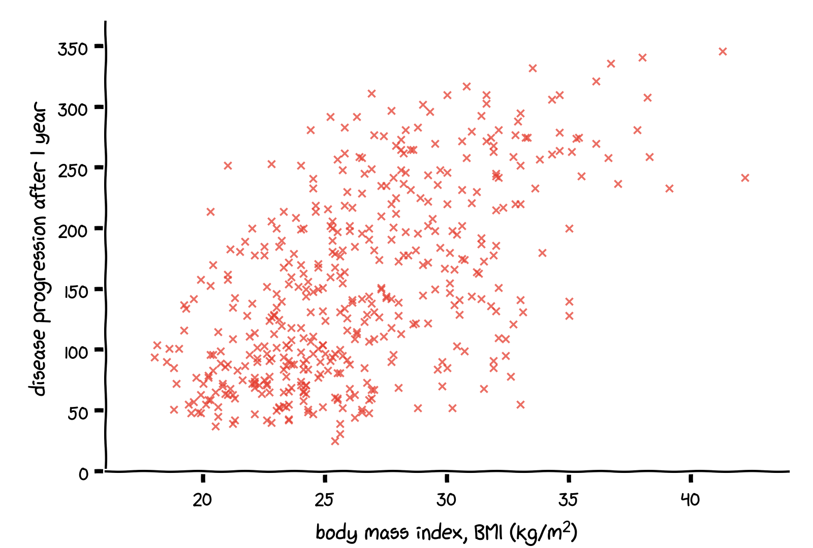

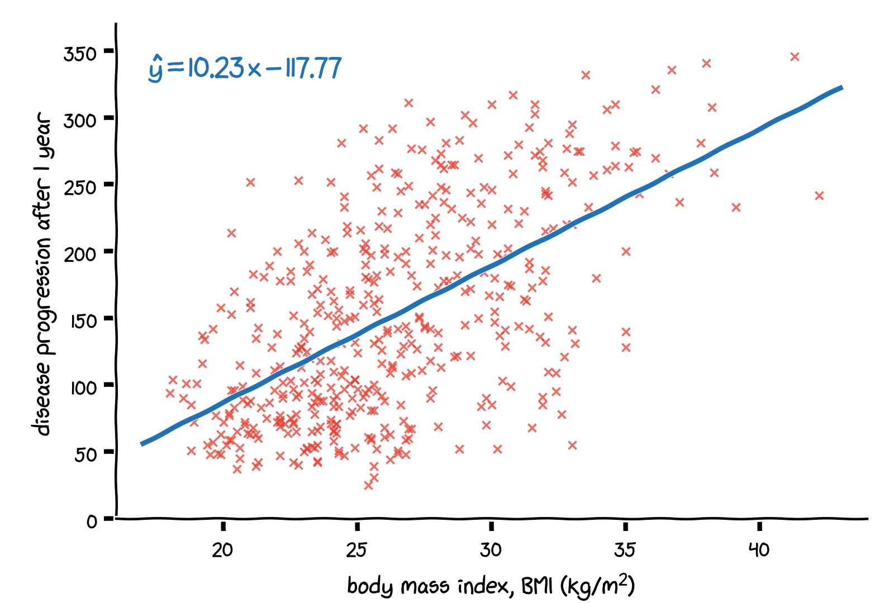
:::
:::
::: {.column width="42%"}
Each × is one of 442 diabetes patients:

- $x$: body mass index (BMI)
- $y$: a measure of disease progression one year later

Can we predict $y$ for a **new** patient from their BMI?

. . .

- **Supervised learning**: the training data contain the "right answers" $y$.
- **Regression**: the target $y$ is a *number*.
- **Classification**: the target is a *category* (e.g. diabetic or not), see Lecture 3.

::: small
Data: Efron, Hastie, Johnstone & Tibshirani (2004), *Annals of Statistics* 32(2); in Python `sklearn.datasets.load_diabetes`.
:::
:::
::::

## Training data and notation

:::: {.columns}
::: {.column width="42%"}
**Training set**

| $i$ | BMI $x^{(i)}$ | progression $y^{(i)}$ |
|:---:|:---:|:---:|
| 1 | 32.1 | 151 |
| 2 | 21.6 | 75 |
| 3 | 30.5 | 141 |
| 4 | 25.3 | 206 |
| $\vdots$ | $\vdots$ | $\vdots$ |
| 442 | 19.6 | 57 |
:::
::: {.column width="58%"}
**Notation**

- $x$: **input** variable, or **feature**
- $y$: **output** variable, or **target**
- $m$: number of training examples (here $m = 442$)
- $(x^{(i)}, y^{(i)})$: the $i$-th training example, $i = 1, \dots, m$

. . .

For example $\big(x^{(1)}, y^{(1)}\big) = (32.1,\ 151)$ and $x^{(2)} = 21.6$.

::: {.callout-warning title="Index, not exponent"}
$x^{(2)}$ is the **second** example, $x^{(2)} = 21.6$. In contrast, $x^2 = x \cdot x$.
:::
:::
::::

## From data to a model

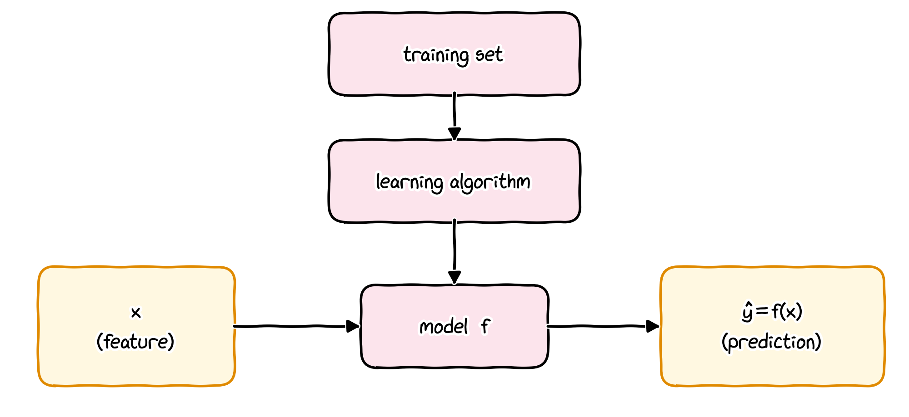{width="50%" fig-align="center"}

- A **learning algorithm** uses the training set to choose a function $f$, the **model** (also called the *hypothesis*).
- For a new input $x$, the model returns a **prediction** $\hat y = f(x)$, an estimate of the unknown true $y$.

. . .

| feature $x$ | $\longrightarrow$ | target $y$ |
|:---|:---:|:---|
| size of a house | $f$ | price of the house |
| body mass index | $f$ | disease progression |

## Univariate linear regression

:::: {.columns}
::: {.column width="52%"}
The simplest model is a straight line:

$$
f_{w,b}(x) = w\,x + b, \qquad w, b \in \mathbb{R}
$$

- $w$ and $b$ are the **parameters** of the model, also called **weight** and **bias**.
- The subscript in $f_{w,b}$ reminds us that the line depends on the choice of $w$ and $b$.
- One input feature: **univariate** linear regression, or linear regression with one variable.
- Several features (part 2b): **multiple** linear regression.
:::
::: {.column width="48%"}

:::
::::

## What do $w$ and $b$ mean?

:::: {.columns}
::: {.column width="45%"}
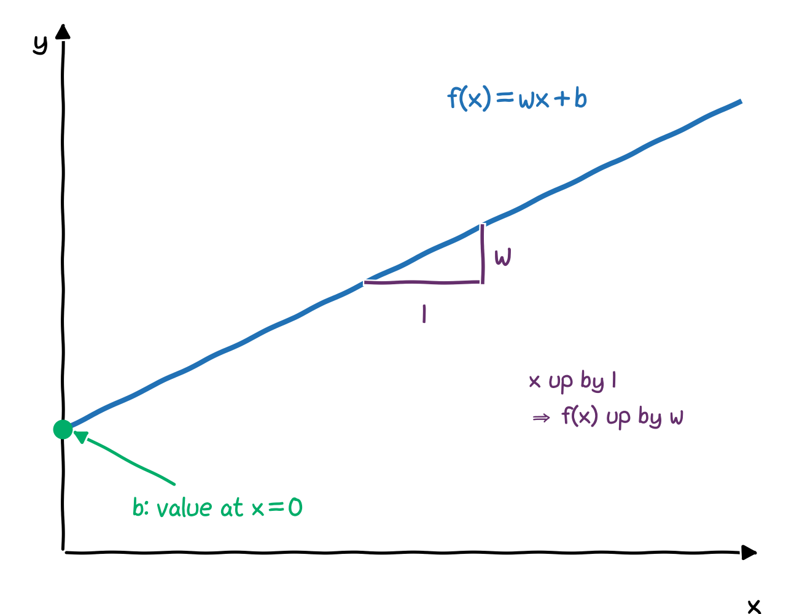
:::
::: {.column width="55%"}
- $w$ is the **slope**: the change in the prediction when $x$ increases by one unit.
- $b$ is the **intercept**: the prediction at $x = 0$.

. . .

For the diabetes data, the best line (we will see how to find it) is
$$
\hat y = 10.23\,x - 117.77 .
$$

- Each extra unit of BMI goes with about 10 points more disease progression, on average.
- The intercept $-117.77$ is the prediction for BMI $= 0$. It has no physical meaning: no patient has BMI $0$, and progression cannot be negative. **Do not extrapolate far outside the data.**
:::
::::

## Fantastic parameters and where to find them

:::: {.columns}
::: {.column width="45%"}
| $x$ | $y$ |
|:---:|:---:|
| 32.1 | 151 |
| 21.6 | 75 |
| 30.5 | 141 |
| $\vdots$ | $\vdots$ |

::: {.callout-note title="Model"}
$f_{w,b}(x) = {\color{red}{w}}\,x + {\color{red}{b}}$, with parameters ${\color{red}{w}}, {\color{red}{b}}$
:::
:::
::: {.column width="55%"}
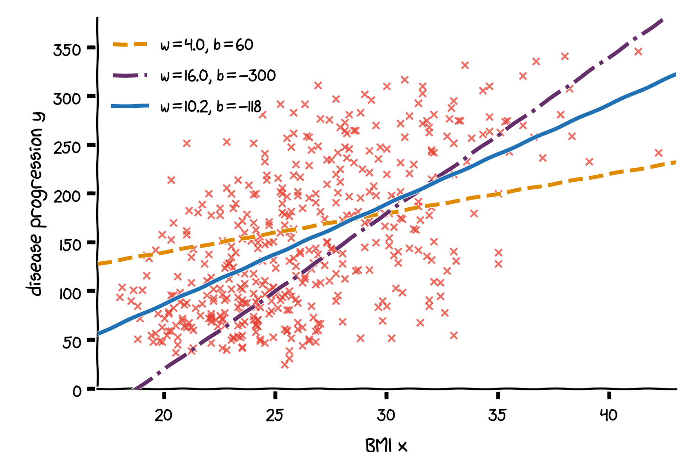{width="74%" fig-align="center"}

. . .

Which values of $w$ and $b$ give a **good** line, and how do we **find** them?

1. Measure how well a line fits the data: the **cost function**.
2. Find the parameters with the smallest cost: **optimisation**.
:::
::::

# The cost function

## How well does a line fit?

:::: {.columns}
::: {.column width="55%"}
::: build
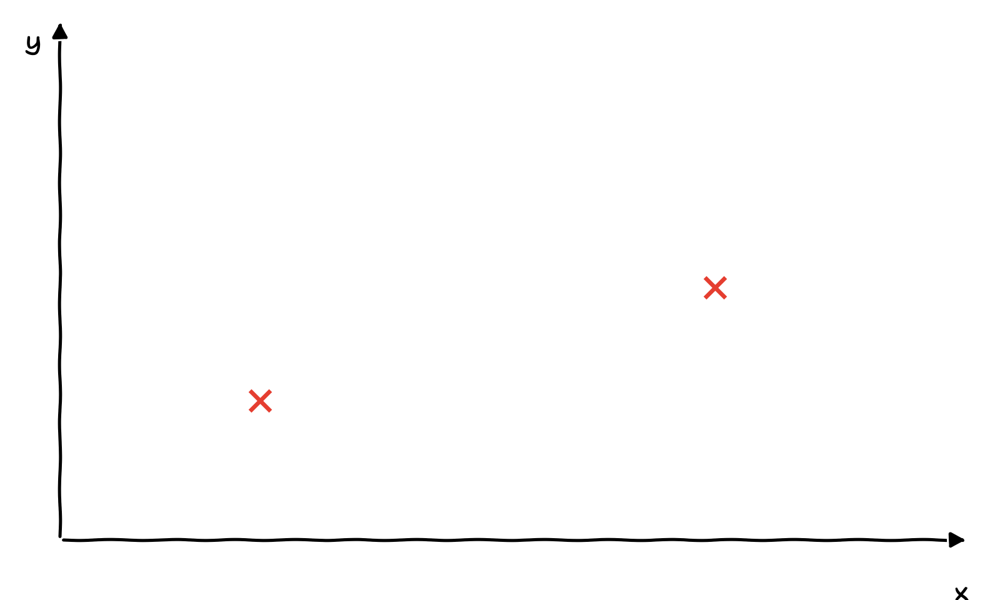

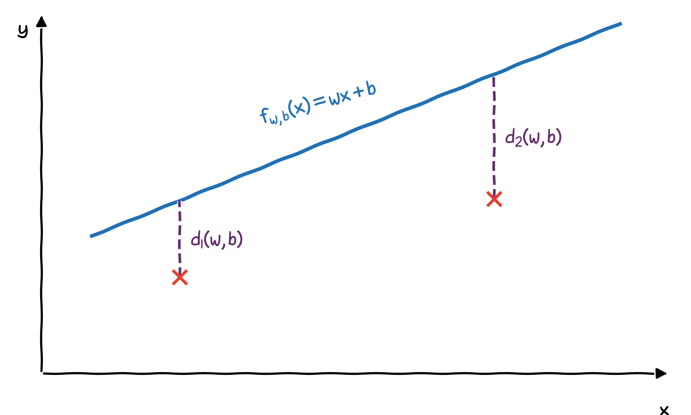

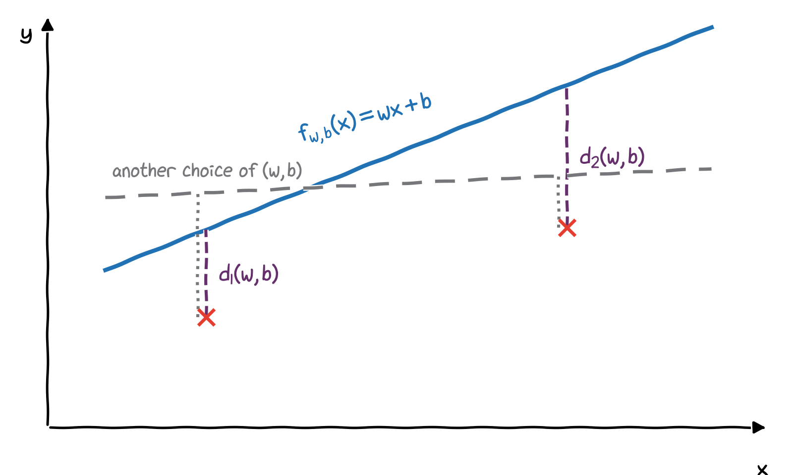
:::
:::
::: {.column width="45%"}
. . .

For a candidate line, the **vertical distance** between data point $i$ and the line is
$$
d_i(w,b) = \big|f_{w,b}(x^{(i)}) - y^{(i)}\big| .
$$

- A different choice of $(w,b)$ gives different distances.
- A good fit has small distances:
$$
\min_{w,b}\ \big[d_1(w,b) + d_2(w,b)\big]
$$
- We use *vertical* distances because the error we care about is the error in the prediction of $y$.
:::
::::

## Many data points

:::: {.columns}
::: {.column width="55%"}
::: build
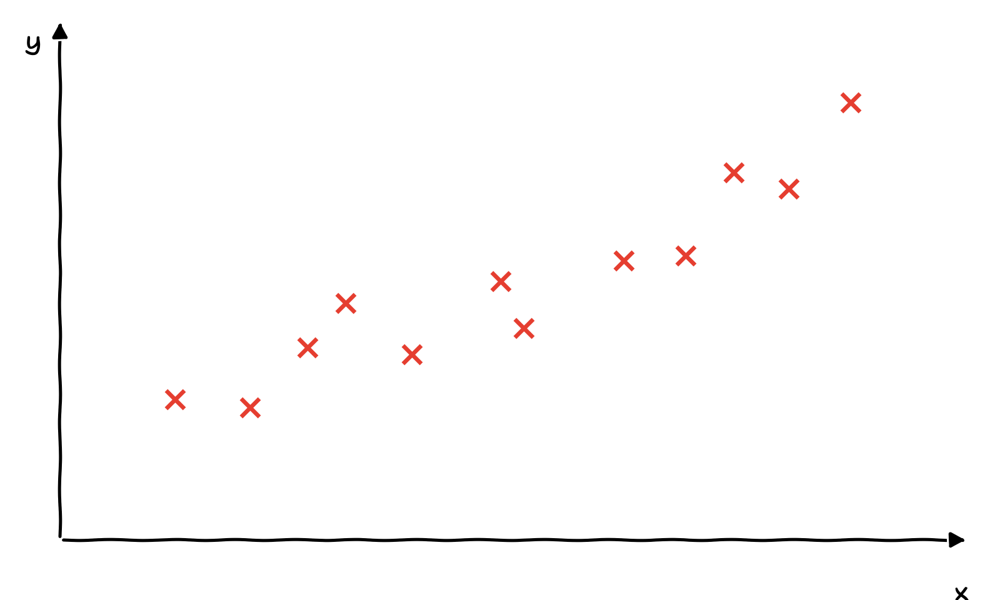

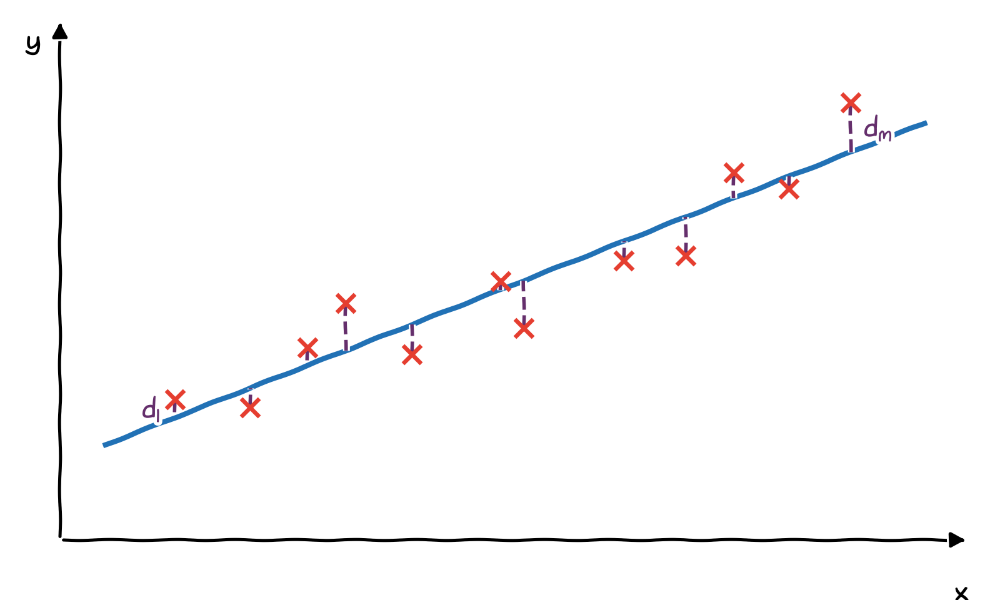
:::
:::
::: {.column width="45%"}
. . .

With $m$ data points there are $m$ distances $d_1, \dots, d_m$. Minimise their **average**:
$$
\min_{w,b}\ \frac{1}{m}\sum_{i=1}^{m} d_i(w,b)
$$

- Dividing by $m$ does not change the best $(w,b)$.
- But the cost no longer grows with the size of the data set, so costs on data sets of different sizes can be compared.
:::
::::

## Absolute or squared distances?

Three points $(1,3)$, $(2,4)$, $(3,5)$, which lie exactly on the line $y = x + 2$:

$$
\begin{aligned}
G(w,b) &= \tfrac{1}{3}\Big(|w + b - 3| + |2w + b - 4| + |3w + b - 5|\Big) && \text{(absolute)}\\
Q(w,b) &= \tfrac{1}{3}\Big((w + b - 3)^2 + (2w + b - 4)^2 + (3w + b - 5)^2\Big) && \text{(squared)}
\end{aligned}
$$

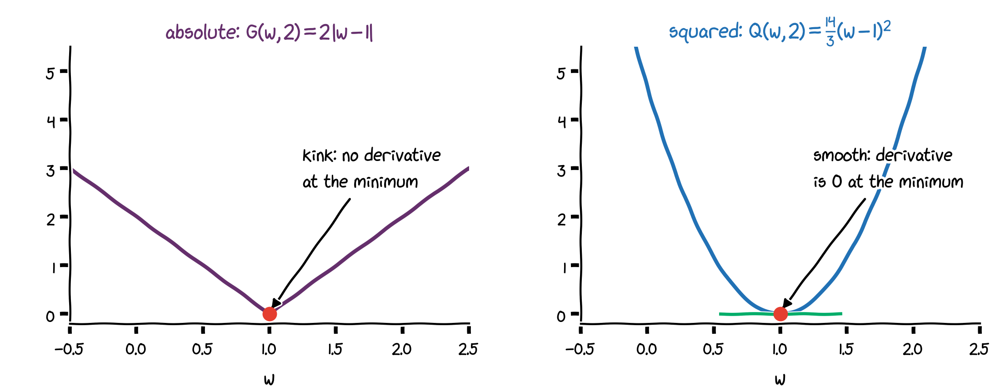{width="46%" fig-align="center"}

. . .

- $G$ is **piecewise linear**, with kinks where it is not differentiable, including at the minimum. Minimising it means checking one region after another.
- $Q$ is a smooth **quadratic**: differentiable everywhere, with derivative $0$ at the minimum.

## The squared-error cost function

For example $i$ the model predicts $\hat y^{(i)} = f_{w,b}(x^{(i)}) = w\,x^{(i)} + b$. The **cost function** is

$$
J(w,b) = \frac{1}{2m}\sum_{i=1}^{m}\big(\hat y^{(i)} - y^{(i)}\big)^2
       = \frac{1}{2m}\sum_{i=1}^{m}\big(w\,x^{(i)} + b - y^{(i)}\big)^2 .
$$

. . .

- $\big(\hat y^{(i)} - y^{(i)}\big)^2$ is the **squared error** of example $i$; squaring also penalises large errors more than small ones.
- $\frac{1}{m}\sum_{i}$ averages over all examples: the **mean squared error** (MSE).
- The extra factor $\frac12$ is for convenience only: it cancels the $2$ that appears when we differentiate the square. Multiplying $J$ by a positive constant does not move its minimum.

. . .

::: {.callout-tip title="Goal"}
Find $w, b$ such that $\hat y^{(i)}$ is close to $y^{(i)}$ for all training examples: $\quad\displaystyle \min_{w,b}\ J(w,b)$.
:::

## Building intuition: fix $b = 0$

:::: {.columns}
::: {.column width="50%"}
**General case**

- Model: $f_{w,b}(x) = wx + b$
- Parameters: $w$, $b$
- Cost:
$$J(w,b) = \frac{1}{2m}\sum_{i=1}^{m}\big(f_{w,b}(x^{(i)}) - y^{(i)}\big)^2$$
- Goal: $\displaystyle\min_{w,b} J(w,b)$
:::
::: {.column width="50%"}
**Simplified case, $b = 0$**

- Model: $f_w(x) = wx$ (lines through the origin)
- Parameter: $w$
- Cost:
$$J(w) = \frac{1}{2m}\sum_{i=1}^{m}\big(w\,x^{(i)} - y^{(i)}\big)^2$$
- Goal: $\displaystyle\min_{w} J(w)$
:::
::::

. . .

Toy data set with $m = 3$: $\ (x^{(i)}, y^{(i)}) = (1, 1),\ (2, 2),\ (3, 3)$.

## $J(w)$ for the toy data, one $w$ at a time

::: build
::: {}
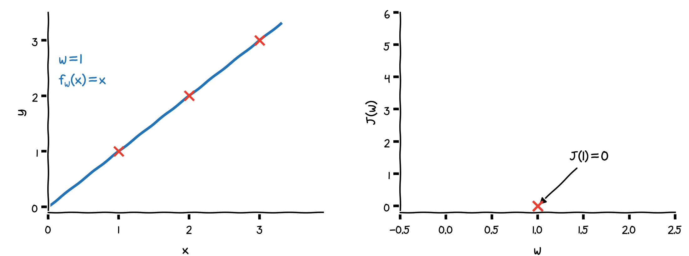{width="72%" fig-align="center"}

$$
w = 1:\quad J(1) = \frac{1}{2\cdot 3}\big[(1-1)^2 + (2-2)^2 + (3-3)^2\big] = 0
$$
:::
::: {}
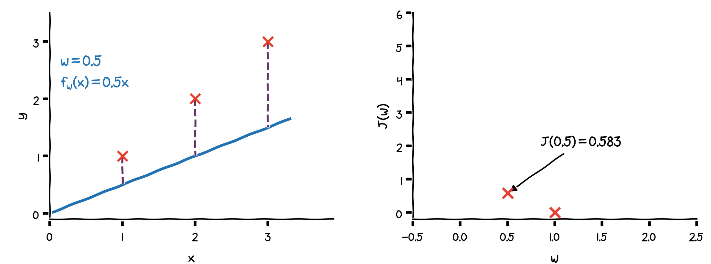{width="72%" fig-align="center"}

$$
w = 0.5:\quad J(0.5) = \frac{1}{6}\big[(0.5-1)^2 + (1-2)^2 + (1.5-3)^2\big] = \frac{3.5}{6} = \frac{7}{12} \approx 0.583
$$
:::
::: {}
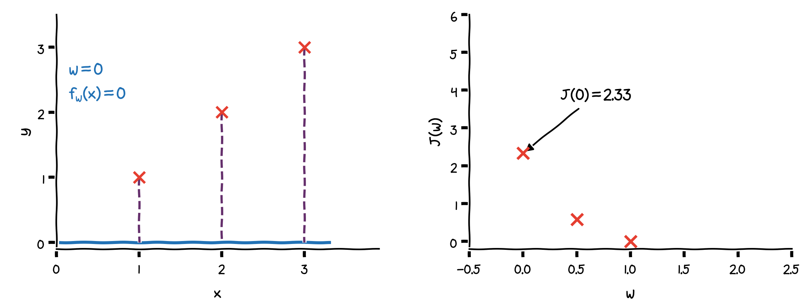{width="72%" fig-align="center"}

$$
w = 0:\quad J(0) = \frac{1}{6}\big[(0-1)^2 + (0-2)^2 + (0-3)^2\big] = \frac{14}{6} = \frac{7}{3} \approx 2.333
$$
:::
::: {}
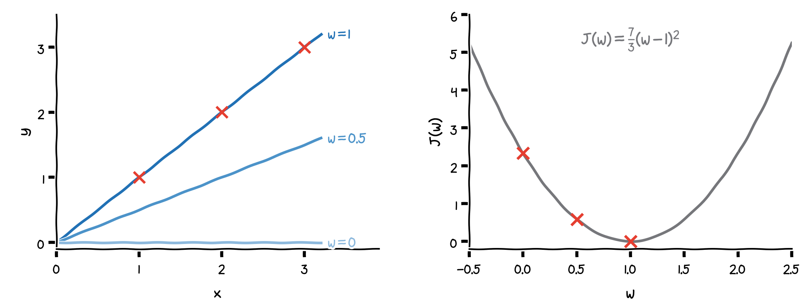{width="72%" fig-align="center"}

$$
\text{any } w:\quad J(w) = \frac{1}{6}\big[(w-1)^2 + (2w-2)^2 + (3w-3)^2\big] = \frac{1+4+9}{6}(w-1)^2 = \frac{7}{3}(w-1)^2
$$
:::
:::

## Surface plots and contour plots

$f(x_1, x_2) = x_1^2 + x_2^2$

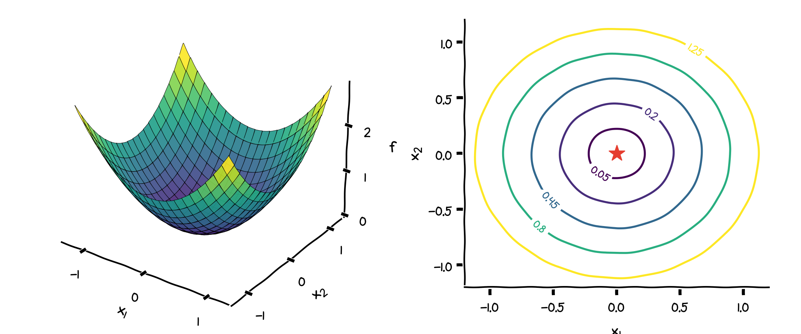{width="70%" fig-align="center"}

- Left: the graph of $f$ is a **bowl**. Right: **contour lines** (level curves) join the points where $f$ has the same value, like height lines on a hiking map.

## The full cost $J(w,b)$ for the toy data

$$
J(w,b) = \frac{1}{6}\Big[(w + b - 1)^2 + (2w + b - 2)^2 + (3w + b - 3)^2\Big]
       = \frac{7}{3}(w-1)^2 + 2\,(w-1)\,b + \frac{1}{2}\,b^2
$$

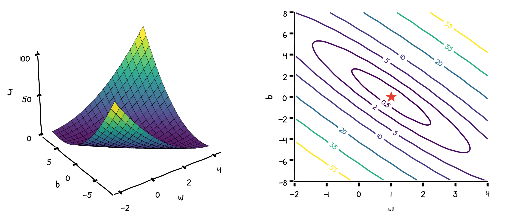{width="66%" fig-align="center"}

- Again a bowl, with its minimum $J = 0$ at $(w, b) = (1, 0)$, i.e. the line $\hat y = x$.
- The contour ellipses are tilted because of the mixed term $2(w-1)b$: $w$ and $b$ are coupled.

## $J(w,b)$ is always a quadratic bowl

Expanding the square for **any** data set gives

$$
J(w,b) = \frac{1}{2m}\sum_{i=1}^{m}\big(x^{(i)}w + b - y^{(i)}\big)^2
       = \frac12\,\overline{x^2}\,w^2 + \bar x\,wb + \frac12\,b^2 - \overline{xy}\,w - \bar y\,b + \frac12\,\overline{y^2},
$$

where a bar denotes an average over the training set, e.g. $\bar x = \frac1m\sum_i x^{(i)}$, $\ \overline{xy} = \frac1m\sum_i x^{(i)}y^{(i)}$.

. . .

- However complicated the data are, $J$ contains only the terms $w^2$, $wb$, $b^2$, $w$, $b$ and a constant: it is a **quadratic function** of $(w,b)$.
- It is a **convex bowl** with exactly one minimum, as long as the $x^{(i)}$ are not all equal.^[The quadratic part is $\frac12\big(\overline{x^2}\,w^2 + 2\bar x\,wb + b^2\big) = \frac12\big(\overline{(xw + b)^2}\big) \ge 0$, and it is zero only if $x^{(i)}w + b = 0$ for all $i$, which forces $w = b = 0$ unless all $x^{(i)}$ are equal.]
- Check: for the toy data $\overline{x^2} = \overline{xy} = \overline{y^2} = \frac{14}{3}$ and $\bar x = \bar y = 2$, which reproduces the previous slide.

# Minimising the cost

## Stationary points

To minimise a differentiable function $f(x_1, \dots, x_n)$, look for points where the **gradient** vanishes:

$$
\nabla f(\mathbf x) = \mathbf 0
\quad\Longleftrightarrow\quad
\frac{\partial f}{\partial x_1}(\mathbf x) = 0,\ \ \dots,\ \ \frac{\partial f}{\partial x_n}(\mathbf x) = 0 .
$$

A solution $\mathbf x^* = (x_1^*, \dots, x_n^*)$ is called a **stationary point**.

. . .

- At a minimum the gradient is zero: $\nabla f = \mathbf 0$ is **necessary**.
- It is **not sufficient**: a stationary point can also be a maximum or a saddle point.
- For a **convex** function, such as our bowl-shaped $J$, every stationary point is a global minimum.

## Stationary points: 1D example

:::: {.columns}
::: {.column width="58%"}
::: build
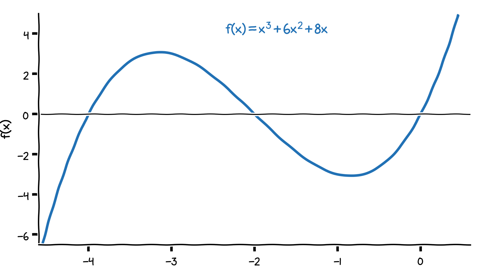

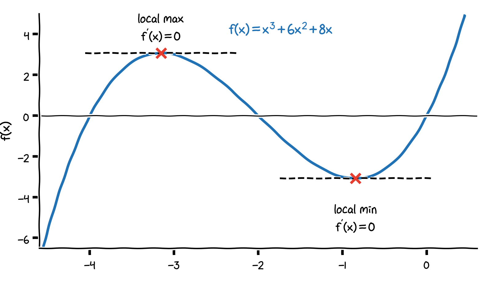
:::
:::
::: {.column width="42%"}
$$
f(x) = x^3 + 6x^2 + 8x
$$

. . .

$$
f'(x) = 3x^2 + 12x + 8 = 0
$$
$$
\Rightarrow\ x = -2 \pm \tfrac{2}{\sqrt 3}
$$

- $x_{\max} \approx -3.15$ is a **local maximum**, $x_{\min} \approx -0.85$ a **local minimum**.
- Both are only *local*: $f(x) \to -\infty$ as $x \to -\infty$, so $f$ has no global minimum.
:::
::::

## Stationary points: 2D example

:::: {.columns}
::: {.column width="50%"}
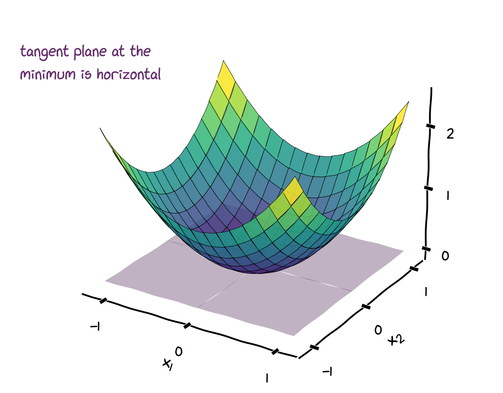
:::
::: {.column width="50%"}
$$
f(x_1, x_2) = x_1^2 + x_2^2
$$

$$
\nabla f(x_1, x_2) = \begin{pmatrix} 2x_1 \\ 2x_2 \end{pmatrix} = \mathbf 0
\ \Rightarrow\ (x_1^*, x_2^*) = (0, 0)
$$

At the minimum the tangent plane to the surface is horizontal: the surface is "flat" in every direction.
:::
::::

## Back to the toy example

$$
J(w,b) = \frac{7}{3}(w-1)^2 + 2(w-1)b + \frac{1}{2}b^2
$$

. . .

$$
\left\{\begin{aligned}
\frac{\partial J}{\partial w} &= \frac{14}{3}(w-1) + 2b = 0\\[2pt]
\frac{\partial J}{\partial b} &= 2(w-1) + b = 0
\end{aligned}\right.
\quad\Longrightarrow\quad
\left\{\begin{aligned} w &= 1\\ b &= 0 \end{aligned}\right.
$$

(From the second equation $b = -2(w-1)$; substituting gives $\frac23(w-1) = 0$.)

. . .

The fitted line is $\hat y = x$, which passes through all three data points, so $J(1, 0) = 0$.

## A closed-form solution, so why gradient descent?

For univariate linear regression, $\nabla J = \mathbf 0$ can be solved by hand:

$$
w^* = \frac{\overline{xy} - \bar x\,\bar y}{\overline{x^2} - \bar x^2},
\qquad
b^* = \bar y - w^*\,\bar x .
$$

For the diabetes data this gives $w^* = 10.23$ and $b^* = -117.77$.

. . .

However:

- With many features we must solve a linear system (the **normal equation**, part 2b), which becomes expensive when there are many features.
- For almost every other model (logistic regression, neural networks), $\nabla J = \mathbf 0$ has **no closed-form solution** at all.

. . .

We need a general, **iterative** method that only uses the gradient: **gradient descent**.

# Gradient descent

## The idea

:::: {.columns}
::: {.column width="55%"}
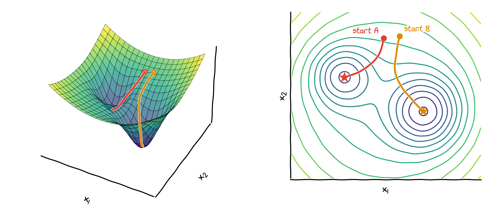
:::
::: {.column width="45%"}
**Problem**: minimise $f(\mathbf x) = f(x_1, \dots, x_n)$.

**Idea**

1. Start from an initial guess $\mathbf x^{[0]}$.
2. Take a small step **downhill**, so that $f$ decreases.
3. Repeat until we (almost) stop moving: we are at or near a minimum.

. . .

Different starting points can end in different **local** minima. This cannot happen for linear regression: $J$ is a bowl with a single minimum.
:::
::::

## Which way is downhill?

:::: {.columns}
::: {.column width="45%"}
::: build
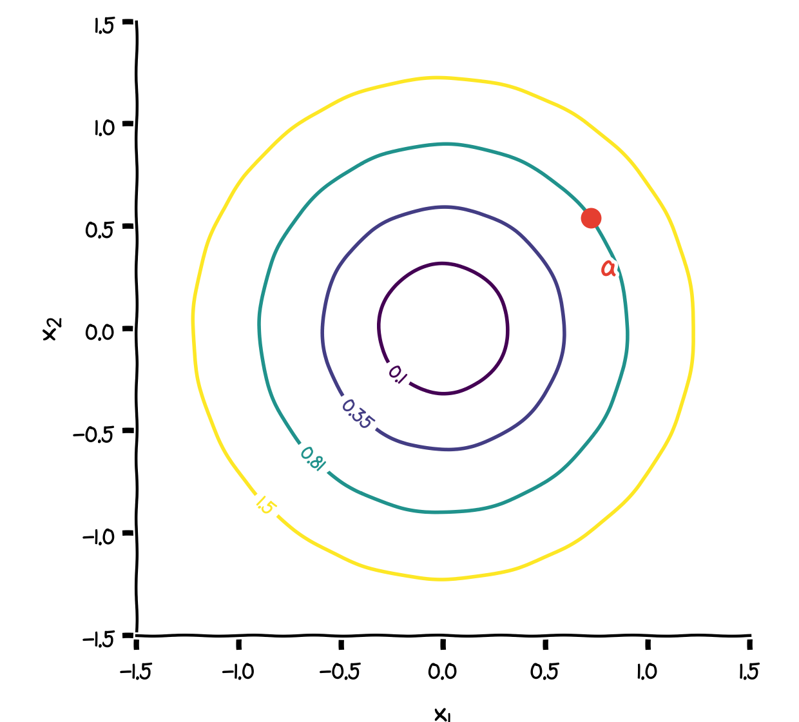

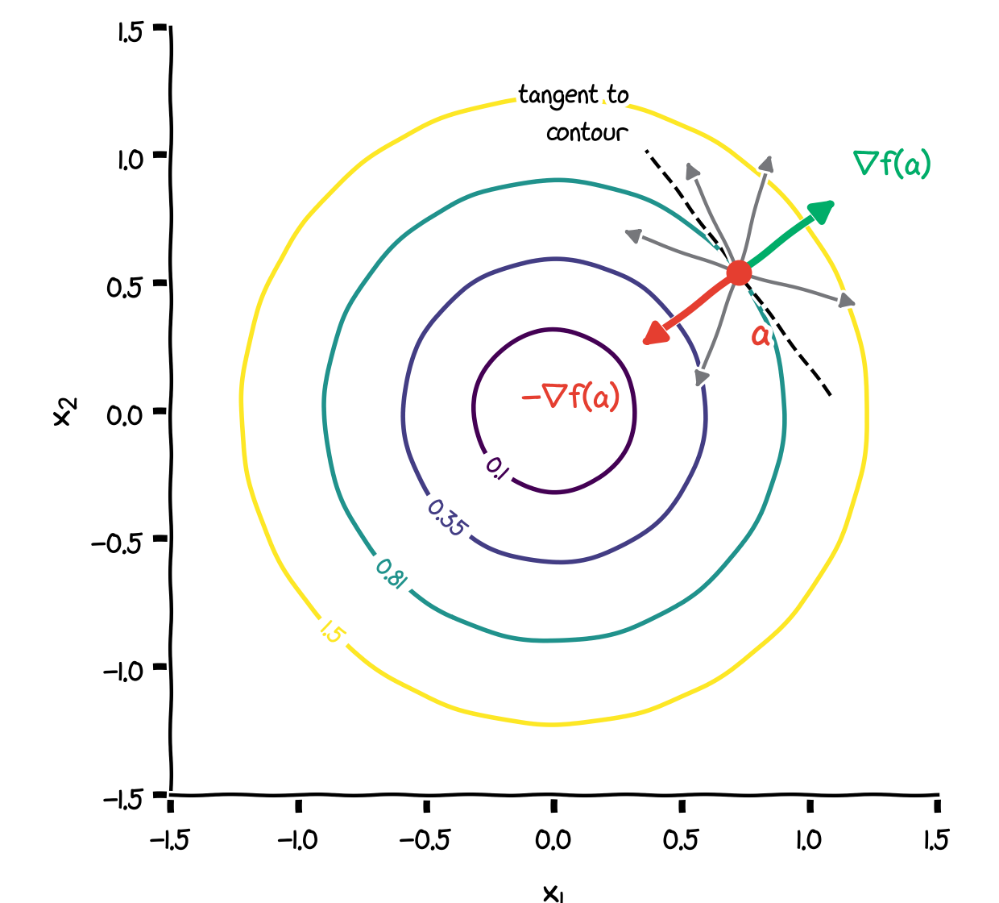
:::
:::
::: {.column width="55%"}
Standing at a point $\mathbf a$, in which unit direction $\mathbf n$ ($\|\mathbf n\| = 1$) does $f$ change fastest?

. . .

The rate of change of $f$ in direction $\mathbf n$ is the **directional derivative**
$$
D_{\mathbf n} f(\mathbf a) = \nabla f(\mathbf a)\cdot\mathbf n = \|\nabla f(\mathbf a)\|\cos\theta ,
$$
where $\theta$ is the angle between $\mathbf n$ and $\nabla f(\mathbf a)$.

- Largest for $\theta = 0$: $f$ **increases** fastest along $\nabla f(\mathbf a)$.
- Most negative for $\theta = \pi$: $f$ **decreases** fastest along $-\nabla f(\mathbf a)$.
- Zero for $\theta = \pi/2$: along the contour line, so $\nabla f(\mathbf a)$ is perpendicular to the contour through $\mathbf a$.
:::
::::

## The gradient descent algorithm

Start from $\mathbf x^{[0]}$ and repeat until convergence:

$$
\mathbf x^{[t+1]} = \mathbf x^{[t]} - {\color{red}{\alpha}}\,{\color{blue}{\nabla f\big(\mathbf x^{[t]}\big)}},
\qquad t = 0, 1, 2, \dots
$$

or, component by component,

$$
x_j^{[t+1]} = x_j^{[t]} - {\color{red}{\alpha}}\,{\color{blue}{\frac{\partial f}{\partial x_j}\big(\mathbf x^{[t]}\big)}},
\qquad j = 1, \dots, n .
$$

. . .

- ${\color{red}{\alpha > 0}}$ is the **learning rate** (step size). It is usually kept fixed, but may also change with $t$ (a *learning-rate schedule* $\alpha^{[t]}$).
- ${\color{blue}{\partial f/\partial x_j}}$ are the partial derivatives, i.e. the components of the gradient.
- "Until convergence" in practice: stop when $\|\nabla f(\mathbf x^{[t]})\|$ is tiny, when $f$ hardly decreases any more, or after a maximum number of iterations.

## Why the minus sign?

:::: {.columns}
::: {.column width="50%"}
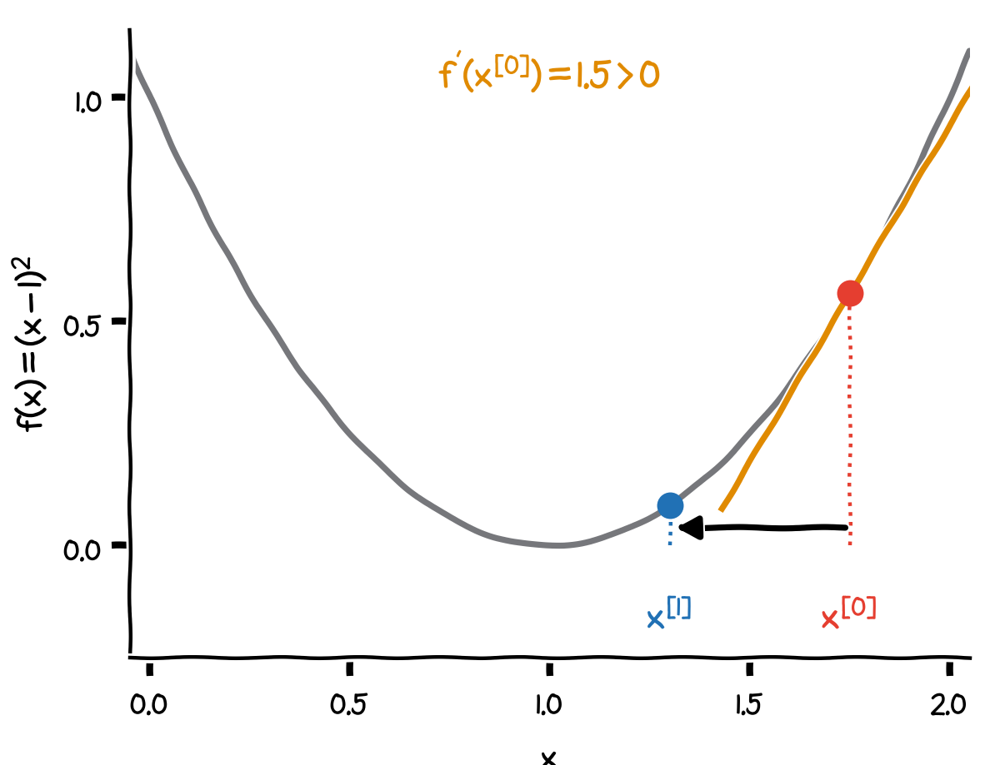{width="60%" fig-align="center"}

If $f'(x^{[0]}) > 0$, $f$ increases to the right, so we move **left**:
$$
x^{[1]} = x^{[0]} - \underbrace{\alpha}_{>0}\,\underbrace{f'(x^{[0]})}_{>0} < x^{[0]}
$$
:::
::: {.column width="50%"}
. . .

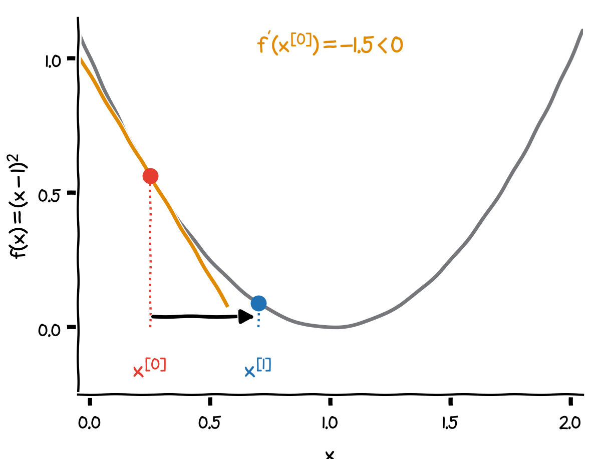{width="60%" fig-align="center"}

If $f'(x^{[0]}) < 0$, $f$ decreases to the right, so we move **right**:
$$
x^{[1]} = x^{[0]} - \underbrace{\alpha}_{>0}\,\underbrace{f'(x^{[0]})}_{<0} > x^{[0]}
$$
:::
::::

. . .

In both cases we move **downhill**. With a plus sign we would climb uphill instead: that is **gradient ascent**, used for *maximisation* problems.

## Update all variables simultaneously

:::: {.columns}
::: {.column width="50%"}
**Correct**: all partial derivatives are evaluated at the *old* point $\mathbf x^{[t]}$

$$
\begin{aligned}
x_1^{[t+1]} &= x_1^{[t]} - \alpha\,\tfrac{\partial f}{\partial x_1}\big(x_1^{[t]}, x_2^{[t]}\big)\\
x_2^{[t+1]} &= x_2^{[t]} - \alpha\,\tfrac{\partial f}{\partial x_2}\big(x_1^{[t]}, x_2^{[t]}\big)
\end{aligned}
$$

```python
df_dx1 = compute_df_dx1(x1, x2)
df_dx2 = compute_df_dx2(x1, x2)
x1 = x1 - alpha * df_dx1
x2 = x2 - alpha * df_dx2
```
:::
::: {.column width="50%"}
**Incorrect**: $x_1$ is updated before $\partial f/\partial x_2$ is computed

$$
\begin{aligned}
x_1^{[t+1]} &= x_1^{[t]} - \alpha\,\tfrac{\partial f}{\partial x_1}\big(x_1^{[t]}, x_2^{[t]}\big)\\
x_2^{[t+1]} &= x_2^{[t]} - \alpha\,\tfrac{\partial f}{\partial x_2}\big({\color{red}{x_1^{[t+1]}}}, x_2^{[t]}\big)
\end{aligned}
$$

```python
df_dx1 = compute_df_dx1(x1, x2)
x1 = x1 - alpha * df_dx1
df_dx2 = compute_df_dx2(x1, x2)  # uses NEW x1!
x2 = x2 - alpha * df_dx2
```
:::
::::

With NumPy arrays the update `x = x - alpha * grad_f(x)` is automatically simultaneous.

## Gradient of the squared-error cost

$$
J(w,b) = \frac{1}{2m}\sum_{i=1}^{m}\big(f_{w,b}(x^{(i)}) - y^{(i)}\big)^2,
\qquad f_{w,b}(x) = wx + b
$$

By the chain rule, with $\partial f_{w,b}/\partial w = x$ and $\partial f_{w,b}/\partial b = 1$:

$$
\begin{aligned}
\frac{\partial J}{\partial w} &= \frac{1}{2m}\sum_{i=1}^{m} 2\big(f_{w,b}(x^{(i)}) - y^{(i)}\big)\,x^{(i)}
  = \frac{1}{m}\sum_{i=1}^{m}\big(f_{w,b}(x^{(i)}) - y^{(i)}\big)\,x^{(i)}\\[4pt]
\frac{\partial J}{\partial b} &= \frac{1}{m}\sum_{i=1}^{m}\big(f_{w,b}(x^{(i)}) - y^{(i)}\big)
\end{aligned}
$$

. . .

- The $\frac12$ in $J$ cancels the $2$ from differentiating the square.
- Each term is (prediction error) $\times$ (derivative of the model with respect to the parameter).
- Check with the toy data: $\frac{\partial J}{\partial w} = \frac{14}{3}(w-1) + 2b$ and $\frac{\partial J}{\partial b} = 2(w-1) + b$, as before.

## Batch gradient descent for linear regression

:::: {.columns}
::: {.column width="44%"}
Repeat until convergence, updating $w$ and $b$ **simultaneously**:

$$
\begin{aligned}
w &\leftarrow w - \alpha\,\frac{1}{m}\sum_{i=1}^{m}\big(w x^{(i)} + b - y^{(i)}\big)\,x^{(i)}\\
b &\leftarrow b - \alpha\,\frac{1}{m}\sum_{i=1}^{m}\big(w x^{(i)} + b - y^{(i)}\big)
\end{aligned}
$$

On the toy data, $\alpha = 0.3$ and 150 iterations from $(w,b) = (-1.5, 6)$ give $(0.989, 0.024)$; the exact answer is $(1, 0)$.
:::
::: {.column width="56%"}
```python
import numpy as np

def gradient_descent(x, y, w=0.0, b=0.0,
                     alpha=0.01, n_iters=1000):
    """Batch gradient descent for f(x) = w*x + b.
    x, y: 1D NumPy arrays of length m."""
    m = len(x)
    for _ in range(n_iters):
        err = w * x + b - y   # errors, shape (m,)
        dJ_dw = np.sum(err * x) / m
        dJ_db = np.sum(err) / m
        # simultaneous update
        w, b = w - alpha * dJ_dw, b - alpha * dJ_db
    return w, b
```
:::
::::

## Gradient descent in action

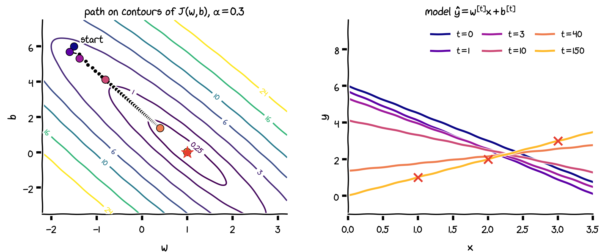{width="78%" fig-align="center"}

- Left: the path $(w^{[t]}, b^{[t]})$ on the contours of $J$. Each step is perpendicular to the contour it starts from; the path quickly reaches the long, narrow valley and then slowly moves along it to the minimum $\star$ at $(1, 0)$.
- Right: the corresponding lines $\hat y = w^{[t]}x + b^{[t]}$ approach the data.

# The learning rate

## Small learning rates: slow convergence

Test problem: $f(x) = (x-1)^2$, minimum at $x^* = 1$, start at $x^{[0]} = 0.1$, 15 iterations of
$\ x^{[t+1]} = x^{[t]} - \alpha\, f'(x^{[t]}) = x^{[t]} - 2\alpha\,(x^{[t]} - 1)$.

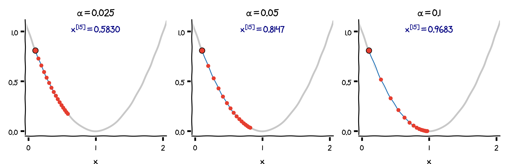{width="90%" fig-align="center"}

If $\alpha$ is **too small**, gradient descent takes tiny steps and converges **slowly**.

## Larger learning rates: overshooting

Same problem, larger $\alpha$:

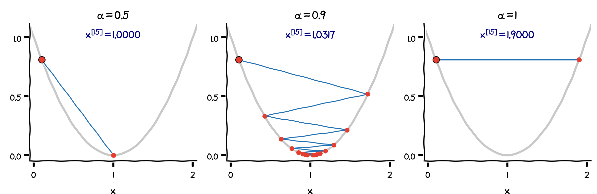{width="86%" fig-align="center"}

- $\alpha = 0.5$: the minimum is reached in a single step.
- $\alpha = 0.9$: each step **overshoots** the minimum; the iterates oscillate around $x^* = 1$ but still converge.
- $\alpha = 1$: the iterates bounce between $0.1$ and $1.9$ forever and **never converge**.

## Too large: divergence

Start very close to the minimum, $x^{[0]} = 0.95$, but use $\alpha = 1.1$:

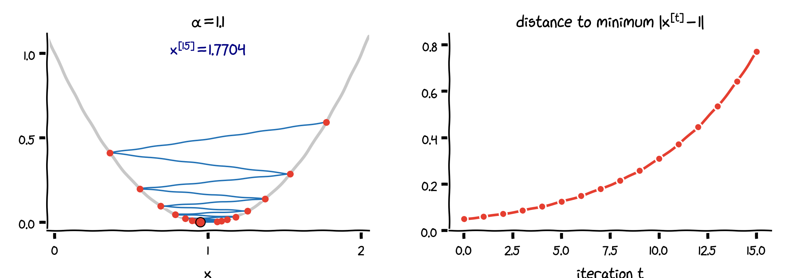{width="70%" fig-align="center"}

If $\alpha$ is **too large**, gradient descent may

- overshoot and never reach the minimum,
- oscillate without converging, or even
- **diverge**: here the distance to the minimum grows by a factor $1.2$ at every step.

## Why? An exact analysis

For $f(x) = (x-1)^2$ the update can be solved exactly:
$$
x^{[t+1]} - 1 = (1 - 2\alpha)\big(x^{[t]} - 1\big)
\quad\Longrightarrow\quad
x^{[t]} - 1 = (1 - 2\alpha)^t\,\big(x^{[0]} - 1\big).
$$

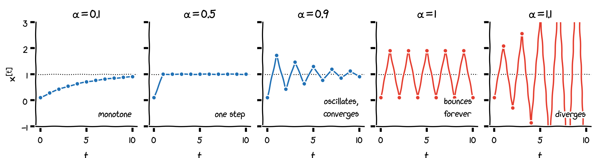{width="72%" fig-align="center"}

. . .

- Gradient descent converges if and only if $|1 - 2\alpha| < 1$, i.e. $0 < \alpha < 1$; for $\alpha < 0.5$ monotonically, for $0.5 < \alpha < 1$ with oscillations.
- More generally, for a quadratic with curvature $f'' = \kappa$ (here $\kappa = 2$), gradient descent converges if and only if $0 < \alpha < 2/\kappa$: **the steeper the bowl, the smaller $\alpha$ must be.**

## Batch, mini-batch and stochastic gradient descent

**Batch** gradient descent: every step uses **all** $m$ training examples,
$$
\frac{\partial J}{\partial w} = \frac{1}{m}\sum_{i=1}^{m}\big(f_{w,b}(x^{(i)}) - y^{(i)}\big)\,x^{(i)} .
$$

. . .

**Mini-batch** gradient descent: every step uses a random subset $B \subset \{1, \dots, m\}$ of the examples, with $|B| \ll m$ (e.g. 32 to 512), to **approximate** the gradient,
$$
\frac{\partial J}{\partial w} \approx \frac{1}{|B|}\sum_{i \in B}\big(f_{w,b}(x^{(i)}) - y^{(i)}\big)\,x^{(i)} .
$$

**Stochastic** gradient descent (SGD): $|B| = 1$, one example per step.

. . .

Smaller batches give cheaper but noisier steps. They are essential for very large data sets and for training neural networks later in the course.

## Summary of part 2a

- **Model**: $f_{w,b}(x) = wx + b$, with slope $w$ and intercept $b$.
- **Cost**: $J(w,b) = \frac{1}{2m}\sum_{i=1}^{m}\big(f_{w,b}(x^{(i)}) - y^{(i)}\big)^2$, a convex quadratic bowl.
- **Minimum**: where $\nabla J = \mathbf 0$. Linear regression has a closed-form solution, most models do not.
- **Gradient descent**: $\mathbf x \leftarrow \mathbf x - \alpha\,\nabla f(\mathbf x)$, updating all components simultaneously.
- **Gradient of the cost**: $\frac{\partial J}{\partial w} = \frac1m\sum_i\big(f_{w,b}(x^{(i)}) - y^{(i)}\big)x^{(i)}$, $\ \frac{\partial J}{\partial b} = \frac1m\sum_i\big(f_{w,b}(x^{(i)}) - y^{(i)}\big)$.
- **Learning rate**: too small gives slow convergence; too large gives oscillation or divergence.

. . .

**Next, part 2b**: several features, vectorisation, the normal equation, and feature scaling. (On the raw diabetes data, gradient descent needs about $100\,000$ iterations to converge; feature scaling fixes this.)

## Check your understanding: part 2a

1. Why is $J(w,b) \ge 0$ for every $(w,b)$? When is $J(w,b) = 0$?
2. During gradient descent, $J$ **increases** from one iteration to the next. What is the most likely cause, and what do you change?
3. For $f(x) = (x-1)^2$, for which learning rates does gradient descent converge?
4. Suppose we force $w = 0$. What does the model predict, and which $b$ minimises $J$?

::: notes
1. $J$ is an average of squares, so $J \ge 0$. $J = 0$ exactly when every data point lies on the line, $w x^{(i)} + b = y^{(i)}$ for all $i$.
2. Most likely the learning rate is too large (overshooting or divergence): decrease $\alpha$. Otherwise check the sign of the update and the gradient code.
3. Exactly for $0 < \alpha < 1$.
4. The model predicts the constant $b$ for every input. $\partial J/\partial b = \frac1m\sum_i (b - y^{(i)}) = 0$ gives $b = \bar y$, the mean of the targets.
:::

# Part 2b: linear regression with many features {.part-slide}

::: {.content-visible when-format="revealjs"}
Multiple features, vectorisation, gradient descent for $n$ features, the normal equation, feature scaling, learning curves, feature engineering, evaluation, scikit-learn
:::

## Where we are

In part 2a we built the whole machinery for **one** feature:

- model $f_{w,b}(x) = wx + b$, cost $J(w,b) = \frac{1}{2m}\sum_i\big(f_{w,b}(x^{(i)}) - y^{(i)}\big)^2$;
- gradient descent $w \leftarrow w - \alpha\,\partial J/\partial w$, $\ b \leftarrow b - \alpha\,\partial J/\partial b$, with a well-chosen learning rate.

. . .

Part 2b keeps all of these ideas and changes only what is needed for **many** features:

- the model becomes $f_{\mathbf w,b}(\mathbf x) = \mathbf w\cdot\mathbf x + b$, written with vectors and matrices;
- the code becomes **vectorised** (no loops over features or examples);
- features with very different ranges must be **scaled**, otherwise gradient descent crawls. With raw BMI alone it needed about $100{,}000$ iterations;
- we learn to **check** gradient descent, to **create** better features, and to **evaluate** the model.

# Multiple features

## From one feature to many

:::: {.columns}
::: {.column width="52%"}
Diabetes data, now with several features per patient:

| $i$ | age $x_1$ | sex $x_2$ | BMI $x_3$ | BP $x_4$ | $y$ |
|:---:|:---:|:---:|:---:|:---:|:---:|
| 1 | 59 | 2 | 32.1 | 101 | 151 |
| 2 | 48 | 1 | 21.6 | 87 | 75 |
| 3 | 72 | 2 | 30.5 | 93 | 141 |
| 4 | 24 | 1 | 25.3 | 84 | 206 |
| $\vdots$ | $\vdots$ | $\vdots$ | $\vdots$ | $\vdots$ | $\vdots$ |

BP is the average blood pressure; $y$ is again disease progression after one year.
:::
::: {.column width="48%"}
**Notation**

- $m$: number of training examples (rows)
- $n$: number of features (columns), here $n = 4$
- $x_j$: the $j$-th feature
- $\mathbf x^{(i)}$: all features of the $i$-th example
- $x_j^{(i)}$: value of feature $j$ in example $i$

. . .

**Convention**: superscript $^{(i)}$ = row (example), subscript $_j$ = column (feature).
:::
::::

## Reading the notation

The second patient:

$$
\mathbf x^{(2)} = \big(\,\underbrace{48}_{x_1^{(2)}},\ \underbrace{1}_{x_2^{(2)}},\ \underbrace{21.6}_{x_3^{(2)}},\ \underbrace{87}_{x_4^{(2)}}\,\big),
\qquad x_3^{(2)} = 21.6 .
$$

. . .

**Your turn** (use the table on the previous slide):

$$
x_4^{(3)} = \ ?\qquad x_3^{(1)} = \ ?\qquad x_2^{(4)} = \ ?
$$

. . .

Answers: $x_4^{(3)} = 93$, $\ x_3^{(1)} = 32.1$, $\ x_2^{(4)} = 1$.

## The model with $n$ features

Previously $f_{w,b}(x) = wx + b$. Now:

::: {.callout-note title="Linear regression with $n$ features"}
$$
f_{\mathbf w,b}(\mathbf x) = w_1x_1 + w_2x_2 + \dots + w_nx_n + b = \sum_{j=1}^{n} w_jx_j + b = \mathbf w\cdot\mathbf x + b
$$
:::

- $\mathbf w = (w_1, \dots, w_n)$: the **weights**, one per feature.
- $b$: the **bias** (intercept), a single number: the prediction when all features are $0$.
- $\mathbf x = (x_1, \dots, x_n)$: the **feature vector**.
- $\mathbf w\cdot\mathbf x = \sum_j w_jx_j$ is the dot product.

. . .

**Interpretation**: $w_j$ is the change in the prediction when $x_j$ increases by one unit **while all other features stay fixed**.

## Two features: the model is a plane

:::: {.columns}
::: {.column width="52%"}
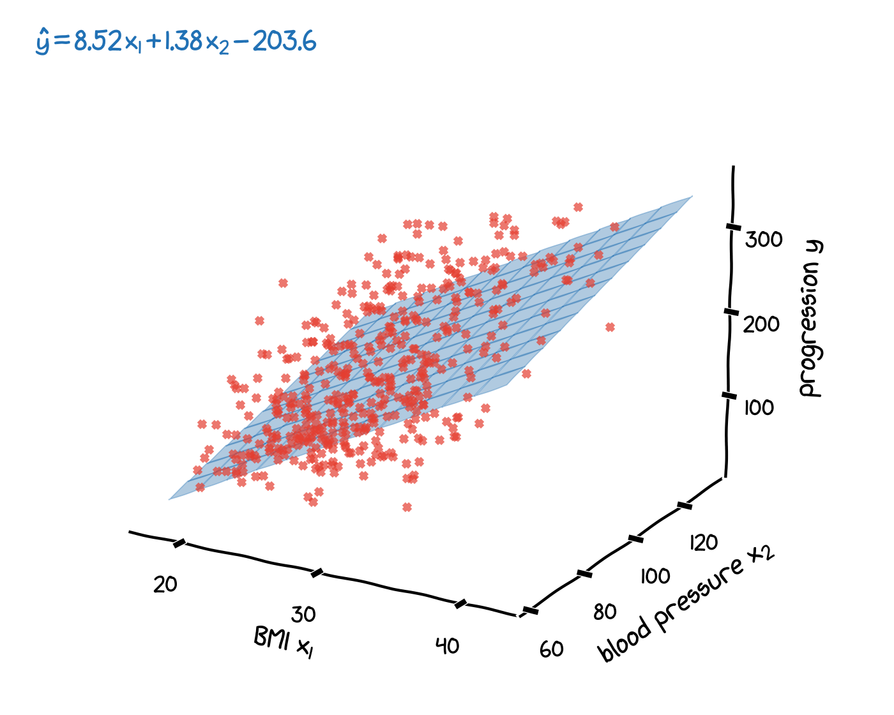
:::
::: {.column width="48%"}
Fitting BMI $x_1$ and blood pressure $x_2$ together gives
$$
\hat y = 8.52\,x_1 + 1.38\,x_2 - 203.6 .
$$

- One more unit of BMI, at the **same** blood pressure: about $8.5$ points more progression.
- With BMI alone (part 2a) the slope was $10.23$. Patients with a high BMI also tend to have a high blood pressure, so part of that effect is now explained by $x_2$.
- With $n$ features the model is a (hyper)plane in $n+1$ dimensions; we can no longer draw it, but the algebra is the same.
:::
::::

# Vectorisation

## Three ways to compute $f_{\mathbf w,b}(\mathbf x)$

Maths counts from $1$, Python from $0$: $w_1$ is `w[0]`, and $w_n$ is `w[n-1]`.

:::: {.columns}
::: {.column width="50%"}
**Written out**: only works for fixed, small $n$

```python
import numpy as np
w = np.array([1.0, 2.5, -2.0])
b = 4.0
x = np.array([10.0, 20.0, 30.0])

f = (w[0] * x[0] + w[1] * x[1]
     + w[2] * x[2] + b)
```

**Loop**: works for any $n$, but slow

```python
f = 0.0
for j in range(len(w)):
    f = f + w[j] * x[j]
f = f + b
```
:::
::: {.column width="50%"}
**Vectorised**: short, general and fast

```python
f = np.dot(w, x) + b      # or: w @ x + b
```

All three give `f = 4.0`.

. . .

**Vectorisation** means writing a computation as operations on whole vectors and matrices instead of on single numbers. The code mirrors the maths:
$$
f_{\mathbf w,b}(\mathbf x) = \mathbf w\cdot\mathbf x + b
\quad\longleftrightarrow\quad
\texttt{np.dot(w, x) + b}
$$
:::
::::

## Why is vectorised code faster?

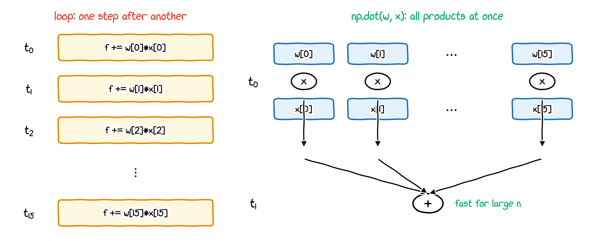{width="70%" fig-align="center"}

- A Python loop executes one interpreted multiply-add after another.
- `np.dot` runs compiled code that processes several numbers per instruction (SIMD) and uses optimised linear-algebra libraries (BLAS); on GPUs, thousands of products run in parallel.
- Efficient code is what makes it possible to train on large data sets.

## Measuring the speed-up

```python
import time
import numpy as np

rng = np.random.default_rng(0)
x = rng.random(1_000_000)
y = rng.random(1_000_000)

t0 = time.perf_counter()
s = 0.0
for i in range(len(x)):          # explicit Python loop
    s += x[i] * y[i]
t_loop = time.perf_counter() - t0

t0 = time.perf_counter()
s_vec = np.dot(x, y)             # vectorised
t_vec = time.perf_counter() - t0

print(f"loop: {1000 * t_loop:.1f} ms, vectorised: {1000 * t_vec:.2f} ms, "
      f"speed-up: {t_loop / t_vec:.0f}x")
```

A typical output is `loop: 267.1 ms, vectorised: 1.22 ms, speed-up: 219x`. The exact numbers depend on the computer, but speed-ups of a few hundred are normal.

## Vectorising the gradient-descent update

Task: update all $n$ weights with their partial derivatives $d_j = \partial J/\partial w_j$:
$$
w_j \leftarrow w_j - \alpha\, d_j, \qquad j = 1, \dots, n
\qquad\Longleftrightarrow\qquad
\mathbf w \leftarrow \mathbf w - \alpha\,\mathbf d
$$

:::: {.columns}
::: {.column width="50%"}
**Without vectorisation**

```python
alpha = 0.1
for j in range(len(w)):
    w[j] = w[j] - alpha * d[j]
```
:::
::: {.column width="50%"}
**With vectorisation**

```python
alpha = 0.1
w = w - alpha * d     # one line, any n
```
:::
::::

## The whole training set at once

Stack the examples as the rows of the **design matrix** $\mathbf X$ and the targets in a vector $\mathbf y$:
$$
\mathbf X = \begin{pmatrix}
x_1^{(1)} & x_2^{(1)} & \cdots & x_n^{(1)}\\
\vdots & \vdots & & \vdots\\
x_1^{(m)} & x_2^{(m)} & \cdots & x_n^{(m)}
\end{pmatrix} \in \mathbb R^{m\times n},
\qquad
\mathbf y = \begin{pmatrix} y^{(1)}\\ \vdots\\ y^{(m)}\end{pmatrix} \in \mathbb R^{m}.
$$

. . .

All $m$ predictions in one matrix-vector product ($b$ is added to every entry):
$$
\hat{\mathbf y} = \mathbf X\mathbf w + b
\qquad\longleftrightarrow\qquad
\texttt{y\_hat = X @ w + b}\quad\text{(shape (m,))}
$$

# Gradient descent with multiple features

## Notation and the algorithm

| | element-wise | vector notation |
|:---|:---|:---|
| parameters | $w_1, \dots, w_n,\ b$ | $\mathbf w = (w_1, \dots, w_n),\ b$ |
| model | $f(\mathbf x) = w_1x_1 + \dots + w_nx_n + b$ | $f_{\mathbf w,b}(\mathbf x) = \mathbf w\cdot\mathbf x + b$ |
| cost | $J(w_1, \dots, w_n, b)$ | $J(\mathbf w, b)$ |

. . .

**Gradient descent**: repeat until convergence, updating all parameters **simultaneously**,
$$
\left\{\begin{aligned}
w_j &\leftarrow w_j - \alpha\,\frac{\partial J}{\partial w_j}(\mathbf w, b), \quad j = 1, \dots, n\\
b &\leftarrow b - \alpha\,\frac{\partial J}{\partial b}(\mathbf w, b)
\end{aligned}\right.
\qquad\Longleftrightarrow\qquad
\left\{\begin{aligned}
\mathbf w &\leftarrow \mathbf w - \alpha\,\nabla_{\mathbf w}J(\mathbf w, b)\\
b &\leftarrow b - \alpha\,\frac{\partial J}{\partial b}(\mathbf w, b)
\end{aligned}\right.
$$

## Gradient of the cost function

Write the prediction error of example $i$ as
$$
e^{(i)} = f_{\mathbf w,b}(\mathbf x^{(i)}) - y^{(i)} = w_1x_1^{(i)} + \dots + w_nx_n^{(i)} + b - y^{(i)},
\qquad
J(\mathbf w, b) = \frac{1}{2m}\sum_{i=1}^{m}\big(e^{(i)}\big)^2 .
$$
The data $x_j^{(i)}$, $y^{(i)}$ are constants; only $\mathbf w$ and $b$ vary.

. . .

Chain rule, using $\dfrac{\partial e^{(i)}}{\partial w_j} = x_j^{(i)}$ and $\dfrac{\partial e^{(i)}}{\partial b} = 1$:
$$
\frac{\partial J}{\partial w_j} = \frac{1}{2m}\sum_{i=1}^{m} 2\,e^{(i)}\,x_j^{(i)} = \frac{1}{m}\sum_{i=1}^{m}\big(f_{\mathbf w,b}(\mathbf x^{(i)}) - y^{(i)}\big)\,x_j^{(i)},
\qquad
\frac{\partial J}{\partial b} = \frac{1}{m}\sum_{i=1}^{m}\big(f_{\mathbf w,b}(\mathbf x^{(i)}) - y^{(i)}\big).
$$

. . .

In words: **the error times the input, averaged over all examples**. For $b$ the "input" is always $1$. With $n = 1$ this is exactly the result of part 2a.

## Gradient descent: one feature versus $n$ features

:::: {.columns}
::: {.column width="45%"}
**One feature** (part 2a)

$$
\begin{aligned}
w &\leftarrow w - \alpha\,\frac{1}{m}\sum_{i=1}^{m}\big(f_{w,b}(x^{(i)}) - y^{(i)}\big)\,x^{(i)}\\[4pt]
b &\leftarrow b - \alpha\,\frac{1}{m}\sum_{i=1}^{m}\big(f_{w,b}(x^{(i)}) - y^{(i)}\big)
\end{aligned}
$$

Update $w$ and $b$ simultaneously.
:::
::: {.column width="55%"}
**$n$ features**

$$
\begin{aligned}
w_1 &\leftarrow w_1 - \alpha\,\frac{1}{m}\sum_{i=1}^{m}\big(f_{\mathbf w,b}(\mathbf x^{(i)}) - y^{(i)}\big)\,x_1^{(i)}\\
&\ \ \vdots\\
w_n &\leftarrow w_n - \alpha\,\frac{1}{m}\sum_{i=1}^{m}\big(f_{\mathbf w,b}(\mathbf x^{(i)}) - y^{(i)}\big)\,x_n^{(i)}\\[4pt]
b &\leftarrow b - \alpha\,\frac{1}{m}\sum_{i=1}^{m}\big(f_{\mathbf w,b}(\mathbf x^{(i)}) - y^{(i)}\big)
\end{aligned}
$$

Update $w_1, \dots, w_n$ and $b$ simultaneously.
:::
::::

## Vectorised gradient descent

:::: {.columns}
::: {.column width="40%"}
With the error vector $\mathbf e = \mathbf X\mathbf w + b - \mathbf y \in \mathbb R^m$:
$$
\begin{aligned}
\nabla_{\mathbf w}J &= \frac{1}{m}\,\mathbf X^{\top}\mathbf e \ \in \mathbb R^{n}\\[4pt]
\frac{\partial J}{\partial b} &= \frac{1}{m}\sum_{i=1}^{m} e^{(i)}
\end{aligned}
$$

Entry $j$ of $\mathbf X^{\top}\mathbf e$ is $\sum_i x_j^{(i)}e^{(i)}$: exactly the sum on the previous slide.

The same code works for any number of features $n$.
:::
::: {.column width="60%"}
```python
import numpy as np

def gradient_descent(X, y, alpha=0.1, n_iters=1000):
    """Batch gradient descent for f(x) = w . x + b.
    X: (m, n) design matrix, y: (m,) targets."""
    m, n = X.shape
    w = np.zeros(n)
    b = 0.0
    J_history = []
    for _ in range(n_iters):
        err = X @ w + b - y     # (m,) errors
        dJ_dw = X.T @ err / m   # (n,) gradient
        dJ_db = err.mean()      # scalar
        w = w - alpha * dJ_dw   # simultaneous
        b = b - alpha * dJ_db   # update
        J_history.append((err ** 2).mean() / 2)
    return w, b, J_history
```
:::
::::

## Folding $b$ into $\mathbf w$

Add a constant feature $x_0 = 1$ and call the bias $w_0 = b$. Then
$$
f(\mathbf x) = \underbrace{w_0x_0}_{b\,\cdot\,1} + \sum_{j=1}^{n} w_jx_j = \sum_{j=0}^{n} w_jx_j = \boldsymbol\theta\cdot\tilde{\mathbf x},
\qquad
\boldsymbol\theta = (w_0, w_1, \dots, w_n),\quad \tilde{\mathbf x} = (1, x_1, \dots, x_n).
$$

. . .

- One formula for all parameters: $\dfrac{\partial J}{\partial w_j} = \dfrac1m\sum_{i=1}^{m}\big(f(\mathbf x^{(i)}) - y^{(i)}\big)\,x_j^{(i)}$, for $j = 0, 1, \dots, n$.
- In matrix form, with $\tilde{\mathbf X} = [\,\mathbf 1\ \ \mathbf X\,] \in \mathbb R^{m\times(n+1)}$: $\quad\nabla_{\boldsymbol\theta}J = \dfrac1m\,\tilde{\mathbf X}^{\top}\big(\tilde{\mathbf X}\boldsymbol\theta - \mathbf y\big)$.

. . .

**Why keep $b$ separate at all?** It has a different meaning (the baseline prediction), it is treated differently when we regularise in Lecture 4, and libraries report it separately: scikit-learn stores $\mathbf w$ in `coef_` and $b$ in `intercept_`.

# The normal equation

## An alternative to gradient descent

:::: {.columns}
::: {.column width="50%"}
**Normal equation**

- Solves for $\mathbf w$ and $b$ in one step: no iterations, no learning rate, no feature scaling needed.

**Disadvantages**

- Only works for linear regression with the squared-error cost; it does not generalise to other models.
- Solving the $(n+1)\times(n+1)$ linear system costs about $n^3$ operations: slow when $n$ is large (say $n \gtrsim 10{,}000$).
:::
::: {.column width="50%"}
**What you need to know**

- Libraries such as scikit-learn's `LinearRegression` solve the least-squares problem directly, with methods closely related to the normal equation.
- Gradient descent is the general method: it works for almost every model in this course, from logistic regression to deep neural networks.
:::
::::

## Deriving the normal equation (optional)

From the previous section, the gradient of $J(\boldsymbol\theta) = \frac{1}{2m}\|\tilde{\mathbf X}\boldsymbol\theta - \mathbf y\|^2$ is
$$
\nabla_{\boldsymbol\theta}J = \frac1m\,\tilde{\mathbf X}^{\top}\big(\tilde{\mathbf X}\boldsymbol\theta - \mathbf y\big).
$$

. . .

At the minimum the gradient vanishes, which gives the **normal equation**
$$
\tilde{\mathbf X}^{\top}\tilde{\mathbf X}\,\boldsymbol\theta = \tilde{\mathbf X}^{\top}\mathbf y
\qquad\Longrightarrow\qquad
\boldsymbol\theta = \big(\tilde{\mathbf X}^{\top}\tilde{\mathbf X}\big)^{-1}\tilde{\mathbf X}^{\top}\mathbf y .
$$

. . .

- $\tilde{\mathbf X}^{\top}\tilde{\mathbf X} \in \mathbb R^{(n+1)\times(n+1)}$ and $\tilde{\mathbf X}^{\top}\mathbf y \in \mathbb R^{n+1}$: their size does not depend on the number of examples $m$.
- $\tilde{\mathbf X}^{\top}\tilde{\mathbf X}$ is invertible exactly when the columns of $\tilde{\mathbf X}$ are linearly independent: no feature is a linear combination of the others, and $m \ge n + 1$.
- The name: the residual $\mathbf y - \tilde{\mathbf X}\boldsymbol\theta$ is orthogonal ("normal") to every column of $\tilde{\mathbf X}$.
- In code, solve the linear system; do not compute the inverse explicitly.

## Normal equation: a worked example

Data: $(x, y) \in \{(1, 300),\ (2, 450),\ (3, 500)\}$.

$$
\tilde{\mathbf X} = \begin{pmatrix}1 & 1\\ 1 & 2\\ 1 & 3\end{pmatrix},\quad
\mathbf y = \begin{pmatrix}300\\ 450\\ 500\end{pmatrix},\quad
\tilde{\mathbf X}^{\top}\tilde{\mathbf X} = \begin{pmatrix}3 & 6\\ 6 & 14\end{pmatrix},\quad
\tilde{\mathbf X}^{\top}\mathbf y = \begin{pmatrix}1250\\ 2700\end{pmatrix}
$$

:::: {.columns}
::: {.column width="58%"}
$$
\big(\tilde{\mathbf X}^{\top}\tilde{\mathbf X}\big)^{-1} = \frac16\begin{pmatrix}14 & -6\\ -6 & 3\end{pmatrix} = \begin{pmatrix}7/3 & -1\\ -1 & 1/2\end{pmatrix}
$$
$$
\boldsymbol\theta = \begin{pmatrix}7/3 & -1\\ -1 & 1/2\end{pmatrix}\begin{pmatrix}1250\\ 2700\end{pmatrix} = \begin{pmatrix}216.67\\ 100\end{pmatrix}
$$
$$
\Rightarrow\quad b = w_0 = 216.67, \qquad w = w_1 = 100 .
$$
:::
::: {.column width="42%"}
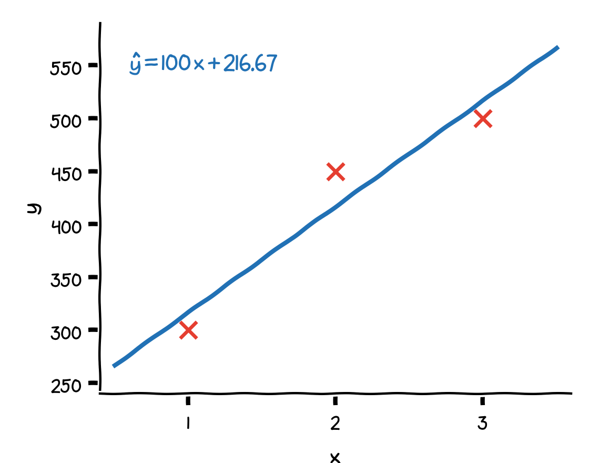{width="88%" fig-align="center"}
:::
::::

## Normal equation in Python

:::: {.columns}
::: {.column width="42%"}
**NumPy**

```python
import numpy as np
x = np.array([1.0, 2.0, 3.0])
y = np.array([300.0, 450.0, 500.0])

# add a column of ones: shape (m, 2)
X = np.column_stack([np.ones_like(x), x])
A = X.T @ X
r = X.T @ y
# solve A theta = r (no explicit inverse)
theta = np.linalg.solve(A, r)
b, w = theta          # 216.67, 100.0
```
:::
::: {.column width="58%"}
**scikit-learn**

```python
from sklearn.linear_model import LinearRegression

model = LinearRegression()
# X must be 2D: (m examples, n features)
model.fit(x.reshape(-1, 1), y)
model.coef_          # array([100.])
model.intercept_     # 216.67
```

We return to scikit-learn at the end of the lecture.
:::
::::

# Feature scaling

## Features live on very different scales

All ten features of the diabetes data, first three patients:

| age | sex | BMI | BP | S1 | S2 | S3 | S4 | S5 | S6 | $y$ |
|:-:|:-:|:-:|:-:|:-:|:-:|:-:|:-:|:-:|:-:|:-:|
| 59 | 2 | 32.1 | 101 | 157 | 93.2 | 38 | 4 | 4.86 | 87 | 151 |
| 48 | 1 | 21.6 | 87 | 183 | 103.2 | 70 | 3 | 3.89 | 69 | 75 |
| 72 | 2 | 30.5 | 93 | 156 | 93.6 | 41 | 4 | 4.67 | 85 | 141 |
| $\vdots$ | $\vdots$ | $\vdots$ | $\vdots$ | $\vdots$ | $\vdots$ | $\vdots$ | $\vdots$ | $\vdots$ | $\vdots$ | $\vdots$ |

. . .

Ranges over all 442 patients (S1 to S6 are six blood measurements, e.g. S1 is total cholesterol):

| | age | sex | BMI | BP | S1 | S2 | S3 | S4 | S5 | S6 |
|:-|:-:|:-:|:-:|:-:|:-:|:-:|:-:|:-:|:-:|:-:|
| min | 19 | 1 | 18.0 | 62 | 97 | 41.6 | 22 | 2.0 | 3.26 | 58 |
| max | 79 | 2 | 42.2 | 133 | 301 | 242.4 | 99 | 9.1 | 6.11 | 124 |

## Large features need small weights

Toy house-price model, with $x_1$ = floor area in m² (40 to 200), $x_2$ = number of bedrooms (1 to 5), and the price in £1000:
$$
\hat y = w_1x_1 + w_2x_2 + b .
$$
House: $x_1 = 120$, $x_2 = 3$, true price $y = 300$ (£300,000).

:::: {.columns}
::: {.column width="50%"}
$w_1 = 50,\ w_2 = 0.1,\ b = 50$
$$
\hat y = 50\cdot 120 + 0.1\cdot 3 + 50 = 6050.3
$$
£6,050,300: **nonsense**.
:::
::: {.column width="50%"}
$w_1 = 1.5,\ w_2 = 30,\ b = 30$
$$
\hat y = 1.5\cdot 120 + 30\cdot 3 + 30 = 300
$$
£300,000: **reasonable**.
:::
::::

. . .

A feature with a **large range** gets a **small weight**, and a feature with a **small range** gets a **large weight**. Small changes in $w_1$ then change $J$ a lot, while large changes in $w_2$ change $J$ only a little.

## Why this matters for gradient descent

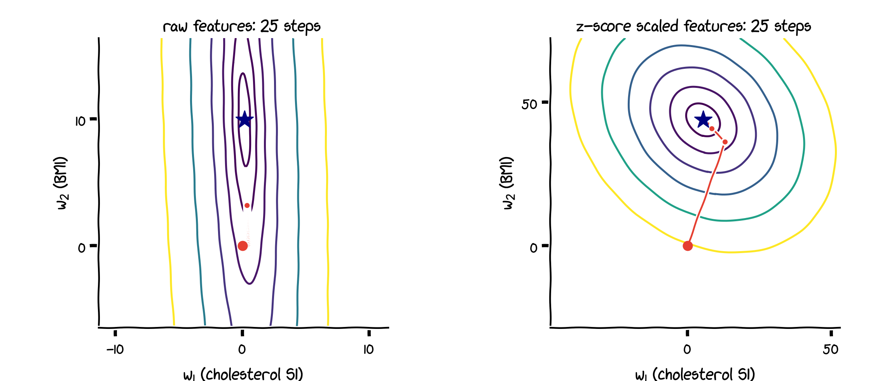{width="62%" fig-align="center"}

- **Raw features** (cholesterol S1 in the hundreds, BMI around 25): $J$ is very sensitive to $w_1$ and insensitive to $w_2$, so the contours are long, narrow ellipses. $\alpha$ must be small to avoid diverging in the $w_1$ direction, and then gradient descent crawls along $w_2$.
- **Scaled features**: the contours are almost circles and gradient descent heads straight for the minimum $\star$. (The bias $b$ is kept at its optimal value so that $J$ can be drawn in 2D.)

## Scaling makes gradient descent much faster

:::: {.columns}
::: {.column width="58%"}
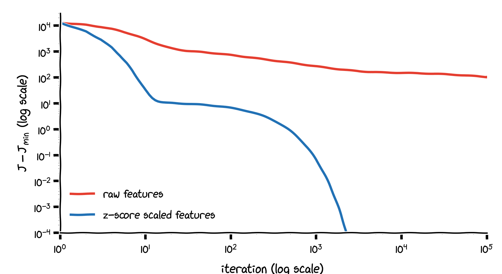
:::
::: {.column width="42%"}
All ten diabetes features, each run with the largest learning rate that is safely stable:

- **raw features**: after $100{,}000$ iterations, $J$ is still $7\%$ above its minimum;
- **z-score scaled features**: within $0.1\%$ of the minimum after about $400$ iterations.

The fitted model is the same; only the units of the features change. (In part 2a, gradient descent with raw BMI alone needed about $100{,}000$ iterations.)
:::
::::

## Min-max normalisation

$$
x_{j,\text{scaled}} = \frac{x_j - \min(x_j)}{\max(x_j) - \min(x_j)}
\qquad\Longrightarrow\qquad
0 \le x_{j,\text{scaled}} \le 1
$$

:::: {.columns}
::: {.column width="58%"}
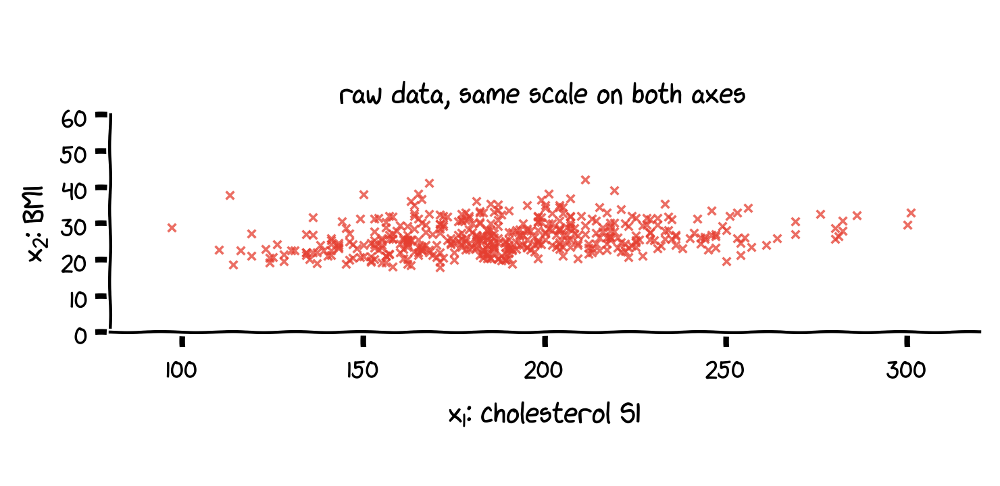{width="94%"}
:::
::: {.column width="42%"}
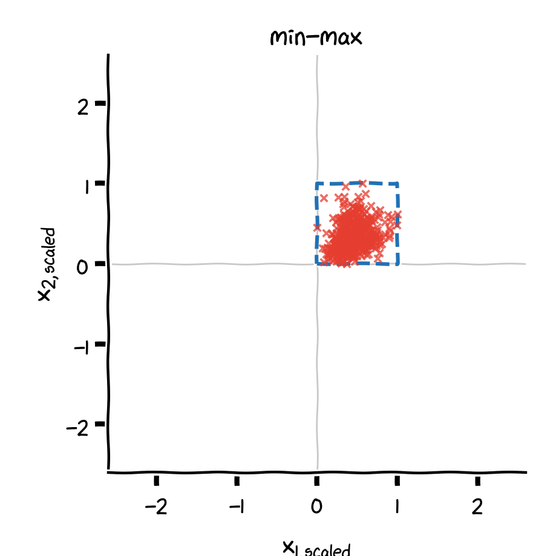{width="64%" fig-align="center"}
:::
::::

The smallest value becomes $0$ and the largest $1$; the data fill the unit box (dashed).

## Mean normalisation

$$
x_{j,\text{scaled}} = \frac{x_j - \mu_j}{\max(x_j) - \min(x_j)},
\qquad \mu_j = \frac1m\sum_{i=1}^{m} x_j^{(i)}
$$

:::: {.columns}
::: {.column width="58%"}
{width="94%"}
:::
::: {.column width="42%"}
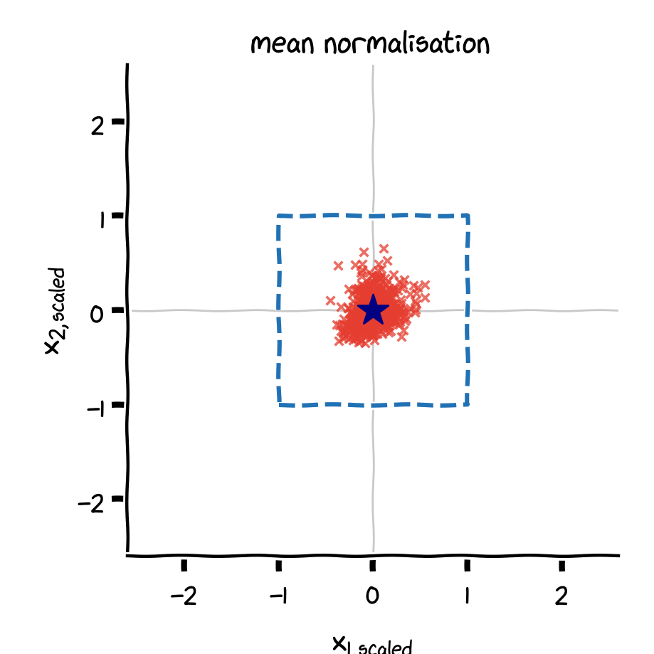{width="64%" fig-align="center"}
:::
::::

The scaled feature has mean $0$. Because $\min(x_j) \le \mu_j \le \max(x_j)$, its values lie in $[-1, 1]$; in fact they span an interval of length exactly $1$ that contains $0$.

## Z-score normalisation

$$
x_{j,\text{scaled}} = \frac{x_j - \mu_j}{\sigma_j},
\qquad \mu_j = \frac1m\sum_{i=1}^{m} x_j^{(i)},
\qquad \sigma_j = \sqrt{\frac1m\sum_{i=1}^{m}\big(x_j^{(i)} - \mu_j\big)^2}
$$

:::: {.columns}
::: {.column width="58%"}
{width="94%"}
:::
::: {.column width="42%"}
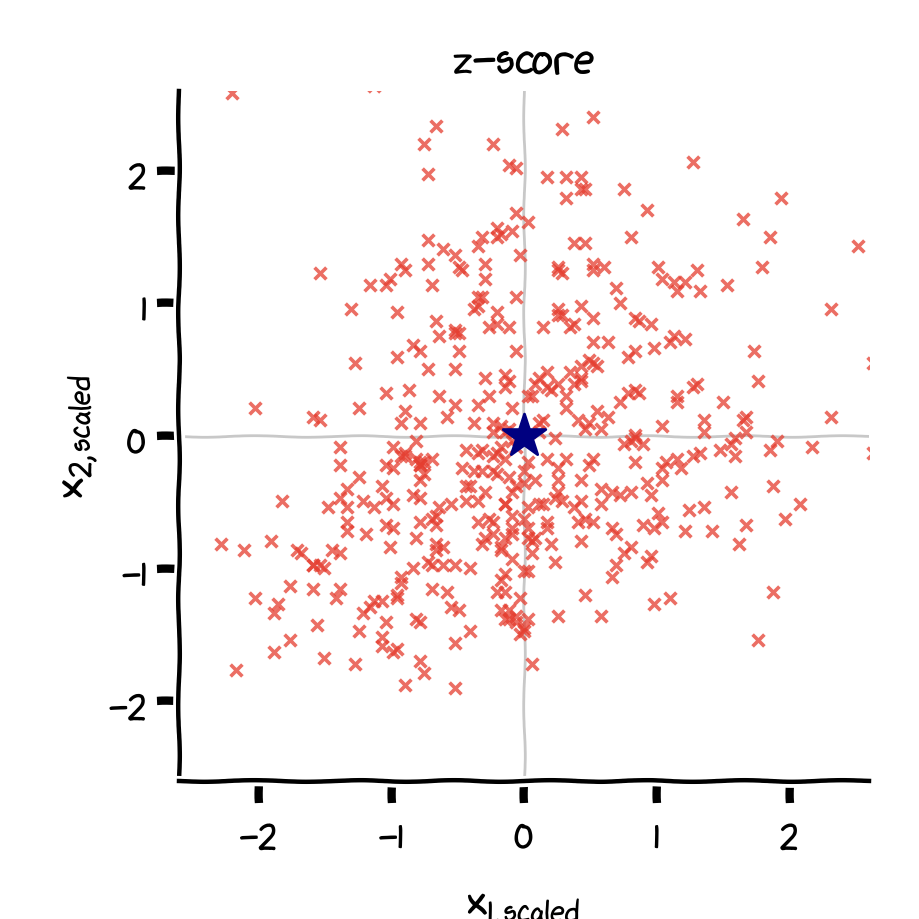{width="64%" fig-align="center"}
:::
::::

Every scaled feature has mean $0$ and standard deviation $1$; most values lie between $-3$ and $3$. This is what scikit-learn's `StandardScaler` does.

## The three methods side by side

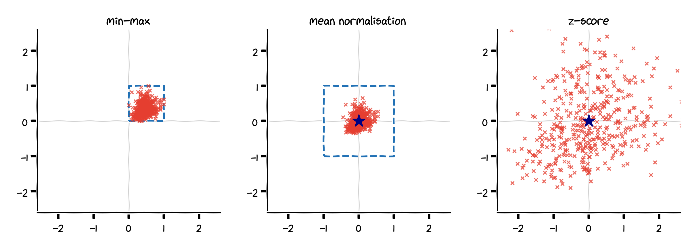{width="78%" fig-align="center"}

- **Min-max**: values in the box $[0, 1]^n$.
- **Mean normalisation**: values in the box $[-1, 1]^n$, mean of every feature $0$.
- **Z-score**: mean $0$ and standard deviation $1$ for every feature; no fixed bounds. The most common choice in practice.

## Feature scaling in practice

:::: {.columns}
::: {.column width="52%"}
Aim for roughly $-1 \le x_j \le 1$; ranges such as $[-3, 3]$ or $[-0.3, 0.3]$ are also fine.

| range of feature | action |
|:---|:---|
| $0 \le x_1 \le 3$ | fine |
| $-2 \le x_2 \le 0.5$ | fine |
| $-100 \le x_3 \le 100$ | rescale: too large |
| $-0.001 \le x_4 \le 0.001$ | rescale: too small |
| $98.6 \le x_5 \le 105$ | rescale: far from 0 |
:::
::: {.column width="48%"}
. . .

::: {.callout-important title="Use the training statistics"}
Compute $\mu_j$, $\sigma_j$ (or $\min$, $\max$) on the **training set only**, store them, and apply exactly the same transformation to test data and to every new example you predict for.
:::

- Scale whenever you use gradient descent. When in doubt, scale: it never hurts.
- The normal equation does not need scaling.
:::
::::

# Checking gradient descent and choosing $\alpha$

## Is gradient descent working? Learning curves

:::: {.columns}
::: {.column width="56%"}
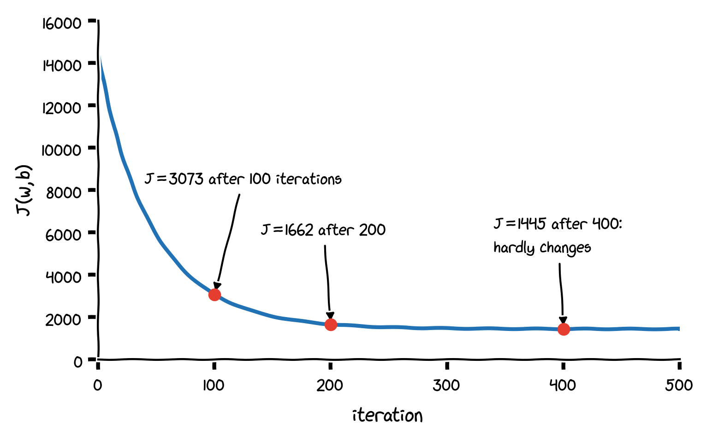
:::
::: {.column width="44%"}
Plot the cost $J(\mathbf w, b)$ after every iteration: the **learning curve**.

- $J$ should **decrease at every iteration**.
- The number of iterations needed varies widely between problems: 30, 1,000 or 100,000.
- Here (scaled diabetes data, $\alpha = 0.01$) the curve has flattened after about 400 iterations.

. . .

**Automatic convergence test**: stop when $J$ decreases by less than a small $\varepsilon$ (e.g. $10^{-3}$) in one iteration. A good $\varepsilon$ is hard to choose, so also look at the curve.
:::
::::

## When the learning curve looks wrong

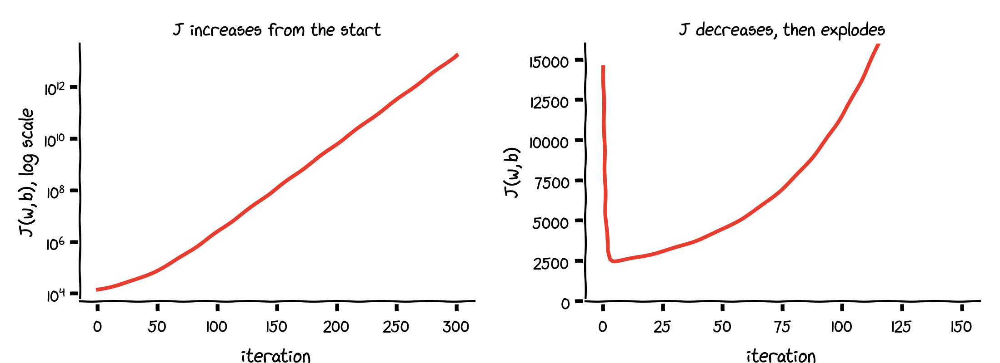{width="62%" fig-align="center"}

If $J$ goes up, the two usual causes are:

- **A bug**, e.g. `w = w + alpha * dJ_dw` instead of `w - ...`. The left curve is exactly this bug (gradient *ascent*). Find and fix it.
- **$\alpha$ too large**: every step overshoots. The right curve uses $\alpha = 0.5$, just above the stability limit $\approx 0.497$ for these data. Use a smaller $\alpha$.

Debugging tip: with a sufficiently small $\alpha$, $J$ **must** decrease at every iteration. If it does not, there is a bug.

## Choosing the learning rate

:::: {.columns}
::: {.column width="60%"}
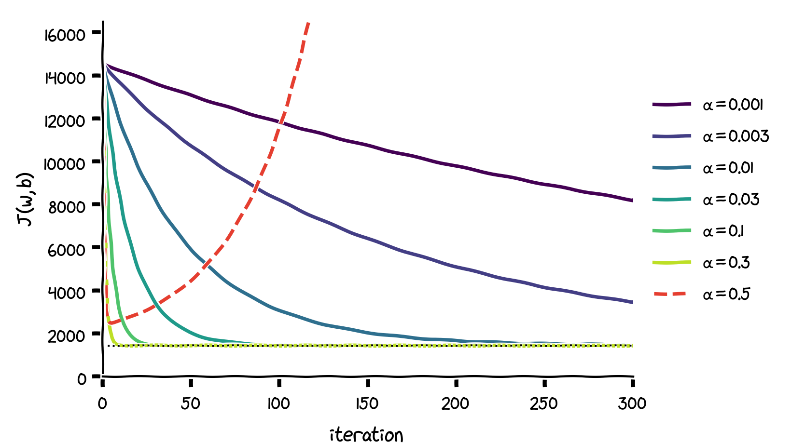
:::
::: {.column width="40%"}
Try values that grow by a factor of about 3:
$$
0.001,\ 0.003,\ 0.01,\ 0.03,\ 0.1,\ 0.3,\ 1,\ \dots
$$

- $J$ decreases slowly: **increase** $\alpha$.
- $J$ increases or oscillates: **decrease** $\alpha$.
- Pick the largest $\alpha$ for which $J$ decreases quickly and steadily, e.g. $\alpha = 0.3$ here, slightly below the value where things go wrong ($\alpha = 0.5$).
:::
::::

# Feature engineering and polynomial regression

## Feature engineering

:::: {.columns}
::: {.column width="58%"}
Price of a plot of land, with $x_1$ = frontage and $x_2$ = depth:
$$
f_{\mathbf w,b}(\mathbf x) = w_1x_1 + w_2x_2 + b
$$

. . .

The price probably depends on the **area**, so create a new feature $x_3 = x_1x_2$:
$$
f_{\mathbf w,b}(\mathbf x) = w_1x_1 + w_2x_2 + w_3x_3 + b
$$

**Feature engineering**: using domain knowledge and intuition to design new features, by transforming or combining the original ones.
:::
::: {.column width="42%"}
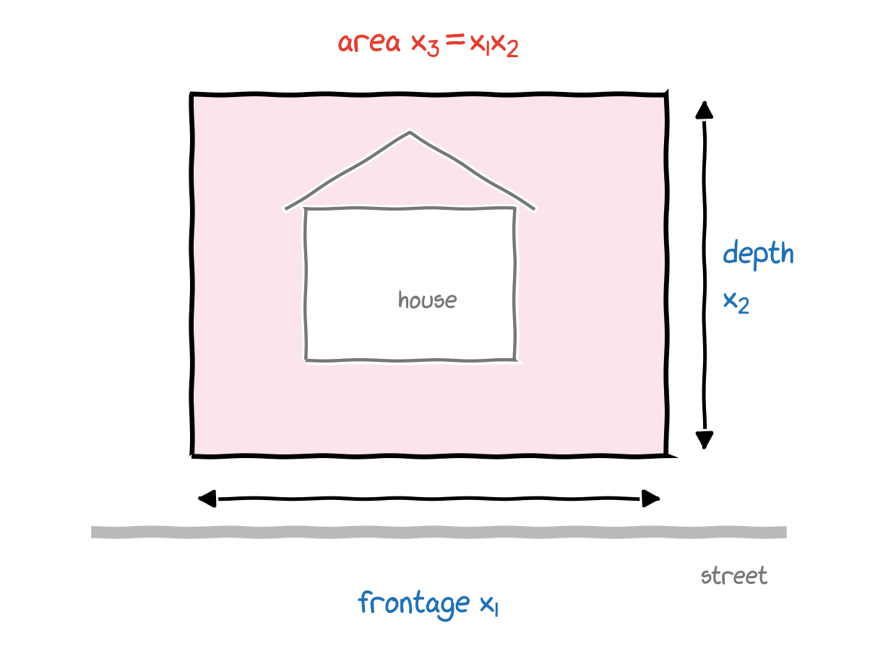
:::
::::

## Feature engineering in a project

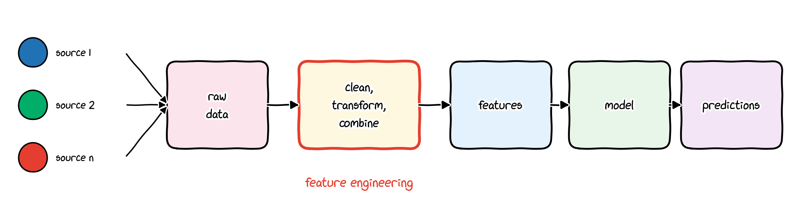{width="92%" fig-align="center"}

- Raw data rarely arrive in a form a model can use directly: they must be cleaned, transformed and combined into features.
- In practical projects this step often takes the most time and has the largest effect on the result.
- A familiar example: BMI itself is an engineered feature, $\text{BMI} = \text{mass}/\text{height}^2$.

## Polynomial regression

::: build
::: {}
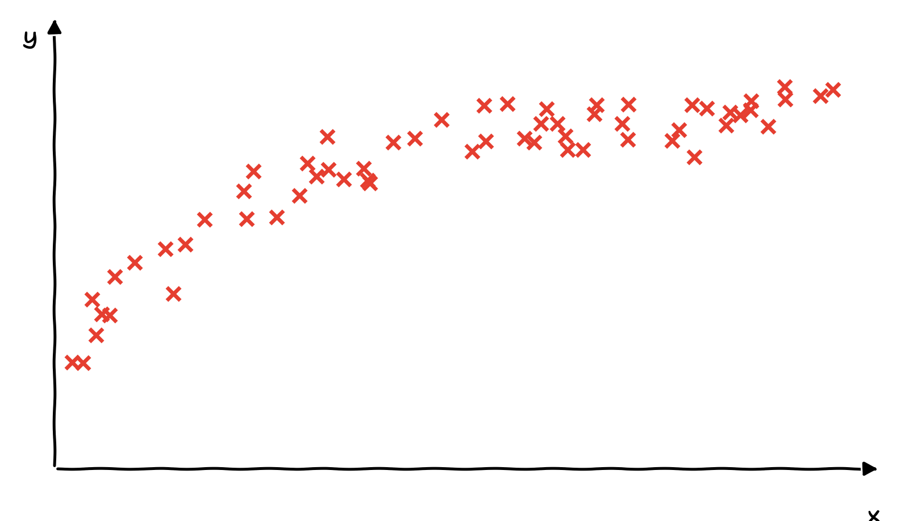{width="62%" fig-align="center"}

The data clearly bend: which model $f(x)$ should we use?
:::
::: {}
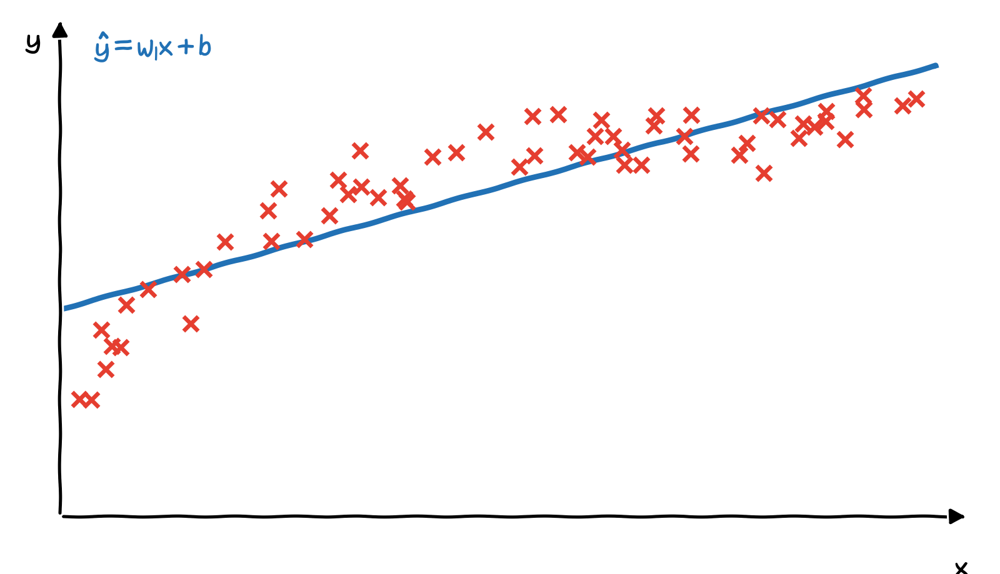{width="62%" fig-align="center"}

A straight line $f_{w,b}(x) = wx + b$ misses the curvature.
:::
::: {}
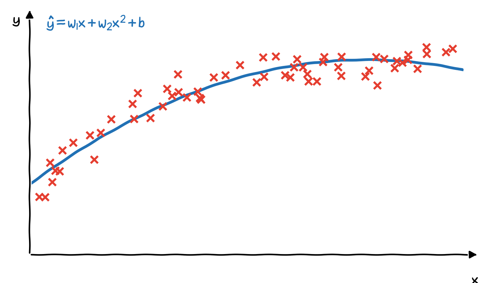{width="62%" fig-align="center"}

Quadratic: $f_{\mathbf w,b}(x) = w_1x + {\color{blue}{w_2}}\,{\color{red}{x^2}} + b$ follows the bend, but turns down at the end.
:::
::: {}
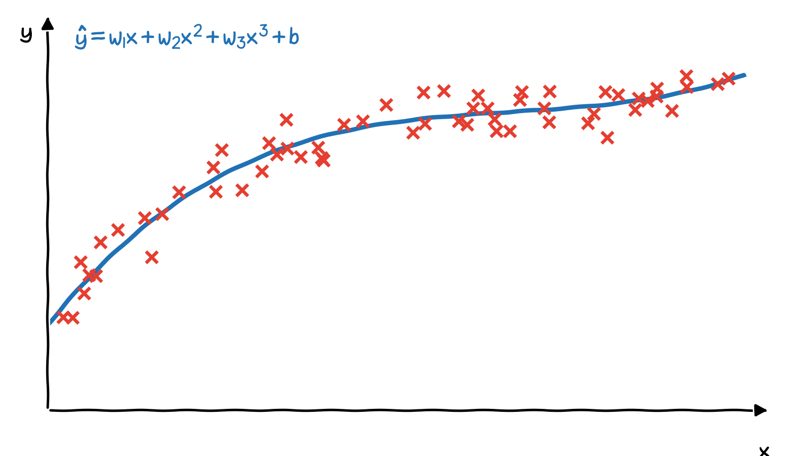{width="62%" fig-align="center"}

Cubic: $f_{\mathbf w,b}(x) = w_1x + {\color{blue}{w_2}}\,{\color{red}{x^2}} + {\color{blue}{w_3}}\,{\color{red}{x^3}} + b$ fits well.
:::
:::

## Polynomial regression is still linear regression

Define new features from the single input $x$:
$$
x_1 = x,\quad x_2 = x^2,\quad x_3 = x^3
\qquad\Longrightarrow\qquad
f_{\mathbf w,b}(\mathbf x) = w_1x_1 + w_2x_2 + w_3x_3 + b .
$$

. . .

- The model is a curve in $x$, but it is **linear in the parameters** $\mathbf w, b$. So the cost function, gradient descent and the normal equation from this lecture apply unchanged.
- **Feature scaling becomes essential**: if $1 \le x \le 10$, then $1 \le x^2 \le 100$ and $1 \le x^3 \le 1000$.
- Other transformations work the same way, e.g. $\sqrt x$, $\log x$ or $x_1x_2$.
- A higher degree is not always better: a very flexible model can fit the noise instead of the trend (**overfitting**, Lecture 4).

# Evaluating a regression model

## Training set and test set

:::: {.columns}
::: {.column width="50%"}
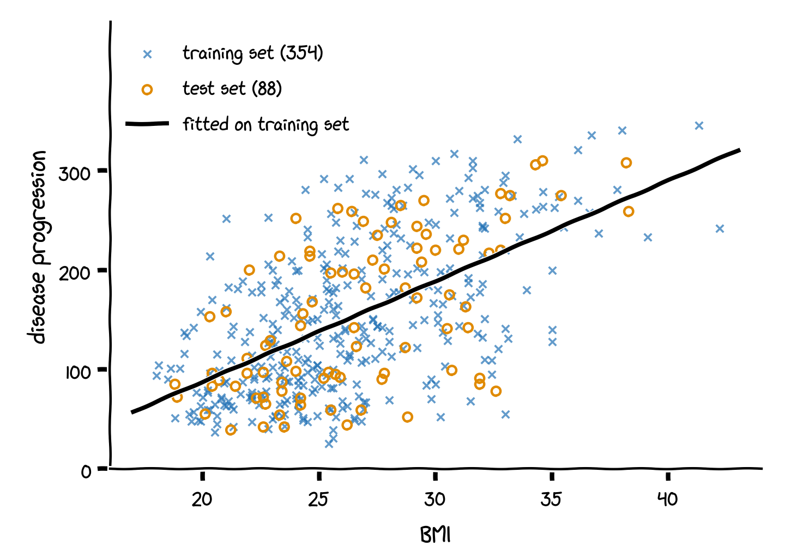
:::
::: {.column width="50%"}
- **Training set**: the examples used to fit the model, i.e. to choose $w$ and $b$.
- **Test set**: examples held back and used only to assess how well the model **generalises** to unseen data.
- Never use the test set to train or tune the model, otherwise the test score is too optimistic.

. . .

How well does the model do on the test set? For regression we use the **mean squared error** and the **coefficient of determination** $R^2$ (next slides); for classification, the **accuracy** (Lecture 3).
:::
::::

## Mean squared error and $R^2$

Two common measures of how well a model's predictions $\hat y^{(i)}$ match the true values $y^{(i)}$, computed on any data set (training or test):

. . .

**Mean squared error** and its square root:
$$
\mathrm{MSE} = \frac1m\sum_{i=1}^{m}\big(y^{(i)} - \hat y^{(i)}\big)^2,
\qquad \mathrm{RMSE} = \sqrt{\mathrm{MSE}}\ \ \text{(same units as $y$)}.
$$
Our cost function is half the MSE on the training set: $J = \frac12\,\mathrm{MSE}$.

. . .

**Coefficient of determination**, $R^2$:
$$
R^2 = 1 - \frac{SS_{\text{res}}}{SS_{\text{tot}}},
\qquad SS_{\text{res}} = \sum_{i=1}^{m}\big(y^{(i)} - \hat y^{(i)}\big)^2,
\qquad SS_{\text{tot}} = \sum_{i=1}^{m}\big(y^{(i)} - \bar y\big)^2,
\qquad \bar y = \frac1m\sum_{i=1}^{m} y^{(i)}.
$$
$R^2$ is the fraction of the variation of $y$ that the model explains.

## $R^2$: intuition

{width="70%" fig-align="center"}

- $R^2 = 1$: perfect predictions, $SS_{\text{res}} = 0$.
- $R^2 = 0$: no better than the baseline that always predicts the mean $\bar y$.
- $R^2 < 0$: **worse** than that baseline. This can happen on test data. Despite its name, $R^2$ is not the square of anything and can be negative.

# Linear regression with scikit-learn

## `LinearRegression` in three steps

```python
from sklearn.linear_model import LinearRegression

model = LinearRegression()          # 1. create a model object
model.fit(X_train, y_train)         # 2. learn w and b; X_train: (m, n), y_train: (m,)
y_pred = model.predict(X_test)      # 3. predict; X_test: (k, n), y_pred: (k,)

w = model.coef_                     # learned weights, 1D array of length n
b = model.intercept_                # learned bias, a single number
```

- `X` must always be a **2D** array of shape (examples, features), even when there is only one feature.
- The same `fit` / `predict` pattern is used by almost every model in scikit-learn.

## A first example

:::: {.columns}
::: {.column width="58%"}
```python
import numpy as np
from sklearn.linear_model import LinearRegression

rng = np.random.default_rng(42)
w_true, b_true = 3.0, 1.0
x_train = rng.normal(loc=10.0, scale=3.0, size=100)
y_train = (w_true * x_train + b_true
           + rng.normal(0.0, 1.0, size=100))
X_train = x_train.reshape(-1, 1)    # shape (100, 1)

model = LinearRegression()
model.fit(X_train, y_train)
w = model.coef_[0]       # coef_ is a 1D array
b = model.intercept_
print(f"w = {w:.3f}, b = {b:.3f}")
# w = 3.040, b = 0.598
```
:::
::: {.column width="42%"}


The data were generated with $w = 3$ and $b = 1$ plus noise; the fit recovers them approximately.
:::
::::

## MSE, RMSE and $R^2$ in scikit-learn

```python
import numpy as np
from sklearn.metrics import mean_squared_error, root_mean_squared_error, r2_score

y_true = np.array([3.0, -0.5, 2.0, 7.0])
y_pred = np.array([2.5, 0.0, 2.0, 8.0])

mean_squared_error(y_true, y_pred)        # 0.375
root_mean_squared_error(y_true, y_pred)   # 0.612
r2_score(y_true, y_pred)                  # 0.949
```

- `root_mean_squared_error` needs scikit-learn 1.4 or newer. The older `mean_squared_error(..., squared=False)` was removed in version 1.6.
- A fitted model also has `model.score(X, y)`, which returns $R^2$.

## Feature scaling in scikit-learn

```python
import numpy as np
from sklearn.preprocessing import StandardScaler, MinMaxScaler

X_train = np.array([[0.0, 0.0], [0.0, 0.0], [1.0, 1.0], [1.0, 1.0]])
X_test = np.array([[2.0, 0.5]])

scaler = StandardScaler()                   # z-score normalisation
X_train_s = scaler.fit_transform(X_train)   # learn mu, sigma on TRAINING data
X_test_s = scaler.transform(X_test)         # same mu, sigma: [[3., 0.]]
scaler.mean_, scaler.scale_                 # [0.5 0.5], [0.5 0.5]

X_train_mm = MinMaxScaler().fit_transform(X_train)   # min-max to [0, 1]
```

`fit_transform` = `fit` (compute the statistics) followed by `transform` (apply them). Never call `fit` on the test data.

## Polynomial features in scikit-learn

```python
import numpy as np
from sklearn.pipeline import make_pipeline
from sklearn.preprocessing import PolynomialFeatures, StandardScaler
from sklearn.linear_model import LinearRegression

PolynomialFeatures(degree=3, include_bias=False).fit_transform([[2.0]])
# array([[2., 4., 8.]])          x  ->  (x, x^2, x^3)

model = make_pipeline(PolynomialFeatures(degree=3, include_bias=False),
                      StandardScaler(),        # scaling matters for x^2, x^3
                      LinearRegression())
model.fit(X, y)                  # X: (m, 1) array of x values
model.predict(X_new)             # applies the same three steps to new data
```

A **pipeline** chains the steps, so the polynomial features and the training statistics of the scaler are reused automatically when predicting.

## Summary of part 2b

- **Model**: $f_{\mathbf w,b}(\mathbf x) = \mathbf w\cdot\mathbf x + b$; for the whole data set $\hat{\mathbf y} = \mathbf X\mathbf w + b$.
- **Vectorisation**: write computations with vectors and matrices (`X @ w + b`); it is shorter and hundreds of times faster than loops.
- **Gradient**: $\dfrac{\partial J}{\partial w_j} = \dfrac1m\sum_i\big(f_{\mathbf w,b}(\mathbf x^{(i)}) - y^{(i)}\big)x_j^{(i)}$, i.e. $\nabla_{\mathbf w}J = \frac1m\mathbf X^{\top}(\mathbf X\mathbf w + b - \mathbf y)$.
- **Normal equation**: $\tilde{\mathbf X}^{\top}\tilde{\mathbf X}\boldsymbol\theta = \tilde{\mathbf X}^{\top}\mathbf y$; exact, but only for linear regression and slow for very many features.
- **Feature scaling** (min-max, mean, z-score) can make gradient descent orders of magnitude faster. Use the training statistics for all data.
- **Learning curves**: $J$ must decrease every iteration; try $\alpha = 0.001, 0.003, 0.01, \dots$
- **Feature engineering** and **polynomial features** make linear models more flexible.
- **Evaluation**: MSE, RMSE and $R^2$.

## Check your understanding: part 2b

1. With $m = 1000$ examples and $n = 20$ features, what are the shapes of $\mathbf X$, $\mathbf w$ and $\mathbf X^{\top}(\mathbf X\mathbf w + b - \mathbf y)$?
2. Why does gradient descent become slow when one feature is in the thousands and another lies between $0$ and $1$?
3. Your learning curve starts to go up after a few iterations. Name two possible causes.
4. Is $\hat y = w_1x + w_2x^2 + b$ a linear regression model? Explain.
5. A model has $R^2 = -0.3$ on the test set. What does this mean?

::: notes
1. $\mathbf X$: $(1000, 20)$; $\mathbf w$: $(20,)$; $\mathbf X^{\top}\mathbf e$: $(20,)$, one entry per weight.
2. $J$ is very sensitive to the weight of the large feature and insensitive to the other, so the contours are long, narrow ellipses. $\alpha$ must be small to stay stable, and then progress along the flat direction is very slow. Scaling fixes this.
3. $\alpha$ too large, or a bug such as a wrong sign in the update or a wrong gradient.
4. Yes: it is linear in the parameters $w_1, w_2, b$. Use the features $x$ and $x^2$.
5. The model predicts the test targets worse than simply predicting their mean. Possible reasons: overfitting, a bug, or test data that differ from the training data (e.g. scaled with different statistics).
:::

# Wrapping up

## Lecture 2 at a glance

| | one feature (2a) | $n$ features (2b) |
|:---|:---|:---|
| model | $f_{w,b}(x) = wx + b$ | $f_{\mathbf w,b}(\mathbf x) = \mathbf w\cdot\mathbf x + b$, $\ \hat{\mathbf y} = \mathbf X\mathbf w + b$ |
| cost | $J = \frac{1}{2m}\sum_i\big(f(x^{(i)}) - y^{(i)}\big)^2$ | the same, with $f(\mathbf x^{(i)})$ |
| gradient | $\frac{\partial J}{\partial w} = \frac1m\sum_i e^{(i)} x^{(i)}$ | $\nabla_{\mathbf w}J = \frac1m\mathbf X^{\top}\mathbf e$ |
| exact solution | stationary point of $J(w, b)$ | normal equation |
| practice | choose $\alpha$ | scale features, check learning curves, evaluate on a test set |

Here $e^{(i)} = f(\mathbf x^{(i)}) - y^{(i)}$ is the error on example $i$, and $\mathbf e$ collects all of them.

**Next lecture**: logistic regression, where the target is a category instead of a number.
