## This lecture

In classification the target is a **category**, not a number. Part 3a treats two classes, part 3b any number of classes; the second contains the first as the special case $K = 2$.

:::: {.columns}
::: {.column width="47%"}
**Part 3a: binary classification**

- why linear regression fails for classification;
- the **logistic regression** model, with outputs that are **probabilities**;
- **decision boundaries** (linear and nonlinear) and the **threshold**;
- the **logistic loss**, and why not the squared error;
- **gradient descent**, and logistic regression in **scikit-learn**.
:::
::: {.column width="6%"}
:::
::: {.column width="47%"}
**Part 3b: multiclass classification**

- multiclass problems and their notation;
- the **softmax** function and **softmax regression**;
- decision regions for $K$ classes;
- the **cross-entropy loss**, its gradient and gradient descent;
- softmax regression in **scikit-learn**, the **confusion matrix**, and **one-vs-rest**.
:::
::::

# Part 3a: binary classification {.part-slide}

::: {.content-visible when-format="revealjs"}
Classification, the logistic regression model, decision boundaries, the cost function, gradient descent, scikit-learn
:::

# Classification

## Classification problems

:::: {.columns}
::: {.column width="50%"}
| question | answer |
|:---|:---|
| Is this email spam? | no / yes |
| Is this transaction fraudulent? | no / yes |
| Is this tumour malignant? | no / yes |

- The target $y$ can take only **two** values: **binary classification**.
- Each value is a **class** (category).
:::
::: {.column width="50%"}
We encode the two classes as numbers:

| answer | $y$ | name |
|:---:|:---:|:---|
| no, false | $0$ | **negative** class |
| yes, true | $1$ | **positive** class |

. . .

"Negative" and "positive" do not mean bad and good. The positive class is the **presence** of the property we are looking for (spam, fraud, a malignant tumour); the negative class is its absence.
:::
::::

## Why not linear regression?

::: build
::: {}
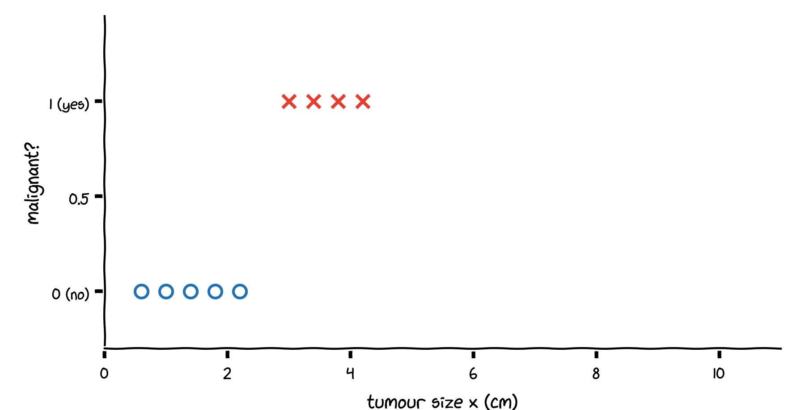{width="66%" fig-align="center"}

Tumour size $x$ and diagnosis $y \in \{0, 1\}$ for nine patients.
:::
::: {}
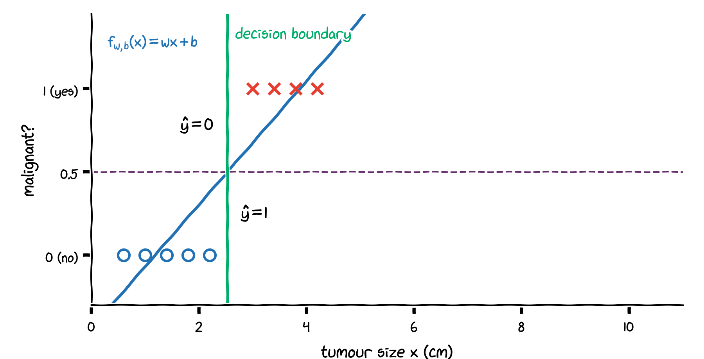{width="66%" fig-align="center"}

Fit a line and predict $\hat y = 1$ when $f_{w,b}(x) \ge 0.5$: the **decision boundary** separates the classes.
:::
::: {}
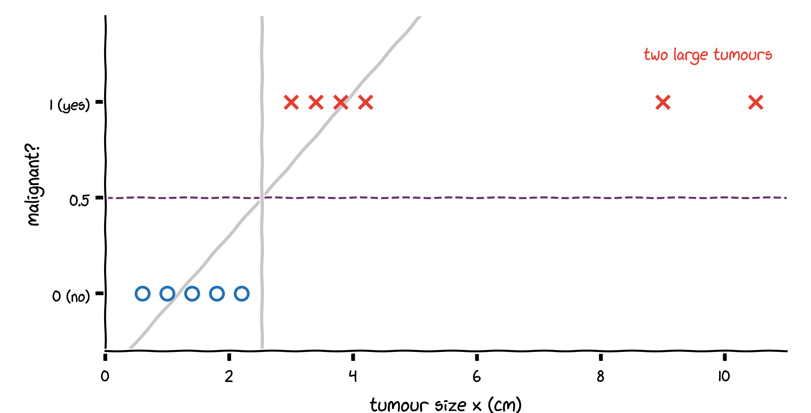{width="66%" fig-align="center"}

Now add two very large tumours. They are clearly malignant, so they should change nothing...
:::
::: {}
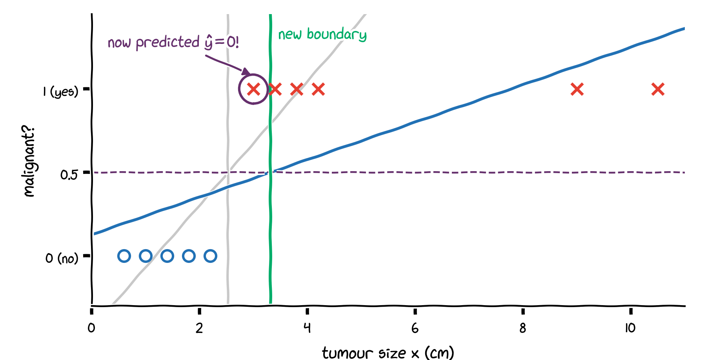{width="66%" fig-align="center"}

...but the least-squares line tilts, the boundary moves from $2.53$ to $3.31$ cm, and a malignant tumour is now predicted benign.
:::
:::

## What we need instead

The linear-regression approach has two problems:

- **Easy examples move the boundary.** Points far from the boundary, which are easy to classify, pull the line and shift the boundary.
- **The output is not a probability.** $f_{w,b}(x) = wx + b$ can be below $0$ or above $1$, so it cannot be read as "the chance that the tumour is malignant".

. . .

We want a model whose output

- always lies between $0$ and $1$, and can be read as a probability;
- is close to $0$ or $1$ far from the boundary, so easy examples have little influence.

This is **logistic regression**: despite its name, it is a **classification** algorithm.

# The logistic regression model

## The sigmoid (logistic) function

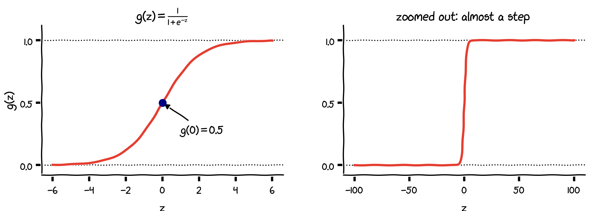{width="62%" fig-align="center"}

$$
g(z) = \frac{1}{1 + e^{-z}} = \frac{1}{1 + \exp(-z)}
$$

- $0 < g(z) < 1$ for every $z$, and $g(0) = 0.5$.
- $g(z) \to 1$ as $z \to \infty$ and $g(z) \to 0$ as $z \to -\infty$; e.g. $g(10) \approx 0.99995$.
- Symmetry: $g(-z) = 1 - g(z)$.

## The logistic regression model

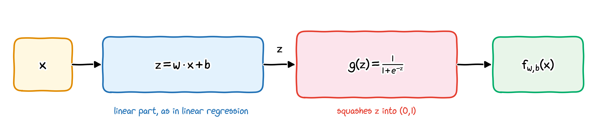{width="90%" fig-align="center"}

::: {.callout-note title="Logistic regression"}
$$
f_{\mathbf w,b}(\mathbf x) = g(\mathbf w\cdot\mathbf x + b) = \frac{1}{1 + e^{-(\mathbf w\cdot\mathbf x + b)}}
$$
:::

- The **linear part** $z = \mathbf w\cdot\mathbf x + b$ is exactly the model of Lecture 2.
- The **sigmoid** squashes $z$ into the interval $(0, 1)$.

## Logistic regression on the tumour data

:::: {.columns}
::: {.column width="62%"}
::: build
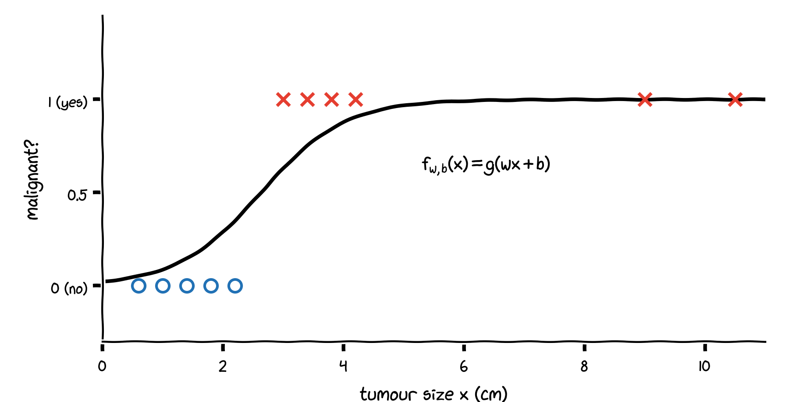

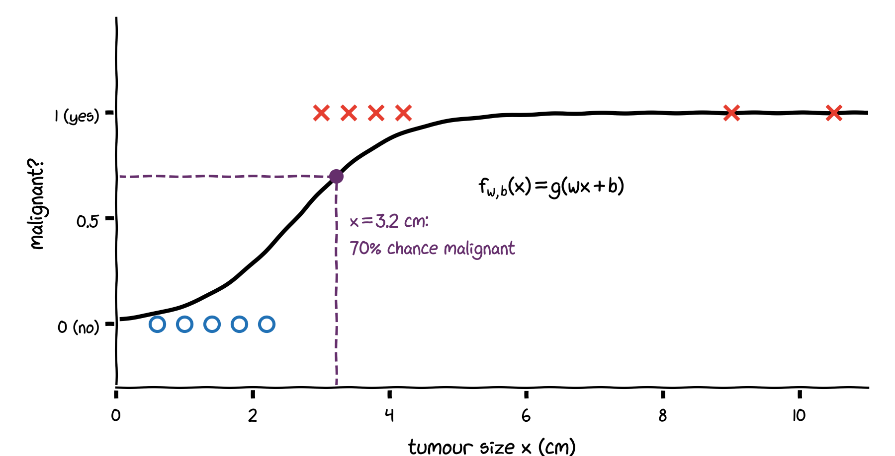
:::
:::
::: {.column width="38%"}
The same eleven patients, including the two large tumours.

- The sigmoid saturates at $1$ for large tumours, so they hardly affect the fit.
- Fitted with scikit-learn: $w = 1.44$, $b = -3.77$. The boundary $f = 0.5$ lies at $x = 2.63$ cm, between the two classes.

. . .

- For a tumour of $3.2$ cm the model gives $f = 0.7$: a **70% chance** of being malignant.
:::
::::

## The output is a probability

$$
f_{\mathbf w,b}(\mathbf x) = P(y = 1 \mid \mathbf x;\ \mathbf w, b)
$$

"The probability that $y = 1$, given the input $\mathbf x$, for parameters $\mathbf w$ and $b$."

. . .

- The two probabilities add up to one: $P(y = 0 \mid \mathbf x) = 1 - P(y = 1 \mid \mathbf x) = 1 - f_{\mathbf w,b}(\mathbf x)$.
- Example: $f_{\mathbf w,b}(\mathbf x) = 0.7$ means a 70% chance that the tumour is malignant and a 30% chance that it is benign.

. . .

**Optional: log-odds.** Solving $f = g(z)$ for $z$ gives
$$
z = \mathbf w\cdot\mathbf x + b = \log\frac{f}{1 - f}
\qquad \text{(the log-odds of class 1)}.
$$
Increasing $x_j$ by one unit adds $w_j$ to the log-odds, i.e. multiplies the odds $f/(1-f)$ by $e^{w_j}$.

# Decision boundary

## From probabilities to predictions

:::: {.columns}
::: {.column width="50%"}
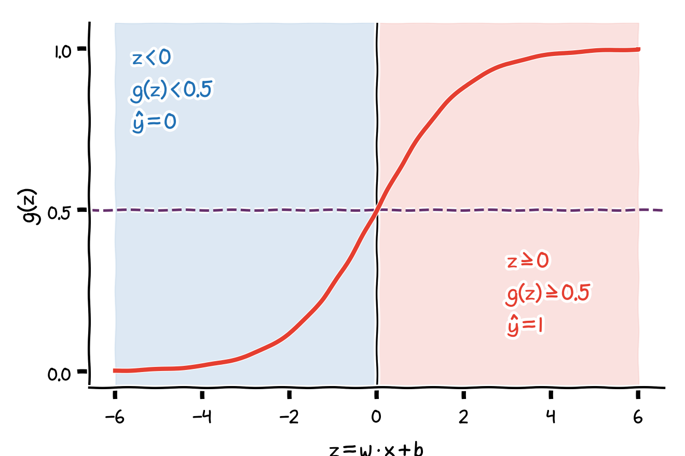
:::
::: {.column width="50%"}
To predict a class, compare the probability with a **threshold**, usually $0.5$:
$$
\hat y = \begin{cases} 1 & \text{if } f_{\mathbf w,b}(\mathbf x) \ge 0.5\\ 0 & \text{if } f_{\mathbf w,b}(\mathbf x) < 0.5 \end{cases}
$$

. . .

Since $g(z) \ge 0.5$ exactly when $z \ge 0$:
$$
\hat y = 1 \iff \mathbf w\cdot\mathbf x + b \ge 0 .
$$

The **decision boundary** is the set of points where
$$
\mathbf w\cdot\mathbf x + b = 0 .
$$
:::
::::

## Decision boundary in 1D: real data

::: build
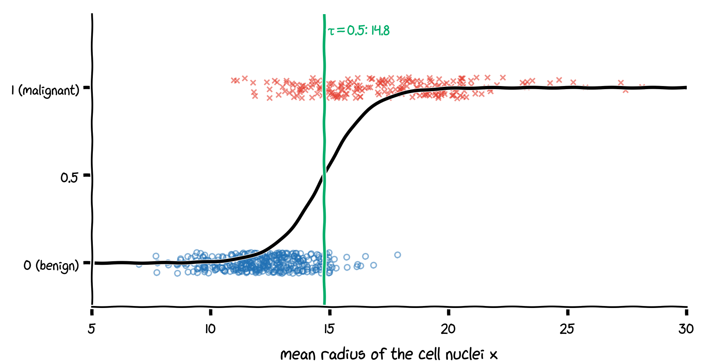{width="64%" fig-align="center"}

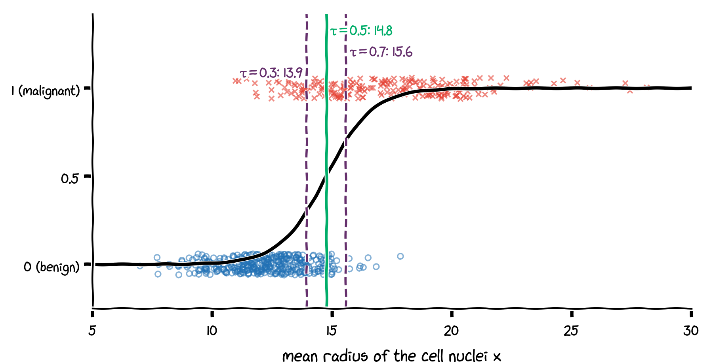{width="64%" fig-align="center"}
:::

Breast-cancer data: 569 tumours, feature $x$ = mean radius of the cell nuclei. With one feature the boundary is a single point, $wx + b = 0 \iff x = -b/w$. Here $w = 1.034$, $b = -15.25$, so $x = 14.75$.

::: small
Data: Street, Wolberg & Mangasarian (1993), Wisconsin breast cancer data; in Python `sklearn.datasets.load_breast_cancer`.
:::

. . .

**Question**: what happens if we change the threshold from $0.5$ to $0.7$?

## Changing the threshold

For a threshold $\tau$ with $0 < \tau < 1$, the boundary is where $f = \tau$:
$$
\frac{1}{1 + e^{-z}} = \tau
\iff e^{-z} = \frac{1}{\tau} - 1
\iff z = \log\frac{\tau}{1 - \tau}.
$$

. . .

In 1D, with $z = wx + b$:
$$
x = \frac{1}{w}\left(\log\frac{\tau}{1 - \tau} - b\right).
$$
For $\tau = 0.5$ this gives $\log 1 = 0$ and $x = -b/w$ as before. For the breast-cancer data, $\tau = 0.3, 0.5, 0.7$ give $x = 13.9,\ 14.75,\ 15.6$.

. . .

- A **higher** $\tau$ predicts "malignant" only when the model is more certain: fewer false alarms, but more missed tumours.
- A **lower** $\tau$ catches more malignant tumours at the cost of more false alarms; in medical screening this is often preferred.

## Decision boundary in 2D

:::: {.columns}
::: {.column width="45%"}
::: build
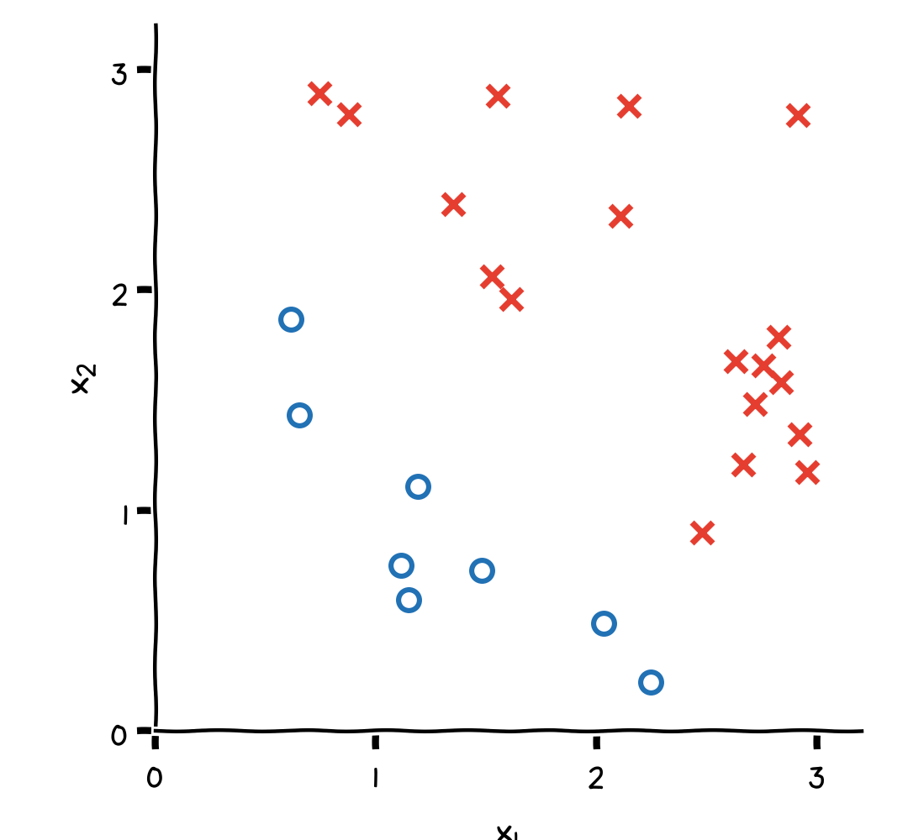{width="88%" fig-align="center"}

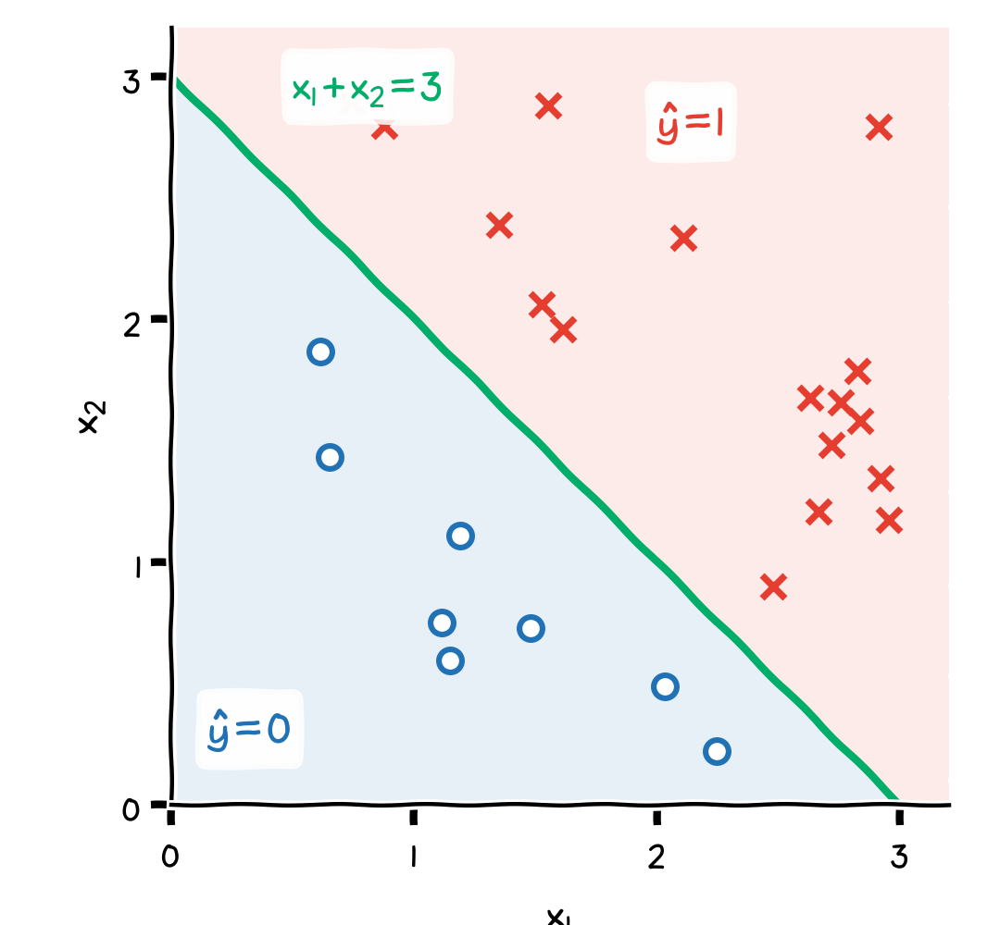{width="88%" fig-align="center"}
:::
:::
::: {.column width="55%"}
With two features
$$
f_{\mathbf w,b}(\mathbf x) = g(w_1x_1 + w_2x_2 + b),
$$
and the decision boundary is the straight line
$$
w_1x_1 + w_2x_2 + b = 0 .
$$

. . .

Example: after training, $w_1 = w_2 = 1$ and $b = -3$:
$$
x_1 + x_2 - 3 = 0 \iff x_1 + x_2 = 3,
$$
with $\hat y = 1$ where $x_1 + x_2 \ge 3$.

With $n$ features the boundary $\mathbf w\cdot\mathbf x + b = 0$ is a (hyper)plane.
:::
::::

## Nonlinear decision boundaries

:::: {.columns}
::: {.column width="45%"}
::: build
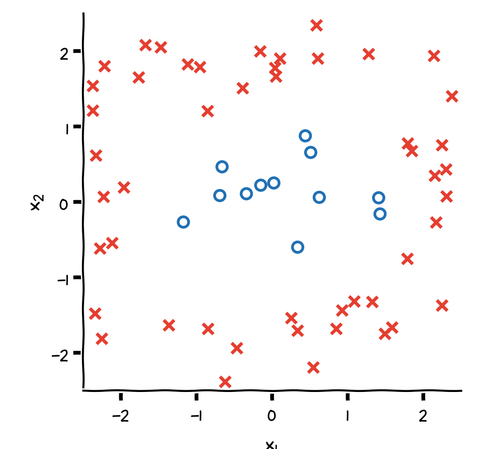{width="88%" fig-align="center"}

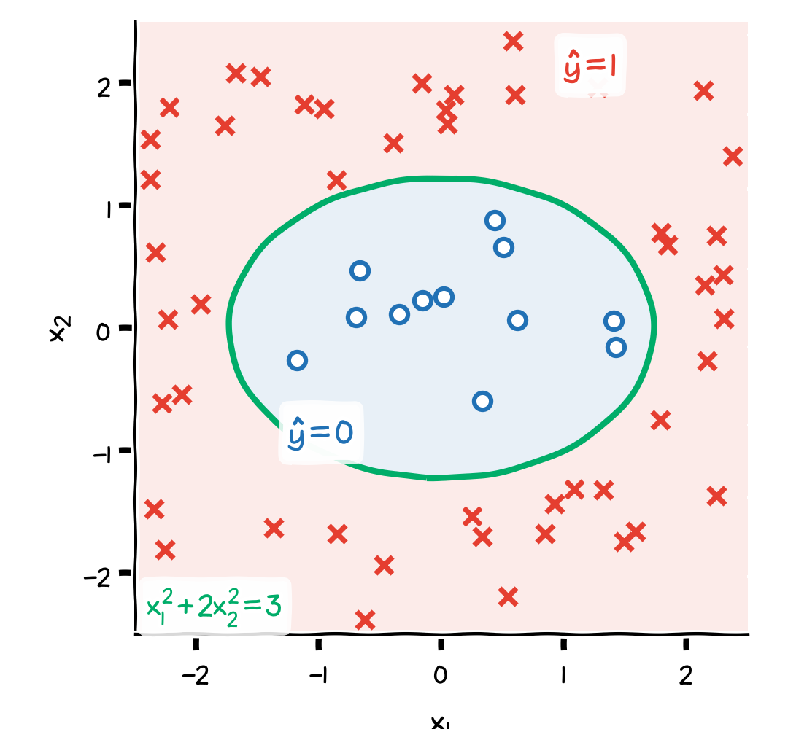{width="88%" fig-align="center"}
:::
:::
::: {.column width="55%"}
Use polynomial features, as in polynomial regression:
$$
f_{\mathbf w,b}(\mathbf x) = g\big(w_1x_1^2 + w_2x_2^2 + b\big).
$$

. . .

Example: after training, $w_1 = 1$, $w_2 = 2$ and $b = -3$. The decision boundary is
$$
x_1^2 + 2x_2^2 - 3 = 0 \iff x_1^2 + 2x_2^2 = 3,
$$
an **ellipse**. Outside it $z \ge 0$, so $\hat y = 1$; inside it $\hat y = 0$.

Changing the sign of all parameters swaps the two regions.
:::
::::

## Even more flexible boundaries

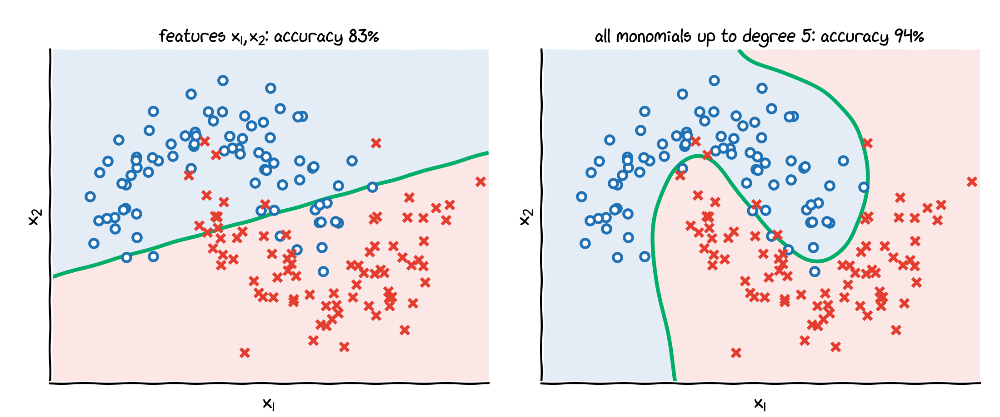{width="66%" fig-align="center"}

- Left: only $x_1$ and $x_2$, so the boundary is a straight line.
- Right: all 20 monomials up to degree 5 ($x_1, x_2, x_1^2, x_1x_2, \dots, x_2^5$). The boundary can take almost any shape.
- More flexible is not always better: a very wiggly boundary may follow the noise in the training data (**overfitting**, Lecture 4).

# The cost function

## The training set

:::: {.columns}
::: {.column width="50%"}
| tumour size (cm) | $\cdots$ | age | malignant? |
|:---:|:---:|:---:|:---:|
| $x_1$ | $\cdots$ | $x_n$ | $y$ |
| 2.5 | | 52 | 1 |
| 0.8 | | 73 | 0 |
| 1.6 | | 55 | 0 |
| 3.1 | | 49 | 1 |
| $\vdots$ | | $\vdots$ | $\vdots$ |
:::
::: {.column width="50%"}
- Training examples $i = 1, \dots, m$; features $j = 1, \dots, n$.
- The target $y^{(i)}$ is $0$ or $1$.
- Model:
$$
f_{\mathbf w,b}(\mathbf x) = \frac{1}{1 + e^{-(\mathbf w\cdot\mathbf x + b)}}
$$

. . .

How do we choose $\mathbf w$ and $b$? We need a **cost function** that measures how well $f_{\mathbf w,b}$ fits the training labels.
:::
::::

## Why not the squared error?

The cost of linear regression, written as an average of per-example **losses** $L$:
$$
J(\mathbf w, b) = \frac{1}{m}\sum_{i=1}^{m} \underbrace{\tfrac12\big(f_{\mathbf w,b}(\mathbf x^{(i)}) - y^{(i)}\big)^2}_{L\left(f_{\mathbf w,b}(\mathbf x^{(i)}),\ y^{(i)}\right)}
$$

:::: {.columns}
::: {.column width="44%"}
- Linear model $f = \mathbf w\cdot\mathbf x + b$: this $J$ is a convex bowl (Lecture 2).
- Sigmoid model (left plot): $J$ is **not convex**. It has flat plateaus where gradient descent stalls, and can have local minima.
- The logistic loss (right plot, next slides) gives a **convex** cost with a single minimum.
:::
::: {.column width="56%"}
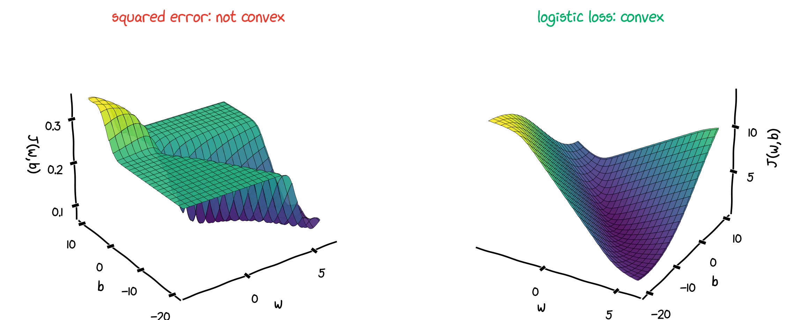
:::
::::

## The logistic loss

$$
L\big(f_{\mathbf w,b}(\mathbf x^{(i)}), y^{(i)}\big) =
\begin{cases}
-\log\big(f_{\mathbf w,b}(\mathbf x^{(i)})\big) & \text{if } y^{(i)} = 1\\[4pt]
-\log\big(1 - f_{\mathbf w,b}(\mathbf x^{(i)})\big) & \text{if } y^{(i)} = 0
\end{cases}
$$

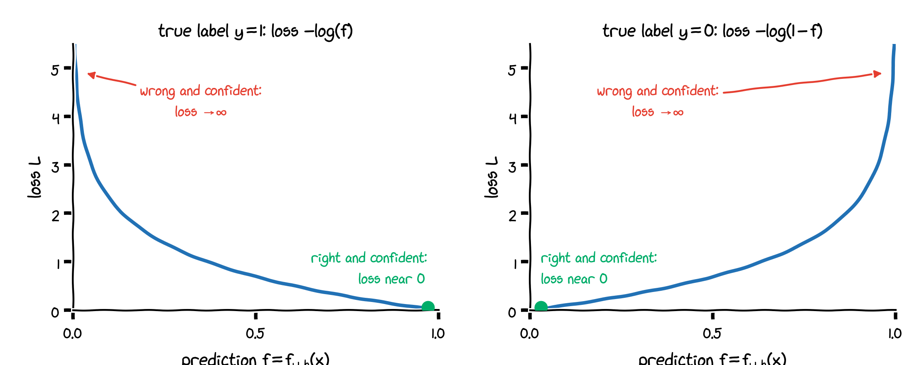{width="60%" fig-align="center"}

- The loss is $0$ when the model predicts the true label with full confidence.
- It grows without bound when the model is confident **and wrong**: confident mistakes are punished severely.

## A single formula for the loss

Because $y^{(i)}$ is either $0$ or $1$, both cases fit into one expression:
$$
L\big(f_{\mathbf w,b}(\mathbf x^{(i)}), y^{(i)}\big) = -y^{(i)}\log\big(f_{\mathbf w,b}(\mathbf x^{(i)})\big) - \big(1 - y^{(i)}\big)\log\big(1 - f_{\mathbf w,b}(\mathbf x^{(i)})\big).
$$

. . .

- If $y^{(i)} = 1$: $\ L = -1\cdot\log(f) - 0\cdot\log(1 - f) = -\log(f)$.
- If $y^{(i)} = 0$: $\ L = -0\cdot\log(f) - 1\cdot\log(1 - f) = -\log(1 - f)$.

. . .

::: {.callout-note title="Cost function for logistic regression"}
$$
J(\mathbf w, b) = {\color{red}{-}}\frac{1}{m}\sum_{i=1}^{m}\Big[y^{(i)}\log\big(f_{\mathbf w,b}(\mathbf x^{(i)})\big) + \big(1 - y^{(i)}\big)\log\big(1 - f_{\mathbf w,b}(\mathbf x^{(i)})\big)\Big]
$$
:::

Note the minus sign in front of the sum. $J$ is **convex**, and training means solving $\min_{\mathbf w,b} J(\mathbf w, b)$. Other names: **log loss**, **binary cross-entropy**.

## Where does the logistic loss come from? (optional)

The model states $P(y = 1 \mid \mathbf x) = f$ and $P(y = 0 \mid \mathbf x) = 1 - f$. Both cases in one formula:
$$
P(y \mid \mathbf x) = f^{\,y}\,(1 - f)^{1 - y}.
$$

. . .

If the training examples are independent, the probability that the model assigns to all the observed labels (the **likelihood**) is
$$
\prod_{i=1}^{m} P\big(y^{(i)} \mid \mathbf x^{(i)}\big).
$$

. . .

Good parameters make this large. Taking $-\frac1m\log$ turns the product into a sum, and maximising becomes minimising:
$$
-\frac1m\sum_{i=1}^{m}\log P\big(y^{(i)} \mid \mathbf x^{(i)}\big)
= -\frac1m\sum_{i=1}^{m}\Big[y^{(i)}\log f^{(i)} + \big(1 - y^{(i)}\big)\log\big(1 - f^{(i)}\big)\Big] = J(\mathbf w, b).
$$

Minimising $J$ is **maximum likelihood estimation**: each loss is $-\log(\text{probability of the true label})$.

# Gradient descent

## The gradient of the logistic cost

One example, with $f = g(z)$ and $z = \mathbf w\cdot\mathbf x + b$. The key fact about the sigmoid is
$$
g'(z) = g(z)\big(1 - g(z)\big).
$$

. . .

Chain rule, step by step:
$$
\frac{\partial L}{\partial f} = -\frac{y}{f} + \frac{1 - y}{1 - f} = \frac{f - y}{f(1 - f)},
\qquad
\frac{\partial f}{\partial z} = f(1 - f)
\quad\Longrightarrow\quad
\frac{\partial L}{\partial z} = f - y .
$$

. . .

With $\partial z/\partial w_j = x_j$ and $\partial z/\partial b = 1$, and averaging over all examples:
$$
\frac{\partial J}{\partial w_j} = \frac1m\sum_{i=1}^{m}\big(f_{\mathbf w,b}(\mathbf x^{(i)}) - y^{(i)}\big)\,x_j^{(i)},
\qquad
\frac{\partial J}{\partial b} = \frac1m\sum_{i=1}^{m}\big(f_{\mathbf w,b}(\mathbf x^{(i)}) - y^{(i)}\big).
$$

## Gradient descent for logistic regression

Repeat until convergence, updating all parameters **simultaneously**:
$$
\left\{\begin{aligned}
w_j &\leftarrow w_j - \alpha\,\frac1m\sum_{i=1}^{m}\big(f_{\mathbf w,b}(\mathbf x^{(i)}) - y^{(i)}\big)\,x_j^{(i)}, \qquad j = 1, \dots, n\\
b &\leftarrow b - \alpha\,\frac1m\sum_{i=1}^{m}\big(f_{\mathbf w,b}(\mathbf x^{(i)}) - y^{(i)}\big)
\end{aligned}\right.
$$

. . .

:::: {.columns}
::: {.column width="50%"}
**Same form as linear regression...**

- linear regression: $f_{\mathbf w,b}(\mathbf x) = \mathbf w\cdot\mathbf x + b$
- logistic regression: $f_{\mathbf w,b}(\mathbf x) = \dfrac{1}{1 + e^{-(\mathbf w\cdot\mathbf x + b)}}$

...but a different $f$, so a different algorithm.
:::
::: {.column width="50%"}
**The same practical tools apply**

- learning curves to monitor $J$;
- a vectorised implementation;
- feature scaling.
:::
::::

## Vectorised implementation

:::: {.columns}
::: {.column width="58%"}
```python
import numpy as np

def sigmoid(z):
    return 1.0 / (1.0 + np.exp(-z))

def cost(X, y, w, b):
    f = sigmoid(X @ w + b)
    return -np.mean(y * np.log(f)
                    + (1 - y) * np.log(1 - f))

def gradient_descent(X, y, alpha=0.5, n_iters=1000):
    m, n = X.shape
    w, b = np.zeros(n), 0.0
    for _ in range(n_iters):
        f = sigmoid(X @ w + b)   # (m,)
        err = f - y              # (m,)
        w = w - alpha * X.T @ err / m
        b = b - alpha * err.mean()
    return w, b
```
:::
::: {.column width="42%"}
Compared with linear regression, only one line changes: the predictions are `sigmoid(X @ w + b)` instead of `X @ w + b`.

On the two-class data of the next slide, 1000 iterations give $\mathbf w = (3.60,\ 2.26)$ and $b = -0.20$, the same as scikit-learn without regularisation.
:::
::::

## Gradient descent in action

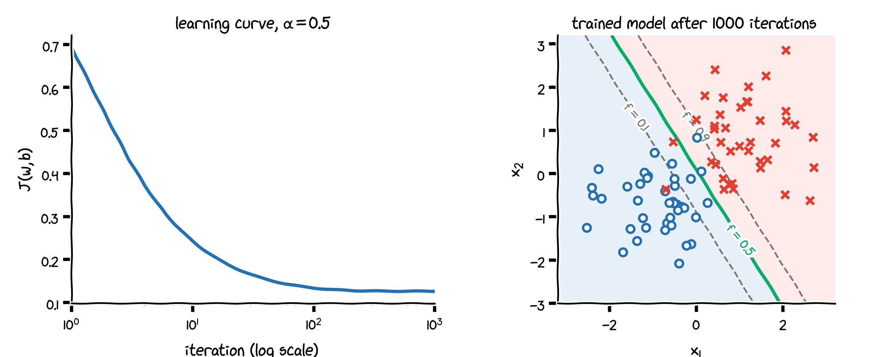{width="80%" fig-align="center"}

- Left: $J$ decreases at every iteration and levels off, as it should.
- Right: the trained model. The boundary is the contour $f = 0.5$; between the dashed contours $f = 0.1$ and $f = 0.9$ the model is uncertain, and this is where the two classes overlap.

# Logistic regression with scikit-learn

## `LogisticRegression` in practice

```python
from sklearn.datasets import load_breast_cancer
from sklearn.model_selection import train_test_split
from sklearn.pipeline import make_pipeline
from sklearn.preprocessing import StandardScaler
from sklearn.linear_model import LogisticRegression

data = load_breast_cancer()
X = data.data[:, :2]                 # mean radius, mean texture
y = 1 - data.target                  # 1 = malignant (scikit-learn codes it as 0)
X_train, X_test, y_train, y_test = train_test_split(
    X, y, test_size=0.25, random_state=0, stratify=y)

model = make_pipeline(StandardScaler(), LogisticRegression())
model.fit(X_train, y_train)

model.predict(X_test[:3])            # array([1, 0, 0]): predicted classes
model.predict_proba(X_test[:3])      # rows [P(y=0), P(y=1)]: [0.04, 0.96], [0.89, 0.11], ...
model.score(X_test, y_test)          # 0.923: accuracy on the test set
```

## Results and remarks

:::: {.columns}
::: {.column width="52%"}
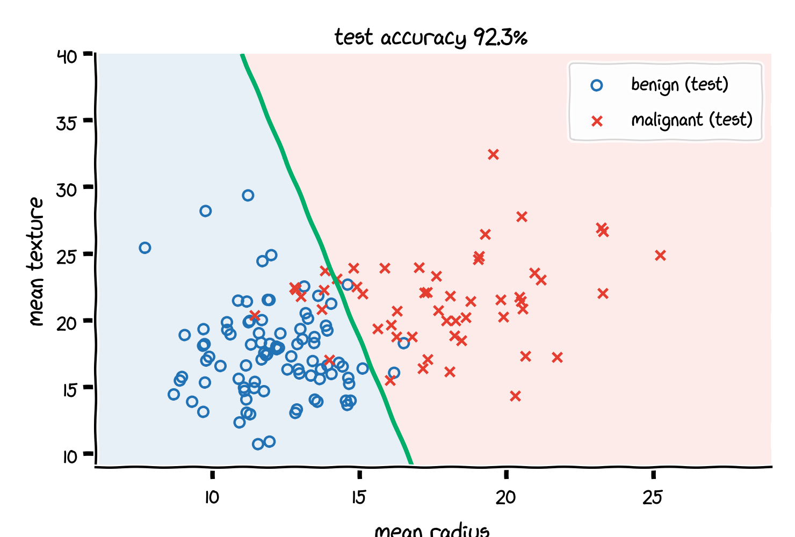
:::
::: {.column width="48%"}
- **Accuracy** = fraction of correct predictions. Two features: 92.3% on the test set; all 30 features: 98.6%.
- Always compare with a **baseline**: predicting "benign" for every tumour already gives 62.9%.
- `predict` uses the threshold $0.5$; for another threshold, use `predict_proba(X)[:, 1] >= tau`.

. . .

- `LogisticRegression` applies **regularisation** by default ($C = 1$, Lecture 4). Use `C=np.inf` to switch it off (older versions: `penalty=None`).
:::
::::

## Summary of part 3a

- **Binary classification**: $y \in \{0, 1\}$; linear regression is a poor classifier.
- **Model**: $f_{\mathbf w,b}(\mathbf x) = g(\mathbf w\cdot\mathbf x + b)$ with the sigmoid $g(z) = 1/(1 + e^{-z})$; the output is $P(y = 1 \mid \mathbf x)$.
- **Prediction**: $\hat y = 1$ if $f \ge \tau$ (usually $\tau = 0.5$, i.e. $\mathbf w\cdot\mathbf x + b \ge 0$).
- **Decision boundary**: $\mathbf w\cdot\mathbf x + b = 0$ for $\tau = 0.5$; linear in the features, but nonlinear in $\mathbf x$ when we use polynomial features.
- **Cost**: $J = -\frac1m\sum_i\big[y^{(i)}\log f^{(i)} + (1 - y^{(i)})\log(1 - f^{(i)})\big]$: convex, from maximum likelihood.
- **Gradient descent**: same update formulas as linear regression, with the sigmoid inside $f$.
- **scikit-learn**: `LogisticRegression`, `predict`, `predict_proba`, `score`; regularised by default.

**Next, part 3b**: more than two classes, with the softmax function and the cross-entropy loss.

## Check your understanding: part 3a

1. Why can the output of linear regression not be read as a probability?
2. A model gives $f_{\mathbf w,b}(\mathbf x) = 0.2$ for a tumour. What is the probability that it is benign? What is $\hat y$ for $\tau = 0.5$?
3. With $\mathbf w = (2, -1)$ and $b = 1$, is the point $\mathbf x = (0, 3)$ classified as $1$ or $0$?
4. Why do we not use the squared error as the cost for logistic regression?
5. The gradient-descent updates look identical to those of linear regression. What is actually different?

::: notes
1. It can be smaller than 0 or larger than 1, and easy examples far from the boundary change it a lot.
2. $P(y = 0 \mid \mathbf x) = 0.8$; since $0.2 < 0.5$, $\hat y = 0$.
3. $z = 2\cdot 0 - 1\cdot 3 + 1 = -2 < 0$, so $f = g(-2) \approx 0.12$ and $\hat y = 0$.
4. With the sigmoid inside, the squared-error cost is not convex: it has flat regions and possibly local minima, so gradient descent can stall. The logistic loss gives a convex cost.
5. $f_{\mathbf w,b}$ is the sigmoid of $\mathbf w\cdot\mathbf x + b$ instead of $\mathbf w\cdot\mathbf x + b$ itself, so the errors $f - y$, and hence the gradients, are different.
:::

# Part 3b: multiclass classification {.part-slide}

::: {.content-visible when-format="revealjs"}
Multiclass problems, the softmax model, the cross-entropy loss, scikit-learn, the confusion matrix, one-vs-rest
:::

## Where we are

In part 3a we classified into **two** classes:

- a linear score $z = \mathbf w\cdot\mathbf x + b$, turned into a probability by the sigmoid, $P(y = 1 \mid \mathbf x) = g(z)$;
- the logistic loss, convex and derived from maximum likelihood;
- gradient descent with the familiar gradient "error times input".

. . .

Part 3b handles $K \ge 3$ classes with the same ingredients:

- **one score per class**, $z_k = \mathbf w_k\cdot\mathbf x + b_k$;
- the **softmax** turns the $K$ scores into $K$ probabilities that sum to 1 (the sigmoid's job for $K = 2$);
- the **cross-entropy** loss generalises the logistic loss, and the gradient is again error times input;
- for $K = 2$, everything reduces exactly to part 3a.

# Multiclass classification

## From two classes to many

:::: {.columns}
::: {.column width="45%"}
Many questions have more than two possible answers:

- Which **digit** (0 to 9) is in this image?
- Which **species** is this flower?
- Which **blood type** does a patient have, given test results?
- Which **degree programme** will a student choose, given grades and interests?
:::
::: {.column width="55%"}
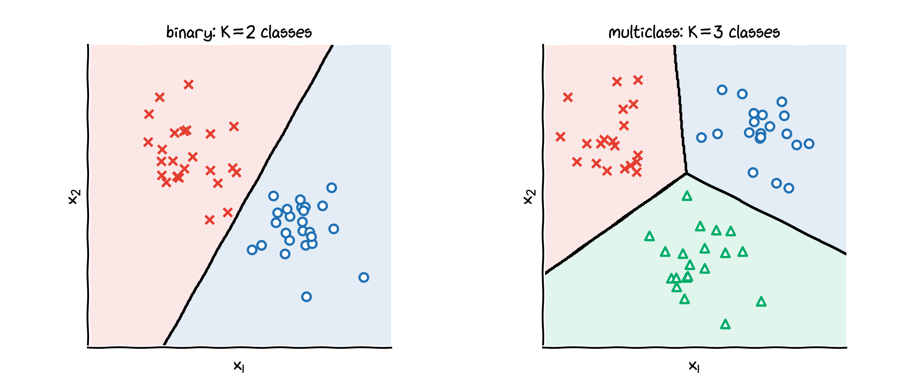
:::
::::

. . .

- **Multiclass classification**: assign each example to exactly one of $K \ge 3$ classes.
- Not to be confused with **multi-label** classification, where an example can belong to several classes at once (e.g. the tags of a photo).

## Notation

Data set with $m$ examples, $n$ features and $K$ classes:
$$
\mathcal D = \big\{(\mathbf x^{(1)}, y^{(1)}), \dots, (\mathbf x^{(m)}, y^{(m)})\big\},
\qquad \mathbf x^{(i)} \in \mathbb R^n,
\qquad y^{(i)} \in \{1, 2, \dots, K\}.
$$

. . .

In binary classification (part 3a) the model gave two probabilities:
$$
\underbrace{P(y = 0 \mid \mathbf x)}_{1 - f_{\mathbf w,b}(\mathbf x)} + \underbrace{P(y = 1 \mid \mathbf x)}_{f_{\mathbf w,b}(\mathbf x)} = 1 .
$$

. . .

Now the model must give $K$ probabilities, one per class, that form a **probability distribution**:
$$
P(y = k \mid \mathbf x) \ge 0 \quad\text{for } k = 1, \dots, K,
\qquad
\sum_{k=1}^{K} P(y = k \mid \mathbf x) = 1 .
$$

The method is called **softmax regression** or **multinomial logistic regression** (also: multinomial logit, maximum-entropy classifier).

# The softmax model

## Making a prediction

:::: {.columns}
::: {.column width="56%"}
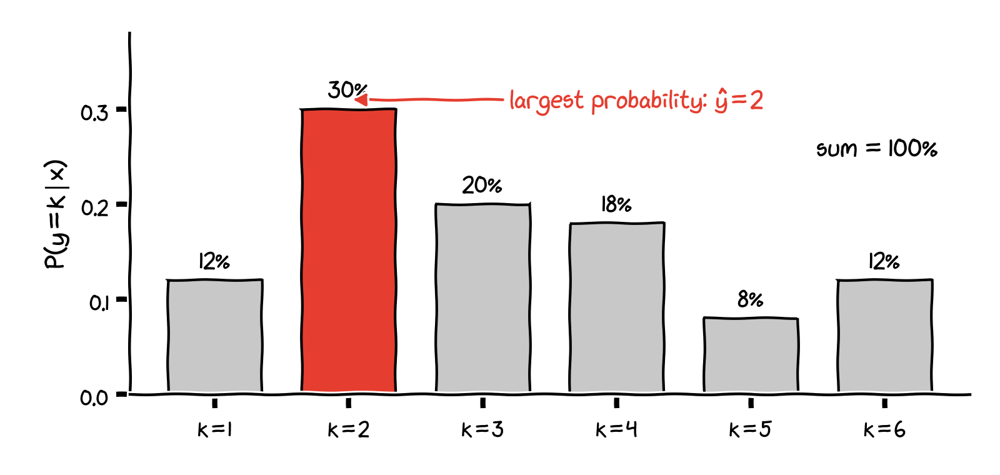
:::
::: {.column width="44%"}
1. Compute all $K$ probabilities $P(y = k \mid \mathbf x)$, $k = 1, \dots, K$.
2. Predict the class with the **largest** probability:
$$
\hat y = \operatorname*{arg\,max}_{k} P(y = k \mid \mathbf x).
$$

In the example $K = 6$, and $\hat y = 2$ because $P(y = 2 \mid \mathbf x) = 30\%$ is the largest.
:::
::::

## The softmax function

Turn $K$ arbitrary real numbers $z_1, \dots, z_K$ ("scores") into a probability distribution:
$$
\operatorname{softmax}(\mathbf z)_k = \frac{e^{z_k}}{\sum_{l=1}^{K} e^{z_l}}, \qquad k = 1, \dots, K.
$$

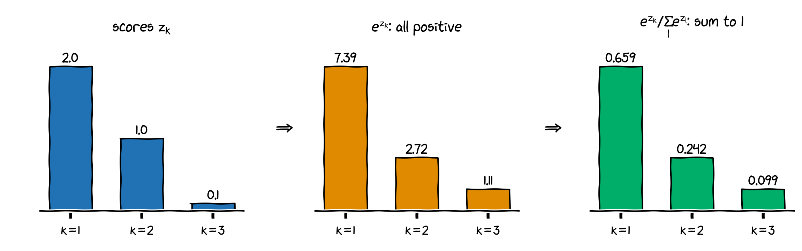{width="76%" fig-align="center"}

- Every output is positive, and $\sum_{k=1}^{K}\operatorname{softmax}(\mathbf z)_k = \big(e^{z_1} + \dots + e^{z_K}\big)\big/\sum_{l} e^{z_l} = 1$.
- The largest score gets the largest probability. Softmax is a "soft" version of picking the maximum.

## The softmax regression model

Each class $k$ gets its own linear score, with its own weights and bias:
$$
z_k = \mathbf w_k\cdot\mathbf x + b_k,
\qquad
P(y = k \mid \mathbf x) = \frac{e^{\mathbf w_k\cdot\mathbf x + b_k}}{\sum_{l=1}^{K} e^{\mathbf w_l\cdot\mathbf x + b_l}},
\qquad k = 1, \dots, K.
$$

. . .

All parameters together: a weight matrix $\mathbf W$ with one **row per class**, and a bias vector $\mathbf b$:
$$
\mathbf W = \begin{pmatrix} \text{---}\ \mathbf w_1\ \text{---}\\ \vdots\\ \text{---}\ \mathbf w_K\ \text{---}\end{pmatrix}
= \begin{pmatrix} w_{11} & w_{12} & \cdots & w_{1n}\\ \vdots & \vdots & \ddots & \vdots\\ w_{K1} & w_{K2} & \cdots & w_{Kn}\end{pmatrix} \in \mathbb R^{K\times n},
\qquad \mathbf b = (b_1, \dots, b_K).
$$

$w_{kj}$ is the weight of feature $j$ for class $k$. In total: $Kn + K = K(n + 1)$ parameters.

## Two classes: back to logistic regression

With $K = 2$ classes, called $0$ and $1$, divide numerator and denominator by $e^{z_1}$:
$$
P(y = 1 \mid \mathbf x) = \frac{e^{z_1}}{e^{z_0} + e^{z_1}} = \frac{1}{1 + e^{z_0 - z_1}} = \frac{1}{1 + e^{-[(\mathbf w_1 - \mathbf w_0)\cdot\mathbf x + (b_1 - b_0)]}} .
$$

. . .

With $\mathbf w = \mathbf w_1 - \mathbf w_0$ and $b = b_1 - b_0$ this is exactly the sigmoid model of part 3a:
$$
P(y = 1 \mid \mathbf x) = g(\mathbf w\cdot\mathbf x + b) = f_{\mathbf w,b}(\mathbf x),
\qquad
P(y = 0 \mid \mathbf x) = 1 - f_{\mathbf w,b}(\mathbf x).
$$

. . .

- Softmax regression **generalises** logistic regression.
- Only **differences** between the class scores matter: adding the same vector to every $\mathbf w_k$ (and the same number to every $b_k$) does not change any probability. Regularisation picks one of these equivalent solutions.

## Decision boundaries

Between classes $j$ and $k$ the boundary is where both are equally likely:
$$
P(y = j \mid \mathbf x) = P(y = k \mid \mathbf x)
\iff e^{z_j} = e^{z_k}
\iff (\mathbf w_k - \mathbf w_j)\cdot\mathbf x + (b_k - b_j) = 0,
$$
a straight line (a hyperplane in $n$ dimensions).

:::: {.columns}
::: {.column width="42%"}
::: build
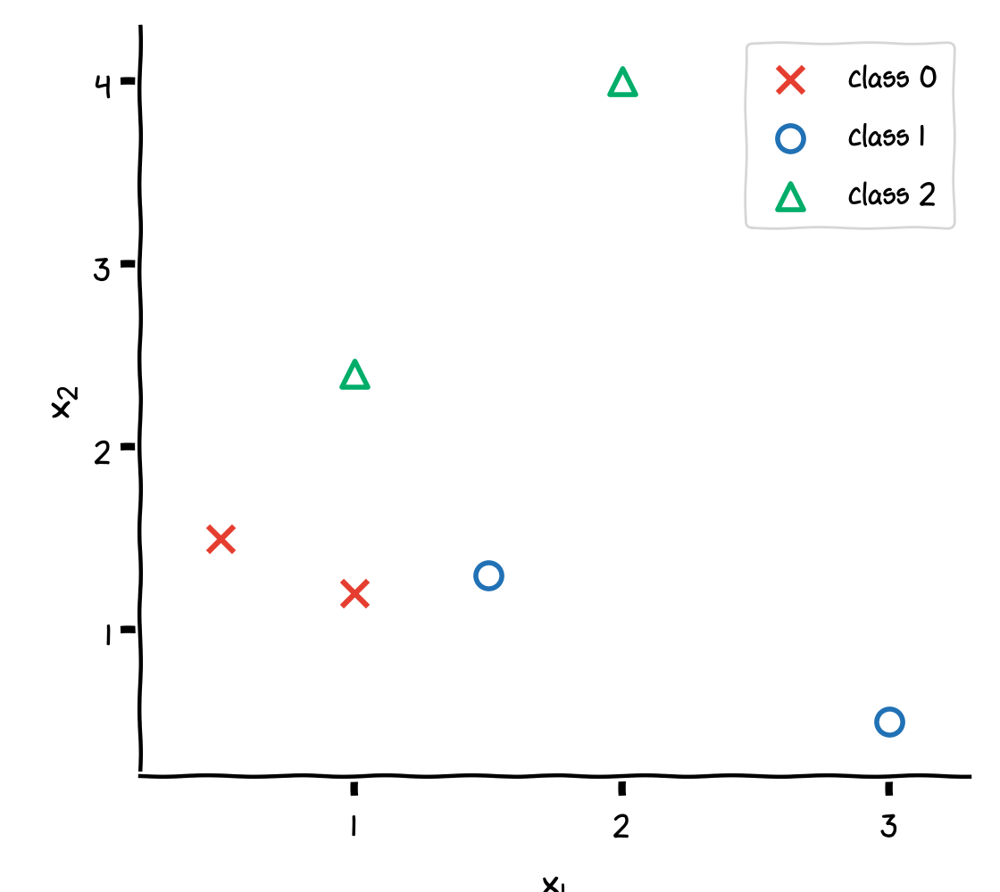{width="90%" fig-align="center"}

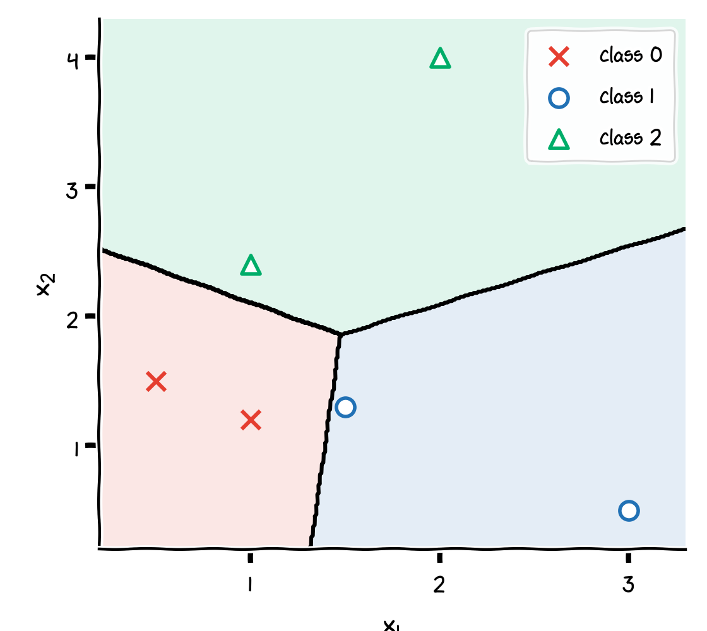{width="90%" fig-align="center"}
:::
:::
::: {.column width="58%"}
. . .

- Each pairwise line only matters where $j$ and $k$ are the two most likely classes.
- So the plane is divided into $K$ **convex regions**, one per class, with straight borders.
- Example: six points in three classes, fitted with scikit-learn (code later in the lecture).
:::
::::

# Training: the cross-entropy loss

## One-hot encoding

Write the label $y^{(i)}$ as a vector of length $K$ with a single $1$:
$$
y = 2,\ K = 3 \quad\longrightarrow\quad \mathbf y = (0,\ 1,\ 0),
\qquad\text{entry } k:\quad
\delta_{k, y} = \begin{cases} 1 & \text{if } k = y\\ 0 & \text{if } k \ne y \end{cases}
$$

. . .

The model's output for the same example is also a vector of length $K$:
$$
\mathbf p = \big(P(y = 1 \mid \mathbf x), \dots, P(y = K \mid \mathbf x)\big),
\qquad p_k = \operatorname{softmax}(\mathbf z)_k .
$$

Training should make $\mathbf p$ close to the one-hot vector $\mathbf y$: a large probability for the true class.

## The cross-entropy loss

::: {.callout-note title="Cost function of softmax regression"}
$$
J(\mathbf W, \mathbf b) = -\frac1m\sum_{i=1}^{m}\sum_{k=1}^{K}\delta_{k, y^{(i)}}\log p_k^{(i)} = -\frac1m\sum_{i=1}^{m}\log p_{y^{(i)}}^{(i)}
$$
:::

- For each example, only one term of the inner sum survives: **minus the log-probability of the true class**. This is the same idea as the logistic loss of part 3a, and again it follows from maximum likelihood.

. . .

Example with $\mathbf p = (0.659,\ 0.242,\ 0.099)$:

| true class | loss $-\log p_y$ |
|:---:|:---:|
| $y = 1$ | $0.42$ (model fairly confident and right) |
| $y = 2$ | $1.42$ |
| $y = 3$ | $2.31$ (the model gave the true class only 10%) |

## Two classes: the binary cross-entropy

For $K = 2$ with classes $0$ and $1$:
$$
\delta_{1, y} = y, \qquad \delta_{0, y} = 1 - y, \qquad p_1 = f_{\mathbf w,b}(\mathbf x), \qquad p_0 = 1 - f_{\mathbf w,b}(\mathbf x).
$$

. . .

So the cross-entropy becomes
$$
J = -\frac1m\sum_{i=1}^{m}\Big[\big(1 - y^{(i)}\big)\log\big(1 - f_{\mathbf w,b}(\mathbf x^{(i)})\big) + y^{(i)}\log f_{\mathbf w,b}(\mathbf x^{(i)})\Big],
$$
which is exactly the logistic cost of part 3a. Softmax regression with its cross-entropy loss contains binary logistic regression as the special case $K = 2$.

## The gradient

For one example, with scores $z_k = \mathbf w_k\cdot\mathbf x + b_k$ and loss $L = -\log p_y$:
$$
\frac{\partial L}{\partial z_k} = p_k - \delta_{k, y}
\qquad \text{(predicted probability minus one-hot label: the error)}.
$$

. . .

Since $\partial z_k/\partial w_{kj} = x_j$ and $\partial z_k/\partial b_k = 1$, averaging over all examples gives
$$
\frac{\partial J}{\partial w_{kj}} = \frac1m\sum_{i=1}^{m}\big(p_k^{(i)} - \delta_{k, y^{(i)}}\big)\,x_j^{(i)},
\qquad
\frac{\partial J}{\partial b_k} = \frac1m\sum_{i=1}^{m}\big(p_k^{(i)} - \delta_{k, y^{(i)}}\big).
$$

Once again: **error times input**, exactly as in Lecture 2 and part 3a.

. . .

::: small
Derivation of the first line: the softmax derivative is $\partial p_y/\partial z_k = p_y(\delta_{k,y} - p_k)$, so $\partial L/\partial z_k = -\frac{1}{p_y}\,p_y(\delta_{k,y} - p_k) = p_k - \delta_{k,y}$.
:::

## Vectorised implementation

:::: {.columns}
::: {.column width="58%"}
```python
import numpy as np

def softmax(Z):
    Z = Z - Z.max(axis=1, keepdims=True)  # stability
    E = np.exp(Z)
    return E / E.sum(axis=1, keepdims=True)

def gradient_descent(X, y, K, lam=1.0,
                     alpha=0.5, n_iters=20000):
    m, n = X.shape
    W, b = np.zeros((K, n)), np.zeros(K)
    Y = np.eye(K)[y]              # one-hot, (m, K)
    for _ in range(n_iters):
        P = softmax(X @ W.T + b)  # (m, K)
        E = P - Y                 # errors
        W = W - alpha * (E.T @ X / m + lam / m * W)
        b = b - alpha * E.mean(axis=0)
    return W, b
```
:::
::: {.column width="42%"}
- `X @ W.T + b` computes all $m \times K$ scores at once.
- `E.T @ X / m` is the gradient $\frac1m(\mathbf P - \mathbf Y)^{\top}\mathbf X$ for all $w_{kj}$.
- With $\lambda = 1$ (Lecture 4) this reproduces scikit-learn's `LogisticRegression(C=1)` on the iris data to three decimals.

**Why subtract the maximum?** $e^{1000}$ overflows: the naive softmax of $(1000, 999, 998)$ gives `nan`. Since $\operatorname{softmax}(\mathbf z - c) = \operatorname{softmax}(\mathbf z)$, subtracting $\max_k z_k$ changes nothing mathematically and gives $(0.665, 0.245, 0.090)$.
:::
::::

# Softmax regression in scikit-learn

## A small example with three classes

:::: {.columns}
::: {.column width="62%"}
```python
import numpy as np
from sklearn.linear_model import LogisticRegression

X_train = np.array([[0.5, 1.5], [1, 1.2], [1.5, 1.3],
                    [3, 0.5], [2, 4], [1, 2.4]])
y_train = np.array([0, 0, 1, 1, 2, 2])

model = LogisticRegression()    # softmax for K > 2
model.fit(X_train, y_train)

model.predict(X_train)          # [0 0 1 1 2 2]
model.predict_proba(X_train[:2])
# [[0.609 0.185 0.206]
#  [0.522 0.309 0.168]]   each row sums to 1
model.coef_        # W, shape (3, 2): one row per class
# [[-0.639 -0.376] [ 0.627 -0.497] [ 0.012  0.873]]
model.intercept_   # b, shape (3,): [ 1.641 -0.002 -1.640]
```
:::
::: {.column width="38%"}
These are the six points of the decision-boundary slide.

- For more than two classes, `LogisticRegression` uses softmax automatically.
- Older code passes `multi_class="multinomial"`. That option was removed in scikit-learn 1.8 and now raises an error: simply leave it out.
- `predict_proba` (not `predict_prob`) returns one row of $K$ probabilities per example.
:::
::::

## Real data: the iris flowers

:::: {.columns}
::: {.column width="58%"}
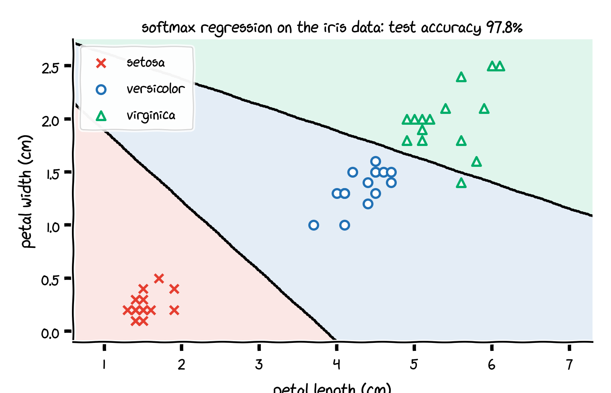
:::
::: {.column width="42%"}
150 iris flowers of three species (setosa, versicolor, virginica), collected by Edgar Anderson and made famous by R. A. Fisher (1936).

- Two features: petal length and petal width.
- 70% of the flowers for training, 30% for testing.
- Softmax regression gives three convex regions with straight borders, and **97.8%** test accuracy.
:::
::::

## The iris example in code

```python
from sklearn.datasets import load_iris
from sklearn.model_selection import train_test_split
from sklearn.pipeline import make_pipeline
from sklearn.preprocessing import StandardScaler
from sklearn.linear_model import LogisticRegression
from sklearn.metrics import confusion_matrix

iris = load_iris()
X, y = iris.data[:, 2:], iris.target          # petal length and width; 3 species
X_train, X_test, y_train, y_test = train_test_split(
    X, y, test_size=0.3, random_state=0, stratify=y)

model = make_pipeline(StandardScaler(), LogisticRegression())
model.fit(X_train, y_train)
model.score(X_test, y_test)                            # 0.978: accuracy
confusion_matrix(y_test, model.predict(X_test))        # see the next slide
```

## Evaluating: the confusion matrix

:::: {.columns}
::: {.column width="45%"}
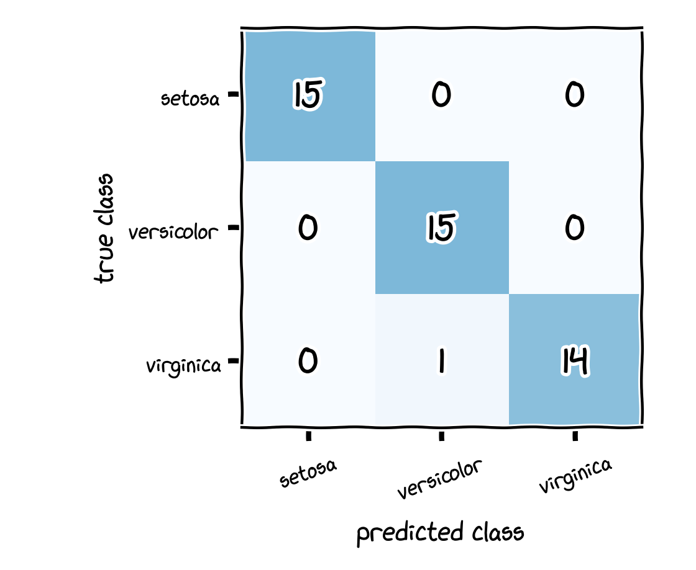
:::
::: {.column width="55%"}
Entry $(i, j)$ counts the test examples of **true** class $i$ that were **predicted** as class $j$.

- The diagonal holds the correct predictions: $15 + 15 + 14 = 44$ of $45$, i.e. accuracy $97.8\%$.
- Off-diagonal entries show **which** classes are confused: here one virginica was predicted as versicolor. Setosa is never confused.
- With many classes, the confusion matrix is much more informative than the accuracy alone.
:::
::::

## An alternative: one-vs-rest

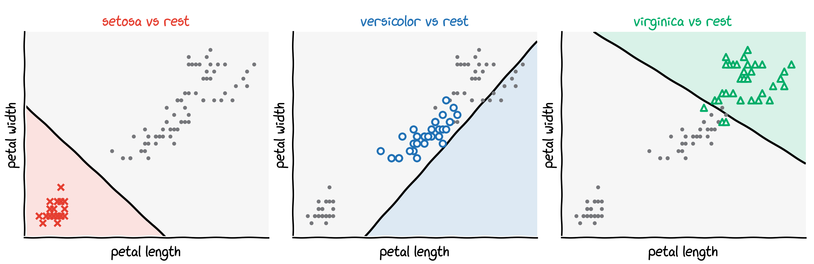{width="84%" fig-align="center"}

- Train $K$ separate **binary** classifiers: "class $k$" against "all other classes".
- Predict the class whose classifier is the most confident.
- Works with any binary classifier (`sklearn.multiclass.OneVsRestClassifier`). Softmax regression instead trains one model whose probabilities are consistent and sum to 1.

## Summary of part 3b

- **Multiclass classification**: $y \in \{1, \dots, K\}$; the model outputs a probability distribution over the $K$ classes, and predicts the most probable class.
- **Softmax**: $\operatorname{softmax}(\mathbf z)_k = e^{z_k}/\sum_l e^{z_l}$; **softmax regression** uses $z_k = \mathbf w_k\cdot\mathbf x + b_k$, with $K(n + 1)$ parameters.
- For $K = 2$, softmax regression **is** logistic regression.
- **Decision regions** are convex, with straight borders $(\mathbf w_k - \mathbf w_j)\cdot\mathbf x + (b_k - b_j) = 0$.
- **Cross-entropy loss**: $J = -\frac1m\sum_i\log p^{(i)}_{y^{(i)}}$; gradient $\frac1m\sum_i(p_k^{(i)} - \delta_{k,y^{(i)}})\,x_j^{(i)}$: error times input.
- **Evaluation**: accuracy and the **confusion matrix**.

## Check your understanding: part 3b

1. Compute $\operatorname{softmax}(1, 1, 1)$. Which class is predicted?
2. How many parameters does softmax regression have for $n = 4$ features and $K = 3$ classes?
3. The model gives $\mathbf p = (0.7, 0.2, 0.1)$ and the true class is $y = 2$. What is the loss for this example?
4. What does an off-diagonal entry of 5 in row "cat", column "dog" of a confusion matrix mean?

::: notes
1. $(1/3, 1/3, 1/3)$: all classes equally likely; with a tie, `argmax` (and scikit-learn) returns the first class.
2. $K(n + 1) = 3 \times 5 = 15$.
3. $-\log 0.2 \approx 1.61$.
4. Five test examples that are really cats were predicted to be dogs.
:::

# Wrapping up

## Lecture 3 at a glance

| | two classes (3a) | $K$ classes (3b) |
|:---|:---|:---|
| labels | $y \in \{0, 1\}$ | $y \in \{1, \dots, K\}$, one-hot vector $\mathbf y$ |
| scores | $z = \mathbf w\cdot\mathbf x + b$ | $z_k = \mathbf w_k\cdot\mathbf x + b_k$, $\ k = 1, \dots, K$ |
| probabilities | $P(y = 1 \mid \mathbf x) = g(z) = \frac{1}{1 + e^{-z}}$ | $P(y = k \mid \mathbf x) = \frac{e^{z_k}}{\sum_l e^{z_l}}$ |
| prediction | $\hat y = 1$ if $g(z) \ge \tau$ | $\hat y = \arg\max_k P(y = k \mid \mathbf x)$ |
| loss | $-y\log g(z) - (1 - y)\log(1 - g(z))$ | $-\log P(y = y^{(i)} \mid \mathbf x)$ |
| gradient | error times input | error times input, for every class |
| scikit-learn | `LogisticRegression` | `LogisticRegression` (softmax automatically) |

: {tbl-colwidths="[16,40,44]"}

**Next lecture**: overfitting, regularisation and model selection, for regression and classification alike.
