## This lecture

By the end of this lecture you should be able to

- recognise **underfitting** (high bias) and **overfitting** (high variance), in regression and in classification;
- name three ways to reduce overfitting;
- write down the **regularised cost function** for linear and logistic regression, and explain the role of $\lambda$;
- derive and implement **gradient descent with regularisation**;
- use a **validation set** to choose the regularisation parameter $\lambda$ and the model complexity;
- use regularisation in **scikit-learn**.

## Where we are

We now have models for both kinds of supervised learning:

- **regression** (Lecture 2): $f_{\mathbf w,b}(\mathbf x) = \mathbf w\cdot\mathbf x + b$, with the squared-error cost;
- **classification** (Lecture 3): logistic and softmax regression, with the logistic and cross-entropy losses.

All of them are trained in the same way: choose the parameters that **minimise the cost on the training set**.

. . .

But a small training cost is not the goal. We want a model that makes good predictions on **new** data. This lecture is about the gap between the two:

- how to **recognise** a model that is too simple or too flexible;
- how to **control** its flexibility with regularisation;
- how to **choose** the model and its settings honestly, with a validation set.

# Underfitting and overfitting

## What do we want? Generalisation

:::: {.columns}
::: {.column width="52%"}
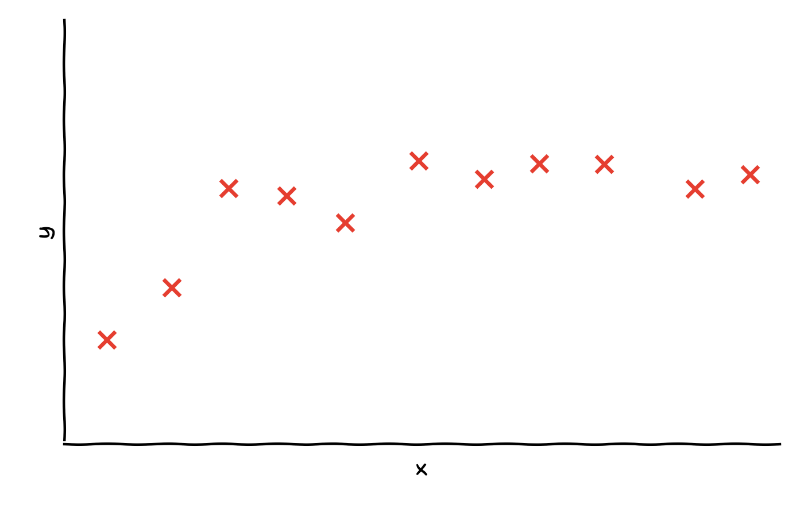
:::
::: {.column width="48%"}
A small training set: $m = 11$ examples.

We could fit polynomials of different degrees, $f_{\mathbf w,b}(x) = w_1x + w_2x^2 + \dots + w_dx^d + b$.

. . .

The goal is **not** to fit these 11 points as closely as possible. The goal is to predict well for **new** inputs $x$ that the model has never seen.

This ability is called **generalisation**.
:::
::::

## Underfitting and overfitting in regression

::: build
::: {}
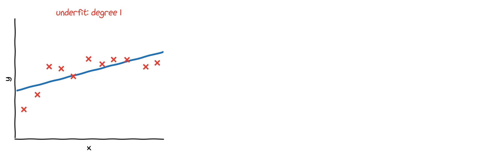{width="92%" fig-align="center"}

**Underfit**, $w_1x + b$: the model is too simple and does not even fit the training set well. It has **high bias**.
:::
::: {}
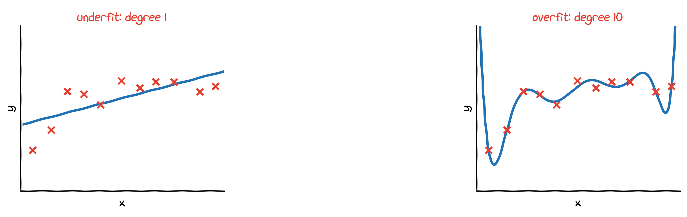{width="92%" fig-align="center"}

**Overfit**, $w_1x + w_2x^2 + \dots + w_{10}x^{10} + b$: the curve passes through every training point, noise included, and swings wildly in between. It has **high variance**.
:::
::: {}
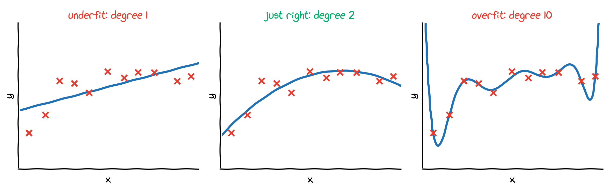{width="92%" fig-align="center"}

**Just right**, $w_1x + w_2x^2 + b$: it follows the trend, ignores the noise, and **generalises** to new $x$.
:::
:::

## Why "bias" and "variance"?

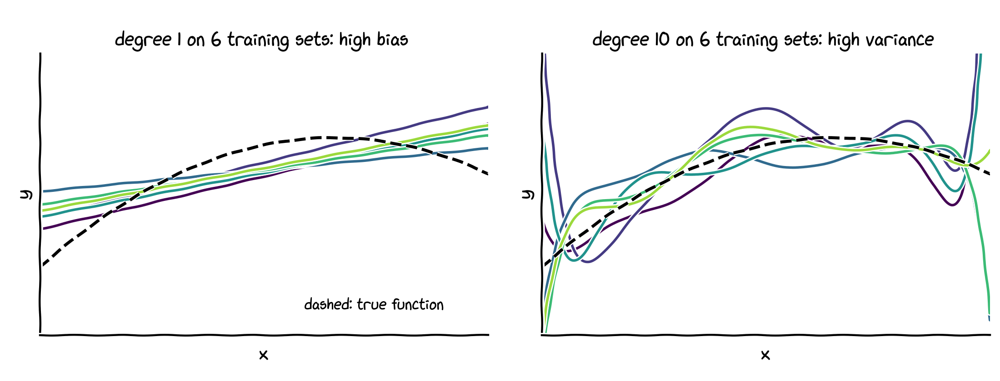{width="70%" fig-align="center"}

Each curve is fitted to a different random training set of 11 points from the same source.

- **High bias** (left): whatever the training set, the straight line misses the true curve in the same way. The model's assumption, "the data lie on a line", is too strong.
- **High variance** (right): the degree-10 curves change completely from one training set to the next. The model reacts to the noise in each particular sample.

## Underfitting and overfitting in classification

::: build
::: {}
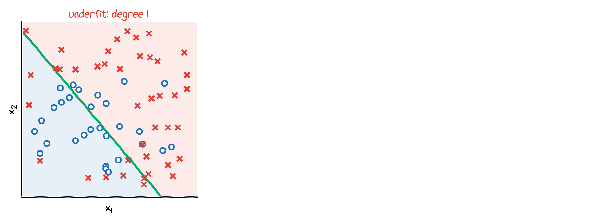{width="88%" fig-align="center"}

**Underfit**: $z = w_1x_1 + w_2x_2 + b$, with $f_{\mathbf w,b}(\mathbf x) = g(z)$. A straight boundary cannot separate the classes (training accuracy 70%).
:::
::: {}
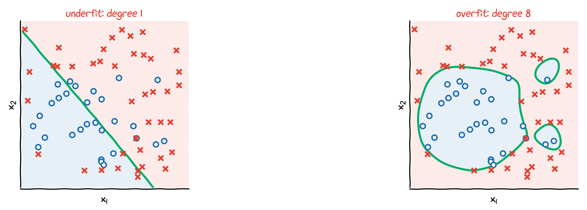{width="88%" fig-align="center"}

**Overfit**: all 44 monomials up to degree 8, $z = w_1x_1 + w_2x_2 + w_3x_1^2 + \dots + w_{44}x_2^8 + b$. Training accuracy 97%, but the islands around single points will not generalise.
:::
::: {}
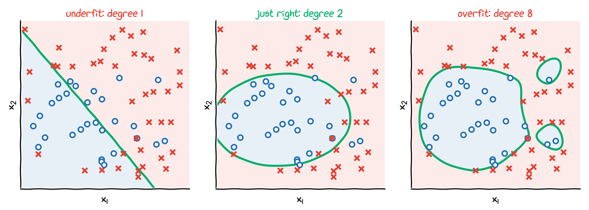{width="88%" fig-align="center"}

**Just right**: $z = w_1x_1 + w_2x_2 + w_3x_1^2 + w_4x_1x_2 + w_5x_2^2 + b$. A smooth, ellipse-like boundary (training accuracy 84%).
:::
:::

# Addressing overfitting

## Option 1: collect more training data

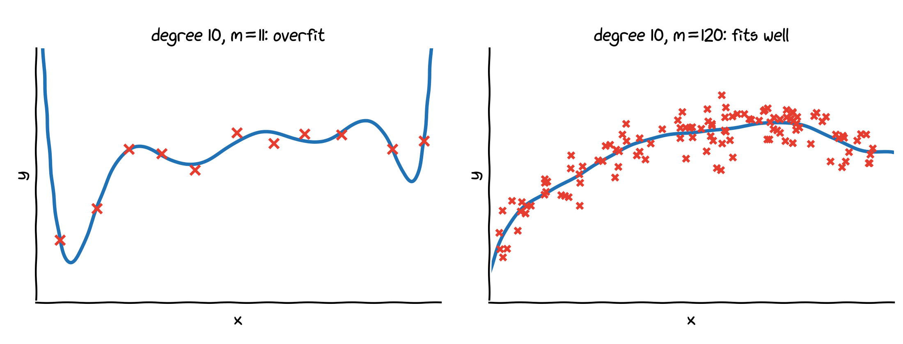{width="80%" fig-align="center"}

- The same degree-10 model: with 11 examples it overfits; with 120 examples it follows the trend.
- More data is often the most effective remedy, but it is not always available: data can be expensive, slow or impossible to collect.

## Option 2: select features

| size | bedrooms | floors | age | avg. income | $\cdots$ | distance to centre | price |
|:-:|:-:|:-:|:-:|:-:|:-:|:-:|:-:|
| $x_1$ | $x_2$ | $x_3$ | $x_4$ | $x_5$ | $\cdots$ | $x_{100}$ | $y$ |

. . .

:::: {.columns}
::: {.column width="34%"}
**All 100 features** with too little data: the model can overfit.
:::
::: {.column width="33%"}
. . .

**Feature selection**: keep only the most relevant ones, e.g. size, bedrooms, age and distance to centre.
:::
::: {.column width="33%"}
. . .

**Disadvantage**: you throw away information, and a discarded feature might have been useful.
:::
::::

. . .

For polynomial models, selecting features means choosing a lower degree.

## Option 3: regularisation

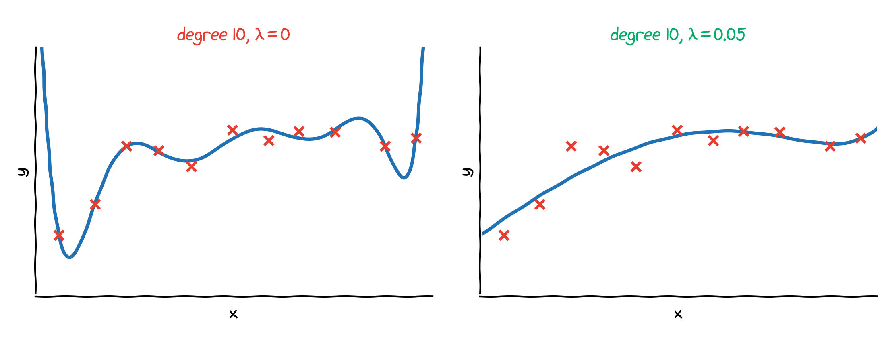{width="76%" fig-align="center"}

- Keep **all** features, but stop the weights from becoming large.
- Both models are degree 10. Without regularisation (left) the largest weight is about $10^6$; with regularisation (right) all weights are below $0.6$, and the curve is smooth.

## Large weights are a symptom of overfitting

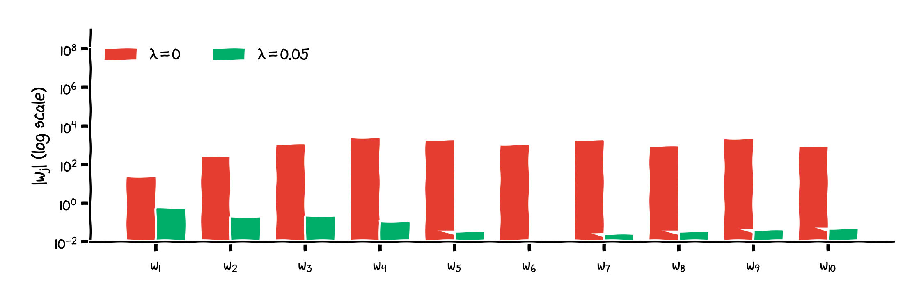{width="84%" fig-align="center"}

- To pass exactly through noisy points, the unregularised model uses huge weights that almost cancel each other.
- Small weights mean that the prediction changes only gently when $x$ changes: a **simpler, smoother** model.
- (Both models use standardised polynomial features; Lecture 2.)

## Three ways to address overfitting

1. **Collect more data.**
2. **Select features**: use fewer features, or a lower polynomial degree.
3. **Regularisation**: keep all features but reduce the size of the weights.

. . .

The rest of this lecture is about option 3: how regularisation works, and how to choose how much of it to use.

# Regularisation

## Intuition: penalise large weights

Suppose we want the degree-10 model to behave like a quadratic. We could add large penalties for the higher-order weights to the cost:
$$
\min_{\mathbf w,b}\ \frac{1}{2m}\sum_{i=1}^{m}\big(f_{\mathbf w,b}(x^{(i)}) - y^{(i)}\big)^2 + {\color{purple}{1000\,w_3^2 + 1000\,w_4^2 + \dots + 1000\,w_{10}^2}} .
$$

. . .

- Any noticeable $w_3, \dots, w_{10}$ now makes the cost large, so the minimiser has $w_3, \dots, w_{10} \approx 0$.
- What is left is approximately $w_1x + w_2x^2 + b$: the "just right" model.

. . .

In practice we do not know which weights matter. So we penalise **all** of them a little, and let the data decide which ones stay large.

## The regularised cost function

::: {.callout-note title="Regularised linear regression"}
$$
J(\mathbf w, b) = \underbrace{\frac{1}{2m}\sum_{i=1}^{m}\big(f_{\mathbf w,b}(\mathbf x^{(i)}) - y^{(i)}\big)^2}_{\text{fit the data}} + \underbrace{\frac{\lambda}{2m}\sum_{j=1}^{n} w_j^2}_{\text{keep the weights small}}
$$
:::

- $\lambda \ge 0$ is the **regularisation parameter**. It sets the balance between the two goals.
- The bias $b$ is not penalised. This is the usual convention; it makes little difference in practice.
- Multiplied by $2m$, the cost reads $\sum_i(f - y)^2 + \lambda\sum_j w_j^2$: the data term grows with $m$, the penalty does not. So the same $\lambda$ regularises **less** when there is more data, which is sensible, because more data already reduces overfitting.
- **Scale the features first.** The penalty compares the sizes of the weights, which only makes sense if all features are on similar scales.

## The role of $\lambda$

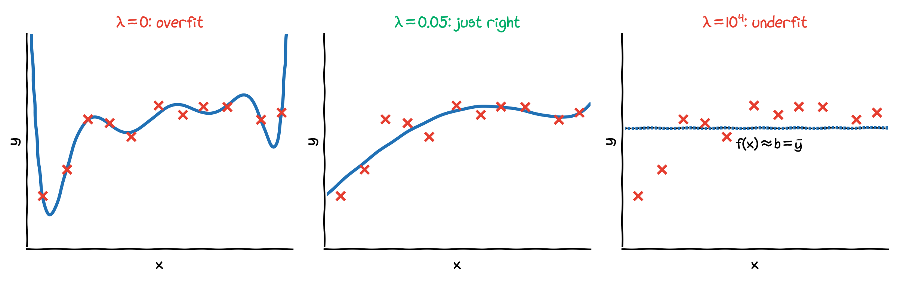{width="90%" fig-align="center"}

- $\lambda = 0$: the ordinary cost; the degree-10 model overfits.
- A well-chosen $\lambda$: smooth curve that follows the trend.
- $\lambda$ very large: every $w_j \approx 0$, so $f_{\mathbf w,b}(x) \approx b$. The best constant is the mean $\bar y$ of the targets, and the model underfits. (Note: $f \approx b$, not $0$, because $b$ is not penalised.)

# Regularised linear regression

## The gradient

$$
J(\mathbf w, b) = \frac{1}{2m}\sum_{i=1}^{m}\big(f_{\mathbf w,b}(\mathbf x^{(i)}) - y^{(i)}\big)^2 + \frac{\lambda}{2m}\sum_{j=1}^{n} w_j^2,
\qquad f_{\mathbf w,b}(\mathbf x) = \mathbf w\cdot\mathbf x + b
$$

. . .

The first term gives the gradient of Lecture 2. The penalty only depends on $w_j$, and $\frac{\partial}{\partial w_j}\frac{\lambda}{2m}w_j^2 = \frac{\lambda}{m}w_j$:
$$
\frac{\partial J}{\partial w_j} = \frac1m\sum_{i=1}^{m}\big(f_{\mathbf w,b}(\mathbf x^{(i)}) - y^{(i)}\big)\,x_j^{(i)} + {\color{purple}{\frac{\lambda}{m}\,w_j}},
\qquad j = 1, \dots, n,
$$
$$
\frac{\partial J}{\partial b} = \frac1m\sum_{i=1}^{m}\big(f_{\mathbf w,b}(\mathbf x^{(i)}) - y^{(i)}\big)
\qquad \text{(unchanged, since $b$ is not penalised)}.
$$

## Gradient descent: weight decay

Repeat, updating all parameters simultaneously:
$$
\left\{\begin{aligned}
w_j &\leftarrow w_j - \alpha\left[\frac1m\sum_{i=1}^{m}\big(f_{\mathbf w,b}(\mathbf x^{(i)}) - y^{(i)}\big)\,x_j^{(i)} + \frac{\lambda}{m}\,w_j\right], \qquad j = 1, \dots, n\\
b &\leftarrow b - \alpha\,\frac1m\sum_{i=1}^{m}\big(f_{\mathbf w,b}(\mathbf x^{(i)}) - y^{(i)}\big)
\end{aligned}\right.
$$

. . .

Rearranging the update for $w_j$:
$$
w_j \leftarrow \underbrace{{\color{purple}{w_j\Big(1 - \alpha\frac{\lambda}{m}\Big)}}}_{\text{shrink $w_j$ slightly}} - \underbrace{\alpha\,\frac1m\sum_{i=1}^{m}\big(f_{\mathbf w,b}(\mathbf x^{(i)}) - y^{(i)}\big)\,x_j^{(i)}}_{\text{the usual update}}
$$

Example: $\alpha = 0.1$, $\lambda = 1$, $m = 1000$ give $1 - \alpha\lambda/m = 0.9999$. Every iteration first shrinks each weight by $0.01\%$, then takes the usual step. This is why regularisation is also called **weight decay**.

## Vectorised implementation

:::: {.columns}
::: {.column width="62%"}
```python
import numpy as np

def gradient_descent_reg(X, y, lam,
                         alpha=0.1, n_iters=1000):
    """Gradient descent for regularised linear
    regression; b is not regularised."""
    m, n = X.shape
    w, b = np.zeros(n), 0.0
    for _ in range(n_iters):
        err = X @ w + b - y                # (m,)
        dJ_dw = X.T @ err / m + lam / m * w
        dJ_db = err.mean()
        w = w - alpha * dJ_dw
        b = b - alpha * dJ_db
    return w, b
```
:::
::: {.column width="38%"}
Compared with Lecture 2, only one term is new: `lam / m * w`.

Checked on the 11-point data set with standardised features $x, \dots, x^4$ and $\lambda = 1$: the result agrees to four decimals with scikit-learn's `Ridge(alpha=1)` and with the normal equation on the next slide.
:::
::::

## The regularised normal equation (optional)

With $\boldsymbol\theta = (b, w_1, \dots, w_n)$ and $\tilde{\mathbf X} = [\,\mathbf 1\ \ \mathbf X\,]$ as in Lecture 2, setting the gradient to zero gives
$$
\big(\tilde{\mathbf X}^{\top}\tilde{\mathbf X} + \lambda\,\mathbf D\big)\,\boldsymbol\theta = \tilde{\mathbf X}^{\top}\mathbf y,
\qquad
\mathbf D = \begin{pmatrix} 0 & & & \\ & 1 & & \\ & & \ddots & \\ & & & 1\end{pmatrix}.
$$

- The $0$ in the top-left corner of $\mathbf D$ means that $b$ is not penalised.
- For $\lambda > 0$ the matrix $\tilde{\mathbf X}^{\top}\tilde{\mathbf X} + \lambda\mathbf D$ is **always invertible**, even with more features than examples or with duplicated features. This is a second benefit of regularisation.

# Regularised logistic regression

## Regularised logistic regression

:::: {.columns}
::: {.column width="56%"}
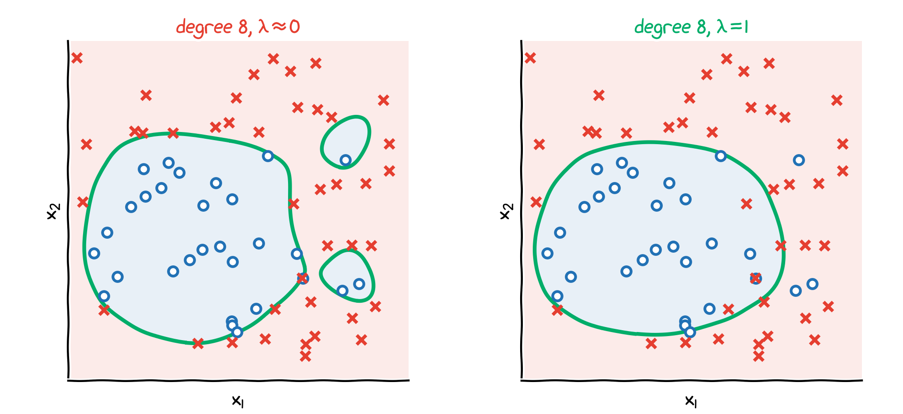
:::
::: {.column width="44%"}
Degree-8 polynomial features, as before:
$$
z = w_1x_1 + w_2x_2 + w_3x_1^2 + \dots + w_{44}x_2^8 + b,
$$
$$
f_{\mathbf w,b}(\mathbf x) = \frac{1}{1 + e^{-z}} .
$$

With $\lambda = 1$ the islands disappear and the boundary becomes smooth.
:::
::::

**Cost function**: the logistic cost of Lecture 3 plus the same penalty,
$$
J(\mathbf w, b) = -\frac1m\sum_{i=1}^{m}\Big[y^{(i)}\log f_{\mathbf w,b}(\mathbf x^{(i)}) + \big(1 - y^{(i)}\big)\log\big(1 - f_{\mathbf w,b}(\mathbf x^{(i)})\big)\Big] + {\color{purple}{\frac{\lambda}{2m}\sum_{j=1}^{n} w_j^2}} .
$$

## Gradient descent for regularised logistic regression

Repeat, updating all parameters simultaneously:
$$
\left\{\begin{aligned}
w_j &\leftarrow w_j - \alpha\left[\frac1m\sum_{i=1}^{m}\big(f_{\mathbf w,b}(\mathbf x^{(i)}) - y^{(i)}\big)\,x_j^{(i)} + \frac{\lambda}{m}\,w_j\right], \qquad j = 1, \dots, n\\
b &\leftarrow b - \alpha\,\frac1m\sum_{i=1}^{m}\big(f_{\mathbf w,b}(\mathbf x^{(i)}) - y^{(i)}\big)
\end{aligned}\right.
$$

- Exactly the same formulas as for regularised linear regression...
- ...but with $f_{\mathbf w,b}(\mathbf x) = g(\mathbf w\cdot\mathbf x + b)$, the sigmoid of the linear part.
- In code: add `lam / m * w` to the gradient of Lecture 3.
- **Softmax regression** (Lecture 3b) is regularised in the same way: add $\frac{\lambda}{2m}\sum_{k=1}^{K}\|\mathbf w_k\|^2$ to the cross-entropy cost; the biases $b_k$ are again not penalised.

# Model selection

## Training, validation and test sets

$\lambda$ and the polynomial degree are **hyperparameters**: they are chosen by us, not learned by gradient descent. To choose them fairly, split the data into three parts:

| set | typical share | used for |
|:---|:---:|:---|
| **training** set | 60% | learning $\mathbf w$ and $b$ for each candidate $\lambda$ |
| **validation** set | 20% | comparing the candidates and picking the best $\lambda$ |
| **test** set | 20% | measuring the final model **once**, at the very end |

. . .

- Do not choose $\lambda$ with the test set: the test error would then be too optimistic, because we tuned to it.
- With little data, use **$k$-fold cross-validation**: split the training data into $k$ parts, use each part once as the validation set, and average the $k$ validation errors.

## Choosing the polynomial degree

:::: {.columns}
::: {.column width="56%"}
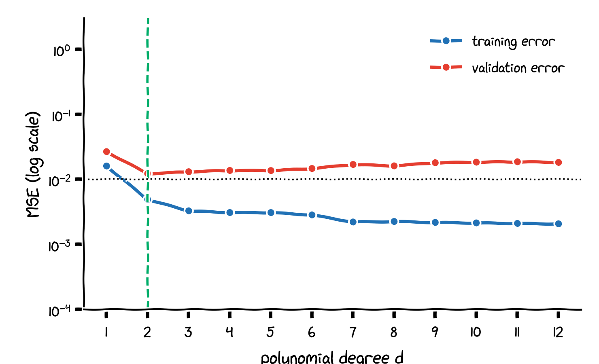
:::
::: {.column width="44%"}
15 training examples, 400 validation examples; no regularisation.

- The **training error** keeps falling as the degree grows: a more flexible model always fits the training set better.
- The **validation error** is lowest at degree 2 and rises again for high degrees: overfitting.
- Choose the degree with the lowest validation error.

The dotted line is the noise level: no model can do better than this on new data.
:::
::::

## Choosing $\lambda$

:::: {.columns}
::: {.column width="56%"}
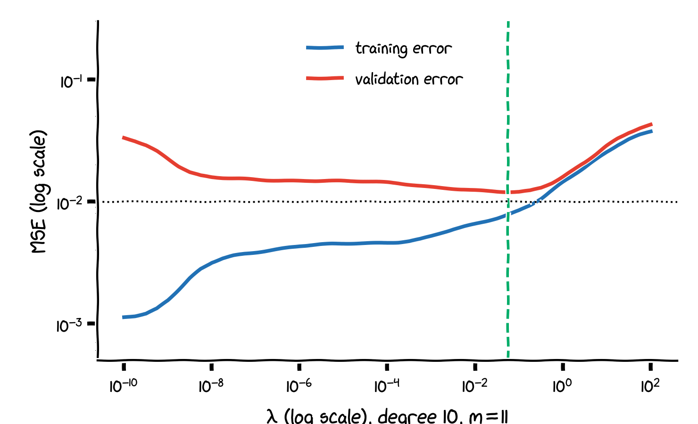
:::
::: {.column width="44%"}
Degree 10, the 11-point training set, $\lambda$ from $10^{-10}$ to $100$.

- **Small $\lambda$**: low training error, higher validation error: high variance.
- **Large $\lambda$**: both errors high: high bias.
- The validation error is lowest around $\lambda \approx 0.05$, the value used in the figures of this lecture.

Typical candidates grow by a factor of about 3 or 10: $0,\ 0.001,\ 0.01,\ 0.1,\ 1,\ 10, \dots$
:::
::::

## Diagnosing bias and variance

Compare the training error with the validation error:

| | training error | validation error | what helps |
|:---|:---:|:---:|:---|
| **high bias** (underfit) | high | high, close to training | more features, higher degree, smaller $\lambda$ |
| **high variance** (overfit) | low | much higher than training | more data, fewer features, larger $\lambda$ |
| **just right** | low | low, close to training | |

. . .

- "High" means high compared with what is achievable, e.g. the noise level or human performance.
- Regularisation moves a model from the high-variance row towards the high-bias row as $\lambda$ grows; the validation set tells us where to stop.

# Regularisation in scikit-learn

## `Ridge`: regularised linear regression

```python
from sklearn.pipeline import make_pipeline
from sklearn.preprocessing import PolynomialFeatures, StandardScaler
from sklearn.linear_model import Ridge
from sklearn.metrics import mean_squared_error

best = None
for lam in [0.0001, 0.001, 0.01, 0.1, 1, 10]:
    model = make_pipeline(PolynomialFeatures(10, include_bias=False),
                          StandardScaler(),        # scale before regularising
                          Ridge(alpha=lam))        # alpha plays the role of lambda
    model.fit(X_train, y_train)
    err = mean_squared_error(y_val, model.predict(X_val))
    if best is None or err < best[1]:
        best = (lam, err, model)

lam, _, model = best                               # chosen: lam = 0.1
test_mse = mean_squared_error(y_test, model.predict(X_test))   # 0.0127, computed once
```

- `Ridge(alpha=lam)` minimises $\sum_i(f(\mathbf x^{(i)}) - y^{(i)})^2 + \lambda\sum_j w_j^2$, which is $2m\cdot J$: the same minimiser as our cost.
- This coarse grid picks $\lambda = 0.1$; the finer search on the previous slides gives $\approx 0.05$. Both work well.

## `LogisticRegression`: the parameter `C`

```python
from sklearn.linear_model import LogisticRegression

model = LogisticRegression(C=1.0)       # default: regularised, C = 1
model = LogisticRegression(C=0.01)      # strong regularisation  (lambda = 100)
model = LogisticRegression(C=100)       # weak regularisation    (lambda = 0.01)
```

- scikit-learn uses $C = 1/\lambda$: a **smaller** $C$ means **more** regularisation.
- The default $C = 1$ means that `LogisticRegression` is always regularised unless you say otherwise (Lecture 3).
- Choose $C$ exactly like $\lambda$: with a validation set or cross-validation, e.g. `LogisticRegressionCV` or `GridSearchCV`.

## Regularisation everywhere

The idea of this lecture, penalising large weights and choosing the strength on validation data, returns in every later model:

| where | the regularisation parameter |
|:---|:---|
| linear and logistic regression | $\lambda$; in scikit-learn `Ridge(alpha=lam)`, `LogisticRegression(C=1/lam)` |
| support vector machines (Lecture 5) | $C$ in `SVC(C=...)`: again, smaller $C$ means more regularisation |
| neural networks in PyTorch (Lectures 6, 7) | `torch.optim.SGD(params, lr=alpha, weight_decay=lam / m)` |

: {tbl-colwidths="[38,62]"}

- PyTorch's `weight_decay` adds `weight_decay * w` to the gradient: with `weight_decay` $= \lambda/m$ it is exactly the update of this lecture (checked numerically). By default it also decays the biases; parameter groups can exclude them.
- Neural networks add further tools against overfitting, such as **dropout** and **early stopping**; the diagnosis with training and validation error stays the same.

# Wrapping up

## Summary

- **Underfitting** (high bias): too simple; poor even on the training set. **Overfitting** (high variance): fits the noise; poor on new data.
- Remedies for overfitting: **more data**, **fewer features**, **regularisation**.
- **Regularised cost**: add $\frac{\lambda}{2m}\sum_{j=1}^{n} w_j^2$ to the cost; $b$ is not penalised; scale the features first.
- **Gradient descent**: add $\frac{\lambda}{m}w_j$ to $\partial J/\partial w_j$; each step shrinks the weights by the factor $1 - \alpha\lambda/m$ (weight decay). Same for linear and logistic regression.
- **$\lambda$**: too small $\Rightarrow$ overfitting; too large $\Rightarrow$ underfitting ($f \approx b$).
- **Choose $\lambda$ and the degree with a validation set** (or cross-validation); use the test set only once.
- **scikit-learn**: `Ridge(alpha=lam)`; `LogisticRegression(C=1/lam)`.

**Next lecture**: support vector machines, a classifier built on the idea of the largest margin, with its own regularisation parameter $C$.

## Check your understanding

1. A model has training error 0.01 and validation error 0.35. Is this high bias or high variance? Name two things that could help.
2. What happens to the weights $w_j$, and to the model, when $\lambda \to \infty$?
3. Why do we usually not include $b$ in the regularisation term?
4. Why must the features be scaled before regularisation?
5. You choose $\lambda$ by picking the value with the lowest **test** error. What is wrong with that?

::: notes
1. High variance (overfitting): the training error is much lower than the validation error. More data, fewer features or a lower degree, or a larger $\lambda$.
2. All $w_j \to 0$, so $f_{\mathbf w,b}(\mathbf x) \to b$, and $b$ becomes the mean of the targets: the model predicts a constant and underfits.
3. $b$ only shifts the prediction up or down; it does not make the model more wiggly, so penalising it does not reduce overfitting and would bias the predictions.
4. The penalty treats all weights equally. A feature measured in large units needs only a small weight, so without scaling the penalty would affect features unequally, depending on their units.
5. The test set has then been used for tuning, so the test error is an optimistic estimate of the performance on new data. Use a validation set (or cross-validation) for choosing $\lambda$.
:::
