## This lecture

By the end of this lecture you should be able to

- explain the **maximum-margin** principle and derive the margin width $2/\|\mathbf w\|$;
- solve constrained optimisation problems with **Lagrange multipliers**, and state and interpret the **KKT conditions**;
- derive the **dual problem** of the SVM and explain why only the **support vectors** matter;
- solve a small SVM **by hand** and check the result with scikit-learn;
- explain the **soft margin**, its box constraints $0 \le \alpha_i \le C$ and the **hinge loss**;
- use **kernels** for nonlinear decision boundaries, and choose $C$ and $\gamma$.

## Where we are

- **Lecture 3**: logistic regression finds a decision boundary $\mathbf w\cdot\mathbf x + b = 0$ by **maximum likelihood**; its output is a probability.
- **Lecture 4**: regularisation and model selection keep models from overfitting.

. . .

The support vector machine (SVM) uses a different principle: among all boundaries that separate the classes, choose the one that stays **as far as possible from the data**.

- This leads to an optimisation problem **with constraints**. To solve it we learn **Lagrange multipliers** and the **KKT conditions**, standard tools across engineering: structural optimisation, control, economics.
- Convention in this lecture: the labels are $y^{(i)} \in \{-1, +1\}$ instead of $\{0, 1\}$, which makes the formulas symmetric.

# The maximum-margin classifier

## Which separating line is best?

:::: {.columns}
::: {.column width="50%"}
::: build
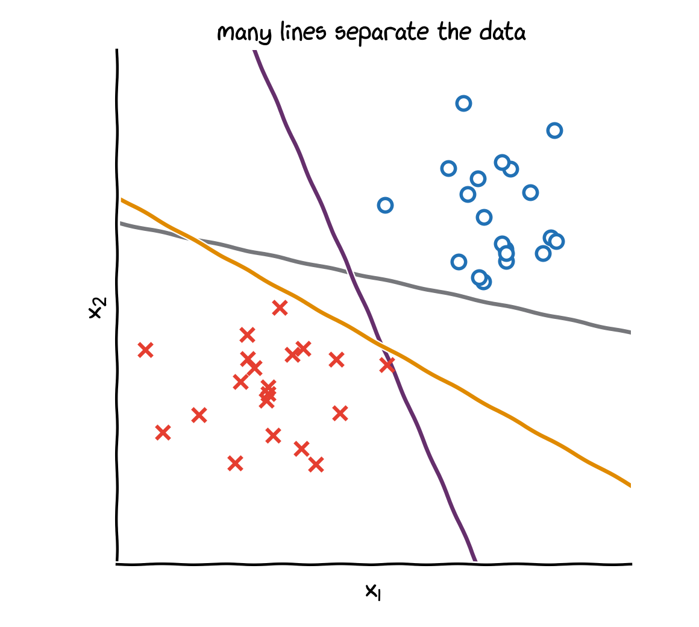{width="88%" fig-align="center"}

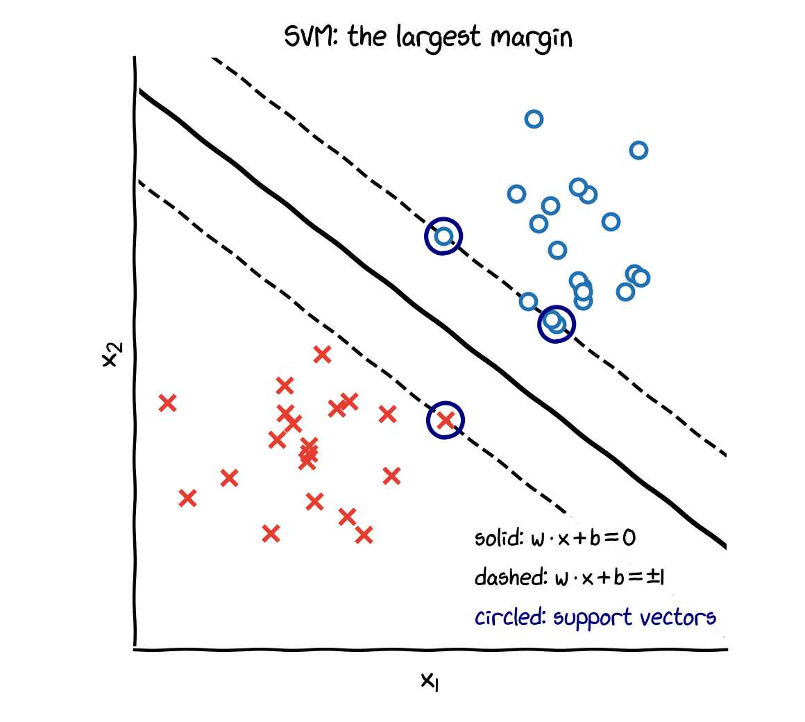{width="88%" fig-align="center"}
:::
:::
::: {.column width="50%"}
Many lines separate these two classes perfectly; some pass very close to the training points.

. . .

A **support vector machine** chooses the line with the **largest margin**: the widest band that contains no training points.

- Only the points on the edge of the band, the **support vectors**, determine the line.
- A large margin leaves room for new points that lie a little off the training data: it tends to **generalise** well.
:::
::::

## The distance to a hyperplane

:::: {.columns}
::: {.column width="48%"}
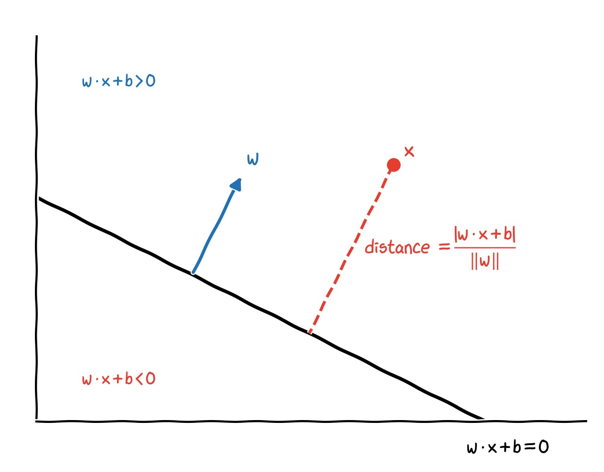
:::
::: {.column width="52%"}
- The hyperplane $H$: $\ \mathbf w\cdot\mathbf x + b = 0$. For two points $\mathbf x_A, \mathbf x_B$ on $H$, $\ \mathbf w\cdot(\mathbf x_A - \mathbf x_B) = 0$: so $\mathbf w$ is **perpendicular** to $H$.
- Write any point as $\mathbf x = \mathbf x_H + r\,\dfrac{\mathbf w}{\|\mathbf w\|}$, with $\mathbf x_H$ on $H$ and $r$ the signed distance. Since $\mathbf w\cdot\mathbf x_H + b = 0$:
$$
\mathbf w\cdot\mathbf x + b = r\,\|\mathbf w\|
\quad\Longrightarrow\quad
r = \frac{\mathbf w\cdot\mathbf x + b}{\|\mathbf w\|} .
$$
- For a correctly classified point, $y\,(\mathbf w\cdot\mathbf x + b) > 0$, so its distance is $\dfrac{y\,(\mathbf w\cdot\mathbf x + b)}{\|\mathbf w\|}$.
:::
::::

## The margin and the hard-margin SVM

- Scaling $(\mathbf w, b) \to (c\,\mathbf w, c\,b)$ with $c > 0$ does not change the hyperplane. We choose the scale so that the closest points satisfy $y^{(i)}(\mathbf w\cdot\mathbf x^{(i)} + b) = 1$.
- Then every training point satisfies $y^{(i)}(\mathbf w\cdot\mathbf x^{(i)} + b) \ge 1$, the closest points lie on $\mathbf w\cdot\mathbf x + b = \pm 1$ at distance $1/\|\mathbf w\|$, and the margin is $2/\|\mathbf w\|$.
- **Maximising the margin** $\Leftrightarrow$ minimising $\|\mathbf w\|$ $\Leftrightarrow$ minimising $\frac12\|\mathbf w\|^2$ (smooth and convex).

::: {.callout-note title="Hard-margin SVM (primal problem)"}
$$
\min_{\mathbf w, b}\ \frac12\|\mathbf w\|^2
\qquad\text{subject to}\qquad
y^{(i)}\big(\mathbf w\cdot\mathbf x^{(i)} + b\big) \ge 1, \quad i = 1, \dots, m.
$$
:::

- A convex quadratic objective with linear constraints: a **convex quadratic programme** with a unique solution. In the figure the margin is $1.46$, set by 3 support vectors.
- Gradient descent on $\frac12\|\mathbf w\|^2$ alone would give $\mathbf w = \mathbf 0$ and ignore the data. We need optimality conditions that include the **constraints**.

# Constrained optimisation: Lagrange multipliers

## An equality constraint

:::: {.columns}
::: {.column width="46%"}
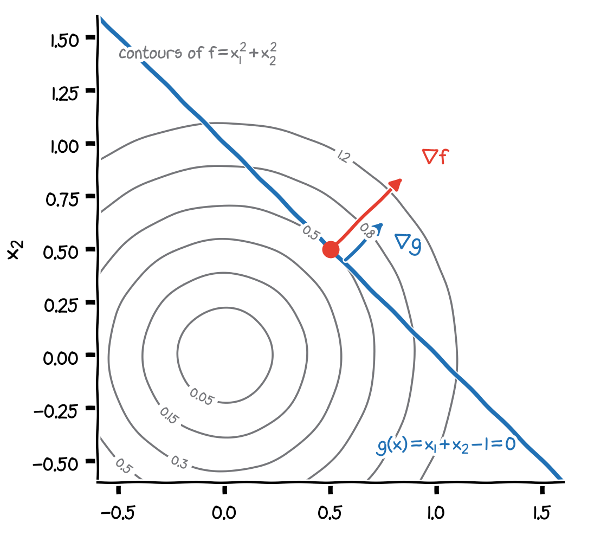
:::
::: {.column width="54%"}
$$
\min_{\mathbf x}\ f(\mathbf x) = x_1^2 + x_2^2
\quad\text{subject to}\quad
g(\mathbf x) = x_1 + x_2 - 1 = 0 .
$$

- Walk along the line $g = 0$: $f$ is smallest where the line just **touches** a contour of $f$.
- There the line and the contour are tangent, so their normals are parallel:
$$
\nabla f(\mathbf x^*) = \lambda\,\nabla g(\mathbf x^*)
$$
for some number $\lambda$: the **Lagrange multiplier**.
- Away from that point, the line crosses contours, so $f$ can still be decreased along the line.
:::
::::

## The Lagrangian

Combine objective and constraint in the **Lagrangian**
$$
\mathcal L(\mathbf x, \lambda) = f(\mathbf x) - \lambda\,g(\mathbf x),
\qquad
\nabla_{\mathbf x}\mathcal L = \nabla f - \lambda\nabla g = \mathbf 0,
\qquad
\frac{\partial\mathcal L}{\partial\lambda} = -g(\mathbf x) = 0 .
$$
The stationary points of $\mathcal L$ satisfy the tangency condition **and** the constraint.

. . .

**Example**: $\ 2x_1 - \lambda = 0$, $\ 2x_2 - \lambda = 0$, $\ x_1 + x_2 = 1$ $\ \Longrightarrow\ $ $x_1 = x_2 = \frac12$, $\ \lambda = 1$, $\ f^* = \frac12$.

. . .

**What $\lambda$ means**: if the constraint becomes $x_1 + x_2 = c$, the optimum is $f^*(c) = c^2/2$, and
$$
\frac{df^*}{dc} = c = \lambda .
$$
Raising $c$ from $1$ to $1.1$ raises $f^*$ from $0.5$ to $0.605 \approx 0.5 + \lambda\cdot 0.1$. The multiplier is the **sensitivity** of the optimum to the constraint, known to engineers and economists as a "shadow price".

## An inequality constraint

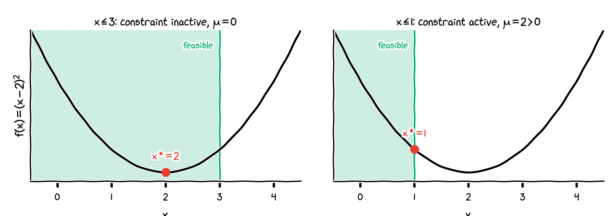{width="58%" fig-align="center"}

$\min_x f(x) = (x - 2)^2$ subject to $g(x) \ge 0$, with Lagrangian $\mathcal L = f - \mu\,g$:

- **Left**, $g(x) = 3 - x \ge 0$: the unconstrained minimum $x = 2$ is feasible. The constraint is **inactive**: it can be ignored, so $\mu = 0$.
- **Right**, $g(x) = 1 - x \ge 0$: the unconstrained minimum is not feasible, so the optimum is on the boundary, $x^* = 1$. The constraint is **active**: $f'(x^*) = \mu\,g'(x^*)$ gives $-2 = -\mu$, so $\mu = 2$.
- At an active constraint, $\mu \ge 0$: moving into the feasible region must not decrease $f$, otherwise $x^*$ would not be optimal.

## The Karush–Kuhn–Tucker (KKT) conditions

::: {.callout-note title="KKT conditions for $\min_{\mathbf x} f(\mathbf x)$ subject to $g_i(\mathbf x) \ge 0$, $i = 1, \dots, m$"}
With the Lagrangian $\mathcal L(\mathbf x, \boldsymbol\mu) = f(\mathbf x) - \sum_i \mu_i\,g_i(\mathbf x)$, an optimum $\mathbf x^*$ has multipliers $\mu_i$ with

1. **stationarity**: $\ \nabla f(\mathbf x^*) - \sum_{i=1}^{m}\mu_i\nabla g_i(\mathbf x^*) = \mathbf 0$;
2. **primal feasibility**: $\ g_i(\mathbf x^*) \ge 0$ for all $i$;
3. **dual feasibility**: $\ \mu_i \ge 0$ for all $i$;
4. **complementary slackness**: $\ \mu_i\,g_i(\mathbf x^*) = 0$ for all $i$.
:::

- Condition 4 says: for every constraint, **either** it is active ($g_i = 0$) **or** its multiplier is zero ($\mu_i = 0$). An inactive constraint does not influence the solution.
- For **convex** problems (convex $f$, linear constraints, as for the SVM) the KKT conditions are not only necessary but also **sufficient**: a point that satisfies them is the global optimum.
- Named after W. Karush (1939) and H. W. Kuhn and A. W. Tucker (1951).

## KKT on the example

With $g(x) = c - x$ we have $g' = -1$, so stationarity reads $f'(x^*) + \mu = 2(x^* - 2) + \mu = 0$.

| condition | $x \le 3$: $\ x^* = 2$, $\mu = 0$ | $x \le 1$: $\ x^* = 1$, $\mu = 2$ |
|:---|:---|:---|
| stationarity $\ 2(x^* - 2) + \mu = 0$ | $0 + 0 = 0$ ✓ | $-2 + 2 = 0$ ✓ |
| primal feasibility $\ g(x^*) \ge 0$ | $3 - 2 = 1 \ge 0$ ✓ | $1 - 1 = 0 \ge 0$ ✓ |
| dual feasibility $\ \mu \ge 0$ | $0 \ge 0$ ✓ | $2 \ge 0$ ✓ |
| complementary slackness $\ \mu\,g(x^*) = 0$ | $0 \cdot 1 = 0$ ✓ (inactive) | $2 \cdot 0 = 0$ ✓ (active) |

: {tbl-colwidths="[40,30,30]"}

Both points satisfy all four conditions, and the problem is convex: both are the global optima of their problems.

# The SVM through the KKT conditions

## The Lagrangian of the SVM

The constraints are $g_i(\mathbf w, b) = y^{(i)}(\mathbf w\cdot\mathbf x^{(i)} + b) - 1 \ge 0$. With one multiplier $\alpha_i \ge 0$ per training example:
$$
\mathcal L(\mathbf w, b, \boldsymbol\alpha) = \frac12\|\mathbf w\|^2 - \sum_{i=1}^{m}\alpha_i\Big[y^{(i)}\big(\mathbf w\cdot\mathbf x^{(i)} + b\big) - 1\Big].
$$
(The $\alpha_i$ are Lagrange multipliers, not learning rates; the name follows the SVM literature and scikit-learn.)

. . .

**Stationarity** with respect to $\mathbf w$ and $b$:
$$
\nabla_{\mathbf w}\mathcal L = \mathbf w - \sum_{i=1}^{m}\alpha_i y^{(i)}\mathbf x^{(i)} = \mathbf 0
\ \ \Longrightarrow\ \
\mathbf w = \sum_{i=1}^{m}\alpha_i y^{(i)}\mathbf x^{(i)},
\qquad
\frac{\partial\mathcal L}{\partial b} = -\sum_{i=1}^{m}\alpha_i y^{(i)} = 0 .
$$

## What the KKT conditions tell us

- primal feasibility: $\ y^{(i)}(\mathbf w\cdot\mathbf x^{(i)} + b) \ge 1$: every point is correctly classified and outside the margin;
- dual feasibility: $\ \alpha_i \ge 0$;
- complementary slackness: $\ \alpha_i\Big[y^{(i)}\big(\mathbf w\cdot\mathbf x^{(i)} + b\big) - 1\Big] = 0$.

. . .

**Consequences**

- A point strictly outside the margin, $y^{(i)}(\mathbf w\cdot\mathbf x^{(i)} + b) > 1$, has $\alpha_i = 0$.
- Only points exactly **on** the margin can have $\alpha_i > 0$: these are the **support vectors**.
- $\mathbf w = \sum_{\text{support vectors}}\alpha_i y^{(i)}\mathbf x^{(i)}$: the boundary depends on the support vectors only. Removing any other point does not change the solution.
- $b$ follows from any support vector $s$: $\ y^{(s)}(\mathbf w\cdot\mathbf x^{(s)} + b) = 1$ gives $b = y^{(s)} - \mathbf w\cdot\mathbf x^{(s)}$ (since $1/y^{(s)} = y^{(s)}$).

## The dual problem

Substitute $\mathbf w = \sum_i\alpha_i y^{(i)}\mathbf x^{(i)}$ and $\sum_i\alpha_i y^{(i)} = 0$ into $\mathcal L$:
$$
\begin{aligned}
\tfrac12\|\mathbf w\|^2 &= \tfrac12\sum_{i,j}\alpha_i\alpha_j y^{(i)}y^{(j)}\,\mathbf x^{(i)}\cdot\mathbf x^{(j)},\\
\sum_i\alpha_i y^{(i)}\,\mathbf w\cdot\mathbf x^{(i)} &= \sum_{i,j}\alpha_i\alpha_j y^{(i)}y^{(j)}\,\mathbf x^{(i)}\cdot\mathbf x^{(j)},
\qquad b\sum_i\alpha_i y^{(i)} = 0 .
\end{aligned}
$$

::: {.callout-note title="Dual problem of the hard-margin SVM"}
$$
\max_{\boldsymbol\alpha}\ \sum_{i=1}^{m}\alpha_i - \frac12\sum_{i=1}^{m}\sum_{j=1}^{m}\alpha_i\alpha_j\,y^{(i)}y^{(j)}\,{\color{red}{\mathbf x^{(i)}\cdot\mathbf x^{(j)}}}
\qquad\text{subject to}\qquad
\alpha_i \ge 0,\quad \sum_{i=1}^{m}\alpha_i y^{(i)} = 0 .
$$
:::

- For this convex problem the optimal values of the primal and the dual problem are equal (**strong duality**).
- **Prediction**: $\ f(\mathbf x) = \sum_{\text{support vectors}}\alpha_i y^{(i)}\,\mathbf x^{(i)}\cdot\mathbf x + b$, $\ \hat y = \operatorname{sign} f(\mathbf x)$.

## Why the dual?

- **Unknowns**: $m$ multipliers, one per example, instead of $n + 1$ weights. Attractive when there are many features.
- **Dot products only**: the data enter only through $\mathbf x^{(i)}\cdot\mathbf x^{(j)}$ (red above). This is what makes **kernels** possible (later in this lecture).
- **Sparsity**: most $\alpha_i$ are zero; the model stores only the support vectors.
- **Solvers**: specialised algorithms for this quadratic programme, such as sequential minimal optimisation (SMO), used by the LIBSVM library behind scikit-learn's `SVC`.

# A worked example by hand

## Three points

:::: {.columns}
::: {.column width="44%"}
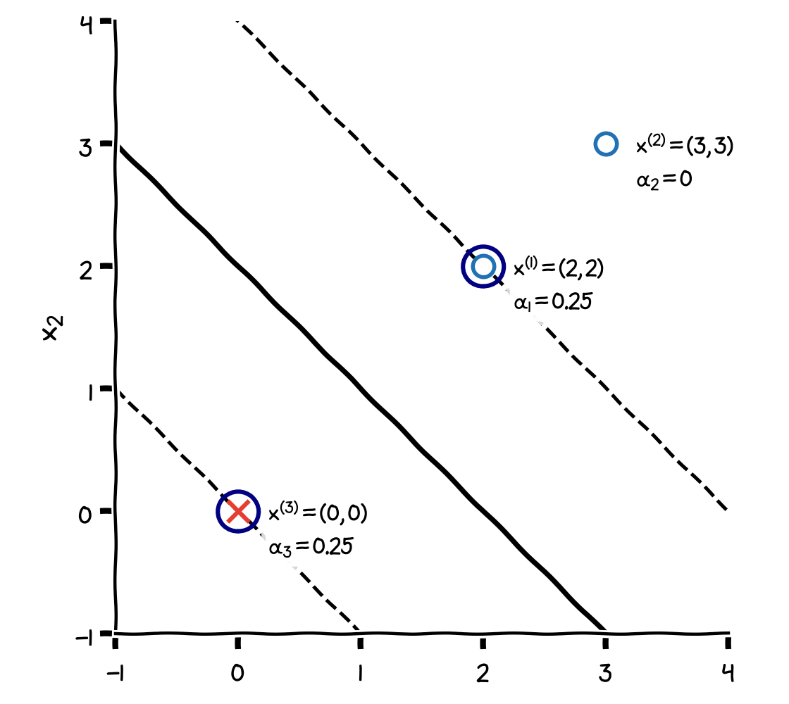
:::
::: {.column width="56%"}
$\mathbf x^{(1)} = (2, 2)$ and $\mathbf x^{(2)} = (3, 3)$ with $y = +1$; $\ \mathbf x^{(3)} = (0, 0)$ with $y = -1$.

1. **Guess the support vectors** from the picture: $\mathbf x^{(1)}$ and $\mathbf x^{(3)}$ face each other; $\mathbf x^{(2)}$ is farther away, so $\alpha_2 = 0$.
2. **Stationarity in $b$**: $\ \alpha_1 - \alpha_3 = 0$, so $\alpha_1 = \alpha_3 =: \alpha$.
3. **Stationarity in $\mathbf w$**: $\ \mathbf w = \alpha\,(2, 2) - \alpha\,(0, 0) = (2\alpha, 2\alpha)$.
4. **Active constraints** (complementary slackness with $\alpha > 0$):
   $\mathbf x^{(3)}$: $\ -(0 + b) = 1$, so $b = -1$;
   $\mathbf x^{(1)}$: $\ 4\alpha + 4\alpha - 1 = 1$, so $\alpha = \frac14$.

Result: $\ \mathbf w = (\frac12, \frac12)$, $\ b = -1$, $\ \boldsymbol\alpha = (\frac14, 0, \frac14)$.
:::
::::

## Checking all KKT conditions

| condition | check |
|:---|:---|
| stationarity | $\mathbf w = \frac14(2, 2) + 0\cdot(3, 3) - \frac14(0, 0) = (\frac12, \frac12)$ ✓; $\ \sum_i\alpha_i y^{(i)} = \frac14 + 0 - \frac14 = 0$ ✓ |
| primal feasibility | $y^{(i)}(\mathbf w\cdot\mathbf x^{(i)} + b)$: $\ (2 - 1) = 1$, $\ (3 - 1) = 2$, $\ -(0 - 1) = 1$, all $\ge 1$ ✓ |
| dual feasibility | $\boldsymbol\alpha = (\frac14, 0, \frac14) \ge 0$ ✓ |
| complementary slackness | $\frac14\cdot 0 = 0$, $\ 0 \cdot 1 = 0$, $\ \frac14 \cdot 0 = 0$ ✓ |

: {tbl-colwidths="[28,72]"}

- All four conditions hold and the problem is convex, so this **is** the optimum.
- Margin: $2/\|\mathbf w\| = 2/(1/\sqrt2) = 2\sqrt2 \approx 2.83$, exactly the distance between $(0, 0)$ and $(2, 2)$.
- Dual objective at $\alpha = \frac14$: $\ \sum\alpha_i - \frac12\|\mathbf w\|^2 = \frac12 - \frac14 = \frac14 = \frac12\|\mathbf w\|^2$: primal and dual values agree.

## The same in scikit-learn

```python
import numpy as np
from sklearn.svm import SVC

X = np.array([[2.0, 2.0], [3.0, 3.0], [0.0, 0.0]])
y = np.array([1, 1, -1])
svm = SVC(kernel="linear", C=1e6).fit(X, y)   # very large C: (almost) a hard margin

svm.coef_, svm.intercept_    # [[0.5, 0.5]], [-1.0]
svm.support_                 # [2, 0]: the support vectors are x^(3) and x^(1)
svm.dual_coef_               # [[-0.25, 0.25]]: y_i * alpha_i of the support vectors
```

- `dual_coef_` stores $y^{(i)}\alpha_i$ for the support vectors: $\alpha_3 = \alpha_1 = \frac14$, exactly as by hand.
- $\mathbf x^{(2)}$ is not a support vector ($\alpha_2 = 0$): moving it further away does not change the classifier.

# Soft margin

## When the data are not separable

Real data overlap, so no line satisfies all constraints. Allow violations, at a price $\xi_i \ge 0$ per point:

::: {.callout-note title="Soft-margin SVM (primal problem)"}
$$
\min_{\mathbf w, b, \boldsymbol\xi}\ \frac12\|\mathbf w\|^2 + C\sum_{i=1}^{m}\xi_i
\qquad\text{subject to}\qquad
y^{(i)}\big(\mathbf w\cdot\mathbf x^{(i)} + b\big) \ge 1 - \xi_i,\quad \xi_i \ge 0 .
$$
:::

- $\xi_i = 0$: on or outside the margin, on the correct side.
- $0 < \xi_i \le 1$: inside the margin, still on the correct side.
- $\xi_i > 1$: on the **wrong** side of the boundary (misclassified).
- $C > 0$ sets the price of violations: the trade-off between a wide margin and few violations.

## KKT for the soft margin

Two kinds of constraints, two kinds of multipliers: $\alpha_i \ge 0$ for the margin constraints and $r_i \ge 0$ for $\xi_i \ge 0$:
$$
\mathcal L = \frac12\|\mathbf w\|^2 + C\sum_i\xi_i - \sum_i\alpha_i\Big[y^{(i)}\big(\mathbf w\cdot\mathbf x^{(i)} + b\big) - 1 + \xi_i\Big] - \sum_i r_i\,\xi_i .
$$

. . .

Stationarity gives the same two equations as before, plus one new one:
$$
\mathbf w = \sum_i\alpha_i y^{(i)}\mathbf x^{(i)},
\qquad
\sum_i\alpha_i y^{(i)} = 0,
\qquad
\frac{\partial\mathcal L}{\partial\xi_i} = C - \alpha_i - r_i = 0 .
$$

. . .

Since $r_i \ge 0$, the last equation gives $\alpha_i = C - r_i \le C$: the **box constraint**
$$
0 \le \alpha_i \le C .
$$
Substituting back, the $\xi_i$ disappear: the dual is **exactly** the hard-margin dual, with $0 \le \alpha_i \le C$ instead of $\alpha_i \ge 0$.

## Three kinds of points

:::: {.columns}
::: {.column width="50%"}
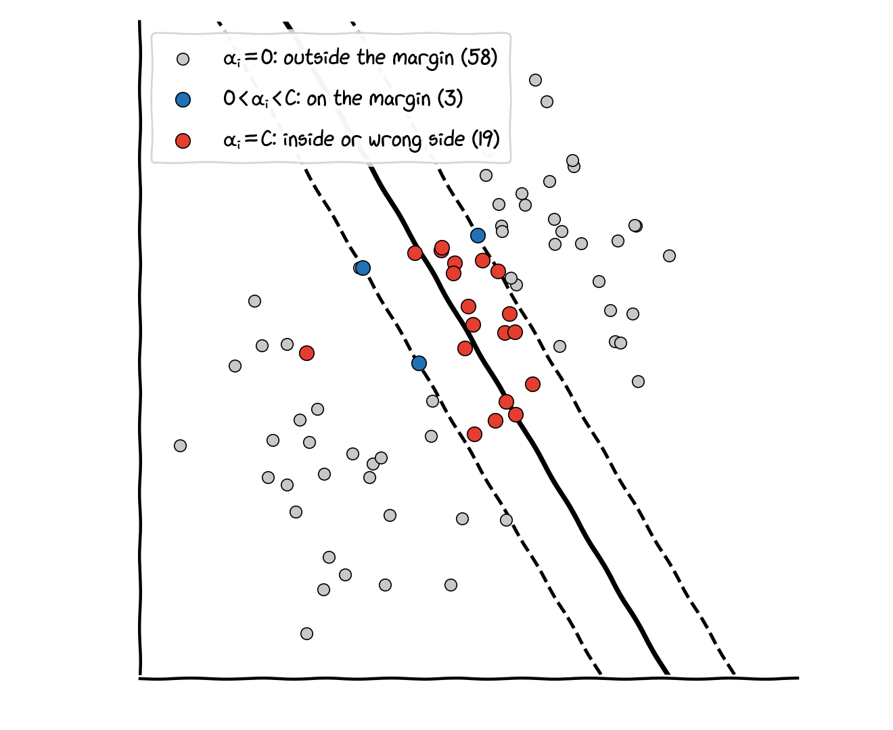
:::
::: {.column width="50%"}
Complementary slackness, $\alpha_i[\dots] = 0$ and $(C - \alpha_i)\,\xi_i = 0$, sorts the points:

| $\alpha_i$ | consequence | here, $C = 1$ |
|:---|:---|:---:|
| $0$ | $y^{(i)}f(\mathbf x^{(i)}) \ge 1$: outside the margin | 58 |
| $(0, C)$ | $y^{(i)}f(\mathbf x^{(i)}) = 1$: on the margin | 3 |
| $C$ | $y^{(i)}f(\mathbf x^{(i)}) \le 1$: inside, or wrong side | 19 |

: {tbl-colwidths="[16,64,20]"}

7 of the 19 points with $\alpha_i = C$ are misclassified. $b$ is computed from points with $0 < \alpha_i < C$.
:::
::::

## The parameter $C$

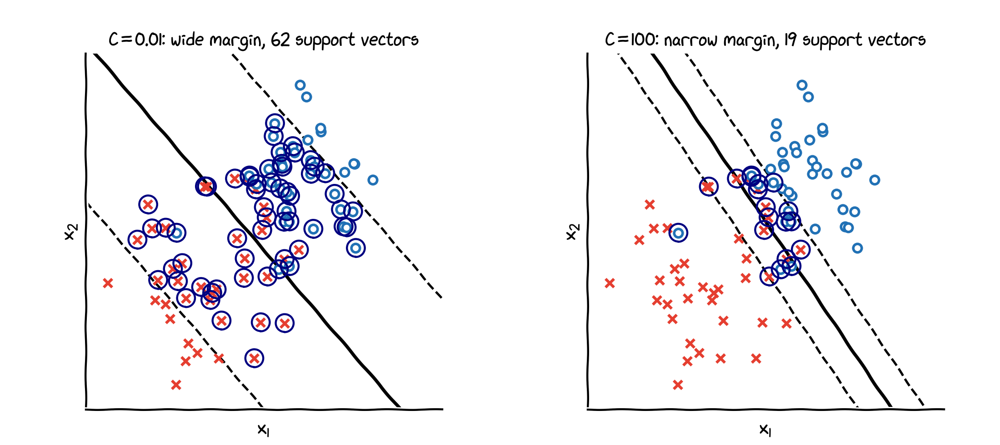{width="60%" fig-align="center"}

- **Small $C$**: violations are cheap, the margin is wide and many points are support vectors: strong regularisation, risk of underfitting.
- **Large $C$**: violations are expensive, the margin is narrow: weak regularisation, risk of overfitting.
- Choose $C$ with a validation set or cross-validation (Lecture 4).

## The hinge-loss view

At the optimum each $\xi_i$ is as small as the constraints allow: $\ \xi_i = \max\big(0,\ 1 - y^{(i)}f(\mathbf x^{(i)})\big)$. Substituting, and dividing by $Cm$:
$$
\min_{\mathbf w, b}\ \frac1m\sum_{i=1}^{m}\underbrace{\max\big(0,\ 1 - y^{(i)}f(\mathbf x^{(i)})\big)}_{\text{hinge loss}} + \frac{\lambda}{2m}\|\mathbf w\|^2,
\qquad \lambda = \frac1C .
$$

:::: {.columns}
::: {.column width="52%"}
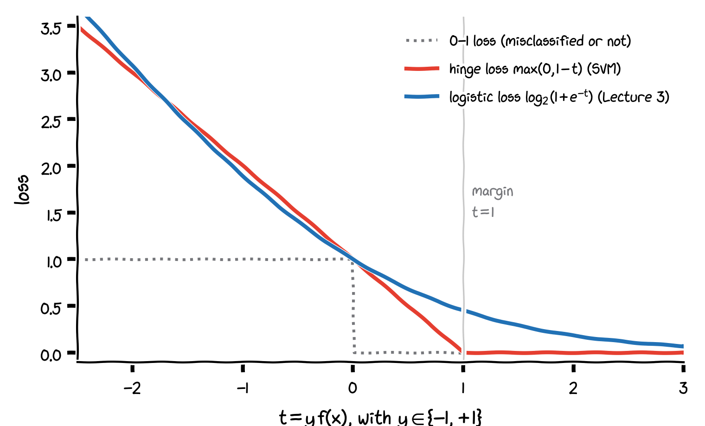{width="86%"}
:::
::: {.column width="48%"}
- **Hinge loss plus L2 regularisation**, as in Lecture 4, with $C = 1/\lambda$.
- Hinge loss is **zero** for $y f \ge 1$: points beyond the margin do not count (sparse solution).
- Logistic loss is never zero: every point counts a little, and it gives probabilities.
- No constraints: (sub)gradient descent works, e.g. `SGDClassifier(loss="hinge")`.
:::
::::

# Kernels

## The kernel trick

The dual problem and the prediction use the data **only** through dot products $\mathbf x^{(i)}\cdot\mathbf x^{(j)}$. Replace them by a **kernel**
$$
K(\mathbf x, \mathbf z) = \Phi(\mathbf x)\cdot\Phi(\mathbf z),
$$
the dot product after a feature map $\Phi$, without ever computing $\Phi$.

. . .

**Example**: for $\mathbf x, \mathbf z \in \mathbb R^2$,
$$
K(\mathbf x, \mathbf z) = (\mathbf x\cdot\mathbf z)^2 = x_1^2z_1^2 + 2x_1x_2z_1z_2 + x_2^2z_2^2 = \Phi(\mathbf x)\cdot\Phi(\mathbf z),
\qquad
\Phi(\mathbf x) = \big(x_1^2,\ \sqrt2\,x_1x_2,\ x_2^2\big).
$$

- Computing $K$ costs one dot product and one square. With $n = 100$ features and degree $3$, the feature map would have $\binom{102}{3} = 171{,}700$ components; the kernel $(\mathbf x\cdot\mathbf z)^3$ still costs about 100 multiplications.
- The SVM then works with the decision function $f(\mathbf x) = \sum_{\text{support vectors}}\alpha_i y^{(i)}K(\mathbf x^{(i)}, \mathbf x) + b$.

## The Gaussian (RBF) kernel

$$
K(\mathbf x, \mathbf z) = \exp\big(-\gamma\,\|\mathbf x - \mathbf z\|^2\big), \qquad \gamma = \frac{1}{2\sigma^2} > 0 .
$$

- A **similarity**: $1$ for identical points, close to $0$ for points far apart.
- It corresponds to a feature map with **infinitely many** components; only the kernel makes it usable.
- The decision function is a sum of "bumps" centred on the support vectors.

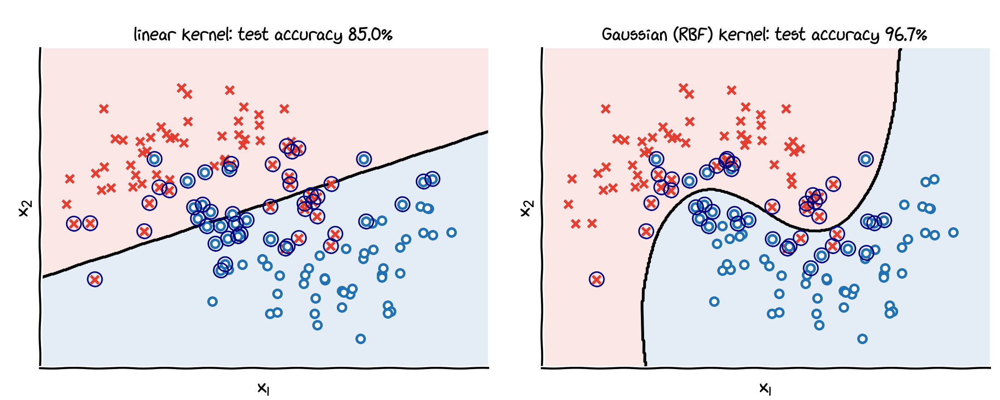{width="70%" fig-align="center"}

## Choosing $C$ and $\gamma$

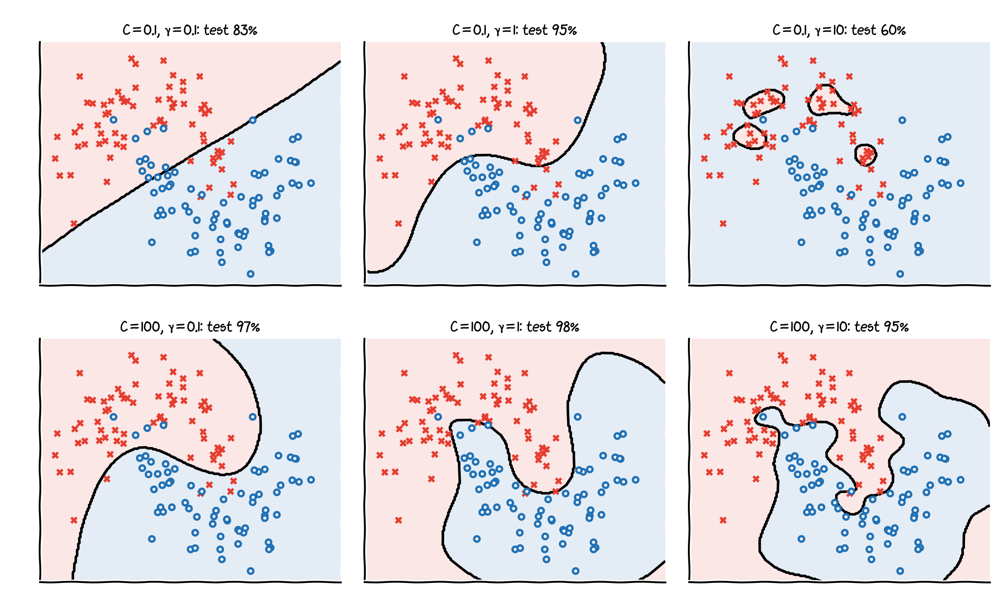{width="50%" fig-align="center"}

- **Small $\gamma$**: wide bumps, smooth boundary, risk of underfitting. **Large $\gamma$**: narrow bumps, islands around single points, risk of overfitting ($C = 100$, $\gamma = 10$: training accuracy 99.3%, test 95%).
- $C$ and $\gamma$ interact; choose them together by cross-validation (Lecture 4).

# SVMs in practice

## SVMs in scikit-learn

```python
from sklearn.datasets import make_moons
from sklearn.model_selection import GridSearchCV, train_test_split
from sklearn.pipeline import make_pipeline
from sklearn.preprocessing import StandardScaler
from sklearn.svm import SVC

X, y = make_moons(n_samples=200, noise=0.2, random_state=0)
X_train, X_test, y_train, y_test = train_test_split(X, y, test_size=0.3, random_state=0)

model = make_pipeline(StandardScaler(), SVC(kernel="rbf"))
grid = GridSearchCV(model, {"svc__C": [0.1, 1, 10, 100], "svc__gamma": [0.01, 0.1, 1, 10]}, cv=5)
grid.fit(X_train, y_train)
grid.best_params_            # {'svc__C': 1, 'svc__gamma': 1}
grid.score(X_test, y_test)   # 0.983
```

- **Scale the features**: the RBF kernel uses distances (Lecture 2).
- `SVC` handles $K > 2$ classes by training one SVM for every pair of classes; probabilities only with `probability=True`.
- Training a kernel SVM takes at least quadratic time in $m$: for very large data sets use `LinearSVC` or `SGDClassifier`.

## SVM or logistic regression?

| | logistic regression (Lecture 3) | support vector machine |
|:---|:---|:---|
| principle | maximum likelihood | maximum margin |
| loss | logistic: every point contributes | hinge: only the support vectors |
| output | a probability $P(y = 1 \mid \mathbf x)$ | a score $f(\mathbf x)$; its sign is the class |
| nonlinear boundaries | add features by hand | kernels |
| very large data sets | scales well (gradient descent) | kernel SVMs become slow |
| regularisation | $C = 1/\lambda$ | $C$ |

: {tbl-colwidths="[22,39,39]"}

Both are strong baselines. With a moderate number of examples and nonlinear structure, an RBF SVM is often hard to beat; when probabilities are needed or $m$ is huge, logistic regression (or a neural network) is the natural choice.

# Wrapping up

## Summary

- **Maximum margin**: with the scale $y^{(i)}(\mathbf w\cdot\mathbf x^{(i)} + b) \ge 1$, the margin is $2/\|\mathbf w\|$; the hard-margin SVM minimises $\frac12\|\mathbf w\|^2$ subject to these constraints.
- **Lagrange multipliers**: $\nabla f = \lambda\nabla g$ at a constrained optimum; $\lambda$ is the sensitivity of the optimum to the constraint.
- **KKT conditions**: stationarity, primal feasibility, dual feasibility $\mu_i \ge 0$, complementary slackness $\mu_i g_i = 0$; sufficient for convex problems.
- **SVM via KKT**: $\mathbf w = \sum_i\alpha_i y^{(i)}\mathbf x^{(i)}$; only **support vectors** have $\alpha_i > 0$; the **dual** depends on the data only through dot products.
- **Soft margin**: slack $\xi_i$ with price $C$; box constraints $0 \le \alpha_i \le C$; equivalently **hinge loss + L2 regularisation**, $\lambda = 1/C$.
- **Kernels**: replace $\mathbf x\cdot\mathbf z$ by $K(\mathbf x, \mathbf z)$; the RBF kernel gives flexible boundaries; tune $C$ and $\gamma$ by cross-validation.

**Next lecture**: PyTorch, the tool for building and training neural networks.

## Check your understanding

1. A canonical hard-margin SVM has $\mathbf w = (3, 4)$, $b = -5$. What is the margin width? What is the distance of $\mathbf x = (3, 4)$ to the boundary?
2. What does complementary slackness say about a training point far away from the boundary?
3. Why does $b$ not appear in the dual objective, and how is it found afterwards?
4. In a soft-margin SVM, a point has $\alpha_i = C$. Where can it lie?
5. Show that $K(x, z) = (1 + xz)^2$ for $x, z \in \mathbb R$ is the dot product of $\Phi(x) = (1, \sqrt2\,x, x^2)$ with $\Phi(z)$.

::: notes
1. Margin $2/\|\mathbf w\| = 2/5 = 0.4$. Distance $|3\cdot 3 + 4\cdot 4 - 5|/5 = 20/5 = 4$.
2. Its constraint is inactive, so its multiplier is $\alpha_i = 0$: it is not a support vector and does not influence the boundary.
3. Stationarity in $b$ gives $\sum_i\alpha_i y^{(i)} = 0$, which removes the term $b\sum_i\alpha_i y^{(i)}$. Afterwards $b = y^{(s)} - \mathbf w\cdot\mathbf x^{(s)}$ for a support vector $s$ on the margin (with $0 < \alpha_s < C$ in the soft-margin case).
4. Inside the margin or on the wrong side of the boundary ($\xi_i > 0$); in degenerate cases exactly on the margin.
5. $\Phi(x)\cdot\Phi(z) = 1 + 2xz + x^2z^2 = (1 + xz)^2$.
:::
