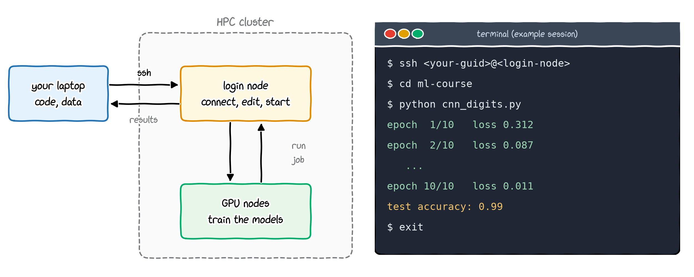
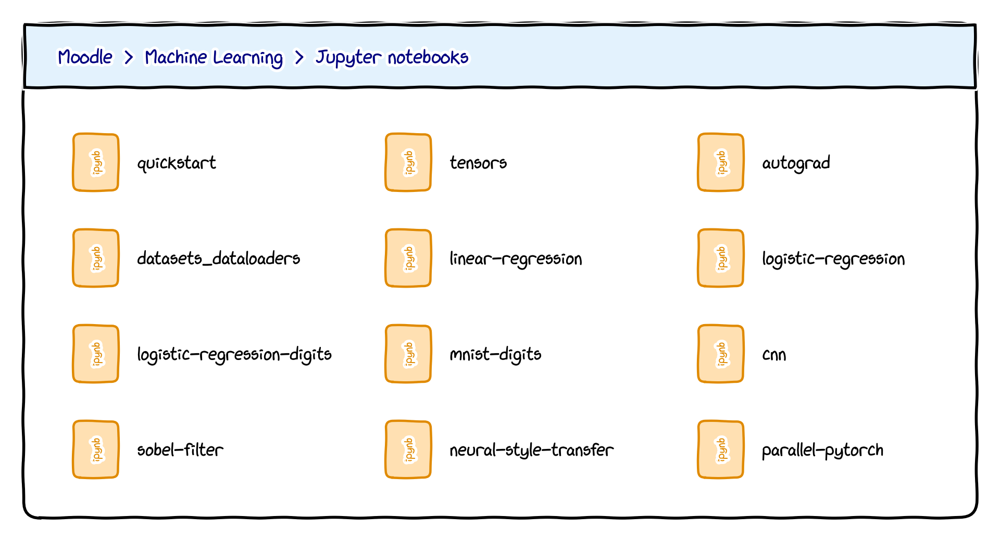
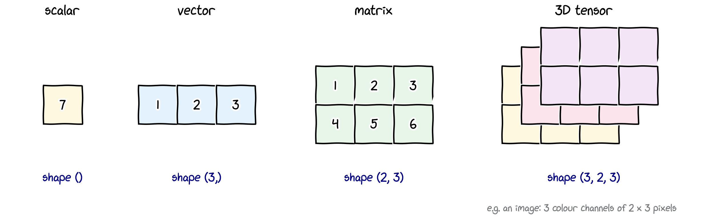
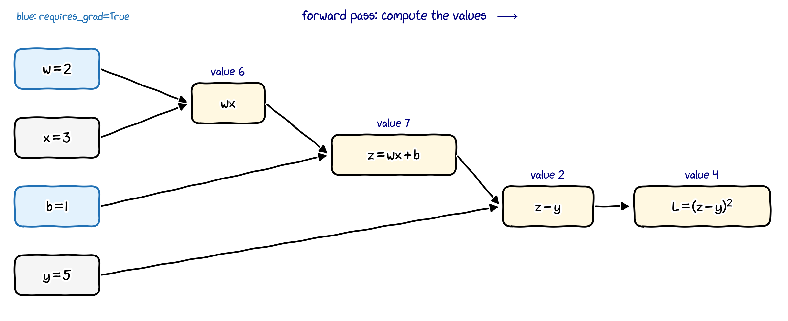
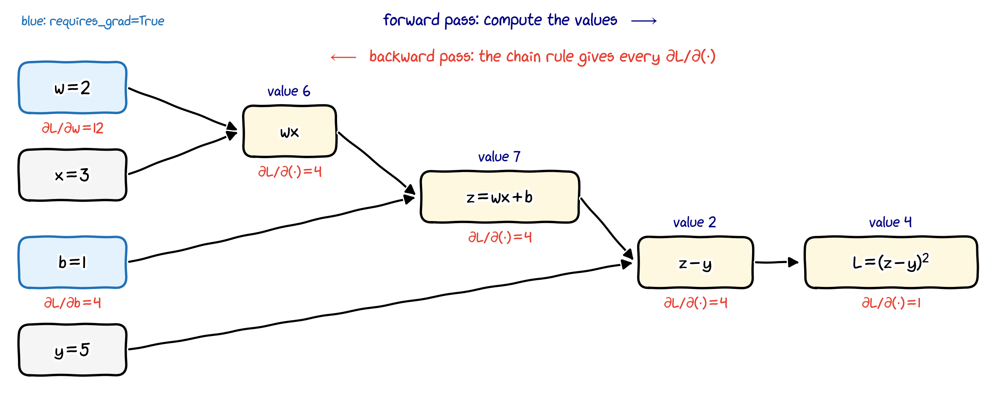
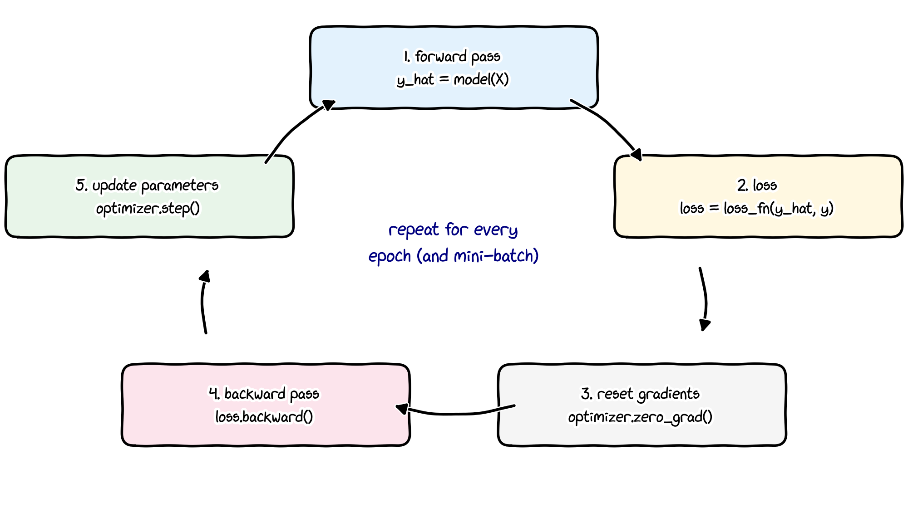
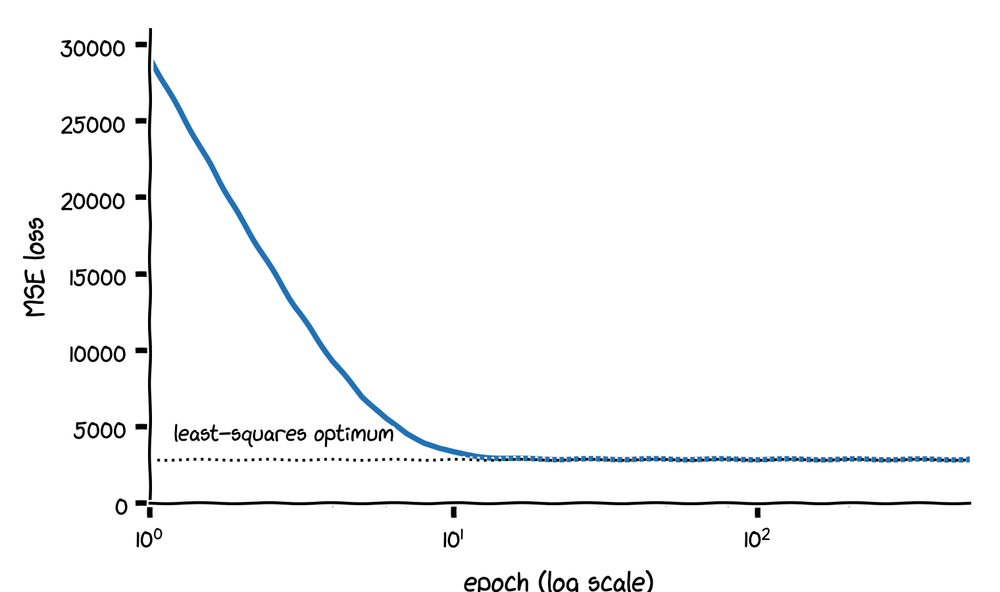
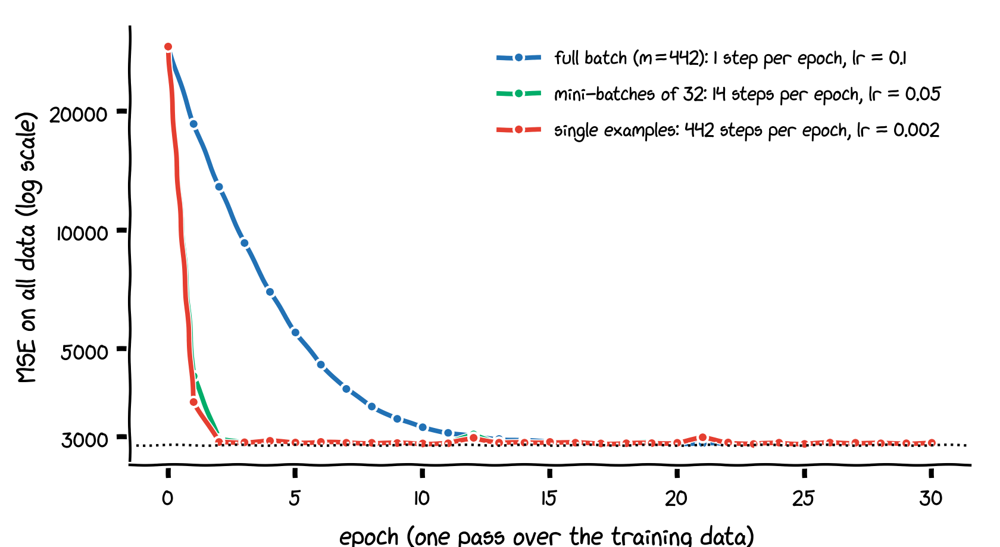

## This lecture

By the end of this lecture you should be able to

- explain why we use **PyTorch** for the rest of the course, and install it;
- create and manipulate **tensors**, and move them between NumPy, the CPU and a GPU;
- use **automatic differentiation** (autograd) to compute gradients;
- write the standard **training loop**: model, loss function, optimiser, mini-batches;
- reproduce linear, logistic and softmax regression from Lectures 2 and 3 in PyTorch.

These slides give a short overview. The detailed material is in the PyTorch lecture notes and the Jupyter notebooks on Moodle.

Bring your laptop: we will run all examples together.

# Why PyTorch?

## Which framework will we use?

:::: {.columns}
::: {.column width="45%"}
Which machine-learning framework will we use from now on?

(A) scikit-learn

(B) TensorFlow

(C) PyTorch
:::
::: {.column width="55%"}
. . .

**Answer: PyTorch.**

. . .

- **scikit-learn** (Lectures 2 to 5) is excellent for classical machine learning, but it does not build or train neural networks on GPUs.
- **TensorFlow** (Google, with the high-level Keras API) and **PyTorch** are the two main deep-learning frameworks. Both are mature and used in industry.
- The ideas of this course, tensors, gradients and training loops, carry over directly from one framework to the other.
:::
::::

## Why PyTorch?

- **Research and open models**: most current deep-learning research code, and many widely used open models, are written in PyTorch.
- **Open governance**: developed by Meta AI since 2016; since 2022 it is hosted by the independent PyTorch Foundation (part of the Linux Foundation).
- **Pythonic**: tensors behave much like NumPy arrays, and code runs line by line ("eager execution"), so you can inspect and debug it with `print` and a debugger.
- **Everything we need**: tensors on CPUs and GPUs, automatic differentiation, ready-made layers, losses and optimisers.

. . .

**Design principles** (from the PyTorch documentation):

1. **Usability over performance**: being easy to use comes first; good performance is the second goal.
2. **Simple over easy**: explicit code that is easy to understand and debug is preferred to hidden magic.
3. **Python first**: PyTorch integrates deeply with Python and its ecosystem (NumPy, SciPy, scikit-learn).

## Installing PyTorch

Use **pip**, ideally inside a virtual environment (venv or conda). Since PyTorch 2.6 there are no official conda packages.

```bash
python -m venv ml-env                 # create an environment (once)
source ml-env/bin/activate            # Windows: ml-env\Scripts\activate
pip install torch torchvision         # default build for your system

# CPU-only build: smaller download, enough for this lecture
pip install torch torchvision --index-url https://download.pytorch.org/whl/cpu
```

- For an NVIDIA GPU, copy the exact command from the selector at <https://pytorch.org/get-started/locally/> (choose your OS, `Pip` and your CUDA version).
- Check the installation:

```bash
python -c "import torch; print(torch.__version__, torch.cuda.is_available())"
```

`True` means that PyTorch can use an NVIDIA GPU. On Apple silicon, check `torch.backends.mps.is_available()` instead.

## Running code on the HPC cluster

{width="64%" fig-align="center"}

Training larger models is much faster on the university's GPU cluster. I will walk you through using it during the semester.

## Where to learn PyTorch

:::: {.columns}
::: {.column width="55%"}
**Official tutorials**, <https://pytorch.org/tutorials/>. Start with *Learn the Basics*:

1. Tensors
2. Datasets and DataLoaders
3. Building the model
4. Automatic differentiation (autograd)
5. Optimisation: the training loop
6. Saving and loading models

The tutorials assume that you know some machine learning and Python: this course gives you the machine learning.
:::
::: {.column width="45%"}
**Course notebooks on Moodle**


:::
::::

# Tensors

## What is a tensor?

{width="86%" fig-align="center"}

- A **tensor** is an $n$-dimensional array of numbers, like a NumPy array.
- Two extra abilities make it the basic object of deep learning:
  1. it can live on a **GPU**, where computations run in parallel;
  2. it can **record the operations** applied to it, so that gradients can be computed automatically.

## Creating tensors

```python
import torch

a = torch.tensor([1.0, 2.0, 3.0])            # from a list
B = torch.tensor([[1, 2, 3], [4, 5, 6]])

a.shape, a.dtype      # torch.Size([3]), torch.float32
B.shape, B.dtype      # torch.Size([2, 3]), torch.int64

torch.zeros(2, 3)               # 2 x 3 tensor of zeros
torch.ones(3)                   # tensor([1., 1., 1.])
torch.arange(0, 10, 2)          # tensor([0, 2, 4, 6, 8])
torch.linspace(0, 1, 5)         # tensor([0.0000, 0.2500, 0.5000, 0.7500, 1.0000])

torch.manual_seed(0)            # reproducible random numbers
torch.rand(2, 2)                # uniform on [0, 1): [[0.4963, 0.7682], [0.0885, 0.1320]]
```

- The default floating-point type is **32-bit** (`float32`), whereas NumPy uses 64-bit (`float64`). Neural networks rarely need more precision, and 32 bits are twice as fast and take half the memory.

## Indexing, reshaping and operations

```python
B[0, 2]           # tensor(3): row 0, column 2
B[:, 1]           # tensor([2, 5]): column 1
B.T.shape         # torch.Size([3, 2]): transpose
B.reshape(3, 2)   # tensor([[1, 2], [3, 4], [5, 6]])

X = torch.tensor([[1.0, 2.0], [3.0, 4.0], [5.0, 6.0]])   # (3, 2): 3 examples, 2 features
w = torch.tensor([0.5, -1.0])                            # (2,)
b = 2.0

X @ w + b          # tensor([ 0.5000, -0.5000, -1.5000]): predictions, as in Lecture 2b
X.sum()            # tensor(21.)
X.sum(dim=0)       # tensor([ 9., 12.]): sum over the examples (rows)
X.mean(dim=1)      # tensor([1.5000, 3.5000, 5.5000]): mean over the features
a * a, a + 1       # element-wise: tensor([1., 4., 9.]), tensor([2., 3., 4.])
```

- `@` is matrix multiplication; `*`, `+` and `**` act element by element.
- **Broadcasting** works as in NumPy: in `X @ w + b`, the number `b` is added to every row.

## NumPy, CPU and GPU

```python
import numpy as np

x_np = np.array([1.0, 2.0])
x_t = torch.from_numpy(x_np)     # shares the memory with x_np!
x_np[0] = 100.0
x_t                              # tensor([100., 2.], dtype=torch.float64)
a.numpy()                        # array([1., 2., 3.], dtype=float32)

device = "cuda" if torch.cuda.is_available() else "cpu"
X = X.to(device)                 # copy the data to the GPU (if there is one)
```

- `torch.from_numpy` does not copy: changing one changes the other. Use `torch.tensor(x_np)` for an independent copy.
- All tensors in one computation must be on the **same device**; otherwise PyTorch raises an error. Move both the model and the data with `.to(device)`.

# Automatic differentiation

## Why automatic differentiation?

- In Lectures 2 to 5 we derived every gradient **by hand**: $\dfrac{\partial J}{\partial w_j} = \dfrac1m\sum_i\big(f(\mathbf x^{(i)}) - y^{(i)}\big)x_j^{(i)}$.
- A deep network has millions of parameters and many layers. Deriving and coding its gradients by hand is error-prone and impractical.

. . .

**Autograd** does it for us:

- During the **forward pass**, PyTorch records every operation on tensors with `requires_grad=True` in a **computational graph**.
- `loss.backward()` runs the **backward pass**: it applies the chain rule through the graph and stores $\partial(\text{loss})/\partial\theta$ in `theta.grad` for every such tensor $\theta$.
- The gradients are **exact** (up to rounding), not numerical approximations.

## A first example

```python
x = torch.tensor(3.0, requires_grad=True)
y = x**2 + 2 * x         # forward pass: builds the graph
y.backward()             # backward pass: computes dy/dx
y, x.grad                # tensor(15., grad_fn=<AddBackward0>), tensor(8.)
```

. . .

Check by hand:
$$
y = x^2 + 2x = 9 + 6 = 15,
\qquad
\frac{dy}{dx} = 2x + 2 = 8 \quad\text{at } x = 3 .
$$

- `grad_fn=<AddBackward0>` shows that $y$ was produced by an addition that autograd knows how to differentiate.
- `backward()` can be called on a **scalar** (a single number), typically the loss.

## The computational graph

::: build
{width="88%" fig-align="center"}

{width="88%" fig-align="center"}
:::

$L = (wx + b - y)^2$ with $w = 2$, $x = 3$, $b = 1$, $y = 5$. Backward, by the chain rule:
$\ \frac{\partial L}{\partial z} = 2(z - y) = 4$, $\ \frac{\partial L}{\partial w} = \frac{\partial L}{\partial z}\,x = 12$, $\ \frac{\partial L}{\partial b} = \frac{\partial L}{\partial z}\cdot 1 = 4$.

## The same example in code

```python
w = torch.tensor(2.0, requires_grad=True)    # parameters: track gradients
b = torch.tensor(1.0, requires_grad=True)
x, y = torch.tensor(3.0), torch.tensor(5.0)  # data: no gradients needed

z = w * x + b              # prediction: 7
L = (z - y) ** 2           # squared error: 4
L.backward()
w.grad, b.grad             # tensor(12.), tensor(4.)
```

. . .

**Gradients accumulate.** Calling `backward()` again **adds** to `.grad`:

```python
L2 = (w * x + b - y) ** 2
L2.backward()
w.grad                     # tensor(24.) = 12 + 12, not 12!
```

So reset the gradients before every new backward pass: `w.grad.zero_()`, or `optimizer.zero_grad()` (later).

## Gradient descent with autograd

The toy data of Lecture 2, the same starting point $(w, b) = (-1.5, 6)$ and the same $\alpha = 0.3$:

```python
x = torch.tensor([1.0, 2.0, 3.0])
y = torch.tensor([1.0, 2.0, 3.0])
w = torch.tensor(-1.5, requires_grad=True)
b = torch.tensor(6.0, requires_grad=True)
alpha = 0.3

for t in range(150):
    J = ((w * x + b - y) ** 2).mean() / 2   # cost function of Lecture 2
    J.backward()                             # dJ/dw and dJ/db, no derivation needed
    with torch.no_grad():                    # the update itself must not be recorded
        w -= alpha * w.grad
        b -= alpha * b.grad
    w.grad.zero_()                           # reset for the next iteration
    b.grad.zero_()

w.item(), b.item()                           # (0.989, 0.024): exactly the result of Lecture 2
```

`torch.no_grad()` switches recording off; use it for parameter updates and when evaluating a trained model.

# The training loop

## The building blocks

:::: {.columns}
::: {.column width="45%"}
PyTorch provides ready-made pieces, so we do not write the update by hand:

- **model**: `nn.Linear(n, 1)` computes $\mathbf w\cdot\mathbf x + b$ and creates $\mathbf w$, $b$ with `requires_grad=True`;
- **loss function**: `nn.MSELoss()`, `nn.BCEWithLogitsLoss()`, `nn.CrossEntropyLoss()`;
- **optimiser**: `torch.optim.SGD(model.parameters(), lr=...)` performs $\theta \leftarrow \theta - \alpha\nabla_\theta J$ for all parameters.
:::
::: {.column width="55%"}

:::
::::

## Linear regression the PyTorch way

:::: {.columns}
::: {.column width="58%"}
```python
from torch import nn

# X: (442, 10) standardised diabetes features
# y: (442, 1) targets, as float32 tensors
torch.manual_seed(0)
model = nn.Linear(10, 1)     # f(x) = w . x + b
loss_fn = nn.MSELoss()       # mean squared error
optimizer = torch.optim.SGD(model.parameters(),
                            lr=0.1)

for epoch in range(500):
    y_hat = model(X)         # 1. forward
    loss = loss_fn(y_hat, y) # 2. loss
    optimizer.zero_grad()    # 3. reset grads
    loss.backward()          # 4. backward
    optimizer.step()         # 5. update

loss.item()                  # 2863.7
```
:::
::: {.column width="42%"}


- The least-squares optimum is MSE $= 2859.7$; after 500 epochs we are within $0.2\%$.
- `nn.MSELoss` has no factor $\frac12$: it equals $2J$, with the same minimiser.
:::
::::

## Mini-batches with `DataLoader`

:::: {.columns}
::: {.column width="52%"}
```python
from torch.utils.data import DataLoader
from torch.utils.data import TensorDataset

dataset = TensorDataset(X, y)
loader = DataLoader(dataset, batch_size=32,
                    shuffle=True)    # 14 batches

for epoch in range(30):
    for X_batch, y_batch in loader:
        loss = loss_fn(model(X_batch), y_batch)
        optimizer.zero_grad()
        loss.backward()
        optimizer.step()
```

- An **epoch** is one pass over all training examples.
- `shuffle=True` draws new random batches in every epoch.
:::
::: {.column width="48%"}


- Smaller batches mean more (but noisier) steps per epoch: after one epoch, the MSE is $18\,557$ with full batches but $4268$ with batches of 32.
- With a fixed learning rate, small batches keep bouncing near the minimum (Lecture 2).
:::
::::

## Classification: logits and `CrossEntropyLoss`

Softmax regression (Lecture 3b) on the iris data:

```python
model = nn.Linear(2, 3)                 # 3 scores ("logits"), one per class
loss_fn = nn.CrossEntropyLoss()         # applies softmax internally!
optimizer = torch.optim.SGD(model.parameters(), lr=0.5)

for epoch in range(500):
    loss = loss_fn(model(X_train), y_train)    # y_train: class indices 0, 1, 2
    optimizer.zero_grad(); loss.backward(); optimizer.step()

with torch.no_grad():
    probs = torch.softmax(model(X_test), dim=1)          # probabilities per class
    accuracy = (probs.argmax(dim=1) == y_test).float().mean()   # 0.978, as in Lecture 3b
```

- The model outputs raw scores; do **not** apply softmax before `nn.CrossEntropyLoss`, which does it in a numerically stable way.
- The targets are class **indices**, not one-hot vectors.
- For two classes, use one output and `nn.BCEWithLogitsLoss()`, which includes the sigmoid of Lecture 3a.

# Wrapping up

## Summary

- **PyTorch**: the deep-learning framework of this course; install it with `pip`.
- **Tensors**: NumPy-like arrays that can live on a GPU and record operations; default type `float32`.
- **Autograd**: the forward pass builds a computational graph; `loss.backward()` applies the chain rule and fills `.grad`. Gradients accumulate, so reset them every iteration.
- **Training loop**: forward pass, loss, `zero_grad()`, `backward()`, `step()`; repeat for every epoch and mini-batch.
- **Building blocks**: `nn.Linear`, `nn.MSELoss`, `nn.CrossEntropyLoss`, `torch.optim.SGD`, `DataLoader`.
- Linear, logistic and softmax regression of Lectures 2 and 3 are all a few lines of PyTorch; neural networks (Lecture 7) use exactly the same loop.

## Check your understanding

1. What are the shape and the `dtype` of `torch.tensor([[1.0, 2.0, 3.0]])`?
2. `x = torch.tensor(2.0, requires_grad=True)`, `y = x**3`, `y.backward()`. What is `x.grad`?
3. Why must we call `optimizer.zero_grad()` in every iteration?
4. Why is the parameter update written inside `with torch.no_grad():`?
5. With 442 examples and `batch_size=32`, how many parameter updates happen in one epoch?

::: notes
1. Shape `torch.Size([1, 3])` (one row, three columns); dtype `torch.float32`.
2. $dy/dx = 3x^2 = 12$, so `tensor(12.)`.
3. `backward()` adds to the existing `.grad`; without resetting, the gradients of all previous iterations would be summed.
4. The update is not part of the model, so autograd must not record it (and in-place changes to leaf tensors that require gradients are not allowed while recording).
5. $\lceil 442/32\rceil = 14$ updates (13 full batches and one batch of 26 examples).
:::

## Let us get coding

Please open your laptop and the notebooks on Moodle:

1. `tensors`: creating, indexing and reshaping tensors;
2. `autograd`: gradients and the computational graph;
3. `linear-regression`: the training loop;
4. `logistic-regression`: classification with `CrossEntropyLoss`.
