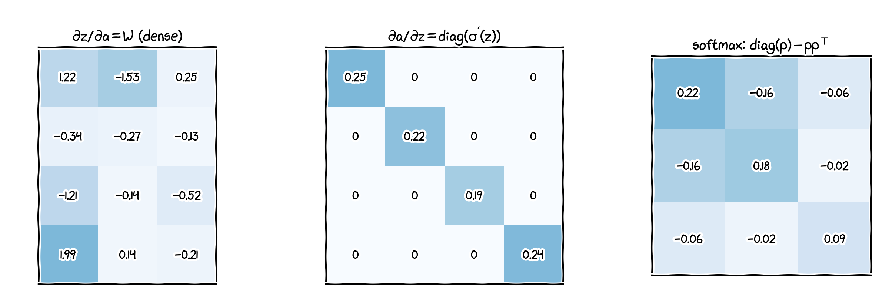
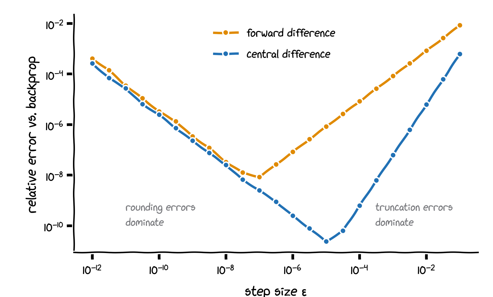

## Purpose and conventions

This optional appendix proves the backpropagation equations of Lecture 7 (part 7b) with matrix calculus, without working entry by entry.

- In the derivation we use **column** vectors: $\mathbf z^{[l]} = \mathbf W^{[l]}\mathbf a^{[l-1]} + \mathbf b^{[l]}$, $\ \mathbf a^{[l]} = g^{[l]}(\mathbf z^{[l]})$. At the end we translate to the row/batch form used in PyTorch.
- $L$ is the loss of one example. For a scalar $L$ and a matrix $\mathbf X$, the **gradient** $\nabla_{\mathbf X}L$ has the **same shape** as $\mathbf X$, with entries $\partial L/\partial X_{ij}$.
- For $\mathbf f: \mathbb R^n \to \mathbb R^p$, the **Jacobian** $\mathbf J_{\mathbf f}(\mathbf x) \in \mathbb R^{p\times n}$ has entries $\partial f_i/\partial x_j$.
- Shorthand: $\boldsymbol\delta^{[l]} := \nabla_{\mathbf z^{[l]}}L$, the "error" of layer $l$.

## Two tools

**1. The chain rule for Jacobians.** For $\mathbf u = \mathbf h(\mathbf x)$ and $\mathbf v = \mathbf f(\mathbf u)$: $\ \mathbf J_{\mathbf f\circ\mathbf h}(\mathbf x) = \mathbf J_{\mathbf f}\big(\mathbf h(\mathbf x)\big)\,\mathbf J_{\mathbf h}(\mathbf x)$. If the last function is a scalar loss $L(\mathbf u)$, its Jacobian is the row $(\nabla_{\mathbf u}L)^{\top}$, and transposing gives
$$
\nabla_{\mathbf x}L = \mathbf J_{\mathbf h}(\mathbf x)^{\top}\,\nabla_{\mathbf u}L .
$$
The gradient is passed back by a **vector-Jacobian product**; the Jacobian itself is never needed in full.

. . .

**2. Gradients from differentials.** With the Frobenius inner product $\langle\mathbf A, \mathbf B\rangle = \sum_{ij}A_{ij}B_{ij} = \operatorname{tr}(\mathbf A^{\top}\mathbf B)$, a first-order change of $L$ can always be written as
$$
dL = \big\langle \nabla_{\mathbf X}L,\ d\mathbf X\big\rangle .
$$
So, to find a gradient, compute $dL$ and rewrite it in the form $\langle\,\cdot\,, d\mathbf X\rangle$. We also use $\operatorname{tr}(\mathbf A\mathbf B\mathbf C) = \operatorname{tr}(\mathbf C\mathbf A\mathbf B)$ and $\mathbf u^{\top}\mathbf v = \operatorname{tr}(\mathbf u^{\top}\mathbf v)$.

## Lemma 1: a linear layer

Let $\mathbf z = \mathbf W\mathbf a + \mathbf b$ and $\boldsymbol\delta = \nabla_{\mathbf z}L$. Then
$$
\nabla_{\mathbf W}L = \boldsymbol\delta\,\mathbf a^{\top},
\qquad
\nabla_{\mathbf b}L = \boldsymbol\delta,
\qquad
\nabla_{\mathbf a}L = \mathbf W^{\top}\boldsymbol\delta .
$$

. . .

**Proof.** The differential of $\mathbf z$ is $d\mathbf z = (d\mathbf W)\,\mathbf a + \mathbf W\,d\mathbf a + d\mathbf b$, so
$$
dL = \boldsymbol\delta^{\top}d\mathbf z
= \underbrace{\operatorname{tr}\big(\boldsymbol\delta^{\top}(d\mathbf W)\,\mathbf a\big)}_{=\ \operatorname{tr}(\mathbf a\boldsymbol\delta^{\top}d\mathbf W)\ =\ \langle\boldsymbol\delta\mathbf a^{\top},\, d\mathbf W\rangle}
+ \underbrace{\boldsymbol\delta^{\top}\mathbf W\,d\mathbf a}_{=\ \langle\mathbf W^{\top}\boldsymbol\delta,\, d\mathbf a\rangle}
+ \underbrace{\boldsymbol\delta^{\top}d\mathbf b}_{=\ \langle\boldsymbol\delta,\, d\mathbf b\rangle} .
$$
Reading off the three gradients completes the proof. $\square$

- $\nabla_{\mathbf W}L = \boldsymbol\delta\mathbf a^{\top}$ is an **outer product**, of the same shape as $\mathbf W$.
- The Jacobian $\partial\mathbf z/\partial\mathbf W$ would be a $n^{[l]}\times(n^{[l]}n^{[l-1]})$ array; we never form it.

## Lemma 2: activations and the output layer

**Element-wise activation.** For $\mathbf a = g(\mathbf z)$, the Jacobian is **diagonal**, $\mathbf J = \operatorname{diag}\big(g'(\mathbf z)\big)$, so
$$
\nabla_{\mathbf z}L = \operatorname{diag}\big(g'(\mathbf z)\big)\,\nabla_{\mathbf a}L = g'(\mathbf z)\odot\nabla_{\mathbf a}L .
$$

. . .

**Softmax with cross-entropy.** For $\mathbf p = \operatorname{softmax}(\mathbf z)$, a one-hot label $\mathbf y$ and $L = -\sum_k y_k\log p_k$:
$$
\mathbf J_{\operatorname{softmax}} = \operatorname{diag}(\mathbf p) - \mathbf p\mathbf p^{\top},
\qquad
\nabla_{\mathbf p}L = -\mathbf y\oslash\mathbf p
$$
$$
\Longrightarrow\quad
\nabla_{\mathbf z}L = \big(\operatorname{diag}(\mathbf p) - \mathbf p\mathbf p^{\top}\big)(-\mathbf y\oslash\mathbf p)
= -\mathbf y + \mathbf p\underbrace{(\mathbf 1^{\top}\mathbf y)}_{=1}
= \mathbf p - \mathbf y .
$$
The sigmoid with binary cross-entropy is the case $K = 2$: $\ \partial L/\partial z = a - y$.

## The three kinds of Jacobian

{width="86%" fig-align="center"}

- A linear layer has a **dense** Jacobian (the weights), an element-wise activation a **diagonal** one, and softmax a dense, symmetric one.
- Backpropagation multiplies by the transposes of these matrices, one at a time, from the loss backwards.
- Diagonal Jacobians reduce to the cheap element-wise products $\odot$ in the code.

## Theorem: backpropagation

For an $L$-layer network with loss $L(\mathbf a^{[L]}, \mathbf y)$, cross-entropy at the output and $\boldsymbol\delta^{[l]} = \nabla_{\mathbf z^{[l]}}L$:

::: {.callout-note title="Backpropagation (column form, one example)"}
$$
\begin{aligned}
\boldsymbol\delta^{[L]} &= \mathbf a^{[L]} - \mathbf y,\\
\boldsymbol\delta^{[l]} &= \Big(\big(\mathbf W^{[l+1]}\big)^{\top}\boldsymbol\delta^{[l+1]}\Big)\odot g^{[l]\prime}\big(\mathbf z^{[l]}\big), \qquad l = L - 1, \dots, 1,\\
\nabla_{\mathbf W^{[l]}}L &= \boldsymbol\delta^{[l]}\big(\mathbf a^{[l-1]}\big)^{\top},
\qquad
\nabla_{\mathbf b^{[l]}}L = \boldsymbol\delta^{[l]} .
\end{aligned}
$$
:::

. . .

**Proof.** The first line is Lemma 2 (output layer). Next, $L$ depends on $\mathbf z^{[l]}$ only through $\mathbf a^{[l]}$ and then $\mathbf z^{[l+1]} = \mathbf W^{[l+1]}\mathbf a^{[l]} + \mathbf b^{[l+1]}$. Lemma 1 gives $\nabla_{\mathbf a^{[l]}}L = (\mathbf W^{[l+1]})^{\top}\boldsymbol\delta^{[l+1]}$, and Lemma 2 (activation) multiplies by $g^{[l]\prime}(\mathbf z^{[l]})$ element-wise. The parameter gradients are Lemma 1 applied to layer $l$. By induction from $l = L$ downwards, every $\boldsymbol\delta^{[l]}$ is computed correctly. $\square$

## From columns to rows and mini-batches

PyTorch stores one example per **row**: $\mathbf z_{\text{row}} = \mathbf a_{\text{row}}\mathbf W^{\top} + \mathbf b$ is the transpose of $\mathbf z = \mathbf W\mathbf a + \mathbf b$. Transposing the theorem gives the row form of Lecture 7:
$$
d\mathbf z^{[l]} = \big(d\mathbf z^{[l+1]}\mathbf W^{[l+1]}\big)\odot g^{[l]\prime}\big(\mathbf z^{[l]}\big),
\qquad
d\mathbf W^{[l]} = \big(d\mathbf z^{[l]}\big)^{\top}\mathbf a^{[l-1]} .
$$

. . .

For a mini-batch with cost $J = \frac1m\sum_i L^{(i)}$, gradients are averages over the examples:
$$
\nabla_{\mathbf W^{[l]}}J = \frac1m\sum_{i=1}^{m}\boldsymbol\delta^{[l](i)}\big(\mathbf a^{[l-1](i)}\big)^{\top}
= \frac1m\big(d\mathbf Z^{[l]}\big)^{\top}\mathbf A^{[l-1]},
$$
since a sum of outer products of matching rows is a single matrix product. Likewise $\nabla_{\mathbf b^{[l]}}J = \frac1m\sum_i\boldsymbol\delta^{[l](i)}$ and $d\mathbf Z^{[l]} = (d\mathbf Z^{[l+1]}\mathbf W^{[l+1]})\odot g^{[l]\prime}(\mathbf Z^{[l]})$.

## Why backwards? The cost of the gradient

- **Reverse mode** (backpropagation): start from the scalar $L$ and pass one vector per layer backwards. Each step costs about as much as the corresponding forward step, so the **whole gradient costs a small constant times one forward pass**, whatever the number of parameters.
- **Forward mode**: push derivatives forwards, one input direction at a time. That needs one pass **per parameter**: hopeless for the 669,706 parameters of the MNIST network of Lecture 7.
- The general principle: for a function $\mathbb R^N \to \mathbb R$ with large $N$, reverse-mode differentiation is the right choice. This is what autograd in PyTorch implements.

## Checking gradients numerically

:::: {.columns}
::: {.column width="55%"}

:::
::: {.column width="45%"}
Compare backpropagation with **finite differences**, one parameter at a time:
$$
\frac{\partial L}{\partial\theta} \approx \frac{L(\theta + \varepsilon) - L(\theta - \varepsilon)}{2\varepsilon},
$$
with error $O(\varepsilon^2)$; the forward difference $\frac{L(\theta + \varepsilon) - L(\theta)}{\varepsilon}$ only has error $O(\varepsilon)$.

- Too large $\varepsilon$: truncation error. Too small: rounding error.
- Here, a $5 \to 8 \to 3$ network with tanh and softmax: the best relative error is $2\times10^{-11}$ at $\varepsilon = 10^{-5}$ (double precision).
- A relative error around $10^{-7}$ or larger usually means a bug.
:::
::::

## Summary

- **Tools**: the chain rule for Jacobians, $\nabla_{\mathbf x}L = \mathbf J^{\top}\nabla_{\mathbf u}L$; and $dL = \langle\nabla_{\mathbf X}L, d\mathbf X\rangle$ with the trace trick.
- **Linear layer**: $\nabla_{\mathbf W}L = \boldsymbol\delta\mathbf a^{\top}$, $\ \nabla_{\mathbf b}L = \boldsymbol\delta$, $\ \nabla_{\mathbf a}L = \mathbf W^{\top}\boldsymbol\delta$.
- **Activation**: diagonal Jacobian, so $\nabla_{\mathbf z}L = g'(\mathbf z)\odot\nabla_{\mathbf a}L$. **Softmax and cross-entropy**: $\nabla_{\mathbf z}L = \mathbf p - \mathbf y$.
- **Backpropagation**: $\boldsymbol\delta^{[l]} = ((\mathbf W^{[l+1]})^{\top}\boldsymbol\delta^{[l+1]})\odot g^{[l]\prime}(\mathbf z^{[l]})$, proved by induction; rows and mini-batches follow by transposing and averaging.
- **Reverse mode** gives the whole gradient for about the cost of one forward pass; **finite differences** check an implementation.
