## This lecture

Images are large, and neighbouring pixels belong together. Convolutional neural networks (CNNs) exploit this structure with small filters that are shared across the whole image.

:::: {.columns}
::: {.column width="31%"}
**Part 8a: convolution**

- why fully connected networks do not scale to images;
- the **convolution** operation and **edge detection**;
- **learned** filters, **padding** and **stride**.
:::
::: {.column width="3%"}
:::
::: {.column width="31%"}
**Part 8b: CNN architectures**

- convolutions over **volumes** and many filters;
- **pooling**, shapes and parameter counts;
- **LeNet-5**, **AlexNet**, **VGG-16**, and why convolutions work.
:::
::: {.column width="3%"}
:::
::: {.column width="31%"}
**Part 8c: applications**

- **transfer learning** from pretrained networks;
- **data augmentation**;
- **face verification** with the triplet loss, and **neural style transfer**.
:::
::::

# Part 8a: the convolution operation {.part-slide}

::: {.content-visible when-format="revealjs"}
Motivation, edge detection, the convolution operation, learned filters, padding and stride
:::

# Motivation

## Computer vision problems

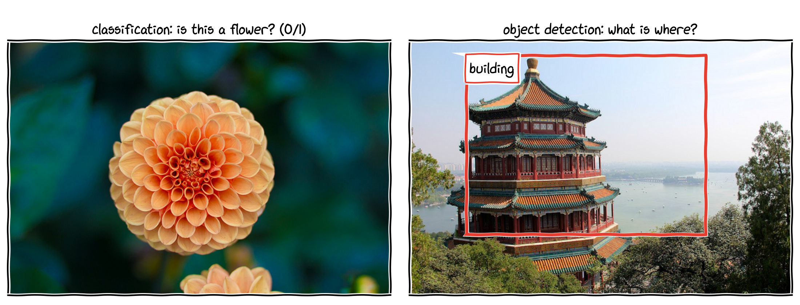{width="70%" fig-align="center"}

- **Image classification**: what is in the image?
- **Object detection**: what objects are there, and where (bounding boxes)?
- **Neural style transfer**: redraw a photo in the style of a painting (part 8c).

::: small
Photos: scikit-learn's sample images (`sklearn.datasets.load_sample_image`).
:::

## Images are large

A photo from a 12-megapixel phone camera has $4000 \times 3000$ pixels and 3 colour channels:
$$
4000 \times 3000 \times 3 = 36{,}000{,}000 \text{ input features.}
$$
Even a small $64 \times 64$ colour image has $64 \times 64 \times 3 = 12{,}288$ features.

. . .

A fully connected network with **one** hidden layer of 1000 units, on $64 \times 64 \times 3$ images:
$$
\underbrace{(12{,}288 + 1) \times 1000}_{\text{hidden layer}} + \underbrace{(1000 + 1) \times 1}_{\text{output}} = 12{,}290{,}001 \text{ parameters}.
$$

For an $h \times w$ colour image, the first layer alone has about $3hw \times 1000$ weights: far too many to train well, and it ignores that neighbouring pixels belong together.

## What a convolutional network computes

- **Early layers** detect simple, local patterns: edges and colour blobs.
- **Middle layers** combine them into textures and parts (corners, circles, an eye).
- **Late layers** respond to whole objects (a face, a wheel, a flower).

. . .

All of these are built from one operation, the **convolution**: a small filter slides over the image and responds wherever its pattern appears. We start with the simplest pattern: an edge.

# Edge detection and convolution

## Edge detection

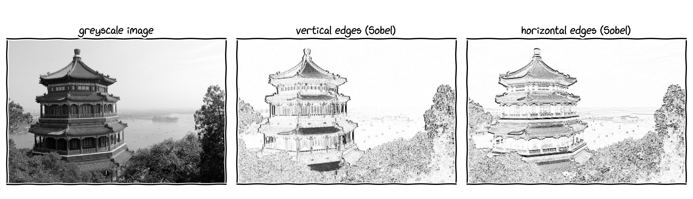{width="90%" fig-align="center"}

A $3\times 3$ filter, applied at every position of the greyscale image, responds strongly where brightness changes from left to right (middle) or from top to bottom (right).

## The convolution operation, step by step

::: build
::: {}
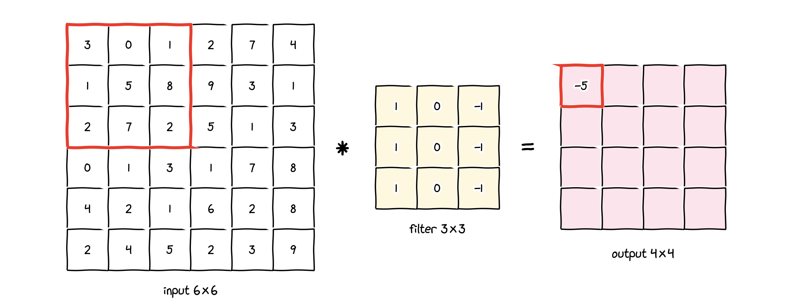{width="84%" fig-align="center"}

$3\cdot 1 + 0\cdot 0 + 1\cdot(-1) + 1\cdot 1 + 5\cdot 0 + 8\cdot(-1) + 2\cdot 1 + 7\cdot 0 + 2\cdot(-1) = -5$
:::
::: {}
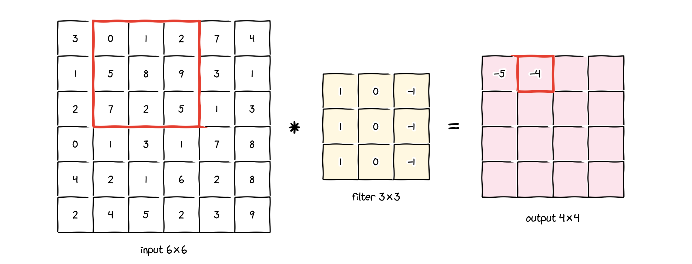{width="84%" fig-align="center"}

$0\cdot 1 + 1\cdot 0 + 2\cdot(-1) + 5\cdot 1 + 8\cdot 0 + 9\cdot(-1) + 7\cdot 1 + 2\cdot 0 + 5\cdot(-1) = -4$
:::
::: {}
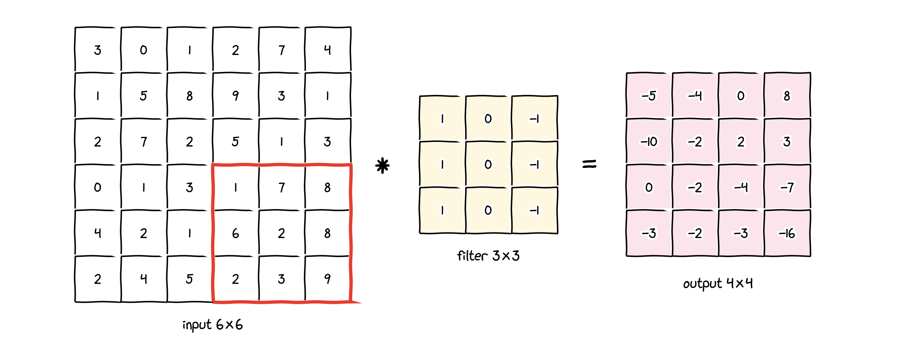{width="84%" fig-align="center"}

Slide the filter over all $4 \times 4$ positions. Last one: $1\cdot 1 + 7\cdot 0 + 8\cdot(-1) + 6\cdot 1 + 2\cdot 0 + 8\cdot(-1) + 2\cdot 1 + 3\cdot 0 + 9\cdot(-1) = -16$.
:::
:::

## The convolution as a formula

For an input $X$ and an $f \times f$ filter $K$, entry $(i, j)$ of the output is the sum of element-wise products over the window starting at $(i, j)$:
$$
(X \ast K)[i, j] = \sum_{u=0}^{f-1}\sum_{v=0}^{f-1} X[i + u,\ j + v]\;K[u, v] .
$$

- An $n \times n$ input and an $f \times f$ filter give an $(n - f + 1)\times(n - f + 1)$ output: here $6 - 3 + 1 = 4$.
- In PyTorch, `torch.nn.functional.conv2d` computes exactly this:

```python
import torch
import torch.nn.functional as F
X = torch.tensor([[3, 0, 1, 2, 7, 4], [1, 5, 8, 9, 3, 1], [2, 7, 2, 5, 1, 3],
                  [0, 1, 3, 1, 7, 8], [4, 2, 1, 6, 2, 8], [2, 4, 5, 2, 3, 9]],
                 dtype=torch.float32)
K = torch.tensor([[1, 0, -1], [1, 0, -1], [1, 0, -1]], dtype=torch.float32)
# shapes are (batch, channels, height, width)
out = F.conv2d(X.view(1, 1, 6, 6), K.view(1, 1, 3, 3))
out[0, 0, 0]          # first row: tensor([-5., -4., 0., 8.])
```

## Why does this filter detect vertical edges?

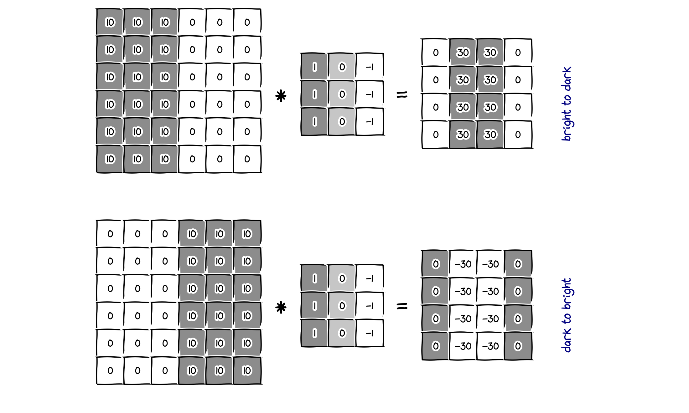{width="50%" fig-align="center"}

- Top: bright (10) on the left, dark (0) on the right. Where the filter straddles the boundary, its left column sees $10$s and its right column $0$s: output $30$. Elsewhere the columns cancel: $0$.
- Bottom: the same edge from dark to bright gives $-30$; the sign tells the **direction** of the change.
- The edge looks thick only because the image is tiny; in a real image it is thin.

## Other edge filters

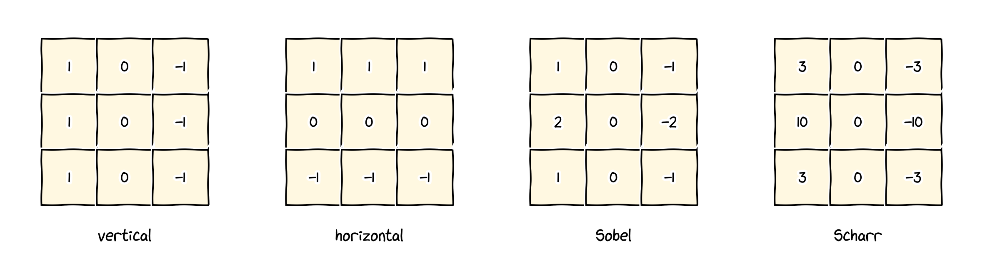{width="84%" fig-align="center"}

- Rotating the vertical filter by $90°$ gives a **horizontal** edge detector.
- **Sobel** and **Scharr** filters put more weight on the centre row, which makes them more robust to noise.
- Which numbers work best? Different tasks need different, and often more complex, patterns.

## Learning the filters

Instead of designing the nine numbers by hand, treat them as **parameters**:
$$
K = \begin{pmatrix} w_1 & w_2 & w_3\\ w_4 & w_5 & w_6\\ w_7 & w_8 & w_9\end{pmatrix}
$$
and learn them by **backpropagation and gradient descent**, exactly like the weights of Lecture 7.

. . .

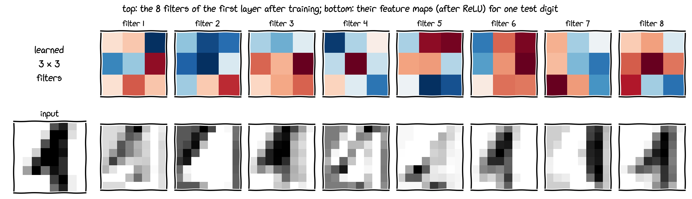{width="74%" fig-align="center"}

A small network trained on $8\times 8$ handwritten digits (part 8b) learned these filters by itself. Several respond to strokes in particular directions: learned edge detectors.

# Padding and stride

## Padding

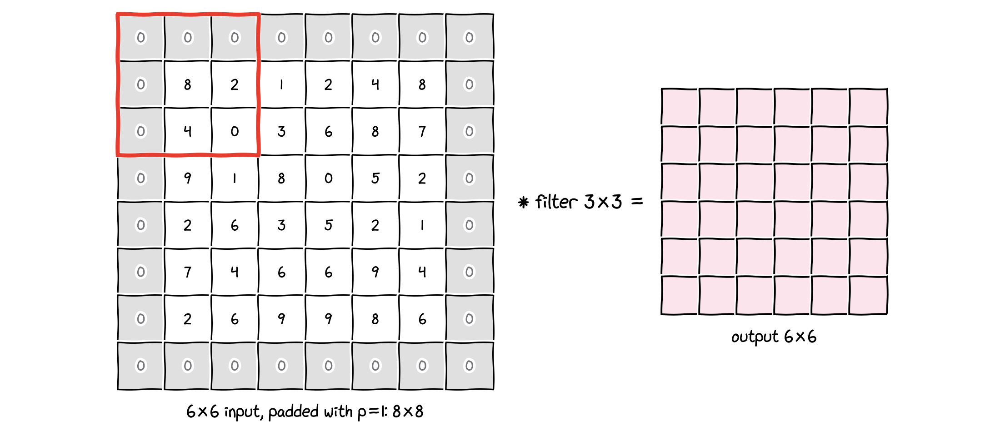{width="74%" fig-align="center"}

Without padding, every layer shrinks the image ($6 \to 4$), and pixels at the border are used by far fewer windows than central pixels. **Padding** adds a border of $p$ zeros around the input:
$$
n \times n \ \ \text{with padding } p,\ \ast\ f \times f \quad\longrightarrow\quad (n + 2p - f + 1)\times(n + 2p - f + 1).
$$

## Valid and same convolutions

- **Valid** convolution: no padding, $p = 0$.
$$
n \times n \ \ast\ f \times f \ \longrightarrow\ (n - f + 1)\times(n - f + 1), \qquad\text{e.g. } 6\times 6 \ast 3\times 3 \to 4 \times 4.
$$

. . .

- **Same** convolution: pad so that the output has the **same** size as the input:
$$
n + 2p - f + 1 = n \quad\Longrightarrow\quad p = \frac{f - 1}{2}.
$$
For $f = 3$: $p = 1$; for $f = 5$: $p = 2$. This is one reason why filter sizes are usually **odd**: the filter then has a central pixel and the padding is symmetric.

- In PyTorch: `F.conv2d(x, k, padding=1)` or `nn.Conv2d(..., padding="same")`.

## Strided convolution

::: build
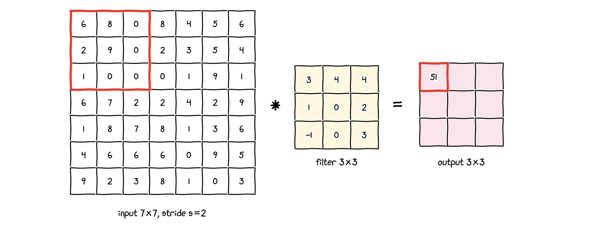{width="84%" fig-align="center"}

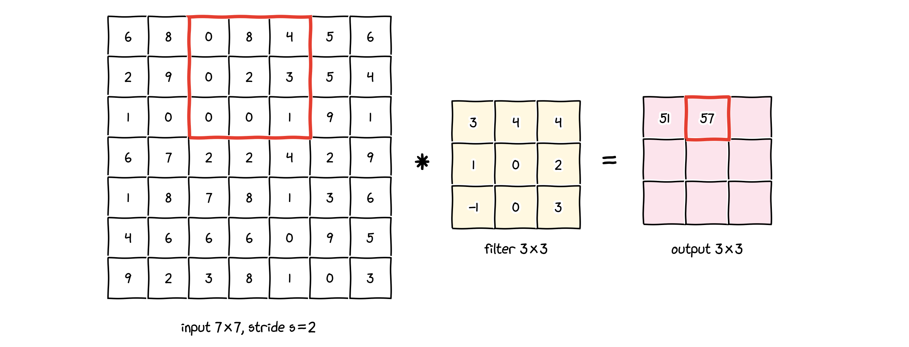{width="84%" fig-align="center"}

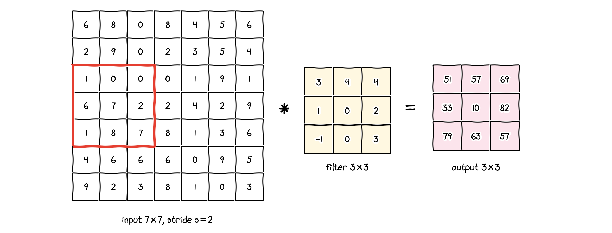{width="84%" fig-align="center"}
:::

With **stride** $s$, the filter jumps $s$ pixels at a time, horizontally and vertically.

## The output size

::: {.callout-note title="Output size of a convolution"}
An $n \times n$ input, an $f \times f$ filter, padding $p$ and stride $s$ give an output of size
$$
\left\lfloor \frac{n + 2p - f}{s} \right\rfloor + 1 \quad\times\quad \left\lfloor \frac{n + 2p - f}{s} \right\rfloor + 1 .
$$
:::

- $\lfloor\cdot\rfloor$ rounds down: positions where the filter would stick out of the (padded) image are skipped.
- Example: $n = 7$, $f = 3$, $p = 0$, $s = 2$: $\ \lfloor 4/2\rfloor + 1 = 3$, so $3 \times 3$.
- Example: $n = 6$, $f = 3$, $p = 1$, $s = 1$: $\ 6 + 2 - 3 + 1 = 6$ (same convolution).

## Convolution or cross-correlation?

In mathematics, the **convolution** of two sequences $a$ and $b$ is
$$
(a \ast b)[i] = \sum_{k} a[k]\,b[i - k] ,
$$
i.e. one sequence is **flipped** before sliding. In 2D this means rotating the filter by $180°$.

. . .

- The operation used in deep learning, without the flip, is strictly speaking a **cross-correlation**.
- Mathematical convolution has nice algebraic properties, e.g. it is associative: $(a \ast b) \ast c = a \ast (b \ast c)$. These matter in signal processing, but not for learning.
- Since the filter is **learned**, flipping it makes no difference: the network simply learns the flipped filter. So deep-learning libraries skip the flip and still call the operation "convolution", and so do we.

## Summary of part 8a

- Fully connected networks need far too many parameters for images.
- A **convolution** slides an $f \times f$ filter over the image and sums element-wise products: $(X \ast K)[i, j] = \sum_{u,v} X[i + u, j + v]\,K[u, v]$.
- Hand-designed filters detect edges; in a CNN the filter entries are **parameters**, learned by backpropagation.
- **Padding** $p$ keeps the size ("same": $p = (f - 1)/2$); **stride** $s$ skips positions.
- Output size: $\lfloor (n + 2p - f)/s\rfloor + 1$.
- Deep-learning "convolution" is cross-correlation; for learned filters the difference does not matter.

**Next, part 8b**: colour images and many filters, pooling, and complete convolutional networks.

## Check your understanding: part 8a

1. Compute the output entry for the window in rows 2 to 4 and columns 1 to 3 of the $6\times 6$ example (the value in row 2, column 1 of the $4 \times 4$ output).
2. A $32 \times 32$ image is convolved with a $5 \times 5$ filter, $p = 0$, $s = 1$. What is the output size? What padding gives a same convolution?
3. A $28 \times 28$ input, $f = 3$, $p = 1$, $s = 2$: what is the output size?
4. How would you build a filter that detects horizontal edges going from bright (top) to dark (bottom)?
5. Why does it not matter for a CNN that we use cross-correlation instead of convolution?

::: notes
1. Window rows 2–4, columns 1–3 is $\begin{pmatrix}7&2&5\\1&3&1\\2&1&6\end{pmatrix}$; with the vertical filter: $(7 + 1 + 2) - (5 + 1 + 6) = -2$, matching the output.
2. $28 \times 28$; same convolution needs $p = 2$.
3. $\lfloor (28 + 2 - 3)/2\rfloor + 1 = 13 + 1 = 14$, so $14 \times 14$.
4. Transpose the vertical filter: $\begin{pmatrix}1&1&1\\0&0&0\\-1&-1&-1\end{pmatrix}$ gives positive values for bright-above-dark.
5. The filter entries are learned; the network can learn the flipped filter just as well.
:::

# Part 8b: CNN layers and architectures {.part-slide}

::: {.content-visible when-format="revealjs"}
Convolutions over volumes, pooling, a complete CNN, classic networks, why convolutions work
:::

## Where we are

In part 8a we met the **convolution** of a single-channel image with a single filter:

- a small $f \times f$ filter slides over the image and sums element-wise products;
- its entries are **parameters**, learned by backpropagation like any weight;
- **padding** $p$ and **stride** $s$ control the output size, $\lfloor (n + 2p - f)/s\rfloor + 1$.

. . .

Part 8b builds complete networks from this operation:

- colour images have several **channels**, and a layer uses **many filters** at once;
- **pooling** layers shrink the feature maps;
- CONV, POOL and fully connected layers combine into **architectures** such as LeNet-5, AlexNet and VGG-16.

# Convolutions over volumes

## Convolution on an RGB image

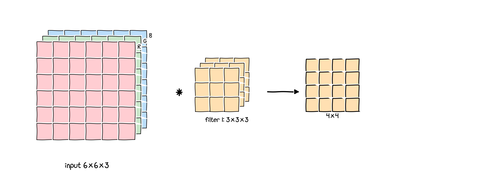{width="74%" fig-align="center"}

- A colour image has $n_C = 3$ **channels** (red, green, blue): a volume of size $6 \times 6 \times 3$.
- The filter has the **same number of channels**: $3 \times 3 \times 3$, i.e. 27 numbers.
- At each position, multiply all 27 pairs of numbers and add them up: **one** number per position. The output is $4 \times 4$, a single channel.

## Several filters

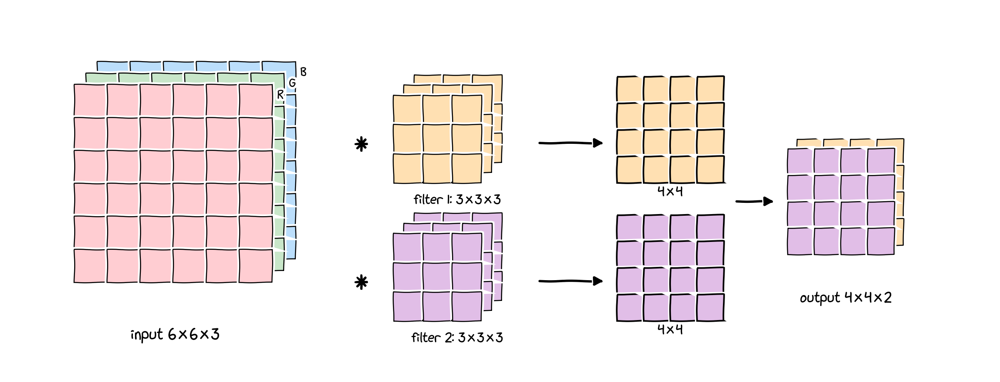{width="74%" fig-align="center"}

Each filter detects one pattern (e.g. vertical edges, horizontal edges). Stacking the results of $n_C'$ filters gives an output with $n_C'$ channels:
$$
(n \times n \times n_C) \ \ast\ \underbrace{(f \times f \times n_C)}_{n_C' \text{ filters}} \ \longrightarrow\ (n - f + 1) \times (n - f + 1) \times n_C' .
$$

## One layer of a convolutional network

For each filter $k = 1, \dots, n_C'$:

1. convolve the input $\mathbf a^{[l-1]}$ with filter $\mathbf W_k^{[l]}$;
2. add a bias $b_k^{[l]}$ (one number per filter);
3. apply an activation function, usually ReLU;

and stack the $n_C'$ results into $\mathbf a^{[l]}$.

. . .

This mirrors a fully connected layer (Lecture 7a):
$$
\underbrace{\mathbf z^{[l]} = \mathbf W^{[l]}\mathbf a^{[l-1]} + \mathbf b^{[l]}}_{\text{fully connected}}
\qquad\longleftrightarrow\qquad
\underbrace{\mathbf z_k^{[l]} = \mathbf W_k^{[l]} \ast \mathbf a^{[l-1]} + b_k^{[l]}}_{\text{convolutional}},
\qquad \mathbf a^{[l]} = g\big(\mathbf z^{[l]}\big).
$$

## How many parameters?

**Question.** A layer has 10 filters of size $3 \times 3 \times 3$. How many parameters does it have?

. . .

Each filter has $3 \cdot 3 \cdot 3 = 27$ weights and one bias:
$$
(27 + 1) \times 10 = 280 \text{ parameters.}
$$

. . .

- The count does **not** depend on the size of the image: the same 280 parameters work for a $64 \times 64$ or a $4000 \times 3000$ image.
- Compare with the 12 million parameters of a fully connected layer on a $64 \times 64 \times 3$ image (part 8a).

## Notation for layer $l$

:::: {.columns}
::: {.column width="45%"}
Hyperparameters of a convolutional layer:

- $f^{[l]}$: filter size
- $p^{[l]}$: padding
- $s^{[l]}$: stride
- $n_C^{[l]}$: number of filters (= number of output channels)

Each filter: $f^{[l]} \times f^{[l]} \times n_C^{[l-1]}$.
Weights: $f^{[l]} \times f^{[l]} \times n_C^{[l-1]} \times n_C^{[l]}$; biases: $n_C^{[l]}$.
:::
::: {.column width="55%"}
Input $n_H^{[l-1]} \times n_W^{[l-1]} \times n_C^{[l-1]}$, output $n_H^{[l]} \times n_W^{[l]} \times n_C^{[l]}$ with
$$
n_H^{[l]} = \left\lfloor \frac{n_H^{[l-1]} + 2p^{[l]} - f^{[l]}}{s^{[l]}}\right\rfloor + 1,
$$
and the same for $n_W^{[l]}$.

For a mini-batch of $m$ examples, $\mathbf A^{[l]}$ has $m \times n_H^{[l]} \times n_W^{[l]} \times n_C^{[l]}$ entries.
:::
::::

## Convolutional layers in PyTorch

```python
from torch import nn
conv = nn.Conv2d(in_channels=3, out_channels=10, kernel_size=3)   # stride 1, no padding
conv.weight.shape                      # torch.Size([10, 3, 3, 3]): (out, in, H, W)
sum(p.numel() for p in conv.parameters())                         # 280

x = torch.rand(8, 3, 32, 32)           # a batch: (N, C, H, W)
conv(x).shape                          # torch.Size([8, 10, 30, 30])
nn.Conv2d(3, 10, 3, padding=1)(x).shape             # (8, 10, 32, 32): same
nn.Conv2d(3, 10, 3, stride=2, padding=1)(x).shape   # (8, 10, 16, 16)
```

PyTorch orders the axes as **(N, C, H, W)**: batch, channels, height, width. Many textbooks (and these slides) write shapes as $n_H \times n_W \times n_C$.

## The formula in the PyTorch documentation

Decoded: output channel $j$ of example $i$ is
$$
\text{out}(N_i, C_{\text{out},j}) = \text{bias}(C_{\text{out},j}) + \sum_{k=0}^{C_{\text{in}} - 1} \text{weight}(C_{\text{out},j}, k) \star \text{input}(N_i, k),
$$
where $k$ runs over the **input channels** and $\star$ is the 2D cross-correlation of part 8a.

## `nn.Linear` versus `nn.Conv2d`

| | `nn.Linear(in_features, out_features)` | `nn.Conv2d(in_channels, out_channels, kernel_size)` |
|:---|:---|:---|
| input | $(N, H_{\text{in}})$ | $(N, C_{\text{in}}, H, W)$ |
| output | $(N, H_{\text{out}})$ | $(N, C_{\text{out}}, H', W')$ |
| one output unit / channel | weighted sum of **all** inputs | the same small filter, applied at **every** position |
| parameters | $(H_{\text{in}} + 1)\,H_{\text{out}}$ | $(k^2 C_{\text{in}} + 1)\,C_{\text{out}}$ |

A useful analogy: the number of **units** of a linear layer plays the role of the number of **output channels** of a convolutional layer.

# Pooling

## Max pooling and average pooling

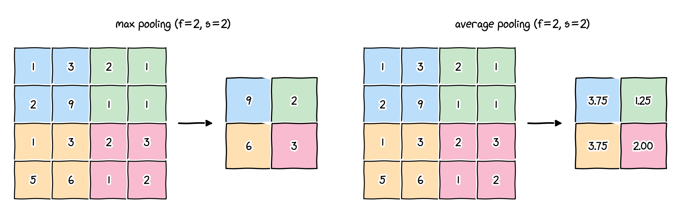{width="86%" fig-align="center"}

- Split the input into windows of size $f \times f$ (moved with stride $s$) and keep the **maximum** (or the **average**) of each window. Here $f = 2$, $s = 2$ halves the height and width.
- Max pooling keeps a feature if it was detected **anywhere** in the window; it makes the network less sensitive to small shifts.
- Pooling acts on each channel separately: $n_H \times n_W \times n_C \to \left(\left\lfloor\frac{n_H - f}{s}\right\rfloor + 1\right) \times \left(\left\lfloor\frac{n_W - f}{s}\right\rfloor + 1\right) \times n_C$.

## Pooling: summary

- Hyperparameters: filter size $f$, stride $s$, max or average. Common choice: $f = 2$, $s = 2$. Padding is rarely used.
- **No parameters to learn**: gradient descent has nothing to update in a pooling layer.
- In PyTorch: `nn.MaxPool2d(kernel_size=2)` and `nn.AvgPool2d(kernel_size=2)` (the stride defaults to the kernel size).
- Max pooling is far more common than average pooling inside networks. Average pooling over the whole feature map ("global average pooling") is often used at the very end of modern networks.

## Three types of layer

A typical convolutional network combines

1. **convolutional layers (CONV)**: learn local pattern detectors, with few parameters;
2. **pooling layers (POOL)**: reduce height and width, with no parameters;
3. **fully connected layers (FC)**: combine all features at the end, as in Lecture 7.

. . .

The typical pattern: CONV → POOL → CONV → POOL → … → FC → FC → softmax. Height and width **decrease** through the network, while the number of channels **increases**.

# An example network

## A complete CNN

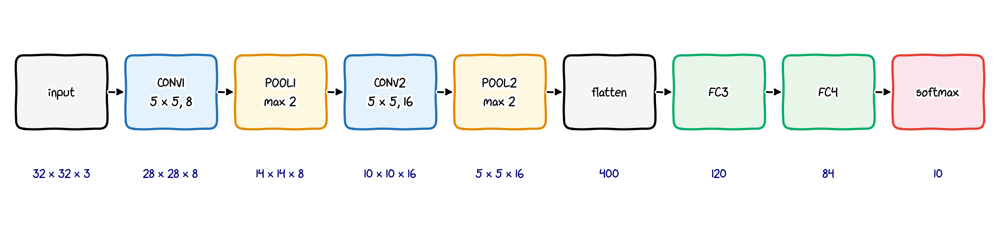{width="96%" fig-align="center"}

The image goes through two CONV-POOL stages; the result ($5 \times 5 \times 16 = 400$ numbers) is flattened and passed to fully connected layers and a softmax over 10 classes. ReLU follows every CONV and FC layer.

## Shapes and parameters

| layer | activation shape | activation size | parameters |
|:---|:---:|:---:|:---:|
| input | $32 \times 32 \times 3$ | $3072$ | $0$ |
| CONV1 ($f = 5$, $s = 1$, 8 filters) | $28 \times 28 \times 8$ | $6272$ | ? |
| POOL1 | $14 \times 14 \times 8$ | $1568$ | ? |
| CONV2 ($f = 5$, $s = 1$, 16 filters) | $10 \times 10 \times 16$ | $1600$ | ? |
| POOL2 | $5 \times 5 \times 16$ | $400$ | ? |
| FC3 | $120$ | $120$ | ? |
| FC4 | $84$ | $84$ | ? |
| softmax | $10$ | $10$ | ? |

**Exercise**: fill in the parameter column.

## Shapes and parameters: solution

| layer | parameters | computation |
|:---|---:|:---|
| CONV1 | $608$ | $(5 \cdot 5 \cdot 3 + 1)\cdot 8$ |
| POOL1, POOL2 | $0$ | no parameters |
| CONV2 | $3{,}216$ | $(5 \cdot 5 \cdot 8 + 1)\cdot 16$ |
| FC3 | $48{,}120$ | $400 \cdot 120 + 120$ |
| FC4 | $10{,}164$ | $120 \cdot 84 + 84$ |
| softmax | $850$ | $84 \cdot 10 + 10$ |
| **total** | $\mathbf{62{,}958}$ | checked in PyTorch (next slide) |

- The activations get **smaller** layer by layer (3072 → 10), while most **parameters** sit in the first fully connected layer.
- The two convolutional layers together have only 3,824 parameters.

## The same network in PyTorch

```python
from torch import nn

net = nn.Sequential(
    nn.Conv2d(3, 8, kernel_size=5), nn.ReLU(), nn.MaxPool2d(2),    # -> 14x14x8
    nn.Conv2d(8, 16, kernel_size=5), nn.ReLU(), nn.MaxPool2d(2),   # -> 5x5x16
    nn.Flatten(),                                                   # -> 400
    nn.Linear(400, 120), nn.ReLU(),
    nn.Linear(120, 84), nn.ReLU(),
    nn.Linear(84, 10),                                              # logits
)
net(torch.rand(2, 3, 32, 32)).shape      # torch.Size([2, 10])
sum(p.numel() for p in net.parameters()) # 62958
```

Training is exactly as in Lecture 7b: `nn.CrossEntropyLoss`, an optimiser, and the same training loop.

## Does the convolution help?

:::: {.columns}
::: {.column width="55%"}
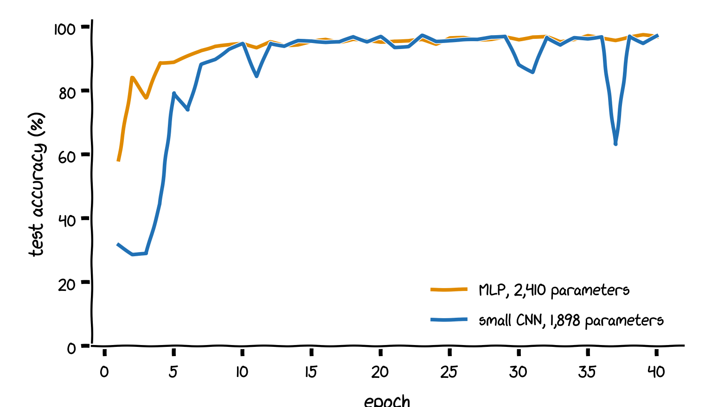
:::
::: {.column width="45%"}
scikit-learn's $8 \times 8$ digits (1,797 images), 40 epochs, same optimiser:

- **small CNN**: two CONV(3×3)-POOL stages (8 and 16 filters) and one linear layer: 1,898 parameters, **97.0%** test accuracy;
- **MLP**: 64 → 32 → 10: 2,410 parameters, **96.9%**.

On these tiny images both work. The CNN reaches the same accuracy with fewer parameters, and its parameter count does not grow with the image size. On real photos the difference becomes decisive.
:::
::::

# Classic networks

## Why study classic networks?

- They show how the building blocks (CONV, POOL, FC) are combined in practice.
- Ideas that work for one vision task often work for others.
- Their design choices explain modern networks: deeper, smaller filters, ReLU, more data.
- Pretrained versions are freely available and are the starting point of **transfer learning** (part 8c).

## LeNet-5 (LeCun et al., 1998)

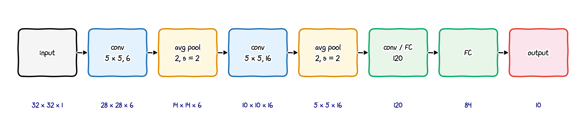{width="94%" fig-align="center"}

A network for $32 \times 32$ greyscale images of handwritten digits. Each convolution is followed by a tanh activation.

## LeNet-5: the architecture in a table

| layer | maps | size | kernel | stride | activation |
|:---|:---:|:---:|:---:|:---:|:---:|
| input | 1 | $32 \times 32$ | | | |
| conv | 6 | $28 \times 28$ | $5 \times 5$ | 1 | tanh |
| avg pool | 6 | $14 \times 14$ | $2 \times 2$ | 2 | |
| conv | 16 | $10 \times 10$ | $5 \times 5$ | 1 | tanh |
| avg pool | 16 | $5 \times 5$ | $2 \times 2$ | 2 | |
| conv (= FC) | 120 | $1 \times 1$ | $5 \times 5$ | 1 | tanh |
| FC | | 84 | | | tanh |
| output | | 10 | | | softmax |

The third convolution covers its whole $5 \times 5 \times 16$ input, so it acts like a fully connected layer.

## LeNet-5: remarks

- About **60,000** parameters (61,706 in a modern PyTorch version with tanh and average pooling).
- Designed to read handwritten digits, e.g. postcodes and bank cheques.
- The original paper used sigmoid-like activations and a trainable subsampling for pooling; modern re-implementations (e.g. the PyTorch tutorial) use ReLU and max pooling. The architecture idea is the same.
- Typical of later networks too: $n_H, n_W$ go down ($32 \to 28 \to 14 \to 10 \to 5$) while $n_C$ goes up ($1 \to 6 \to 16$).

::: small
Y. LeCun, L. Bottou, Y. Bengio, P. Haffner (1998), Gradient-based learning applied to document recognition, *Proc. IEEE* 86(11).
:::

## AlexNet (Krizhevsky, Sutskever and Hinton, 2012)

- Won the ImageNet challenge 2012 (1.2 million training images, 1000 classes) by a large margin: the start of the deep-learning boom in computer vision.
- Five convolutional layers (filters $11\times11$, $5\times5$, $3\times3$), max pooling, three fully connected layers: **61.1 million** parameters (`torchvision.models.alexnet`).
- Key ingredients: **ReLU** activations, **dropout** in the fully connected layers, data augmentation, and training on **GPUs**.
- A classic pitfall: the paper says the input is $224 \times 224 \times 3$, but the sizes of the following layers only work out for $227 \times 227 \times 3$. Always check the numbers you read.

::: small
A. Krizhevsky, I. Sutskever, G. E. Hinton (2012), ImageNet classification with deep convolutional neural networks, *NeurIPS*.
:::

## VGG-16 (Simonyan and Zisserman, 2014)

- A very **regular** design: only $3 \times 3$ convolutions (stride 1, same padding) and $2 \times 2$ max pooling (stride 2).
- 13 convolutional and 3 fully connected layers (hence "16"). The number of filters doubles after each pooling stage: $64 \to 128 \to 256 \to 512$.
- **138.4 million** parameters (`torchvision.models.vgg16`), most of them in the first fully connected layer.
- Showed that **depth** matters: stacking small $3 \times 3$ filters is better than using fewer large ones (two $3\times3$ layers see a $5 \times 5$ region with fewer parameters).

::: small
K. Simonyan, A. Zisserman (2014), Very deep convolutional networks for large-scale image recognition, arXiv:1409.1556.
:::

# Putting it together

## Training a convolutional network

- The cost function is the same as in Lectures 3 and 7, the average loss over the training examples:
$$
J = \frac1m\sum_{i=1}^{m} L\big(\hat{\mathbf y}^{(i)}, \mathbf y^{(i)}\big), \qquad L = \text{cross-entropy for classification.}
$$
- The parameters are all filters, biases and fully connected weights; backpropagation computes their gradients (autograd handles the convolutions).
- Minimise $J$ with gradient descent or a variant (mini-batches, momentum, Adam).

## Why convolutions?

- **Parameter sharing**: a feature detector (e.g. a vertical-edge detector) that is useful in one part of the image is probably useful in other parts too. The same few weights are used at every position.
- **Sparse connections**: each output value depends only on a small window of the input ($f \times f \times n_C$ numbers), not on all pixels.
- **Translation equivariance**: shifting the image shifts the feature maps in the same way; with pooling, the network becomes fairly insensitive to small shifts.

. . .

**In numbers**: mapping a $32 \times 32 \times 3$ image to $28 \times 28 \times 6$ outputs takes $(5 \cdot 5 \cdot 3 + 1)\cdot 6 = 456$ parameters with six $5\times 5$ filters, but $3072 \cdot 4704 + 4704 = 14{,}455{,}392$ with a fully connected layer.

## Summary of part 8b

- A filter has as many channels as its input; $n_C'$ filters give $n_C'$ output channels.
- A CONV layer has $(f^2 n_C^{[l-1]} + 1)\, n_C^{[l]}$ parameters, independent of the image size.
- Output size: $\lfloor (n + 2p - f)/s\rfloor + 1$, for convolutions and pooling alike.
- **Pooling** (max or average) shrinks height and width and has no parameters.
- CNN pattern: CONV → POOL → … → FC → softmax; $n_H, n_W$ decrease, $n_C$ increases.
- Classic networks: LeNet-5 (60k parameters), AlexNet (61M), VGG-16 (138M).
- Convolutions work because of parameter sharing and sparse connections.

**Next, part 8c**: transfer learning, data augmentation, face verification and neural style transfer.

## Check your understanding: part 8b

1. An input of $64 \times 64 \times 3$ goes through `nn.Conv2d(3, 16, 5, padding=2)`. What is the output shape, and how many parameters does the layer have?
2. After that, `nn.MaxPool2d(2)`: what is the shape now? How many parameters does it add?
3. Why does the number of parameters of a CONV layer not depend on the image size, while that of an FC layer does?
4. What would go wrong in VGG-16 if all filters were $7\times 7$ instead of $3\times 3$?
5. In the example network, which layer has the most parameters, and why?

::: notes
1. $64 \times 64 \times 16$ (same convolution); $(5\cdot5\cdot3 + 1)\cdot 16 = 1216$ parameters.
2. $32 \times 32 \times 16$; no parameters.
3. A CONV filter is applied at every position with the same weights; an FC layer has one weight per input value.
4. Many more parameters ($49$ instead of $9$ per channel pair) and fewer nonlinearities for the same receptive field; slower and more prone to overfitting.
5. FC3 ($48{,}120$): it connects all $400$ flattened features to $120$ units.
:::

# Part 8c: CNN applications {.part-slide}

::: {.content-visible when-format="revealjs"}
Transfer learning, data augmentation, face verification, neural style transfer
:::

## Where we are

In part 8b we built and trained complete convolutional networks:

- a CONV layer has $(f^2 n_C^{[l-1]} + 1)\,n_C^{[l]}$ parameters, independent of the image size;
- typical networks shrink height and width while increasing the number of channels;
- deep networks trained on millions of images, such as VGG-16, are freely available.

. . .

Part 8c shows four ways to **use** such networks well:

- **transfer learning**: start from a network trained on another task;
- **data augmentation**: get more out of few training images;
- **face verification**: learn a similarity between images instead of classes;
- **neural style transfer**: optimise an image, not the network.

# Transfer learning

## The problem

- Task: classify photos of **bees** and **ants** (the example in the course notebook on Moodle, after the PyTorch transfer-learning tutorial).
- The data set is tiny: about 120 training images per class.
- Training a convolutional network from scratch on so few images overfits badly (Lecture 4).

. . .

**Idea**: someone has already trained a large network on **ImageNet** (1.2 million images, 1000 classes). Its convolutional layers have learned general features (edges, textures, parts of objects) that are useful for bees and ants too.

## The idea: reuse the body, replace the head

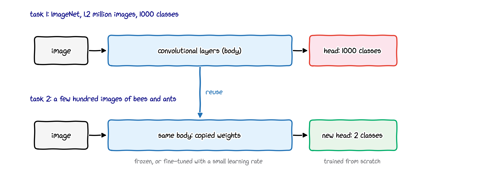{width="86%" fig-align="center"}

- **Body**: the convolutional (and pooling) layers, i.e. the feature extractor.
- **Head**: the last fully connected layer(s), specific to the original 1000 classes.
- Where exactly the body ends is a choice of the practitioner.

## Three ways to adapt the network

1. **Feature extraction**: freeze the body, replace the last layer by a new one with 2 outputs, and train only that. Best for very small data sets.
2. **Replace more of the head**: replace (and retrain) the last two or three layers, possibly with different sizes.
3. **Fine-tuning**: start from the pretrained weights and train the **whole** network with a small learning rate. Best when more data is available.

The more data you have, the more layers you can afford to retrain.

## Transfer learning in PyTorch

```python
from torch import nn
from torchvision import models

weights = models.ResNet18_Weights.DEFAULT     # pretrained on ImageNet
model = models.resnet18(weights=weights)
for p in model.parameters():                  # 1. freeze the body
    p.requires_grad = False
model.fc = nn.Linear(model.fc.in_features, 2) # 2. new head: 512 -> 2

trainable = [p for p in model.parameters() if p.requires_grad]
sum(p.numel() for p in trainable)             # 1026: only the new head
optimizer = torch.optim.SGD(trainable, lr=1e-3, momentum=0.9)
```

- ResNet-18 has 11.7 million parameters; we train only 1,026 of them.
- For fine-tuning, skip step 1 and pass `model.parameters()` to the optimiser with a small learning rate.
- The pretrained weights are downloaded on first use. Input images must be normalised the same way as during pretraining (`weights.transforms()` gives the right preprocessing).

# Data augmentation

## What and why?

**Data augmentation**: create additional training images by applying random, label-preserving changes to the existing ones (crops, flips, rotations, colour changes).

- A flipped bee is still a bee: the label does not change.
- The network sees a slightly different version of each image in every epoch, which acts like a larger data set and reduces **overfitting**.
- The changes must make sense for the task: flipping a photo of an animal is fine, but flipping a handwritten "6" upside down is not.
- Augmentation is applied to the **training** data only, not to the validation or test data.

## Examples

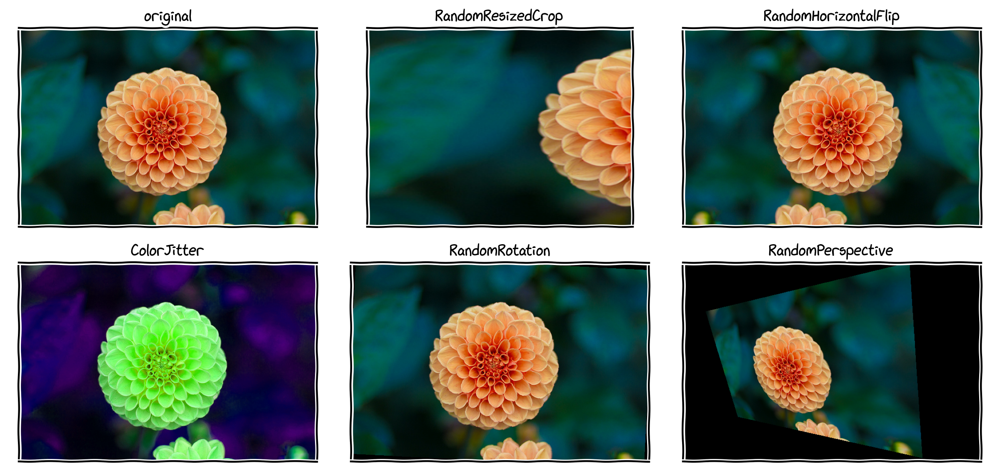{width="80%" fig-align="center"}

Each image was produced by one random transformation of `torchvision.transforms.v2` from the original (top left).

## Data augmentation in PyTorch

```python
from torchvision.transforms import v2

mean, std = [0.485, 0.456, 0.406], [0.229, 0.224, 0.225]   # ImageNet statistics
to_tensor = [v2.ToImage(), v2.ToDtype(torch.float32, scale=True)]  # PIL -> [0, 1]

train_transform = v2.Compose([
    v2.RandomResizedCrop(size=224, antialias=True),   # random crop, then 224 x 224
    v2.RandomHorizontalFlip(p=0.5),
    v2.ColorJitter(brightness=0.3, hue=0.05),
    *to_tensor, v2.Normalize(mean, std),
])
test_transform = v2.Compose([v2.Resize(256), v2.CenterCrop(224),
                             *to_tensor, v2.Normalize(mean, std)])   # no randomness
```

- There are many transformations: learn the mechanism and a few common ones, and look up the rest when needed.
- Gallery: "Illustration of transforms" in the torchvision documentation.

# Face verification

## Verification versus recognition

**Face verification** (1 : 1)

- Input: an image and a claimed identity (name or ID).
- Output: is the image that person, yes or no? (E.g. unlocking a phone.)

**Face recognition** (1 : $K$)

- A database of $K$ people.
- Input: an image.
- Output: which of the $K$ people it is, or "not recognised".

Recognition is harder: each query is compared with all $K$ people. With $K = 100$ and a verifier that errs on 1% of comparisons, more than half of the queries ($1 - 0.99^{100} \approx 63\%$) would contain at least one error. Recognition needs a very accurate verifier.

## One-shot learning

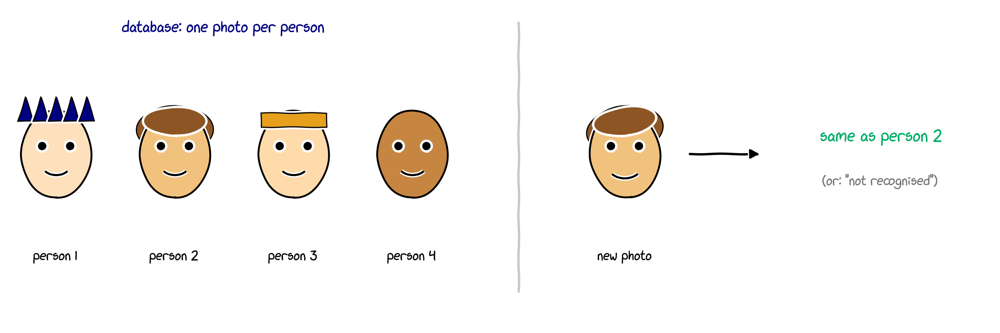{width="86%" fig-align="center"}

- We often have only **one** photo of each person, e.g. a staff ID photo.
- A classifier with one output per person cannot be trained on one example per class, and would have to be retrained whenever someone joins.
- Instead, learn a **similarity function**.

## Learning a similarity function

Learn a function $d$ that measures how different two images are:
$$
d(\text{image 1}, \text{image 2}) = \text{degree of difference between the images.}
$$

Then decide with a threshold $\tau$:
$$
\begin{cases}
d(\text{image 1}, \text{image 2}) \le \tau & \Rightarrow \text{ same person},\\
d(\text{image 1}, \text{image 2}) > \tau & \Rightarrow \text{ different persons}.
\end{cases}
$$

For recognition, compare the new photo with every photo in the database. A new person only needs one photo in the database, and **no retraining**.

## Siamese network

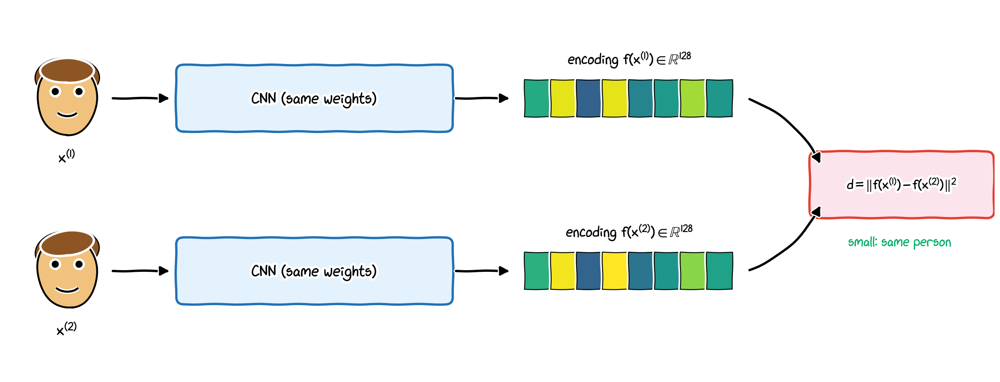{width="72%" fig-align="center"}

The same CNN (same weights) maps each image $\mathbf x$ to an **encoding** $\mathbf f(\mathbf x) \in \mathbb R^{128}$, and
$$
d\big(\mathbf x^{(1)}, \mathbf x^{(2)}\big) = \big\|\mathbf f(\mathbf x^{(1)}) - \mathbf f(\mathbf x^{(2)})\big\|^2 = \sum_{k=1}^{128}\Big(f_k(\mathbf x^{(1)}) - f_k(\mathbf x^{(2)})\Big)^2 .
$$

::: small
Chopra, Hadsell, LeCun (2005), Learning a similarity metric discriminatively; Taigman et al. (2014), DeepFace.
:::

## Goal of learning

The parameters of the network define the encoding $\mathbf f(\mathbf x)$. Learn them so that

- if $\mathbf x^{(i)}$ and $\mathbf x^{(j)}$ show the **same** person, $\ d(\mathbf x^{(i)}, \mathbf x^{(j)})$ is **small**;
- if they show **different** persons, $\ d(\mathbf x^{(i)}, \mathbf x^{(j)})$ is **large**.

. . .

One training example is a **triplet** $(A, P, N)$: an anchor $A$, a positive $P$ (same person as $A$) and a negative $N$ (a different person). We want
$$
\underbrace{\|\mathbf f(A) - \mathbf f(P)\|^2}_{d(A, P)} \ \le\ \underbrace{\|\mathbf f(A) - \mathbf f(N)\|^2}_{d(A, N)} .
$$
This alone is satisfied trivially by $\mathbf f \equiv \mathbf 0$. So we demand a **margin** $\alpha > 0$:
$$
d(A, P) - d(A, N) + \alpha \le 0 .
$$

## The triplet loss

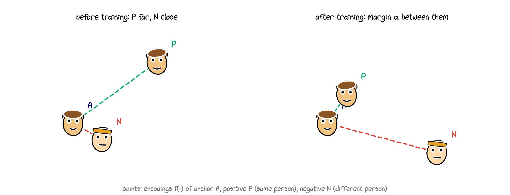{width="74%" fig-align="center"}

For one triplet, and for a training set of $m$ triplets (Schroff et al., 2015, FaceNet):
$$
L(A, P, N) = \max\big(d(A, P) - d(A, N) + \alpha,\ 0\big),
\qquad
J = \sum_{i=1}^{m} L\big(A^{(i)}, P^{(i)}, N^{(i)}\big).
$$
The loss is zero once the negative is farther away than the positive by at least the margin.

## Triplets in practice

- **Data**: several photos per person, e.g. 10,000 pictures of 1,000 persons. (Only for training: the deployed system needs just one photo per person.)
- **Choosing triplets**: if $A, P, N$ are random, $d(A, P) + \alpha \le d(A, N)$ is usually satisfied already, the loss is $0$ and nothing is learned. Choose **hard** triplets, with $d(A, P)$ close to $d(A, N)$, so that the network must learn features that really distinguish people.
- **PyTorch**: `nn.TripletMarginLoss(margin=0.2)` takes the **encodings** $\mathbf f(A), \mathbf f(P), \mathbf f(N)$, not the images. It uses the $p$-norm distance $\|\mathbf u - \mathbf v\|_p = \big(\sum_i |u_i - v_i|^p\big)^{1/p}$ (default $p = 2$) **without squaring**, unlike FaceNet. The idea is the same.

## Similarity as binary classification

An alternative to the triplet loss: feed the two encodings to a logistic-regression unit,
$$
\hat y = \sigma\left(\sum_{k=1}^{128} w_k\,\big|f_k(\mathbf x^{(i)}) - f_k(\mathbf x^{(j)})\big| + b\right),
$$
and train with binary cross-entropy on **pairs** of images: label $y = 1$ for the same person, $y = 0$ for different persons.

- The encodings of the database photos can be computed once and stored; only the new photo needs a forward pass.
- Other ways to compare the encodings, e.g. $\big(f_k(\mathbf x^{(i)}) - f_k(\mathbf x^{(j)})\big)^2$ instead of the absolute difference, work too.

# Neural style transfer

## What is neural style transfer?

<!-- :::: {.columns}
::: {.column width="32%"}

:::
::: {.column width="32%"}

:::
::: {.column width="32%"}

:::
:::: -->

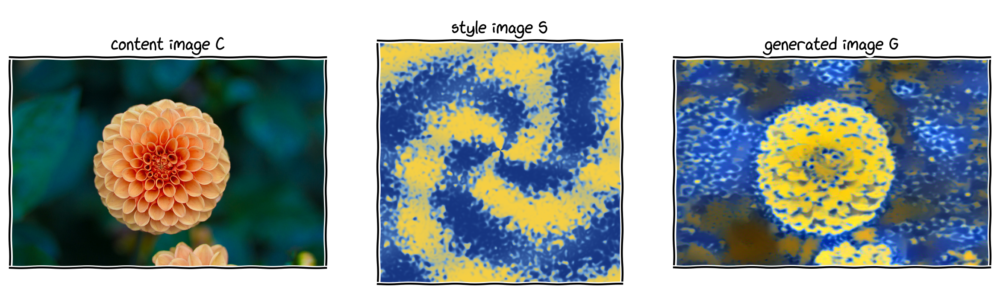

Create a new image $G$ with the **content** of $C$ and the **style** of $S$ (Gatys, Ecker and Bethge, 2015). Generated with the lecturer's implementation.

## Another example

<!-- :::: {.columns}
::: {.column width="32%"}

:::
::: {.column width="32%"}

:::
::: {.column width="32%"}

:::
:::: -->
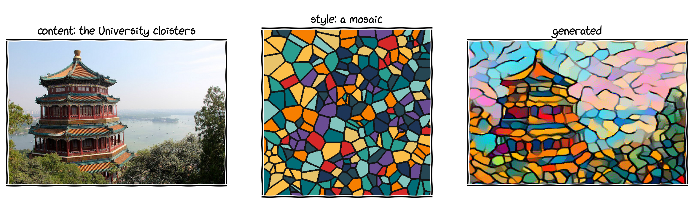

## TAnother example: Iteration process

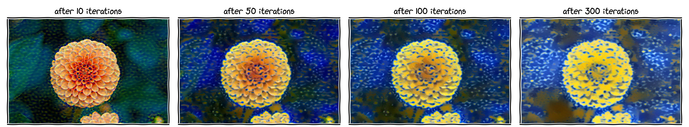

::: small
L. A. Gatys, A. S. Ecker, M. Bethge (2015), A neural algorithm of artistic style, arXiv:1508.06576.
:::

## What do the layers of a CNN detect?

- Each **channel** of a hidden layer responds to one pattern; its feature map shows where in the image the pattern occurs.
- **Early layers** respond to simple, local patterns: edges in particular directions, colours (compare the learned filters of part 8a).
- **Deeper layers** see larger regions of the image and respond to more complex patterns: textures, then parts of objects (eyes, wheels), then whole objects.

. . .

Neural style transfer exploits this:

- the **content** of an image is described by the activations of a deeper layer: *what* is where;
- the **style** is described by which patterns occur **together** within layers: textures and colours, regardless of where.

Zeiler and Fergus (2014) visualised these patterns for AlexNet ("Visualizing and understanding convolutional networks", arXiv:1311.2901).

## The cost function

Measure how good a generated image $G$ is with
$$
J(G) = \alpha\, J_{\text{content}}(C, G) + \beta\, J_{\text{style}}(S, G),
$$
where $\alpha, \beta > 0$ balance content against style.

. . .

**Generating $G$**:

1. Initialise $G$ randomly (or as a copy of $C$), e.g. $256 \times 256 \times 3$.
2. Minimise $J(G)$ by gradient descent **with respect to the pixels of $G$**; the network's weights stay fixed.

<!-- {width="18%"} {width="18%"} {width="18%"} {width="18%"} -->


## Content cost

- Use a pretrained network, e.g. VGG (part 8b), and one hidden layer $l$, neither too shallow nor too deep.
- Let $\mathbf a^{[l](C)}$ and $\mathbf a^{[l](G)}$ be the activations of layer $l$ for the images $C$ and $G$.
- If they are similar, the two images have similar content:
$$
J_{\text{content}}(C, G) = \frac12\,\big\|\mathbf a^{[l](C)} - \mathbf a^{[l](G)}\big\|^2 ,
$$
the sum of the squared differences over all entries of the $n_H^{[l]} \times n_W^{[l]} \times n_C^{[l]}$ activations.

## Style: correlations between channels

- Style is about **which features occur together**: e.g. if one channel detects vertical stripes and another detects orange, a style with orange vertical stripes makes both channels active at the **same** positions.
- Measure this by the correlation between every pair of channels $r, s$ of layer $l$, summed over all positions.

. . .

**Style (Gram) matrix**: with $a^{[l]}_{r,i,j}$ the activation of channel $r$ at position $(i, j)$,
$$
G^{[l]}_{rs} = \sum_{i=1}^{n_H^{[l]}}\sum_{j=1}^{n_W^{[l]}} a^{[l]}_{r,i,j}\;a^{[l]}_{s,i,j}, \qquad r, s = 1, \dots, n_C^{[l]} .
$$

In PyTorch, for activations `A` of shape $(n_C, n_H, n_W)$: `F = A.reshape(n_C, -1)`, `G = F @ F.T`, an $n_C \times n_C$ matrix.

## Style cost

Compute the Gram matrices $\mathbf G^{[l](S)}$ of the style image and $\mathbf G^{[l](G)}$ of the generated image, and compare them:
$$
J^{[l]}_{\text{style}}(S, G) = \frac{1}{\big(2\,n_H^{[l]} n_W^{[l]} n_C^{[l]}\big)^2}\sum_{r=1}^{n_C^{[l]}}\sum_{s=1}^{n_C^{[l]}}\Big(G^{[l](S)}_{rs} - G^{[l](G)}_{rs}\Big)^2 .
$$

. . .

Using several layers captures both fine and coarse textures:
$$
J_{\text{style}}(S, G) = \sum_{l} \lambda^{[l]}\, J^{[l]}_{\text{style}}(S, G), \qquad
J(G) = \alpha\, J_{\text{content}}(C, G) + \beta\, J_{\text{style}}(S, G).
$$

- The normalisation constant and the layer weights $\lambda^{[l]}$ can be absorbed into $\alpha$ and $\beta$; implementations differ in these constants (the lecturer's implementation omits them).

## Summary of part 8c

- **Transfer learning**: reuse the body of a network pretrained on a large data set and train a new head; fine-tune more layers when you have more data.
- **Data augmentation**: random, label-preserving transformations of the training images reduce overfitting (`torchvision.transforms.v2`).
- **Face verification**: a Siamese network maps images to encodings; train it with the **triplet loss** $\max(d(A, P) - d(A, N) + \alpha, 0)$ on hard triplets. One photo per person suffices at deployment.
- **Neural style transfer**: minimise $\alpha J_{\text{content}} + \beta J_{\text{style}}$ over the pixels of $G$; content from activations, style from Gram matrices.

## Check your understanding: part 8c

1. You have 500 labelled X-ray images. Would you freeze the body of a pretrained network or fine-tune all layers? Why?
2. Give a transformation that is a sensible augmentation for photos of cats but not for images of handwritten digits.
3. Why does the triplet loss need the margin $\alpha$?
4. A company adds a new employee to a face-verification system based on a Siamese network. What needs to be done?
5. In neural style transfer, what is optimised by gradient descent, and what stays fixed?

::: notes
1. With only 500 images, start by freezing the body and training a new head (feature extraction); if there is enough data and time, fine-tune the last layers with a small learning rate. X-rays differ from ImageNet photos, so fine-tuning some layers often helps.
2. A horizontal (or vertical) flip: a flipped cat is still a cat, but a flipped digit may become another digit or no digit.
3. Without it, the trivial encoding $\mathbf f \equiv \mathbf 0$ (or any encoding with $d(A,P) = d(A,N)$) would satisfy the constraint.
4. Only compute and store the encoding of the new employee's photo; no retraining.
5. The pixels of the generated image $G$ are optimised; the weights of the pretrained network (and the images $C$ and $S$) stay fixed.
:::

# Wrapping up

## Lecture 8 at a glance

| topic | key formula or idea |
|:---|:---|
| convolution | $(X \ast K)[i, j] = \sum_{u,v} X[i + u, j + v]\,K[u, v]$; filters are learned |
| output size | $\lfloor (n + 2p - f)/s\rfloor + 1$ (convolution and pooling) |
| CONV layer | $(f^2 n_C^{[l-1]} + 1)\,n_C^{[l]}$ parameters, independent of the image size |
| pooling | max or average over $f \times f$ windows; no parameters |
| architectures | CONV $\to$ POOL $\to \dots \to$ FC $\to$ softmax; LeNet-5, AlexNet, VGG-16 |
| transfer learning | reuse a pretrained body, train a new head |
| face verification | encodings $\mathbf f(\mathbf x)$, triplet loss $\max(d(A, P) - d(A, N) + \alpha, 0)$ |
| style transfer | minimise $\alpha J_{\text{content}} + \beta J_{\text{style}}$ over the pixels of $G$ |

: {tbl-colwidths="[22,78]"}

**Next lecture**: recurrent neural networks, for data that come as sequences.
