## This lecture

A neural network is built from many logistic-regression-like units. This lecture shows how it computes its output, how it is trained, and why the training algorithm works.

:::: {.columns}
::: {.column width="31%"}
**Part 7a: representation**

- neurons, layers, weights $\mathbf W^{[l]}$ and biases $\mathbf b^{[l]}$;
- **forward propagation** for a batch, as in PyTorch;
- **activation functions**, and why they must be nonlinear.
:::
::: {.column width="3%"}
:::
::: {.column width="31%"}
**Part 7b: training**

- computational graphs and the **chain rule**;
- **backpropagation** for one hidden layer and for $L$ layers;
- initialisation, **vanishing gradients**, training in **PyTorch**.
:::
::: {.column width="3%"}
:::
::: {.column width="31%"}
**Part 7c: the mathematics**

- the chain rule for vectors and matrices;
- "easy" local and accumulated derivatives;
- a **worked example** by hand, checked numerically.
:::
::::

An optional appendix proves backpropagation with matrix calculus.

# Part 7a: representation and forward propagation {background-image="styles/backgrounds/title.jpg" background-size="cover" background-color="#0B2545" .part-slide}

::: {.content-visible when-format="revealjs"}
From linear models to neural networks, handwritten digits, network representation, activation functions
:::

# From linear models to neural networks

## The simplest neural network: one neuron

:::: {.columns}
::: {.column width="50%"}
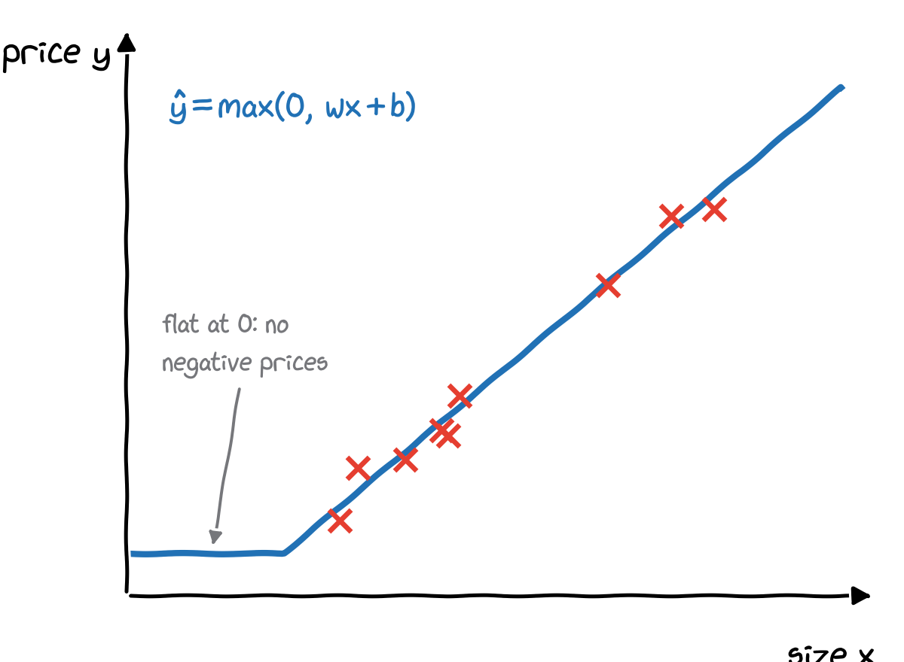
:::
::: {.column width="50%"}
Predict the price $y$ of a house from its size $x$. A straight line would predict negative prices for small houses, so cut it off at zero:
$$
\hat y = \operatorname{ReLU}(wx + b),
$$
$$
\operatorname{ReLU}(z) = \max(0, z) = \begin{cases} z & z \ge 0\\ 0 & z < 0\end{cases}
$$

. . .

This is a single **neuron** (or **unit**):

1. compute a weighted sum $z = wx + b$, as in linear regression;
2. apply an **activation function**, here ReLU, to get the output $a = \operatorname{ReLU}(z)$.
:::
::::

## From one neuron to a hidden layer

::: build
::: {}
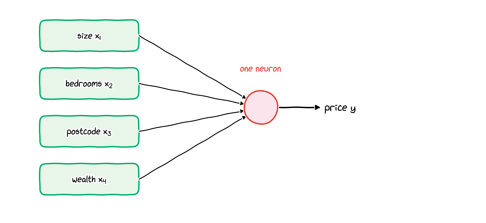{width="70%" fig-align="center"}

With several features, one neuron computes $\hat y = \operatorname{ReLU}(\mathbf w\cdot\mathbf x + b)$: still essentially linear regression.
:::
::: {}
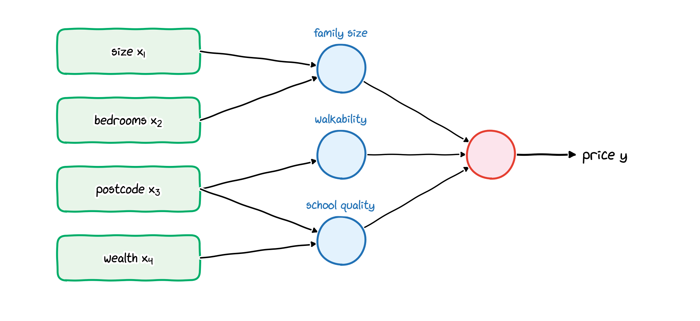{width="70%" fig-align="center"}

Intermediate quantities could help: family size (from size and bedrooms), walkability and school quality (from postcode and wealth). Each is again a neuron.
:::
::: {}
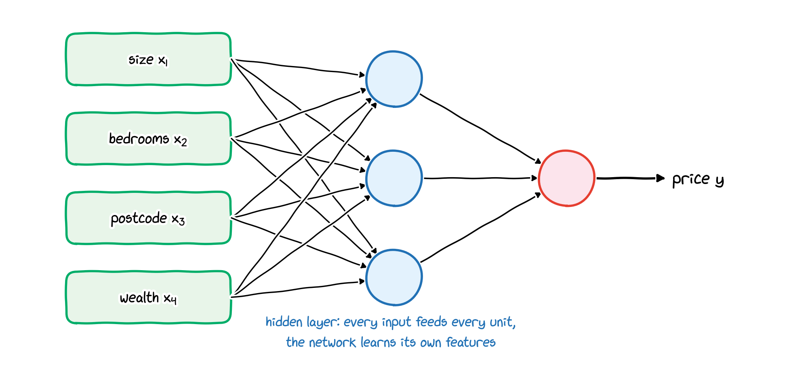{width="70%" fig-align="center"}

In practice we do not design these features by hand: every input feeds every unit of the **hidden layer**, and training decides what each unit computes.
:::
:::

## Supervised learning with neural networks

| input $\mathbf x$ | output $y$ | application | typical network |
|:---|:---|:---|:---|
| house features | price | real estate | fully connected |
| ad and user information | click on ad? (0/1) | online advertising | fully connected |
| image | object class ($1, \dots, 1000$) | photo tagging | convolutional (CNN) |
| audio | text transcript | speech recognition | recurrent (RNN), transformer |
| English text | Chinese text | machine translation | transformer, RNN |
| image, radar | positions of other cars | autonomous driving | custom / hybrid |

. . .

- **Structured data** (tables of features) and **unstructured data** (images, audio, text) can both be handled by neural networks.
- Unstructured data is where neural networks have had their biggest successes.

## Network architectures in this course

::: build
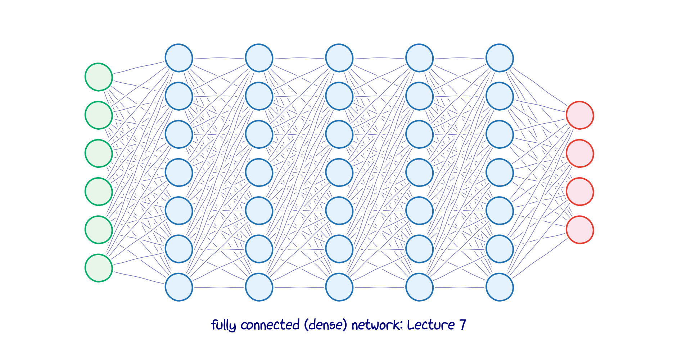{width="68%" fig-align="center"}

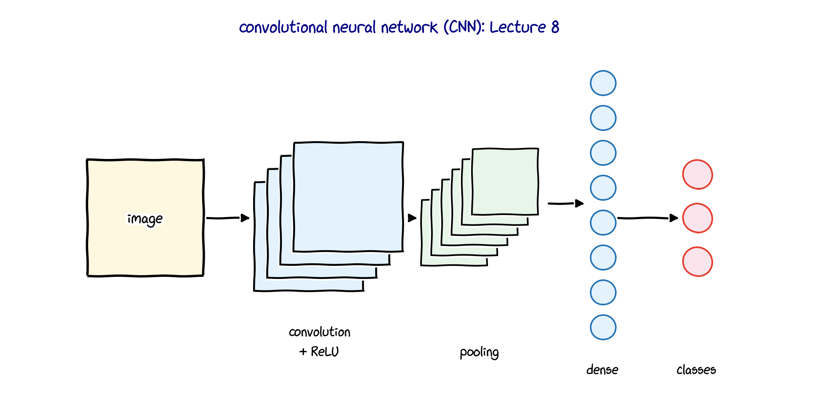{width="68%" fig-align="center"}

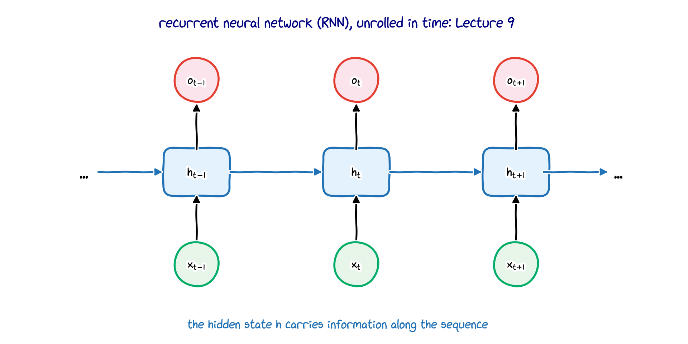{width="68%" fig-align="center"}
:::

All three are trained in the same way: a loss function, gradients by backpropagation, and gradient descent.

# A first problem: handwritten digits

## The MNIST digits

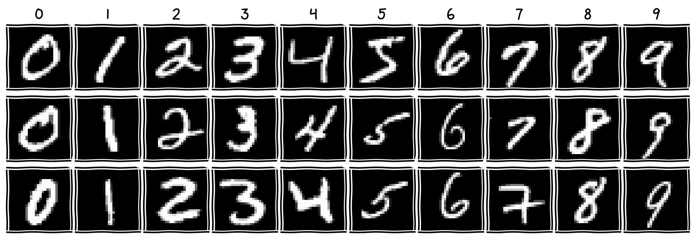{width="80%" fig-align="center"}

- 70,000 images of handwritten digits $0$ to $9$: 60,000 for training and 10,000 for testing.
- Each image is greyscale with $28 \times 28$ pixels; each pixel is an integer from $0$ (background) to $255$ (full ink).
- A classic benchmark for image classification.

## Start simple: $0$ versus $1$

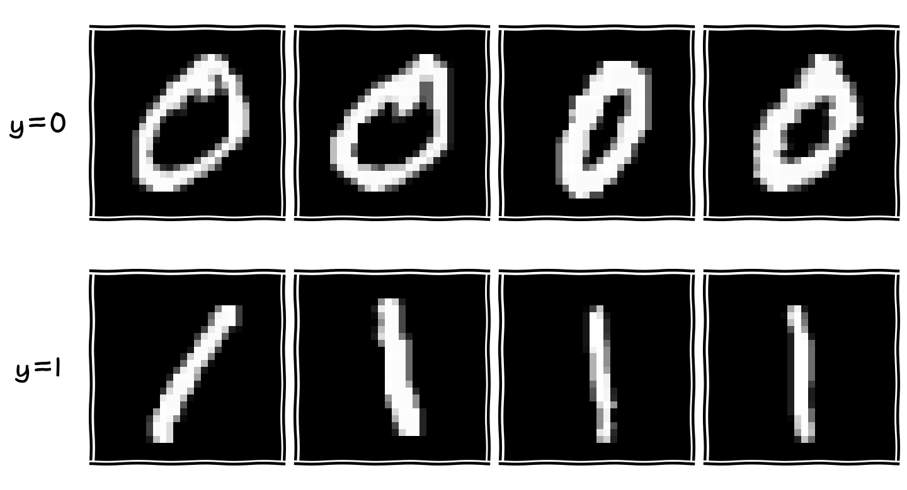{width="62%" fig-align="center"}

A **binary** classification problem, as in Lecture 3a: is the digit a $0$ ($y = 0$) or a $1$ ($y = 1$)? We will later extend it to all ten digits with softmax (Lecture 3b).

## Images as feature vectors

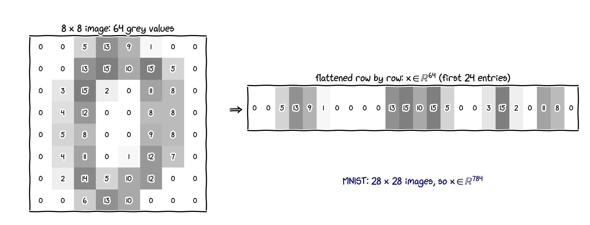{width="76%" fig-align="center"}

- Stack the rows of pixels into one long vector: an $8\times 8$ image becomes $\mathbf x \in \mathbb R^{64}$, an MNIST image $\mathbf x \in \mathbb R^{784}$.
- In NumPy: `x = image.flatten()`; in PyTorch: `x = image.reshape(-1)` or the layer `nn.Flatten()`.
- The network sees 784 numbers. Fully connected networks ignore that neighbouring pixels belong together; convolutional networks (Lecture 8) use this structure.

## Notation for the data

- One training example: $(\mathbf x, y)$ with $\mathbf x \in \mathbb R^{d}$ ($d$ features, e.g. $d = 784$) and $y \in \{0, 1\}$.
- Training set: $m$ examples $\big\{(\mathbf x^{(1)}, y^{(1)}), \dots, (\mathbf x^{(m)}, y^{(m)})\big\}$.

. . .

As in Lecture 2b, the examples are the **rows** of the data matrix:
$$
\mathbf X = \begin{pmatrix} \text{---}\ \mathbf x^{(1)}\ \text{---}\\ \text{---}\ \mathbf x^{(2)}\ \text{---}\\ \vdots\\ \text{---}\ \mathbf x^{(m)}\ \text{---}\end{pmatrix} \in \mathbb R^{m\times d},
\qquad
\mathbf y = \begin{pmatrix} y^{(1)}\\ y^{(2)}\\ \vdots\\ y^{(m)}\end{pmatrix} \in \mathbb R^{m}.
$$

::: small
Many textbooks store the examples as **columns** ($\mathbf X \in \mathbb R^{d\times m}$). We use rows because PyTorch, NumPy and scikit-learn do; the formulas then contain transposes in different places, but they describe the same network.
:::

# Neural network representation

## Logistic regression is a one-neuron network

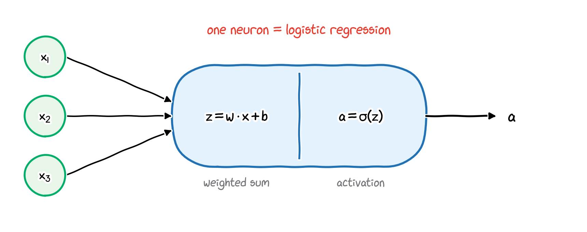{width="60%" fig-align="center"}

$$
z = \mathbf w\cdot\mathbf x + b,
\qquad a = \sigma(z) = \frac{1}{1 + e^{-z}},
\qquad \hat y = a
$$

- From now on we write $\sigma$ for the sigmoid (it was $g$ in Lecture 3a), and $g$ for a general activation function.
- Trained by minimising the binary cross-entropy (Lecture 3a):
$\ J(\mathbf w, b) = -\frac1m\sum_{i=1}^{m}\big[y^{(i)}\log a^{(i)} + (1 - y^{(i)})\log(1 - a^{(i)})\big]$.

## A network with one hidden layer

:::: {.columns}
::: {.column width="55%"}
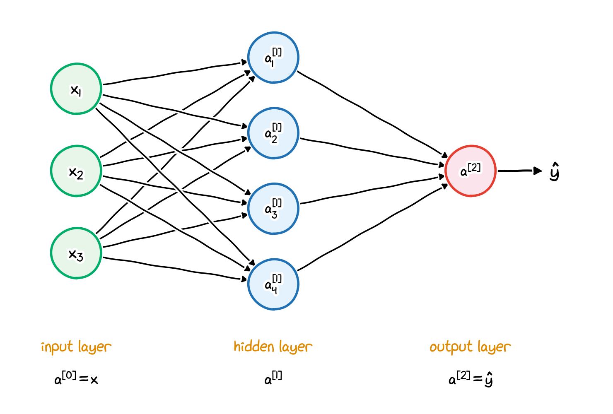
:::
::: {.column width="45%"}
- Each hidden unit $a_j^{[1]}$ is a function of $(x_1, x_2, x_3)$.
- The output $a^{[2]}$ is a function of $(a_1^{[1]}, \dots, a_4^{[1]})$...
- ...so $\hat y = a^{[2]}$ is a function of $\mathbf x$: the network is just a (complicated) model $f(\mathbf x)$.

. . .

**Notation**

- Superscript $[l]$: layer number. $\mathbf a^{[0]} = \mathbf x$ is the input.
- Subscript $j$: unit number within the layer.
- $n^{[l]}$: number of units in layer $l$; here $n^{[0]} = 3$, $n^{[1]} = 4$, $n^{[2]} = 1$.
- This is a **two-layer** network: the input layer is not counted.
:::
::::

## Computing the hidden layer, one unit at a time

:::: {.columns}
::: {.column width="48%"}
::: build
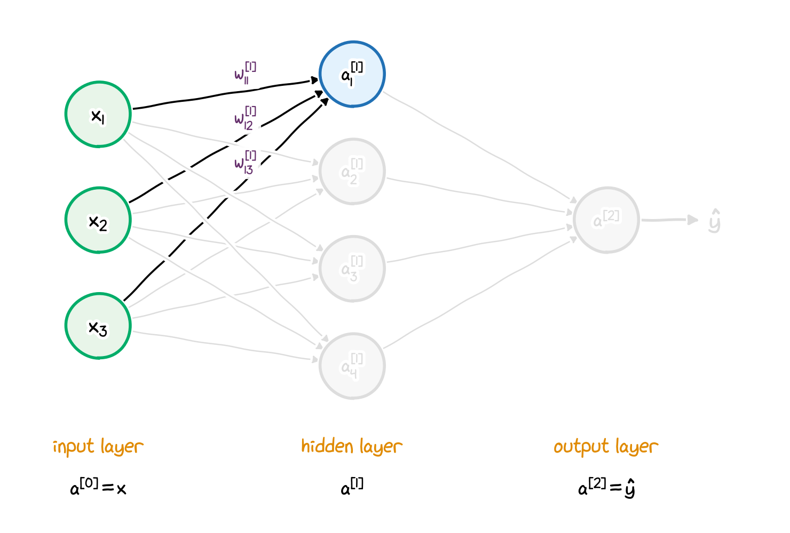{width="92%" fig-align="center"}

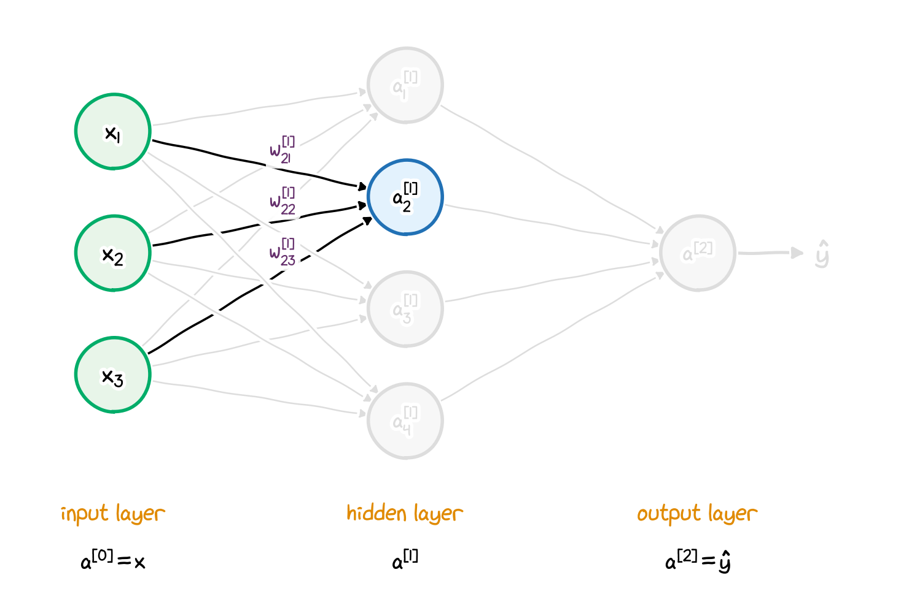{width="92%" fig-align="center"}
:::
:::
::: {.column width="52%"}
Each hidden unit is a logistic-regression unit with its **own** weights and bias:
$$
\begin{aligned}
z_1^{[1]} &= \mathbf w_1^{[1]}\cdot\mathbf a^{[0]} + b_1^{[1]}, & a_1^{[1]} &= \sigma\big(z_1^{[1]}\big)\\
z_2^{[1]} &= \mathbf w_2^{[1]}\cdot\mathbf a^{[0]} + b_2^{[1]}, & a_2^{[1]} &= \sigma\big(z_2^{[1]}\big)\\
z_3^{[1]} &= \mathbf w_3^{[1]}\cdot\mathbf a^{[0]} + b_3^{[1]}, & a_3^{[1]} &= \sigma\big(z_3^{[1]}\big)\\
z_4^{[1]} &= \mathbf w_4^{[1]}\cdot\mathbf a^{[0]} + b_4^{[1]}, & a_4^{[1]} &= \sigma\big(z_4^{[1]}\big)
\end{aligned}
$$

with $\mathbf w_j^{[1]} = \big(w_{j1}^{[1]}, w_{j2}^{[1]}, w_{j3}^{[1]}\big)$: $w_{jk}^{[1]}$ is the weight **from** input $k$ **to** unit $j$.
:::
::::

## Matrix form

Collect the weight vectors as the **rows** of a matrix, and the biases in a vector:
$$
\mathbf W^{[1]} = \begin{pmatrix}
w_{11}^{[1]} & w_{12}^{[1]} & w_{13}^{[1]}\\
w_{21}^{[1]} & w_{22}^{[1]} & w_{23}^{[1]}\\
w_{31}^{[1]} & w_{32}^{[1]} & w_{33}^{[1]}\\
w_{41}^{[1]} & w_{42}^{[1]} & w_{43}^{[1]}
\end{pmatrix}
= \begin{pmatrix} \text{---}\ \mathbf w_1^{[1]}\ \text{---}\\ \text{---}\ \mathbf w_2^{[1]}\ \text{---}\\ \text{---}\ \mathbf w_3^{[1]}\ \text{---}\\ \text{---}\ \mathbf w_4^{[1]}\ \text{---}\end{pmatrix} \in \mathbb R^{4\times 3},
\qquad
\mathbf b^{[1]} = \begin{pmatrix} b_1^{[1]}\\ b_2^{[1]}\\ b_3^{[1]}\\ b_4^{[1]}\end{pmatrix} \in \mathbb R^{4}.
$$

. . .

Then the four equations become one, and the output layer looks the same:
$$
\left\{\begin{aligned}
\mathbf z^{[1]} &= \mathbf W^{[1]}\mathbf a^{[0]} + \mathbf b^{[1]}, & \mathbf a^{[1]} &= \sigma\big(\mathbf z^{[1]}\big), & \mathbf W^{[1]} &\in \mathbb R^{4\times 3}\\
z^{[2]} &= \mathbf W^{[2]}\mathbf a^{[1]} + b^{[2]}, & a^{[2]} &= \sigma\big(z^{[2]}\big), & \mathbf W^{[2]} &\in \mathbb R^{1\times 4}
\end{aligned}\right.
$$
$\sigma$ is applied to each entry of the vector separately.

## Any layer, any size

For layer $l = 1, 2, \dots, L$ with $n^{[l]}$ units and activation function $g^{[l]}$:
$$
\mathbf z^{[l]} = \mathbf W^{[l]}\mathbf a^{[l-1]} + \mathbf b^{[l]},
\qquad
\mathbf a^{[l]} = g^{[l]}\big(\mathbf z^{[l]}\big),
\qquad
\mathbf W^{[l]} \in \mathbb R^{n^{[l]}\times n^{[l-1]}},\quad \mathbf b^{[l]} \in \mathbb R^{n^{[l]}}.
$$

$$
\underbrace{\begin{pmatrix} a_1^{[l]}\\ \vdots\\ a_{n^{[l]}}^{[l]}\end{pmatrix}}_{\mathbf a^{[l]}}
= g^{[l]}\left[\underbrace{\begin{pmatrix} w_{11}^{[l]} & \cdots & w_{1n^{[l-1]}}^{[l]}\\ \vdots & \ddots & \vdots\\ w_{n^{[l]}1}^{[l]} & \cdots & w_{n^{[l]}n^{[l-1]}}^{[l]}\end{pmatrix}}_{\mathbf W^{[l]}:\ \text{one row per unit}}
\underbrace{\begin{pmatrix} a_1^{[l-1]}\\ \vdots\\ a_{n^{[l-1]}}^{[l-1]}\end{pmatrix}}_{\mathbf a^{[l-1]}}
+ \underbrace{\begin{pmatrix} b_1^{[l]}\\ \vdots\\ b_{n^{[l]}}^{[l]}\end{pmatrix}}_{\mathbf b^{[l]}}\right]
$$

- The output of one layer is the input of the next: $\mathbf x = \mathbf a^{[0]} \to \mathbf a^{[1]} \to \dots \to \mathbf a^{[L]} = \hat{\mathbf y}$.
- Computing these in order is called **forward propagation**.

## Many examples at once: the form used by PyTorch

Write one example as a **row** vector and stack the $m$ examples as rows, $\mathbf A^{[0]} = \mathbf X \in \mathbb R^{m\times d}$. Transposing $\mathbf z = \mathbf W\mathbf a + \mathbf b$ row by row gives:

::: {.callout-note title="Forward propagation for a batch (two-layer network)"}
$$
\begin{aligned}
\mathbf Z^{[1]} &= \mathbf A^{[0]}\big(\mathbf W^{[1]}\big)^{\top} + \mathbf b^{[1]}, & \mathbf A^{[1]} &= \sigma\big(\mathbf Z^{[1]}\big), & \mathbf Z^{[1]}, \mathbf A^{[1]} &\in \mathbb R^{m\times n^{[1]}}\\
\mathbf Z^{[2]} &= \mathbf A^{[1]}\big(\mathbf W^{[2]}\big)^{\top} + \mathbf b^{[2]}, & \mathbf A^{[2]} &= \sigma\big(\mathbf Z^{[2]}\big), & \mathbf Z^{[2]}, \mathbf A^{[2]} &\in \mathbb R^{m\times 1}
\end{aligned}
$$
:::

- Row $i$ of $\mathbf A^{[l]}$ holds the activations of layer $l$ for example $i$.
- The bias row vector is added to **every** row (broadcasting, Lecture 6).
- Each layer feeds the next: $\mathbf Z^{[2]}$ uses $\mathbf A^{[1]}$, not $\mathbf A^{[0]}$.

## Forward propagation in PyTorch

:::: {.columns}
::: {.column width="58%"}
```python
import torch
from torch import nn

torch.manual_seed(0)
model = nn.Sequential(
    nn.Linear(3, 4),   # W1: (4, 3), b1: (4,)
    nn.Sigmoid(),
    nn.Linear(4, 1),   # W2: (1, 4), b2: (1,)
    nn.Sigmoid(),
)
W1, b1 = model[0].weight, model[0].bias
W2, b2 = model[2].weight, model[2].bias

X = torch.rand(5, 3)              # m = 5, d = 3
A1 = torch.sigmoid(X @ W1.T + b1) # (5, 4)
A2 = torch.sigmoid(A1 @ W2.T + b2)# (5, 1)
torch.allclose(A2, model(X))      # True
```
:::
::: {.column width="42%"}
- `nn.Linear(in, out)` stores $\mathbf W^{[l]}$ with shape (out, in), exactly as on the previous slides, and computes `X @ W.T + b`.
- So `model(X)` **is** the batch formula: our hand-written forward pass gives the same result.
- `nn.Sequential` applies the layers in order: forward propagation.
- The weights start with small random values; training (part 7b) adjusts them.
:::
::::

## Counting parameters

Layer $l$ has $n^{[l]}\times n^{[l-1]}$ weights and $n^{[l]}$ biases, i.e. $n^{[l]}\big(n^{[l-1]} + 1\big)$ parameters.

| network | layer 1 | layer 2 | total |
|:---|:---:|:---:|:---:|
| $3 \to 4 \to 1$ (previous slide) | $4 \times (3 + 1) = 16$ | $1 \times (4 + 1) = 5$ | $21$ |
| MNIST $0$ vs $1$: $784 \to 25 \to 1$ | $25 \times 785 = 19\,625$ | $1 \times 26 = 26$ | $19\,651$ |

```python
sum(p.numel() for p in model.parameters())     # 21
```

. . .

Almost all parameters sit in the first layer, because the input has 784 features. Logistic regression on the same images would have $785$.

# Activation functions

## Common activation functions

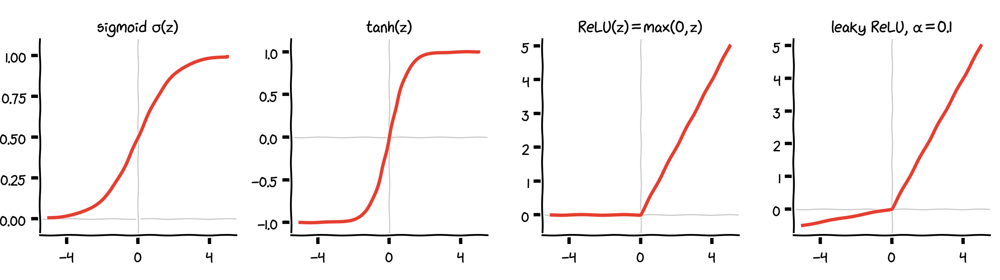{width="66%" fig-align="center"}

$$
\sigma(z) = \frac{1}{1 + e^{-z}},
\qquad
\tanh(z) = \frac{e^{z} - e^{-z}}{e^{z} + e^{-z}},
$$
$$
\operatorname{ReLU}(z) = \max(0, z),
\qquad
\operatorname{LeakyReLU}(z) = \begin{cases} z & z \ge 0\\ \alpha z & z < 0\end{cases}
$$

- Sigmoid: outputs in $(0, 1)$. tanh: outputs in $(-1, 1)$, centred at $0$; $\tanh(z) = 2\sigma(2z) - 1$.
- Leaky ReLU: a small slope $\alpha > 0$ for negative inputs (typically $0.01$; the figure uses $0.1$), so the output is $\alpha z < 0$ there.

## Which activation where?

**Output layer**: chosen by the type of target.

| task | output activation | loss (PyTorch) |
|:---|:---|:---|
| binary classification | sigmoid: $P(y = 1 \mid \mathbf x)$ | `nn.BCEWithLogitsLoss` |
| $K$ classes | softmax (Lecture 3b) | `nn.CrossEntropyLoss` |
| regression | none (identity) | `nn.MSELoss` |

. . .

**Hidden layers**: usually **ReLU**, the default choice in modern networks.

- It is cheap to compute, and its slope is $1$ for all positive inputs.
- Sigmoid and tanh **saturate**: for large $|z|$ their slope is almost $0$, which slows down gradient-based training (part 7b).
- A ReLU unit whose input is always negative outputs $0$ and stops learning ("dead" unit); leaky ReLU avoids this.

## Why must activations be nonlinear?

Suppose every activation is the identity, $g(z) = z$. Then
$$
\mathbf a^{[2]} = \mathbf W^{[2]}\big(\mathbf W^{[1]}\mathbf x + \mathbf b^{[1]}\big) + \mathbf b^{[2]}
= \underbrace{\mathbf W^{[2]}\mathbf W^{[1]}}_{\mathbf W'}\,\mathbf x + \underbrace{\mathbf W^{[2]}\mathbf b^{[1]} + \mathbf b^{[2]}}_{\mathbf b'} :
$$
a **linear** model again, however many layers we stack.

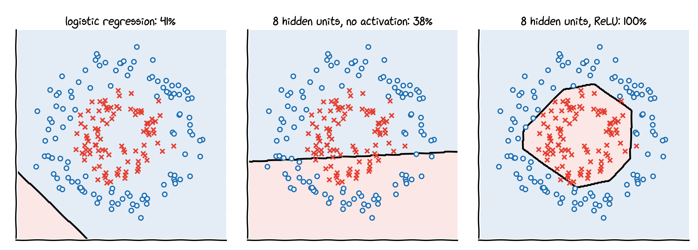{width="64%" fig-align="center"}

Points inside a ring cannot be separated by a straight line: logistic regression and a network without activation both fail (test accuracy 41% and 38%). With ReLU, the same 8 hidden units give 100%.

## Summary of part 7a

- A **neuron** computes $a = g(\mathbf w\cdot\mathbf x + b)$; logistic regression is a one-neuron network.
- A **layer** of $n^{[l]}$ neurons: $\mathbf z^{[l]} = \mathbf W^{[l]}\mathbf a^{[l-1]} + \mathbf b^{[l]}$, $\ \mathbf a^{[l]} = g^{[l]}(\mathbf z^{[l]})$, with $\mathbf W^{[l]} \in \mathbb R^{n^{[l]}\times n^{[l-1]}}$.
- **Forward propagation** for a batch (rows = examples, as in PyTorch): $\mathbf Z^{[l]} = \mathbf A^{[l-1]}(\mathbf W^{[l]})^{\top} + \mathbf b^{[l]}$, $\ \mathbf A^{[l]} = g^{[l]}(\mathbf Z^{[l]})$, starting from $\mathbf A^{[0]} = \mathbf X$.
- **Parameters**: $n^{[l]}(n^{[l-1]} + 1)$ per layer.
- **Activations**: ReLU in hidden layers; sigmoid, softmax or none at the output. They must be **nonlinear**, otherwise the whole network is linear.
- In PyTorch: `nn.Sequential(nn.Linear(d, n1), nn.ReLU(), nn.Linear(n1, 1), ...)`.

**Next, part 7b**: how to train a network: the computational graph, backpropagation and gradient descent, deeper networks, and MNIST in PyTorch.

## Check your understanding: part 7a

1. A network has layers of sizes $10 \to 8 \to 8 \to 3$. What are the shapes of $\mathbf W^{[1]}$, $\mathbf W^{[2]}$ and $\mathbf W^{[3]}$? How many parameters does it have?
2. For a batch of $m = 32$ examples, what is the shape of $\mathbf Z^{[1]}$ in that network?
3. In `nn.Linear(784, 25)`, what is the shape of `.weight`?
4. Why is a network with 10 hidden layers but no nonlinear activation no more powerful than logistic regression?
5. Which output activation would you use to predict (a) a house price, (b) one of ten digits, (c) spam or not spam?

::: notes
1. $\mathbf W^{[1]}$: $(8, 10)$; $\mathbf W^{[2]}$: $(8, 8)$; $\mathbf W^{[3]}$: $(3, 8)$. Parameters: $8 \cdot 11 + 8 \cdot 9 + 3 \cdot 9 = 88 + 72 + 27 = 187$.
2. $(32, 8)$: one row per example, one column per unit of layer 1.
3. $(25, 784)$: (out, in).
4. Compositions of linear maps are linear, so the network computes $\mathbf W'\mathbf x + \mathbf b'$, with a linear decision boundary (plus a sigmoid at the end, if any).
5. (a) none (identity), (b) softmax, (c) sigmoid.
:::

# Part 7b: backpropagation, deep networks and training {background-image="styles/backgrounds/title.jpg" background-size="cover" background-color="#0B2545" .part-slide}

::: {.content-visible when-format="revealjs"}
Computational graphs, backpropagation, deep networks, vanishing gradients, neural networks in PyTorch
:::

## Where we are

In part 7a we computed the output of a network, **forward propagation**:
$$
\mathbf Z^{[l]} = \mathbf A^{[l-1]}\big(\mathbf W^{[l]}\big)^{\top} + \mathbf b^{[l]},
\qquad
\mathbf A^{[l]} = g^{[l]}\big(\mathbf Z^{[l]}\big),
\qquad l = 1, \dots, L,\quad \mathbf A^{[0]} = \mathbf X .
$$

. . .

Part 7b **trains** the network, exactly as in Lectures 2 and 3:

- a cost $J$ (cross-entropy for classification), minimised by gradient descent;
- the new difficulty: the gradient with respect to **every** $\mathbf W^{[l]}$ and $\mathbf b^{[l]}$, through many layers;
- the answer: **backpropagation**, the chain rule applied backwards through the network.

# Computational graphs and the chain rule

## The chain rule

If $J$ depends on $\theta$ only through an intermediate quantity $v$, i.e. $J = J(v)$ and $v = v(\theta)$, then
$$
\frac{\partial J}{\partial \theta} = \frac{\partial J}{\partial v}\,\frac{\partial v}{\partial \theta} .
$$

. . .

If $\theta$ influences $J$ through **several** intermediate quantities $v_1, \dots, v_K$, the contributions add up:
$$
\frac{\partial J}{\partial \theta} = \sum_{k=1}^{K} \frac{\partial J}{\partial v_k}\,\frac{\partial v_k}{\partial \theta} .
$$

. . .

**Example.** $f = a_1 a_2$ with $a_1 = \theta^2$ and $a_2 = 3\theta$: $\ \frac{\partial f}{\partial\theta} = a_2\cdot 2\theta + a_1\cdot 3 = 9\theta^2$, which agrees with differentiating $f = 3\theta^3$ directly.

Backpropagation is nothing more than applying these two rules systematically, from the output back to the parameters.

## A small computational graph

::: build
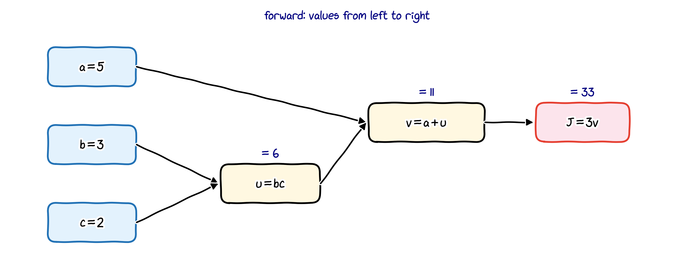{width="80%" fig-align="center"}

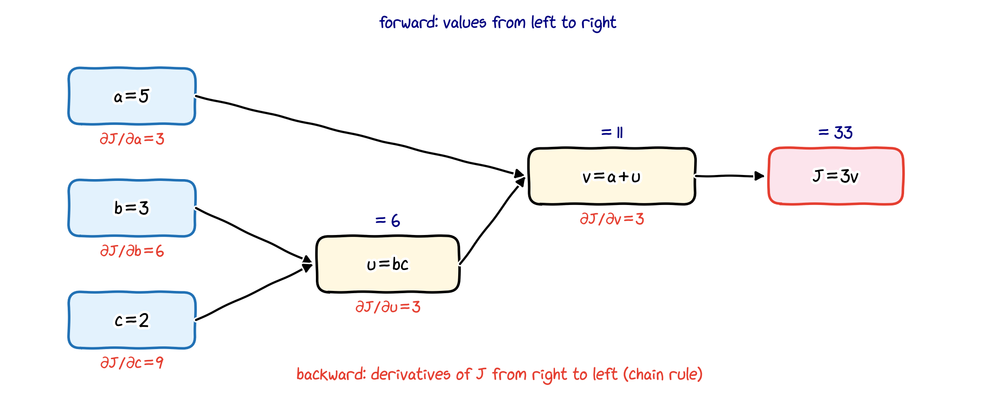{width="80%" fig-align="center"}
:::

$J(a, b, c) = 3(a + bc)$, evaluated at $a = 5$, $b = 3$, $c = 2$. **Backward**, using values from the forward pass:
$\frac{\partial J}{\partial v} = 3$, $\ \frac{\partial J}{\partial a} = \frac{\partial J}{\partial v}\cdot 1 = 3$, $\ \frac{\partial J}{\partial u} = 3$, $\ \frac{\partial J}{\partial b} = \frac{\partial J}{\partial u}\,c = 6$, $\ \frac{\partial J}{\partial c} = \frac{\partial J}{\partial u}\,b = 9$.

## Why go backwards?

- Each derivative $\frac{\partial J}{\partial(\cdot)}$ is computed **once** and then **reused** by every node further back: $\frac{\partial J}{\partial u}$ serves both $b$ and $c$.
- One backward pass gives the derivatives with respect to **all** parameters, at roughly the cost of one forward pass.
- Each step only needs a **local** derivative ("easy"), such as $\partial u/\partial b = c$, and the derivative passed back from the next node.
- A network with a million parameters still needs only one forward and one backward pass per gradient. This is what `loss.backward()` does in PyTorch (Lecture 6).

# Backpropagation for logistic regression

## Logistic regression as a graph

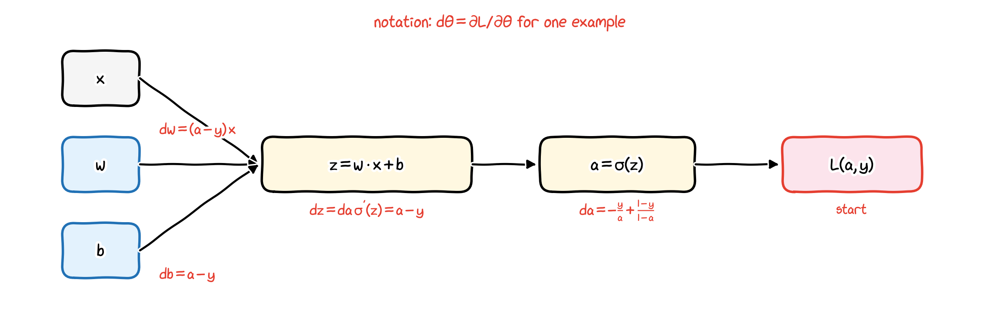{width="70%" fig-align="center"}

For one example, with $z = \mathbf w\cdot\mathbf x + b$, $a = \sigma(z)$ and $L(a, y) = -y\log a - (1 - y)\log(1 - a)$. We write $d\theta = \partial L/\partial\theta$ (the name of the variable in code):
$$
\begin{aligned}
da &= -\frac{y}{a} + \frac{1 - y}{1 - a}, &
dz &= da\;\sigma'(z) = da\;a(1 - a) = a - y,\\
d\mathbf w &= dz\;\mathbf x = (a - y)\,\mathbf x, &
db &= dz = a - y .
\end{aligned}
$$

. . .

Only "easy" local derivatives are needed: $\partial a/\partial z = a(1 - a)$, $\ \partial z/\partial\mathbf w = \mathbf x$, $\ \partial z/\partial b = 1$. Averaging over the examples gives the gradient of Lecture 3a.

# Backpropagation for a two-layer network

## The forward pass

One example, as a **row** vector (part 7a), hidden activation $g$, sigmoid output:
$$
\begin{aligned}
\mathbf z^{[1]} &= \mathbf a^{[0]}\big(\mathbf W^{[1]}\big)^{\top} + \mathbf b^{[1]}, &
\mathbf a^{[1]} &= g\big(\mathbf z^{[1]}\big), && \text{with } \mathbf a^{[0]} = \mathbf x,\\
z^{[2]} &= \mathbf a^{[1]}\big(\mathbf W^{[2]}\big)^{\top} + b^{[2]}, &
a^{[2]} &= \sigma\big(z^{[2]}\big), &&
L\big(a^{[2]}, y\big) = -y\log a^{[2]} - (1 - y)\log\big(1 - a^{[2]}\big).
\end{aligned}
$$

. . .

**Goal**: the gradient of $L$ with respect to all parameters,
$$
\frac{\partial L}{\partial \mathbf W^{[1]}}, \qquad
\frac{\partial L}{\partial \mathbf b^{[1]}}, \qquad
\frac{\partial L}{\partial \mathbf W^{[2]}}, \qquad
\frac{\partial L}{\partial b^{[2]}} .
$$

The parameters of layer 1 influence $L$ only through $\mathbf z^{[1]}$, then $\mathbf a^{[1]}$, then $z^{[2]}$ and $a^{[2]}$. So we work backwards along this chain.

## The backward pass

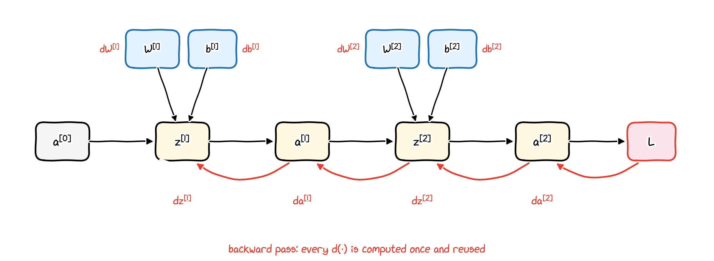{width="64%" fig-align="center"}

$$
da^{[2]} \to dz^{[2]} \to \begin{cases} d\mathbf W^{[2]},\ db^{[2]}\\ d\mathbf a^{[1]} \to d\mathbf z^{[1]} \to d\mathbf W^{[1]},\ d\mathbf b^{[1]}\end{cases}
$$

- Layer 2 is handled exactly like logistic regression.
- For layer 1 we continue the **same** process one layer further, starting from $d\mathbf a^{[1]}$.
- Each arrow needs only one local derivative: $\partial a/\partial z$, $\ \partial z/\partial a$ (one layer back), or $\partial z/\partial\theta$ (the parameters).

## The backpropagation equations

::: {.callout-note title="Two-layer network, one example (rows; $\odot$: element-wise product)"}
$$
\begin{aligned}
dz^{[2]} &= a^{[2]} - y &&\text{(sigmoid output, cross-entropy loss)}\\
d\mathbf W^{[2]} &= \big(dz^{[2]}\big)^{\top}\mathbf a^{[1]}, \qquad db^{[2]} = dz^{[2]}\\
d\mathbf a^{[1]} &= dz^{[2]}\,\mathbf W^{[2]} &&\text{(pass the error one layer back)}\\
d\mathbf z^{[1]} &= d\mathbf a^{[1]} \odot g'\big(\mathbf z^{[1]}\big) &&\text{(through the activation)}\\
d\mathbf W^{[1]} &= \big(d\mathbf z^{[1]}\big)^{\top}\mathbf a^{[0]}, \qquad d\mathbf b^{[1]} = d\mathbf z^{[1]}
\end{aligned}
$$
:::

- **Shapes**: $d\mathbf W^{[l]}$ has the same shape as $\mathbf W^{[l]}$: $(n^{[l]}\times 1)(1\times n^{[l-1]})$.
- **Activation derivatives**: sigmoid $g'(z) = a(1 - a)$; $\ \tanh$: $g'(z) = 1 - a^2$; $\ $ReLU: $g'(z) = 1$ if $z > 0$, else $0$.

## Where do these formulas come from? (optional)

Entry $j$ of layer $l$ is $z_j = \sum_k w_{jk}\,a_k + b_j$, where $a_k$ are the activations of layer $l - 1$. Then

. . .

- **weights**: $w_{jk}$ appears only in $z_j$, with $\partial z_j/\partial w_{jk} = a_k$, so
$$
\frac{\partial L}{\partial w_{jk}} = dz_j\,a_k
\quad\Longrightarrow\quad
d\mathbf W = (d\mathbf z)^{\top}\mathbf a \quad\text{(an outer product)};
$$

. . .

- **activations of the previous layer**: $a_k$ appears in **every** $z_j$, with $\partial z_j/\partial a_k = w_{jk}$; by the multivariable chain rule,
$$
\frac{\partial L}{\partial a_k} = \sum_j dz_j\,w_{jk}
\quad\Longrightarrow\quad
d\mathbf a = d\mathbf z\,\mathbf W ;
$$

. . .

- **through the activation**: $a_j = g(z_j)$ depends only on $z_j$, so $dz_j = da_j\,g'(z_j)$, i.e. $d\mathbf z = d\mathbf a \odot g'(\mathbf z)$.

## A whole mini-batch at once

With the $m$ examples as the rows of $\mathbf A^{[0]} = \mathbf X$, and $J = \frac1m\sum_i L^{(i)}$, row $i$ of $d\mathbf Z^{[l]}$ holds $d\mathbf z^{[l]}$ of example $i$:
$$
\begin{aligned}
d\mathbf Z^{[2]} &= \mathbf A^{[2]} - \mathbf y, &
\frac{\partial J}{\partial \mathbf W^{[2]}} &= \frac1m\big(d\mathbf Z^{[2]}\big)^{\top}\mathbf A^{[1]}, &
\frac{\partial J}{\partial \mathbf b^{[2]}} &= \frac1m\sum_{i=1}^{m}\big(\text{row } i \text{ of } d\mathbf Z^{[2]}\big),\\
d\mathbf A^{[1]} &= d\mathbf Z^{[2]}\,\mathbf W^{[2]}, &
d\mathbf Z^{[1]} &= d\mathbf A^{[1]} \odot g'\big(\mathbf Z^{[1]}\big),\\
\frac{\partial J}{\partial \mathbf W^{[1]}} &= \frac1m\big(d\mathbf Z^{[1]}\big)^{\top}\mathbf A^{[0]}, &
\frac{\partial J}{\partial \mathbf b^{[1]}} &= \frac1m\sum_{i=1}^{m}\big(\text{row } i \text{ of } d\mathbf Z^{[1]}\big).
\end{aligned}
$$

The factor $\frac1m$ and the sum over rows come from averaging the loss over the examples. In NumPy the sum is `dZ.sum(axis=0)`.

## Backpropagation in NumPy, checked against autograd

:::: {.columns}
::: {.column width="58%"}
```python
import numpy as np

def sigmoid(z):
    return 1 / (1 + np.exp(-z))

def backprop(X, y, W1, b1, W2, b2):
    m = X.shape[0]
    Z1 = X @ W1.T + b1;  A1 = sigmoid(Z1)   # forward
    Z2 = A1 @ W2.T + b2; A2 = sigmoid(Z2)
    dZ2 = A2 - y                             # (m, 1)
    dW2 = dZ2.T @ A1 / m
    db2 = dZ2.mean(axis=0)
    dA1 = dZ2 @ W2                           # (m, n1)
    dZ1 = dA1 * A1 * (1 - A1)                # sigmoid'
    dW1 = dZ1.T @ X / m
    db1 = dZ1.mean(axis=0)
    return dW1, db1, dW2, db2
```
:::
::: {.column width="42%"}
- Every line is one of the equations on the previous slides.
- Test: random data with $m = 8$, $d = 3$, $n^{[1]} = 4$. We compare with PyTorch's `loss.backward()` on the same network and the same binary cross-entropy.
- The largest difference among all gradient entries is $6\times 10^{-17}$, i.e. rounding error.

Autograd does exactly this, for any network, automatically.
:::
::::

## Training a network with gradient descent

1. **Initialise** all weights with small **random** values; biases may start at $0$.
2. **Repeat**, for every epoch and mini-batch:
   - forward pass: compute and cache $\mathbf Z^{[l]}$ and $\mathbf A^{[l]}$ for $l = 1, \dots, L$;
   - compute the cost $J$;
   - backward pass: compute $\partial J/\partial \mathbf W^{[l]}$ and $\partial J/\partial \mathbf b^{[l]}$ for $l = L, \dots, 1$;
   - update: $\mathbf W^{[l]} \leftarrow \mathbf W^{[l]} - \alpha\,\frac{\partial J}{\partial \mathbf W^{[l]}}$, $\ \mathbf b^{[l]} \leftarrow \mathbf b^{[l]} - \alpha\,\frac{\partial J}{\partial \mathbf b^{[l]}}$.

. . .

**Why random?** If all weights of a layer start equal (e.g. all zero), every unit in that layer computes the same output and receives the same gradient, so they stay identical forever: $n^{[l]}$ units then behave like one. Random values **break the symmetry**. `nn.Linear` draws its weights uniformly from $\big[-1/\sqrt{n^{[l-1]}},\ 1/\sqrt{n^{[l-1]}}\big]$.

# Deep neural networks

## Notation for a deep network

:::: {.columns}
::: {.column width="58%"}
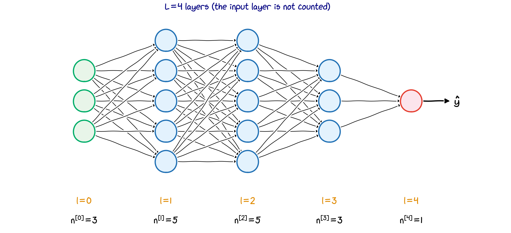
:::
::: {.column width="42%"}
- $L$: number of layers; here $L = 4$.
- $n^{[l]}$: number of units in layer $l$; here $n^{[0]} = 3$, $n^{[1]} = n^{[2]} = 5$, $n^{[3]} = 3$, $n^{[4]} = 1$.
- $\mathbf W^{[l]} \in \mathbb R^{n^{[l]}\times n^{[l-1]}}$, $\ \mathbf b^{[l]} \in \mathbb R^{n^{[l]}}$: parameters of layer $l$.
- $g^{[l]}$: activation function of layer $l$.
- $\mathbf a^{[l]} = g^{[l]}(\mathbf z^{[l]})$: activations of layer $l$; $\mathbf a^{[0]} = \mathbf x$ and $\mathbf a^{[L]} = \hat{\mathbf y}$.
:::
::::

## Forward and backward pass for layer $l$

:::: {.columns}
::: {.column width="45%"}
**Forward**: input $\mathbf A^{[l-1]}$; output $\mathbf A^{[l]}$; cache $\mathbf Z^{[l]}$
$$
\begin{aligned}
\mathbf Z^{[l]} &= \mathbf A^{[l-1]}\big(\mathbf W^{[l]}\big)^{\top} + \mathbf b^{[l]}\\
\mathbf A^{[l]} &= g^{[l]}\big(\mathbf Z^{[l]}\big)
\end{aligned}
$$
for $l = 1, 2, \dots, L$, starting from $\mathbf A^{[0]} = \mathbf X$.
:::
::: {.column width="55%"}
**Backward**: input $d\mathbf A^{[l]}$; output $d\mathbf A^{[l-1]}$ and the gradients of layer $l$
$$
\begin{aligned}
d\mathbf Z^{[l]} &= d\mathbf A^{[l]} \odot g^{[l]\prime}\big(\mathbf Z^{[l]}\big)\\
\frac{\partial J}{\partial \mathbf W^{[l]}} &= \frac1m\big(d\mathbf Z^{[l]}\big)^{\top}\mathbf A^{[l-1]}\\
\frac{\partial J}{\partial \mathbf b^{[l]}} &= \frac1m\,\texttt{dZ.sum(axis=0)}\\
d\mathbf A^{[l-1]} &= d\mathbf Z^{[l]}\,\mathbf W^{[l]}
\end{aligned}
$$
for $l = L, \dots, 1$.
:::
::::

. . .

- The backward pass needs $\mathbf A^{[l-1]}$ and $\mathbf Z^{[l]}$ from the forward pass, so they are **cached**.
- Start of the backward pass: for a sigmoid output with binary cross-entropy, or softmax with cross-entropy (Lecture 3b), $d\mathbf Z^{[L]} = \mathbf A^{[L]} - \mathbf Y$ (with $\mathbf Y$ one-hot for softmax).

## The whole picture

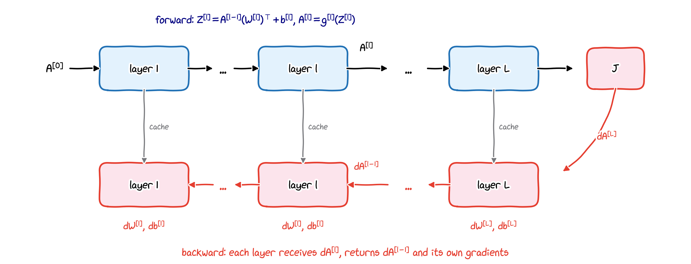{width="84%" fig-align="center"}

- Every layer is a building block with a forward function and a backward function.
- Deep networks just chain more of the same blocks; nothing new is needed in the mathematics. This is exactly how PyTorch's modules work.

## Vanishing gradients

:::: {.columns}
::: {.column width="55%"}
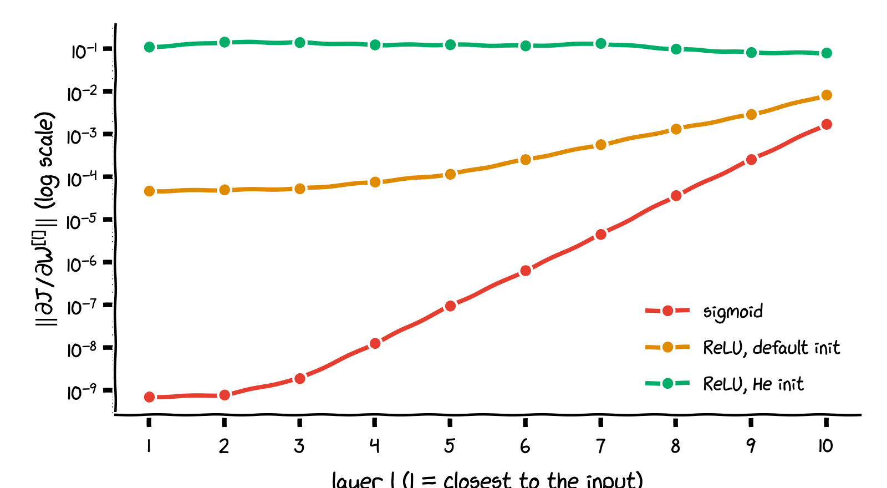
:::
::: {.column width="45%"}
A network with 10 hidden layers of 64 units, at initialisation. Gradient size per layer:

- **sigmoid**: each backward step multiplies by $\sigma'(z) \le \frac14$. The first layer's gradient is about **a million times** smaller than the last layer's, so the first layers barely learn.
- **ReLU**, default initialisation: about 180 times smaller.
- **ReLU with He initialisation** (weights with standard deviation $\sqrt{2/n^{[l-1]}}$): the same size in every layer.

ReLU and careful initialisation are what make deep networks trainable.
:::
::::

# Neural networks in PyTorch

## Building blocks

| PyTorch | what it does |
|:---|:---|
| `nn.Module` | base class of every model: define the layers in `__init__`, the computation in `forward` |
| `nn.Linear(n_in, n_out)` | $\mathbf Z = \mathbf A\mathbf W^{\top} + \mathbf b$, with $\mathbf W$ of shape `(n_out, n_in)` and its own initialisation |
| `nn.ReLU()`, `nn.Sigmoid()`, `nn.Tanh()` | activation functions as layers (no parameters) |
| `torch.relu`, `torch.sigmoid`, `torch.tanh` | the same as functions (also in `torch.nn.functional`) |
| `nn.Flatten()` | turns each $28\times 28$ image into a vector of length $784$ |
| `nn.Sequential(...)` | applies layers one after another |
| `nn.CrossEntropyLoss()` | softmax and cross-entropy in one step, from raw scores ("logits") |

Documentation: <https://pytorch.org/docs/stable/nn.html>

## A network for handwritten digits

{width="56%" fig-align="center"}

$$
{\color{red}{\text{Linear}}}[784, 512] \to {\color{blue}{\text{ReLU}}} \to {\color{red}{\text{Linear}}}[512, 512] \to {\color{blue}{\text{ReLU}}} \to {\color{red}{\text{Linear}}}[512, 10]
$$

**Questions**: Which components have learnable parameters? How many parameters does the model have?

. . .

Only the linear layers: $784\cdot 512 + 512 = 401\,920$, $\ 512\cdot 512 + 512 = 262\,656$, $\ 512\cdot 10 + 10 = 5\,130$. In total **669,706** parameters. The 10 outputs are the scores of the digits 0 to 9.

## The model in code

```python
import torch
from torch import nn

class NeuralNetwork(nn.Module):
    def __init__(self):
        super().__init__()
        self.flatten = nn.Flatten()                  # (batch, 1, 28, 28) -> (batch, 784)
        self.linear_relu_stack = nn.Sequential(
            nn.Linear(28 * 28, 512), nn.ReLU(),
            nn.Linear(512, 512), nn.ReLU(),
            nn.Linear(512, 10),                      # 10 logits, one per digit
        )

    def forward(self, x):
        x = self.flatten(x)
        return self.linear_relu_stack(x)

device = "cuda" if torch.cuda.is_available() else "cpu"
model = NeuralNetwork().to(device)
sum(p.numel() for p in model.parameters())          # 669706
```

We only write the **forward** pass; autograd derives the backward pass.

## Loading MNIST and training

```python
from torch.utils.data import DataLoader
from torchvision import datasets
from torchvision.transforms import ToTensor

train_data = datasets.MNIST("data", train=True, download=True, transform=ToTensor())
test_data = datasets.MNIST("data", train=False, download=True, transform=ToTensor())
train_loader = DataLoader(train_data, batch_size=64, shuffle=True)
test_loader = DataLoader(test_data, batch_size=64)

loss_fn = nn.CrossEntropyLoss()                     # softmax + cross-entropy, from logits
optimizer = torch.optim.SGD(model.parameters(), lr=0.1)

for epoch in range(10):
    train_loop(train_loader, model, loss_fn, optimizer)       # next slide
    test_loss, test_acc = test_loop(test_loader, model, loss_fn)
    print(f"epoch {epoch + 1}: test loss {test_loss:.3f}, accuracy {test_acc:.1%}")
```

- `ToTensor()` turns each image into a tensor of shape (1, 28, 28) with values in $[0, 1]$.
- The data are downloaded once into the folder `data`.

## The training and test loops

```python
def train_loop(loader, model, loss_fn, optimizer):
    model.train()
    for X, y in loader:
        loss = loss_fn(model(X), y)       # forward pass and loss
        optimizer.zero_grad()
        loss.backward()                   # backpropagation
        optimizer.step()                  # gradient-descent update

def test_loop(loader, model, loss_fn):
    model.eval()
    correct, total_loss = 0, 0.0
    with torch.no_grad():                 # no gradients needed for evaluation
        for X, y in loader:
            logits = model(X)
            total_loss += loss_fn(logits, y).item() * len(y)
            correct += (logits.argmax(dim=1) == y).sum().item()
    n = len(loader.dataset)
    return total_loss / n, correct / n    # average loss, accuracy
```

`model.train()` and `model.eval()` switch layers such as dropout between training and evaluation mode; for our network they change nothing, but it is good practice.

## Results

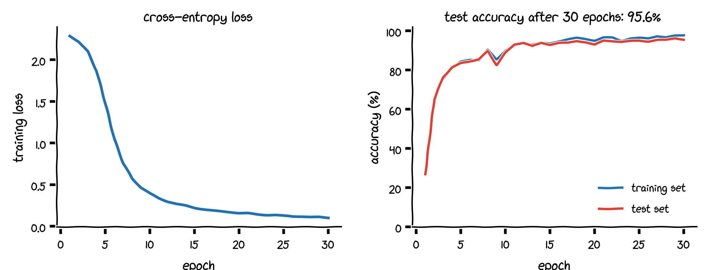{width="50%" fig-align="center"}

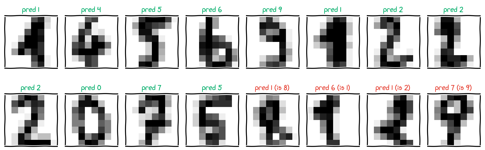{width="42%" fig-align="center"}

The same code on scikit-learn's $8\times 8$ digits (1,797 images; network $64 \to 128 \to 128 \to 10$): **95.6%** test accuracy after 30 epochs; 24 of 540 test images are wrong (red). For MNIST, run the course notebook.

## Summary of part 7b

- **Computational graph**: a forward pass computes values; a backward pass applies the chain rule from the output to every parameter, reusing each intermediate derivative.
- **Backpropagation**, layer $l$ (mini-batch): $d\mathbf Z^{[l]} = d\mathbf A^{[l]} \odot g^{[l]\prime}(\mathbf Z^{[l]})$, $\ \frac{\partial J}{\partial \mathbf W^{[l]}} = \frac1m(d\mathbf Z^{[l]})^{\top}\mathbf A^{[l-1]}$, $\ \frac{\partial J}{\partial \mathbf b^{[l]}} = \frac1m\sum_{\text{rows}} d\mathbf Z^{[l]}$, $\ d\mathbf A^{[l-1]} = d\mathbf Z^{[l]}\mathbf W^{[l]}$.
- It starts from $d\mathbf Z^{[L]} = \mathbf A^{[L]} - \mathbf Y$ for sigmoid or softmax outputs with cross-entropy.
- **Initialise randomly** to break symmetry; use **ReLU** and suitable initialisation against **vanishing gradients**.
- **PyTorch**: define the layers in `nn.Module` and write `forward`; `loss.backward()` performs backpropagation; the optimiser updates the parameters.

**Next, part 7c**: where the backpropagation equations come from, derived step by step and checked on a small example.

## Check your understanding: part 7b

1. For $J = 3(a + bc)$ at $a = 1$, $b = 2$, $c = 4$, compute $\partial J/\partial b$ and $\partial J/\partial c$.
2. In layer $l$, $\mathbf W^{[l]}$ has shape $(64, 128)$ and the mini-batch has $m = 32$ examples. What are the shapes of $\mathbf A^{[l-1]}$, $d\mathbf Z^{[l]}$ and $\partial J/\partial\mathbf W^{[l]}$?
3. Why do the backward formulas need $\mathbf Z^{[l]}$ and $\mathbf A^{[l-1]}$ from the forward pass?
4. What goes wrong if all weights are initialised to $0$?
5. Why do gradients in early layers of a deep sigmoid network become very small?

::: notes
1. $\partial J/\partial b = 3c = 12$; $\ \partial J/\partial c = 3b = 6$.
2. $\mathbf A^{[l-1]}$: $(32, 128)$; $d\mathbf Z^{[l]}$: $(32, 64)$; $\partial J/\partial\mathbf W^{[l]} = \frac1m(d\mathbf Z^{[l]})^{\top}\mathbf A^{[l-1]}$: $(64, 128)$, the same as $\mathbf W^{[l]}$.
3. $g'(\mathbf Z^{[l]})$ needs $\mathbf Z^{[l]}$, and the weight gradient needs the layer's input $\mathbf A^{[l-1]}$; recomputing them would double the cost.
4. All units in a layer stay identical (same output, same gradient), so the layer behaves like a single unit.
5. Each backward step through a sigmoid multiplies by $\sigma'(z) \le 1/4$ (and by the weights), so the gradient shrinks geometrically with depth.
:::

# Part 7c: the mathematics behind backpropagation {background-image="styles/backgrounds/title.jpg" background-size="cover" background-color="#0B2545" .part-slide}

::: {.content-visible when-format="revealjs"}
The chain rule for vectors and matrices, local and accumulated derivatives, a worked example, any number of layers
:::

## Where we are

Part 7b **stated** the backpropagation equations, checked them against autograd, and used them to train networks:
$$
d\mathbf z^{[l]} = d\mathbf a^{[l]} \odot g^{[l]\prime}\big(\mathbf z^{[l]}\big),
\quad
d\mathbf W^{[l]} = \big(d\mathbf z^{[l]}\big)^{\top}\mathbf a^{[l-1]},
\quad
d\mathbf b^{[l]} = d\mathbf z^{[l]},
\quad
d\mathbf a^{[l-1]} = d\mathbf z^{[l]}\,\mathbf W^{[l]} .
$$

. . .

Part 7c shows **why** they hold:

- the chain rule, applied entry by entry to vectors and matrices;
- every gradient as a product of **local** ("easy") derivatives and **accumulated** derivatives from the loss;
- a small network computed completely **by hand**, and checked with finite differences.

# The chain rule for vectors and matrices

## Vectors and matrices: the chain rule entry by entry

The chain rule of part 7b, for numbers, extends to vectors and matrices. In a network, the intermediate quantities are **vectors** ($\mathbf z$, $\mathbf a$) and the parameters are **matrices** ($\mathbf W$). Apply the rule to every entry, summing over every entry it passes through:
$$
\frac{\partial L}{\partial W_{jk}} = \sum_{i}\frac{\partial L}{\partial z_i}\,\frac{\partial z_i}{\partial W_{jk}} .
$$

. . .

We usually write this in a compact "reduced" form,
$$
\frac{\partial L}{\partial \mathbf W} = \frac{\partial L}{\partial \mathbf z}\,\frac{\partial \mathbf z}{\partial \mathbf W},
$$
keeping in mind that it stands for the sum above, for every entry $W_{jk}$. The compact form tells us **what** to multiply; the entry-wise form tells us **how**.

# One hidden layer: the derivation

## The network

One example, as a row vector (as in parts 7a and 7b), hidden activation $g$ and sigmoid output:
$$
\begin{aligned}
\mathbf z^{[1]} &= \mathbf a^{[0]}\big(\mathbf W^{[1]}\big)^{\top} + \mathbf b^{[1]}, &
\mathbf a^{[1]} &= g\big(\mathbf z^{[1]}\big), && \text{with } \mathbf a^{[0]} = \mathbf x,\\
z^{[2]} &= \mathbf a^{[1]}\big(\mathbf W^{[2]}\big)^{\top} + b^{[2]}, &
a^{[2]} &= \sigma\big(z^{[2]}\big), &&
L = -y\log a^{[2]} - (1 - y)\log\big(1 - a^{[2]}\big).
\end{aligned}
$$

. . .

A chain of simple mappings:
$$
\mathbf a^{[0]} \xrightarrow{\text{linear}} \mathbf z^{[1]} \xrightarrow{\text{activation}} \mathbf a^{[1]} \xrightarrow{\text{linear}} z^{[2]} \xrightarrow{\text{activation}} a^{[2]} \xrightarrow{\text{loss}} L(a^{[2]}, y)
$$

**Goal**: compute $\dfrac{\partial L}{\partial \mathbf W^{[1]}}$, $\ \dfrac{\partial L}{\partial \mathbf b^{[1]}}$, $\ \dfrac{\partial L}{\partial \mathbf W^{[2]}}$, $\ \dfrac{\partial L}{\partial b^{[2]}}$.

## Local and accumulated derivatives

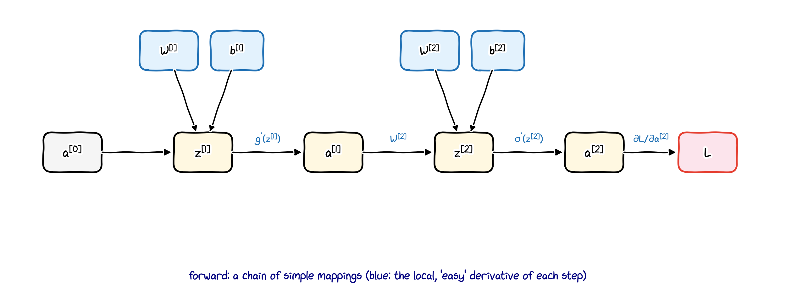{width="78%" fig-align="center"}

- **Local ("easy")** derivatives belong to a single mapping and only need the values of the forward pass: $\partial a/\partial z$, $\ \partial z/\partial a$, $\ \partial z/\partial\mathbf W$, $\ \partial z/\partial\mathbf b$.
- **Accumulated** derivatives $\partial L/\partial(\cdot)$ measure the effect on the **loss**. They are the hard part: each depends on everything that happens later in the chain.

## The four easy derivatives

For a linear map $z_j = \sum_k w_{jk}\,a_k + b_j$ and an element-wise activation $a_j = g(z_j)$:

| local derivative | value | in words |
|:---|:---|:---|
| $\dfrac{\partial a_j}{\partial z_i}$ | $g'(z_j)$ if $i = j$, else $0$ | each $a_j$ depends only on its own $z_j$ |
| $\dfrac{\partial z_j}{\partial a_k}$ | $w_{jk}$ | the weight from input $k$ to unit $j$ |
| $\dfrac{\partial z_i}{\partial w_{jk}}$ | $a_k$ if $i = j$, else $0$ | $w_{jk}$ only enters $z_j$ |
| $\dfrac{\partial z_i}{\partial b_j}$ | $1$ if $i = j$, else $0$ | $b_j$ only enters $z_j$ |

. . .

Activation derivatives: sigmoid $\sigma'(z) = \sigma(z)\big(1 - \sigma(z)\big)$; $\ \tanh'(z) = 1 - \tanh^2(z)$; $\ \operatorname{ReLU}'(z) = 1$ for $z > 0$ and $0$ for $z < 0$.

## Where the backward pass starts

The loss depends on the network only through the output $a^{[2]}$. This first accumulated derivative is easy:
$$
\frac{\partial L}{\partial a^{[2]}} = -\frac{y}{a^{[2]}} + \frac{1 - y}{1 - a^{[2]}} .
$$

. . .

One step further back, through the sigmoid:
$$
\frac{\partial L}{\partial z^{[2]}} = \frac{\partial L}{\partial a^{[2]}}\,\sigma'\big(z^{[2]}\big)
= \left(-\frac{y}{a^{[2]}} + \frac{1 - y}{1 - a^{[2]}}\right) a^{[2]}\big(1 - a^{[2]}\big)
= a^{[2]} - y .
$$

The prediction error, exactly as for logistic regression (Lecture 3a).

## Layer 2: two steps back

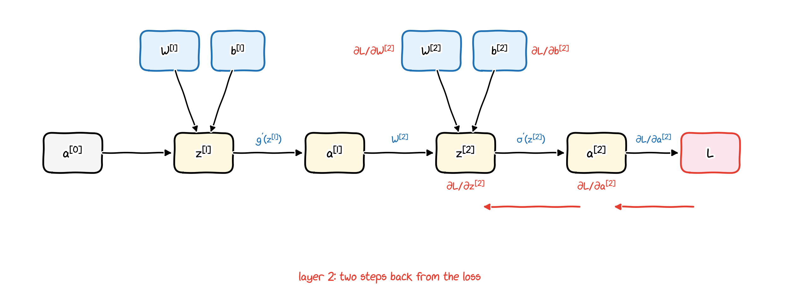{width="80%" fig-align="center"}

$$
\frac{\partial L}{\partial w^{[2]}_{1k}} = \frac{\partial L}{\partial z^{[2]}}\,\underbrace{\frac{\partial z^{[2]}}{\partial w^{[2]}_{1k}}}_{a^{[1]}_k}
\ \Longrightarrow\
\frac{\partial L}{\partial \mathbf W^{[2]}} = \big(a^{[2]} - y\big)\,\mathbf a^{[1]},
\qquad
\frac{\partial L}{\partial b^{[2]}} = a^{[2]} - y .
$$

## Layer 1: continue one layer further

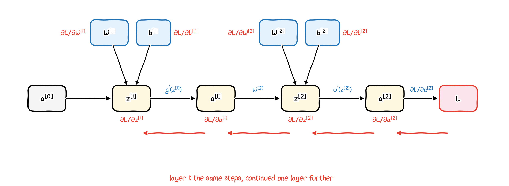{width="80%" fig-align="center"}

$$
\underbrace{\frac{\partial L}{\partial a^{[1]}_k} = \frac{\partial L}{\partial z^{[2]}}\,w^{[2]}_{1k}}_{\text{through } \partial z/\partial a}
\qquad
\underbrace{\frac{\partial L}{\partial z^{[1]}_j} = \frac{\partial L}{\partial a^{[1]}_j}\,g'\big(z^{[1]}_j\big)}_{\text{through } \partial a/\partial z}
\qquad
\underbrace{\frac{\partial L}{\partial w^{[1]}_{jk}} = \frac{\partial L}{\partial z^{[1]}_j}\,a^{[0]}_k,\quad \frac{\partial L}{\partial b^{[1]}_j} = \frac{\partial L}{\partial z^{[1]}_j}}_{\text{through } \partial z/\partial\theta}
$$

## The backpropagation process

Order of computation, with $\boldsymbol\Theta$ standing for $\mathbf W$ or $\mathbf b$:
$$
\begin{aligned}
&\frac{\partial L}{\partial a^{[2]}}
\ \xrightarrow{\ \partial a^{[2]}/\partial z^{[2]}\ }\
{\color{red}{\frac{\partial L}{\partial z^{[2]}}}}
\ \xrightarrow{\ \partial z^{[2]}/\partial \mathbf a^{[1]}\ }\
{\color{red}{\frac{\partial L}{\partial \mathbf a^{[1]}}}}
\ \xrightarrow{\ \partial \mathbf a^{[1]}/\partial \mathbf z^{[1]}\ }\
{\color{red}{\frac{\partial L}{\partial \mathbf z^{[1]}}}}
\ \xrightarrow{\ \partial \mathbf z^{[1]}/\partial \boldsymbol\Theta^{[1]}\ }\
{\color{purple}{\frac{\partial L}{\partial \boldsymbol\Theta^{[1]}}}}\\[4pt]
&\phantom{\frac{\partial L}{\partial a^{[2]}}\ \xrightarrow{\ \partial a^{[2]}/\partial z^{[2]}\ }\ }
\big\downarrow{\scriptstyle\ \partial z^{[2]}/\partial \boldsymbol\Theta^{[2]}}\\[2pt]
&\phantom{\frac{\partial L}{\partial a^{[2]}}\ \xrightarrow{\ \partial a^{[2]}/\partial z^{[2]}\ }\ }
{\color{purple}{\frac{\partial L}{\partial \boldsymbol\Theta^{[2]}}}}
\end{aligned}
$$

. . .

- Each red derivative is computed **once** and used twice: for the parameters of its layer, and to go one layer further back.
- Computing $\partial L/\partial\boldsymbol\Theta^{[1]}$ is the **same process** as for $\partial L/\partial\boldsymbol\Theta^{[2]}$, continued one layer further.
- Every arrow multiplies by one easy derivative. Nothing is ever recomputed.

## The equations, collected

::: {.callout-note title="One hidden layer, one example ($d\theta := \partial L/\partial\theta$; $\odot$: element-wise product)"}
$$
\begin{aligned}
dz^{[2]} &= a^{[2]} - y, & d\mathbf W^{[2]} &= \big(dz^{[2]}\big)^{\top}\mathbf a^{[1]}, & db^{[2]} &= dz^{[2]},\\
d\mathbf a^{[1]} &= dz^{[2]}\,\mathbf W^{[2]}, & d\mathbf z^{[1]} &= d\mathbf a^{[1]} \odot g'\big(\mathbf z^{[1]}\big),\\
d\mathbf W^{[1]} &= \big(d\mathbf z^{[1]}\big)^{\top}\mathbf a^{[0]}, & d\mathbf b^{[1]} &= d\mathbf z^{[1]} .
\end{aligned}
$$
:::

These are the entry-wise results of the last two slides, written with matrices:

- $\frac{\partial L}{\partial w_{jk}} = dz_j\,a_k$ for all $j, k$ is the outer product $(d\mathbf z)^{\top}\mathbf a$;
- $\frac{\partial L}{\partial a_k} = \sum_j dz_j\,w_{jk}$ is the vector-matrix product $d\mathbf z\,\mathbf W$.

# A worked example

## Forward pass with numbers

A $2 \to 2 \to 1$ network with sigmoid activations, one example $\mathbf x = (1, 2)$ with label $y = 1$:
$$
\mathbf W^{[1]} = \begin{pmatrix} 0.1 & 0.2\\ -0.3 & 0.4\end{pmatrix},\quad
\mathbf b^{[1]} = (0,\ 0.1),\quad
\mathbf W^{[2]} = (0.5,\ -0.6),\quad
b^{[2]} = 0.2 .
$$

. . .

| quantity | computation | value |
|:---|:---|:---|
| $\mathbf z^{[1]}$ | $(1\cdot 0.1 + 2\cdot 0.2,\ \ 1\cdot(-0.3) + 2\cdot 0.4 + 0.1)$ | $(0.5,\ 0.6)$ |
| $\mathbf a^{[1]}$ | $\sigma(\mathbf z^{[1]})$ | $(0.6225,\ 0.6457)$ |
| $z^{[2]}$ | $0.5\cdot 0.6225 - 0.6\cdot 0.6457 + 0.2$ | $0.1238$ |
| $a^{[2]}$ | $\sigma(z^{[2]})$ | $0.5309$ |
| $L$ | $-\log a^{[2]}$ (since $y = 1$) | $0.6331$ |

## Backward pass with numbers

| derivative | computation | value |
|:---|:---|:---|
| $dz^{[2]}$ | $a^{[2]} - y$ | $-0.4691$ |
| $d\mathbf W^{[2]}$ | $dz^{[2]}\,\mathbf a^{[1]}$ | $(-0.2920,\ -0.3029)$ |
| $db^{[2]}$ | $dz^{[2]}$ | $-0.4691$ |
| $d\mathbf a^{[1]}$ | $dz^{[2]}\,\mathbf W^{[2]} = -0.4691\cdot(0.5,\ -0.6)$ | $(-0.2345,\ 0.2814)$ |
| $g'(\mathbf z^{[1]})$ | $\mathbf a^{[1]}\odot(1 - \mathbf a^{[1]})$ | $(0.2350,\ 0.2288)$ |
| $d\mathbf z^{[1]}$ | $d\mathbf a^{[1]}\odot g'(\mathbf z^{[1]})$ | $(-0.0551,\ 0.0644)$ |
| $d\mathbf W^{[1]}$ | $(d\mathbf z^{[1]})^{\top}\mathbf a^{[0]}$ | $\begin{pmatrix}-0.0551 & -0.1102\\ 0.0644 & 0.1288\end{pmatrix}$ |
| $d\mathbf b^{[1]}$ | $d\mathbf z^{[1]}$ | $(-0.0551,\ 0.0644)$ |

. . .

**Check**: changing each parameter by $\pm 10^{-6}$ and recomputing $L$ (finite differences) gives the same nine gradient entries, to within $10^{-10}$.

## Reading the numbers

- $dz^{[2]} = -0.47 < 0$: the network predicts $0.53$ for a positive example, so increasing $z^{[2]}$ would reduce the loss. Gradient descent ($\theta \leftarrow \theta - \alpha\,d\theta$) does exactly that.
- $d\mathbf W^{[2]} < 0$: both hidden units are active ($a^{[1]} \approx 0.6$), so increasing either weight increases $z^{[2]}$.
- Hidden unit 1 has a **positive** outgoing weight ($0.5$) and unit 2 a **negative** one ($-0.6$): so $d\mathbf z^{[1]}$ has opposite signs. Training pushes unit 1 to be more active and unit 2 to be less active.
- The gradients of layer 1 are 2 to 5 times smaller than those of layer 2: each step back through a sigmoid multiplies by $\sigma' \le 0.25$ (vanishing gradients, part 7b).

# Any number of layers

## Four layers: the same step, four times

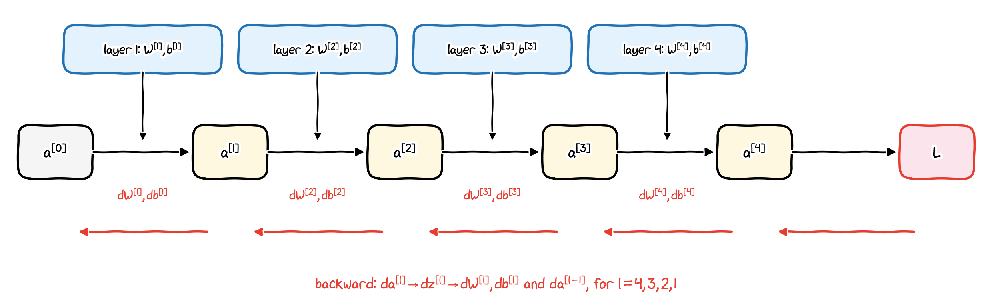{width="90%" fig-align="center"}

$$
\frac{\partial L}{\partial \mathbf a^{[4]}}
\to {\color{red}{\frac{\partial L}{\partial \mathbf z^{[4]}}}}
\to {\color{red}{\frac{\partial L}{\partial \mathbf a^{[3]}}}}
\to {\color{red}{\frac{\partial L}{\partial \mathbf z^{[3]}}}}
\to {\color{red}{\frac{\partial L}{\partial \mathbf a^{[2]}}}}
\to {\color{red}{\frac{\partial L}{\partial \mathbf z^{[2]}}}}
\to {\color{red}{\frac{\partial L}{\partial \mathbf a^{[1]}}}}
\to {\color{red}{\frac{\partial L}{\partial \mathbf z^{[1]}}}}
$$
and from each ${\color{red}{\partial L/\partial\mathbf z^{[l]}}}$ we branch off to ${\color{purple}{\partial L/\partial\boldsymbol\Theta^{[l]}}}$ using $\partial\mathbf z^{[l]}/\partial\boldsymbol\Theta^{[l]}$.

To get the gradient of layer $l - 1$, go through **exactly the same process** as for layer $l$, then continue one layer further. The four equations of this step are those of part 7b ("Forward and backward pass for layer $l$").

## The algorithm

```text
forward pass:   A[0] = X
                for l = 1, ..., L:
                    Z[l] = A[l-1] @ W[l].T + b[l]          # cache Z[l] and A[l-1]
                    A[l] = g[l](Z[l])

backward pass:  dZ = A[L] - Y                              # output layer, cross-entropy loss
                for l = L, ..., 1:
                    dW[l] = dZ.T @ A[l-1] / m
                    db[l] = dZ.sum(axis=0) / m
                    if l > 1:
                        dA = dZ @ W[l]                     # pass the error back
                        dZ = dA * g'[l-1](Z[l-1])          # through the activation

update:         W[l] -= alpha * dW[l];   b[l] -= alpha * db[l]     for every l
```

Each layer needs only its own cached values and the error passed back from the layer above.

## Summary of part 7c

- **Chain rule**: multiply local derivatives along a path; sum over all paths. For vectors and matrices, apply it entry by entry.
- **Local ("easy") derivatives**: $\partial\mathbf a/\partial\mathbf z = g'(\mathbf z)$ (element-wise), $\partial\mathbf z/\partial\mathbf a = \mathbf W$, $\partial z_j/\partial w_{jk} = a_k$, $\partial z_j/\partial b_j = 1$.
- **Accumulated derivatives** $\partial L/\partial(\cdot)$ are passed backwards, computed once and reused.
- The output layer starts with $dz^{[L]} = a^{[L]} - y$; every layer then applies the same four equations.
- Worked example: hand computation and finite differences agree.

The optional appendix to this lecture gives a compact, rigorous derivation of the same results with matrix calculus.

## Check your understanding: part 7c

1. With $f = a_1 + a_1a_2$, $a_1 = 2\theta$, $a_2 = \theta^2$: compute $\partial f/\partial\theta$ with the chain rule.
2. Why is $\partial a_j/\partial z_i = 0$ for $i \ne j$, but $\partial z_j/\partial a_k \ne 0$ for all $k$?
3. In the worked example, compute $dW^{[2]}_{11}$ yourself from $dz^{[2]}$ and $\mathbf a^{[1]}$.
4. Which values from the forward pass does the backward step for layer $l$ need?
5. What changes in the backward pass if the hidden activation is ReLU instead of sigmoid?

::: notes
1. $\partial f/\partial\theta = (1 + a_2)\cdot 2 + a_1\cdot 2\theta = 2 + 2\theta^2 + 4\theta^2 = 2 + 6\theta^2$ (check: $f = 2\theta + 2\theta^3$).
2. The activation acts on each entry separately, so $a_j$ depends only on $z_j$; the linear map mixes all inputs, so every $z_j$ depends on every $a_k$ (through $w_{jk}$).
3. $dW^{[2]}_{11} = dz^{[2]}\,a^{[1]}_1 = -0.4691 \times 0.6225 = -0.2920$.
4. $\mathbf z^{[l]}$ (for $g'$) and $\mathbf a^{[l-1]}$ (for $d\mathbf W^{[l]}$), plus $\mathbf W^{[l]}$ (to pass the error back).
5. Only $g'$: $d\mathbf z^{[1]} = d\mathbf a^{[1]} \odot \mathbb 1[\mathbf z^{[1]} > 0]$, so inactive units pass back no gradient.
:::

# Wrapping up

## Lecture 7 at a glance

| | one layer $l$, mini-batch (rows = examples) |
|:---|:---|
| forward | $\mathbf Z^{[l]} = \mathbf A^{[l-1]}(\mathbf W^{[l]})^{\top} + \mathbf b^{[l]}$, $\ \mathbf A^{[l]} = g^{[l]}(\mathbf Z^{[l]})$ |
| start of backward | $d\mathbf Z^{[L]} = \mathbf A^{[L]} - \mathbf Y$ (sigmoid or softmax with cross-entropy) |
| backward | $d\mathbf Z^{[l]} = d\mathbf A^{[l]} \odot g^{[l]\prime}(\mathbf Z^{[l]})$, $\ d\mathbf A^{[l-1]} = d\mathbf Z^{[l]}\mathbf W^{[l]}$ |
| gradients | $\frac{\partial J}{\partial\mathbf W^{[l]}} = \frac1m(d\mathbf Z^{[l]})^{\top}\mathbf A^{[l-1]}$, $\ \frac{\partial J}{\partial\mathbf b^{[l]}} = \frac1m\sum_{\text{rows}} d\mathbf Z^{[l]}$ |
| in PyTorch | `nn.Sequential(nn.Linear(...), nn.ReLU(), ...)`; `loss.backward()`; `optimizer.step()` |
| in practice | random initialisation, ReLU, suitable scaling against vanishing gradients |

: {tbl-colwidths="[20,80]"}

**Next lecture**: convolutional neural networks, which exploit the structure of images.
