## This lecture

Speech, text, music, DNA and sensor signals come as **sequences**, whose length varies and whose order matters. Recurrent neural networks (RNNs) read a sequence one element at a time and carry a memory along.

:::: {.columns}
::: {.column width="31%"}
**Part 9a: the RNN**

- sequence data, notation, **one-hot** words;
- the **recurrent neural network** and its forward pass;
- **backpropagation through time**, `nn.RNN`, types of RNNs.
:::
::: {.column width="3%"}
:::
::: {.column width="31%"}
**Part 9b: language models**

- the probability of a sentence and the **chain rule of probability**;
- training with teacher forcing, **sampling**, temperature;
- a character-level RNN that invents **dinosaur names**.
:::
::: {.column width="3%"}
:::
::: {.column width="31%"}
**Part 9c: GRU, LSTM and beyond**

- **vanishing and exploding** gradients, gradient clipping;
- **GRU** and **LSTM** cells, in PyTorch;
- **bidirectional** and **deep** RNNs, and an outlook.
:::
::::

# Part 9a: the recurrent neural network {background-image="styles/backgrounds/title.jpg" background-size="cover" background-color="#0B2545" .part-slide}

::: {.content-visible when-format="revealjs"}
Sequence data, the recurrent neural network, backpropagation through time, types of RNNs
:::

# Sequence data

## Examples of sequence data

| task | input $\mathbf x$ | output $y$ |
|:---|:---|:---|
| speech recognition | an audio clip | its transcript |
| music generation | nothing, or a genre | a piece of music |
| sentiment classification | "Nothing to like in this film." | 1 star out of 5 |
| DNA sequence analysis | AGCCCCTGTGAG... | which parts code for a protein |
| machine translation | Ăn cơm chưa? (Vietnamese) | Have you eaten yet? |
| video activity recognition | video frames | running |
| named-entity recognition | Harry Potter met Hermione | Harry Potter, Hermione |

: {tbl-colwidths="[30,38,32]"}

. . .

- The input, the output, or both are **sequences**, and their lengths vary from example to example.
- The order matters: "dog bites man" and "man bites dog" contain the same words.

## Notation

Named-entity recognition: is word $t$ part of a person's name?

| $\mathbf x$ | Harry | Potter | and | Hermione | Granger | invented | a | new | spell |
|:---|:---:|:---:|:---:|:---:|:---:|:---:|:---:|:---:|:---:|
| | $\mathbf x^{\langle 1\rangle}$ | $\mathbf x^{\langle 2\rangle}$ | $\mathbf x^{\langle 3\rangle}$ | $\mathbf x^{\langle 4\rangle}$ | $\mathbf x^{\langle 5\rangle}$ | $\mathbf x^{\langle 6\rangle}$ | $\mathbf x^{\langle 7\rangle}$ | $\mathbf x^{\langle 8\rangle}$ | $\mathbf x^{\langle 9\rangle}$ |
| $y$ | 1 | 1 | 0 | 1 | 1 | 0 | 0 | 0 | 0 |

: {tbl-colwidths="[5,10,10,7,13,12,13,6,8,9]"}

- $\mathbf x^{\langle t\rangle}$: element $t$ of the input sequence (here: word $t$); $\ y^{\langle t\rangle}$: element $t$ of the output.
- $T_x$, $T_y$: lengths of the input and output sequences; here $T_x = T_y = 9$.
- With several training examples: $\mathbf x^{(i)\langle t\rangle}$ is element $t$ of example $i$, and $T_x^{(i)}$ can differ between examples.

## Representing words

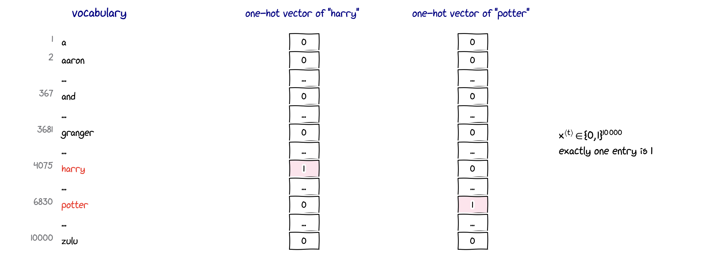{width="80%" fig-align="center"}

- Fix a **vocabulary**, e.g. the 10,000 most frequent words, and number them.
- Represent word $t$ by a **one-hot vector** $\mathbf x^{\langle t\rangle} \in \{0, 1\}^{10\,000}$: a $1$ at the word's index, $0$ elsewhere.
- Words not in the vocabulary are mapped to a special token $\langle\text{UNK}\rangle$ ("unknown").

## Why not a standard network?

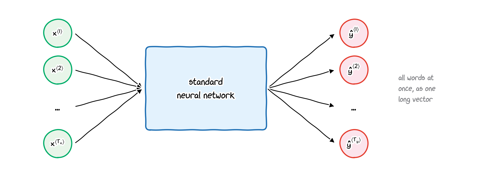{width="66%" fig-align="center"}

- **Different lengths**: inputs and outputs have different lengths in different examples. Padding every sentence to a maximum length is wasteful and arbitrary.
- **No sharing across positions**: a name should be recognised whether it appears at position 1 or at position 5. A standard network learns this separately for every position (compare CNNs, which share filters across positions).
- **Too many parameters**: 20 words $\times$ 10,000-dimensional one-hot vectors $= 200{,}000$ inputs to the first layer.

# The recurrent neural network

## Reading a sequence one element at a time

::: build
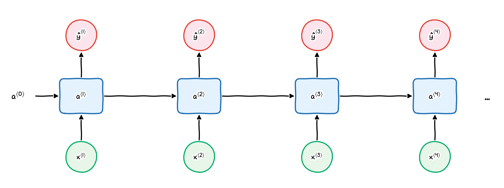{width="86%" fig-align="center"}

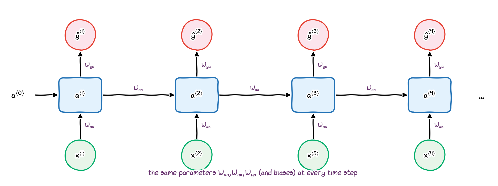{width="86%" fig-align="center"}
:::

The network reads $\mathbf x^{\langle 1\rangle}, \mathbf x^{\langle 2\rangle}, \dots$ in order. At each step it combines the new input with the **activation** $\mathbf a^{\langle t-1\rangle}$ passed on from the previous step: a memory of what it has read so far. The same weights are used at every step.

## Forward propagation

Start with $\mathbf a^{\langle 0\rangle} = \mathbf 0$. For $t = 1, 2, \dots, T_x$:
$$
\begin{aligned}
\mathbf a^{\langle t\rangle} &= g_1\big(\mathbf W_{aa}\,\mathbf a^{\langle t-1\rangle} + \mathbf W_{ax}\,\mathbf x^{\langle t\rangle} + \mathbf b_a\big),\\
\hat{\mathbf y}^{\langle t\rangle} &= g_2\big(\mathbf W_{ya}\,\mathbf a^{\langle t\rangle} + \mathbf b_y\big).
\end{aligned}
$$

- $g_1$: usually $\tanh$ (sometimes ReLU). $\ g_2$: sigmoid for a yes/no output, softmax for one of $K$ classes.
- Subscripts read "to, from": $\mathbf W_{ax}$ maps $\mathbf x$ to (a contribution to) $\mathbf a$.
- Shapes, with $\mathbf a \in \mathbb R^{n_a}$, $\mathbf x \in \mathbb R^{n_x}$, $\hat{\mathbf y} \in \mathbb R^{n_y}$:
  $\mathbf W_{aa} \in \mathbb R^{n_a\times n_a}$, $\ \mathbf W_{ax} \in \mathbb R^{n_a\times n_x}$, $\ \mathbf W_{ya} \in \mathbb R^{n_y\times n_a}$.
- The number of parameters does **not** depend on the sequence length. For $n_x = 10{,}000$ and $n_a = 100$, $\mathbf W_{ax}$ has $10^6$ entries; $\mathbf W_{aa}$ only $10^4$.

## A limitation: only the past

The prediction $\hat y^{\langle t\rangle}$ uses $\mathbf x^{\langle 1\rangle}, \dots, \mathbf x^{\langle t\rangle}$, but **not** the words after position $t$:

- He said, "Teddy Roosevelt was a great President."
- He said, "Teddy bears are on sale!"

When the network reaches "Teddy" (word 3), both sentences look the same. Whether "Teddy" is part of a person's name only becomes clear later.

. . .

**Solution**: a **bidirectional** RNN, which also reads the sentence from right to left (part 9c).

## A compact notation

Stack the two weight matrices side by side, and the two vectors on top of each other:
$$
\mathbf W_a = \big[\,\mathbf W_{aa} \mid \mathbf W_{ax}\,\big] \in \mathbb R^{n_a\times(n_a + n_x)},
\qquad
\big[\mathbf a^{\langle t-1\rangle}, \mathbf x^{\langle t\rangle}\big] = \begin{pmatrix}\mathbf a^{\langle t-1\rangle}\\ \mathbf x^{\langle t\rangle}\end{pmatrix} \in \mathbb R^{n_a + n_x}.
$$

Block multiplication gives $\mathbf W_a\big[\mathbf a^{\langle t-1\rangle}, \mathbf x^{\langle t\rangle}\big] = \mathbf W_{aa}\mathbf a^{\langle t-1\rangle} + \mathbf W_{ax}\mathbf x^{\langle t\rangle}$, so
$$
\mathbf a^{\langle t\rangle} = g\big(\mathbf W_a\big[\mathbf a^{\langle t-1\rangle}, \mathbf x^{\langle t\rangle}\big] + \mathbf b_a\big),
\qquad
\hat{\mathbf y}^{\langle t\rangle} = g\big(\mathbf W_y\,\mathbf a^{\langle t\rangle} + \mathbf b_y\big),
$$
with $\mathbf W_y = \mathbf W_{ya}$. One matrix per formula: this notation is used for the GRU and LSTM in part 9c.

## Inside one RNN cell

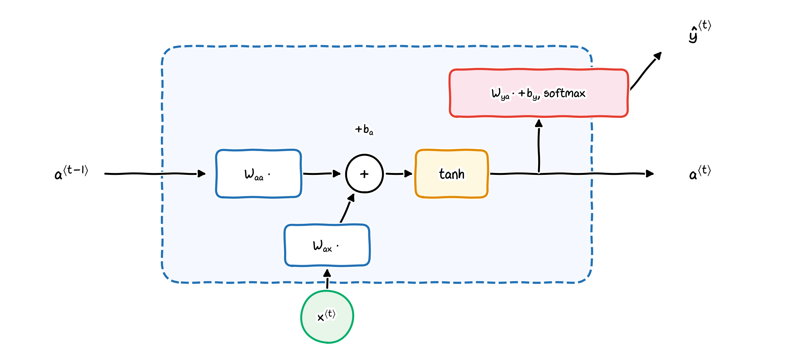{width="66%" fig-align="center"}

$$
\mathbf a^{\langle t\rangle} = \tanh\big(\mathbf W_{aa}\,\mathbf a^{\langle t-1\rangle} + \mathbf W_{ax}\,\mathbf x^{\langle t\rangle} + \mathbf b_a\big),
\qquad
\hat{\mathbf y}^{\langle t\rangle} = \operatorname{softmax}\big(\mathbf W_{ya}\,\mathbf a^{\langle t\rangle} + \mathbf b_y\big)
$$

Diagrams like this one are common in books and online. Read them together with the formula: the formula is the definition, and the diagram only shows which quantities flow where.

# Training: backpropagation through time

## The loss of a sequence

For named-entity recognition, each output is a probability $\hat y^{\langle t\rangle}$ (sigmoid), and each time step has a binary cross-entropy loss (Lecture 3a):
$$
L^{\langle t\rangle}\big(\hat y^{\langle t\rangle}, y^{\langle t\rangle}\big) = -y^{\langle t\rangle}\log\hat y^{\langle t\rangle} - \big(1 - y^{\langle t\rangle}\big)\log\big(1 - \hat y^{\langle t\rangle}\big).
$$

The loss of the whole sequence is the sum over the time steps, and the cost is the average over the training sequences:
$$
L(\hat{\mathbf y}, \mathbf y) = \sum_{t=1}^{T_y} L^{\langle t\rangle}\big(\hat y^{\langle t\rangle}, y^{\langle t\rangle}\big),
\qquad
J = \frac1m\sum_{i=1}^{m} L\big(\hat{\mathbf y}^{(i)}, \mathbf y^{(i)}\big).
$$

## Backpropagation through time

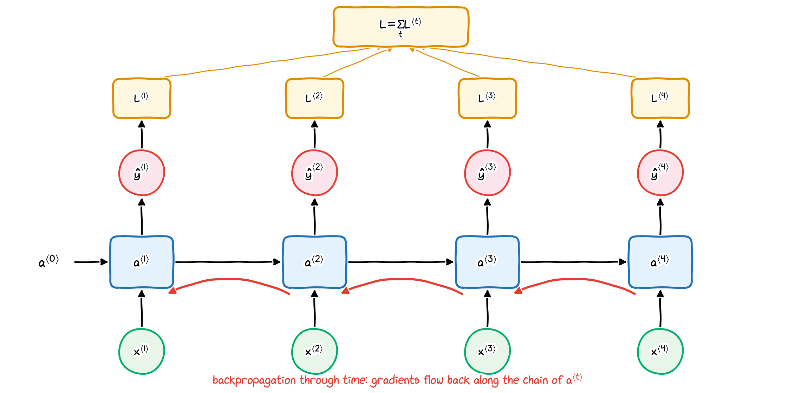{width="48%" fig-align="center"}

- Forward: left to right. Backpropagation (Lecture 7b): right to left, backwards **through time**.
- $\mathbf a^{\langle t\rangle}$ affects the loss directly (through $\hat{\mathbf y}^{\langle t\rangle}$) and through all later activations; $\partial L/\partial\mathbf a^{\langle t\rangle}$ collects both.
- The **same** $\mathbf W_{aa}$ is used at every step, so its gradient is a sum over the time steps: $\ \nabla_{\mathbf W_{aa}}L = \sum_t \boldsymbol\delta^{\langle t\rangle}\big(\mathbf a^{\langle t-1\rangle}\big)^{\top}$, with $\boldsymbol\delta^{\langle t\rangle} = \nabla_{\mathbf z^{\langle t\rangle}}L$ and $\mathbf z^{\langle t\rangle}$ the argument of $g_1$ (as in the appendix to Lecture 7).
- Long sequences mean long chains of products, so gradients can vanish or explode (part 9c).

## RNNs in PyTorch

```python
import torch
from torch import nn

rnn = nn.RNN(input_size=4, hidden_size=3, batch_first=True)   # n_x = 4, n_a = 3, tanh
x = torch.randn(2, 5, 4)      # (batch N, time steps T, features n_x)
out, h_n = rnn(x)             # a<0> = 0 by default
out.shape   # (2, 5, 3): a<t> for every t
h_n.shape   # (1, 2, 3): the last a<T>
{k: tuple(v.shape) for k, v in rnn.named_parameters()}
# {'weight_ih_l0': (3, 4), 'weight_hh_l0': (3, 3), 'bias_ih_l0': (3,), 'bias_hh_l0': (3,)}
```

PyTorch writes $\mathbf h_t$ for our $\mathbf a^{\langle t\rangle}$, uses rows (as in Lecture 7a) and two bias vectors:
$$
\mathbf h_t = \tanh\big(\mathbf x_t\mathbf W_{ih}^{\top} + \mathbf b_{ih} + \mathbf h_{t-1}\mathbf W_{hh}^{\top} + \mathbf b_{hh}\big),
\qquad \mathbf W_{ih} = \mathbf W_{ax},\ \ \mathbf W_{hh} = \mathbf W_{aa},\ \ \mathbf b_{ih} + \mathbf b_{hh} = \mathbf b_a .
$$
A hand-written loop over $t$ with this formula reproduces `out` exactly. The outputs $\hat{\mathbf y}^{\langle t\rangle}$ come from a separate `nn.Linear` applied to `out`.

# Types of RNNs

## Many architectures for many tasks

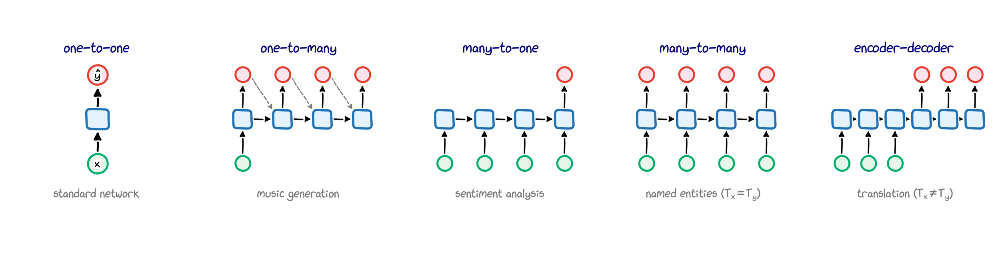{width="96%" fig-align="center"}

The circles at the bottom are inputs, those at the top outputs. Dashed arrows: a generated output is fed back in as the next input.

## Types of RNNs: examples

| type | input / output | example |
|:---|:---|:---|
| one-to-one | single / single | a standard network (no recurrence) |
| one-to-many | single / sequence | music generation; image captioning (an image to a sentence) |
| many-to-one | sequence / single | sentiment classification: a review to 1–5 stars |
| many-to-many, $T_x = T_y$ | one output per input | named-entity recognition |
| encoder-decoder, $T_x \neq T_y$ | read everything, then write | machine translation |

## When $T_x \neq T_y$

| language | sentence | English |
|:---|:---|:---|
| Vietnamese | Ăn cơm chưa? | Have you eaten yet? |
| German | Ich liebe dich nicht. | I do not love you. |

- The sentences have different numbers of words, and the word order differs between languages.
- An **encoder** RNN reads the whole input sentence into its activations; a **decoder** RNN then generates the output sentence word by word. This sequence-to-sequence design was the basis of neural machine translation, before attention and transformers.

::: small
Recommended reading: A. Karpathy (2015), *The unreasonable effectiveness of recurrent neural networks* (blog post, written during his PhD at Stanford): <https://karpathy.github.io/2015/05/21/rnn-effectiveness/>
:::

## Summary of part 9a

- **Sequence data**: inputs and/or outputs are sequences of varying length; notation $\mathbf x^{\langle t\rangle}$, $y^{\langle t\rangle}$, $T_x$, $T_y$. Words are one-hot vectors over a vocabulary.
- An **RNN** reads one element at a time and passes an activation forward:
  $\mathbf a^{\langle t\rangle} = g(\mathbf W_{aa}\mathbf a^{\langle t-1\rangle} + \mathbf W_{ax}\mathbf x^{\langle t\rangle} + \mathbf b_a)$, $\ \hat{\mathbf y}^{\langle t\rangle} = g(\mathbf W_{ya}\mathbf a^{\langle t\rangle} + \mathbf b_y)$, with the **same** weights at every step.
- **Training**: sum the per-step losses; **backpropagation through time** sums the gradient contributions of all steps.
- **PyTorch**: `nn.RNN` (input `(N, T, n_x)` with `batch_first=True`), plus an `nn.Linear` output layer.
- **Architectures**: one-to-many, many-to-one, many-to-many, encoder-decoder.

**Next, part 9b**: language models and generating text.

## Check your understanding: part 9a

1. With $n_x = 5000$ and $n_a = 128$, what are the shapes of $\mathbf W_{aa}$ and $\mathbf W_{ax}$? How many parameters does the recurrent part have, including $\mathbf b_a$?
2. Why does the number of parameters of an RNN not depend on the length of the sequences?
3. In the sentence "Teddy bears are on sale", why can a left-to-right RNN not be sure whether "Teddy" is a name?
4. Which RNN type would you use for (a) detecting the emotion of a tweet, (b) generating a melody, (c) translating English into French?
5. What does `out` contain for `nn.RNN(10, 20, batch_first=True)` applied to an input of shape `(32, 15, 10)`, and what is its shape?

::: notes
1. $\mathbf W_{aa}$: $128 \times 128$; $\mathbf W_{ax}$: $128 \times 5000$. Parameters: $128^2 + 128 \cdot 5000 + 128 = 16{,}384 + 640{,}000 + 128 = 656{,}512$.
2. The same weights are applied at every time step.
3. It has only seen "Teddy" (and the words before); the disambiguating words come later.
4. (a) many-to-one, (b) one-to-many, (c) encoder-decoder (many-to-many with $T_x \neq T_y$).
5. The activations $\mathbf a^{\langle t\rangle}$ of all 15 time steps for all 32 sequences: shape $(32, 15, 20)$.
:::

# Part 9b: language models and sequence generation {background-image="styles/backgrounds/title.jpg" background-size="cover" background-color="#0B2545" .part-slide}

::: {.content-visible when-format="revealjs"}
Language models, generating sequences, character-level language models
:::

## Where we are

In part 9a we built the **recurrent neural network**:

- it reads $\mathbf x^{\langle 1\rangle}, \mathbf x^{\langle 2\rangle}, \dots$ in order and passes an activation forward, $\mathbf a^{\langle t\rangle} = g\big(\mathbf W_{aa}\mathbf a^{\langle t-1\rangle} + \mathbf W_{ax}\mathbf x^{\langle t\rangle} + \mathbf b_a\big)$;
- the same weights are used at every time step;
- it is trained by **backpropagation through time** on the sum of the per-step losses.

. . .

Part 9b uses this machine for one of its most important tasks:

- a **language model** assigns a probability to every sentence, one word at a time;
- trained on text, an RNN can **generate** new text by sampling;
- with characters instead of words, it can even invent new names.

# Language models

## What is a language model?

A speech recogniser hears a sentence and has to choose between two transcripts that **sound the same**:

| candidate transcript | probability from a language model |
|:---|:---:|
| The apple and **pair** salad. | $3.2 \times 10^{-13}$ |
| The apple and **pear** salad. | $5.7 \times 10^{-10}$ |

The second is about 1,800 times more likely, so the recogniser chooses it.

. . .

A **language model** assigns a probability to every sequence of words,
$$
P\big(y^{\langle 1\rangle}, y^{\langle 2\rangle}, \dots, y^{\langle T_y\rangle}\big).
$$
It is used in speech recognition, machine translation, spelling correction, autocomplete, and to **generate** text. Today's large language models are language models in exactly this sense, only much larger and built from transformers instead of RNNs (outlook in part 9c).

## The chain rule of probability

Any joint probability can be split into a product of conditional probabilities:
$$
P\big(y^{\langle 1\rangle}, \dots, y^{\langle T\rangle}\big)
= P\big(y^{\langle 1\rangle}\big)\,P\big(y^{\langle 2\rangle} \mid y^{\langle 1\rangle}\big)\cdots P\big(y^{\langle T\rangle} \mid y^{\langle 1\rangle}, \dots, y^{\langle T-1\rangle}\big)
= \prod_{t=1}^{T} P\big(y^{\langle t\rangle} \mid y^{\langle 1\rangle}, \dots, y^{\langle t-1\rangle}\big).
$$

. . .

For example,
$$
P(\text{cats average 15}) = P(\text{cats})\;P(\text{average} \mid \text{cats})\;P(\text{15} \mid \text{cats average}).
$$

Each factor is a **classification** problem: given the words so far, which word comes next? With a vocabulary of 10,000 words, this is a softmax over 10,000 classes (Lecture 3b). An RNN can predict all factors, one per time step.

## Preparing the training data

**Training set**: a large corpus of text. **Tokenise** it, i.e. split it into units (words), and map each to an index in the vocabulary.

| Cats | average | 15 | hours | of | sleep | a | day | . | $\langle\text{EOS}\rangle$ |
|:---:|:---:|:---:|:---:|:---:|:---:|:---:|:---:|:---:|:---:|
| $y^{\langle 1\rangle}$ | $y^{\langle 2\rangle}$ | $y^{\langle 3\rangle}$ | $y^{\langle 4\rangle}$ | $y^{\langle 5\rangle}$ | $y^{\langle 6\rangle}$ | $y^{\langle 7\rangle}$ | $y^{\langle 8\rangle}$ | $y^{\langle 9\rangle}$ | $y^{\langle 10\rangle}$ |

- $\langle\text{EOS}\rangle$ ("end of sentence") is an extra token, so that the model also learns **when** a sentence ends.
- Punctuation can be a token or be removed; here "." is a token.
- Words outside the vocabulary become $\langle\text{UNK}\rangle$: in "The Egyptian Mau is a breed of cat.", the rare word "Mau" may become $\langle\text{UNK}\rangle$.

## An RNN language model

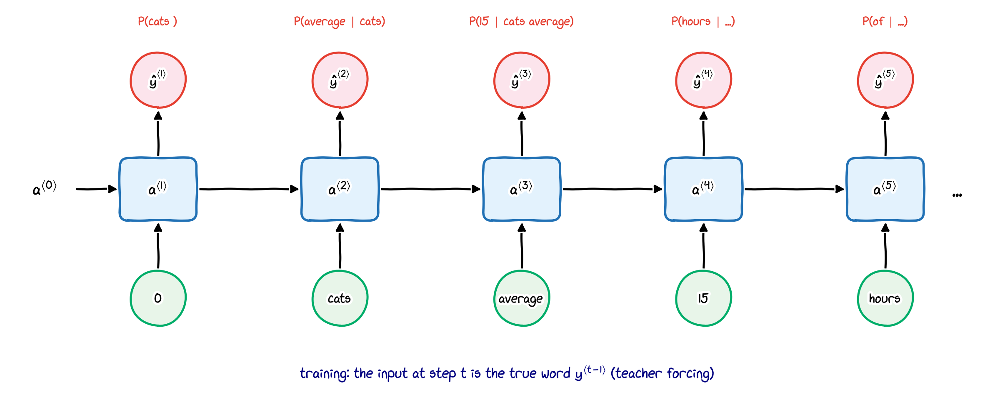{width="70%" fig-align="center"}

- Step 1: $\mathbf a^{\langle 0\rangle} = \mathbf 0$ and $\mathbf x^{\langle 1\rangle} = \mathbf 0$; the softmax output $\hat{\mathbf y}^{\langle 1\rangle}$ gives $P(\text{first word})$ for all words in the vocabulary.
- Step $t$: the input is the **true** previous word, $\mathbf x^{\langle t\rangle} = \mathbf y^{\langle t-1\rangle}$ (**teacher forcing**), and $\hat{\mathbf y}^{\langle t\rangle}$ gives $P(\text{word } t \mid \text{words } 1, \dots, t-1)$.
- The activation $\mathbf a^{\langle t\rangle}$ summarises all previous words.

## The loss

At step $t$ the target is the true word $y^{\langle t\rangle}$, so the loss is the cross-entropy of the softmax output (Lecture 3b):
$$
L^{\langle t\rangle} = -\sum_{i} y_i^{\langle t\rangle}\log\hat y_i^{\langle t\rangle} = -\log \hat y^{\langle t\rangle}_{\,y^{\langle t\rangle}},
\qquad
L = \sum_{t=1}^{T} L^{\langle t\rangle},
$$
where $\hat y^{\langle t\rangle}_{\,y^{\langle t\rangle}}$ is the predicted probability of the correct word.

. . .

Since $\hat y^{\langle t\rangle}_{\,y^{\langle t\rangle}} = P\big(y^{\langle t\rangle} \mid y^{\langle 1\rangle}, \dots, y^{\langle t-1\rangle}\big)$, the chain rule gives
$$
P\big(y^{\langle 1\rangle}, \dots, y^{\langle T\rangle}\big) = \prod_{t=1}^{T}\hat y^{\langle t\rangle}_{\,y^{\langle t\rangle}} = e^{-L}.
$$
Minimising the loss is the same as maximising the probability of the training sentences (maximum likelihood, as in Lecture 3a).

# Generating sequences

## Sampling a sequence

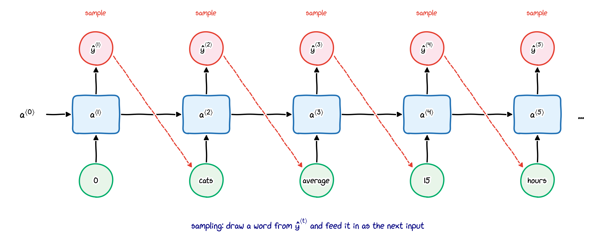{width="64%" fig-align="center"}

1. Start with $\mathbf a^{\langle 0\rangle} = \mathbf 0$, $\mathbf x^{\langle 1\rangle} = \mathbf 0$.
2. At each step, **draw** a word at random with the probabilities $\hat{\mathbf y}^{\langle t\rangle}$, and feed it in as the next input.
3. Stop at $\langle\text{EOS}\rangle$ or after a maximum length. (If $\langle\text{UNK}\rangle$ is drawn, draw again.)

Random draws, instead of always the most likely word, give a different sentence each time.

## Temperature

Before sampling, divide the scores (logits) $z_i$ of the output layer by a **temperature** $\tau > 0$:
$$
p_i = \frac{e^{z_i/\tau}}{\sum_j e^{z_j/\tau}} .
$$

- $\tau = 1$: the model's own probabilities.
- $\tau < 1$: the distribution becomes sharper: safer, more typical, more repetitive output. As $\tau \to 0$, always the most likely word.
- $\tau > 1$: flatter: more surprising, but also more mistakes.

```python
p = torch.softmax(logits / tau, dim=0)       # probabilities of the next token
k = torch.multinomial(p, num_samples=1)      # draw one token index
```

# Character-level language models

## Words or characters?

**Word-level** vocabulary: [a, aaron, ..., zulu, $\langle\text{UNK}\rangle$], typically 10,000 to 100,000 words.

**Character-level** vocabulary: [a, b, ..., z, space, punctuation, 0–9, A–Z], about 100 symbols. "Cats average" becomes c, a, t, s, ␣, a, v, e, r, a, g, e.

. . .

| | word level | character level |
|:---|:---|:---|
| vocabulary | large | small |
| unknown words | become $\langle\text{UNK}\rangle$ | never: any word can be spelled |
| sequence length | short | 5 to 6 times longer |
| long-range dependencies | easier to learn | harder: more steps between related words |
| cost | lower | higher |

Modern systems often use **subword** tokens, a compromise between the two.

## Example: inventing dinosaur names

- **Data**: 292 dinosaur genus names, e.g. *Tyrannosaurus*, *Triceratops*, *Velociraptor*. 234 for training, 58 for validation.
- **Vocabulary**: 27 symbols: a–z and "end of name" (the newline character, the $\langle\text{EOS}\rangle$ of names).
- **Model**: `nn.RNN(27, 64)` with one-hot inputs, then `nn.Linear(64, 27)`; cross-entropy loss; Adam with full batches; gradient clipping (part 9c).

. . .

## Training and validation loss

:::: {.columns}
::: {.column width="58%"}
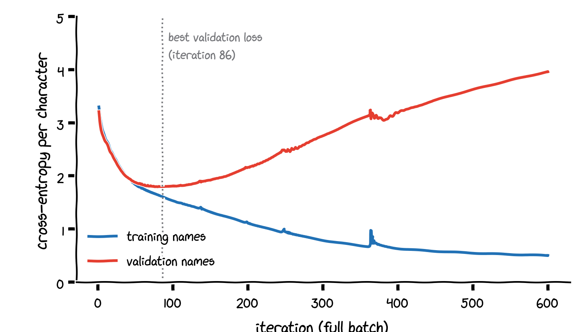
:::
::: {.column width="42%"}
- After 86 iterations the validation loss is lowest: 1.79 per character (random guessing: $\log 27 = 3.30$).
- Afterwards the training loss keeps falling, but the validation loss rises.
- The model starts to **memorise** the training names: overfitting (Lecture 4).
- Keep the parameters with the lowest validation loss: **early stopping**.
:::
::::

## Generated names

Twelve samples each, at temperature $\tau = 0.7$:

:::: {.columns}
::: {.column width="50%"}
**Best validation loss** (iteration 86): **12 of 12 are new names**

Musurus, Mipyraptor, Tensaurus, Rusanobosaurus, Saurus, Rophasaurus, Halobelai, Raothosaulus, Alloaterotaus, Ruposaurusuurus, Aurusaurus, Chegonger
:::
::: {.column width="50%"}
**After 600 iterations** (overfitted): **only 4 of 12 are new**

Mussaurus, Palacanatan, Sinosauropteryx, Gobisaurus, Saichania, Alamosaurus, Iniaruosaurus, Euloraptor, Yinlong, Suurophasaurus, Megaraptor, Gargoyleosaurus
:::
::::

- The early-stopped model has learned typical **patterns** ("-saurus", "-raptor") and combines them into new names.
- The overfitted model mostly **reproduces** training names: low training loss is not the goal; generalisation is.

## The code, in brief

```python
names = [w.lower() for w in open("data/dinosaurs.txt").read().split()]
chars = ["\n"] + sorted(set("".join(names)))   # index 0 = end of name
# X: (N, T, 27) one-hot inputs, shifted by one step (x<1> = 0)
# Y: (N, T) target indices, -100 for padding

class CharRNN(nn.Module):
    def __init__(self, V, n_a=64):
        super().__init__()
        self.rnn = nn.RNN(V, n_a, batch_first=True)
        self.out = nn.Linear(n_a, V)
    def forward(self, X, h=None):
        A, h = self.rnn(X, h)
        return self.out(A), h                  # logits for every time step

logits, _ = model(X)
loss_fn = nn.CrossEntropyLoss()                # ignores the targets -100
loss = loss_fn(logits.reshape(-1, 27), Y.reshape(-1))
```

The complete code (data encoding, training with validation, sampling) is in `scripts/make_figures_lecture09.py`, function `fig_dinosaurs`.

## More character-level tasks

- **Many-to-one**: from a person's name, predict the language it most likely comes from (e.g. Vietnamese, Portuguese, Scottish Gaelic). The PyTorch tutorial "Classifying names with a character-level RNN" does exactly this.
- **One-to-many / generation**: invent names of dinosaurs, places or characters; generate text in the style of Shakespeare (Karpathy, 2015).
- **Regression** on character sequences, e.g. predicting a numeric property from a chemical formula or a DNA sequence.

## Summary of part 9b

- A **language model** gives the probability of a sequence: $P(y^{\langle 1\rangle}, \dots, y^{\langle T\rangle}) = \prod_t P(y^{\langle t\rangle} \mid y^{\langle 1\rangle}, \dots, y^{\langle t-1\rangle})$.
- An **RNN language model** predicts each factor with a softmax; during training the input at step $t$ is the true previous token (teacher forcing).
- The loss is the sum of per-step cross-entropies, and $P(\text{sequence}) = e^{-L}$.
- **Sampling** feeds drawn tokens back as inputs; the **temperature** trades diversity for safety.
- **Character-level** models need no $\langle\text{UNK}\rangle$ but must handle longer sequences.
- Watch the validation loss: an overfitted generator copies its training data.

**Next, part 9c**: why plain RNNs forget, and how GRUs and LSTMs remember.

## Check your understanding: part 9b

1. Write $P(\text{the cat sat})$ with the chain rule.
2. During training, what is the input at step 3 when the target sentence is "cats average 15 hours"?
3. A model predicts the correct words of a 4-word sentence with probabilities 0.5, 0.2, 0.4, 0.5. What are the loss $L$ and the probability of the sentence?
4. What happens to the generated text for a very small and for a very large temperature?
5. Why does the overfitted dinosaur model produce mostly existing names?

::: notes
1. $P(\text{the})\,P(\text{cat}\mid\text{the})\,P(\text{sat}\mid\text{the cat})$.
2. The true word 2, "average" (teacher forcing).
3. $L = -(\log 0.5 + \log 0.2 + \log 0.4 + \log 0.5) = -\log 0.02 \approx 3.91$; the probability is $0.5 \cdot 0.2 \cdot 0.4 \cdot 0.5 = 0.02 = e^{-L}$.
4. Very small: almost always the most likely token, repetitive text; very large: nearly uniform random tokens, gibberish.
5. It has memorised the training names: they have very high probability under the overfitted model, so sampling reproduces them.
:::

# Part 9c: GRU, LSTM, bidirectional and deep RNNs {background-image="styles/backgrounds/title.jpg" background-size="cover" background-color="#0B2545" .part-slide}

::: {.content-visible when-format="revealjs"}
Long-range dependencies, the GRU, the LSTM, RNNs in PyTorch, bidirectional and deep RNNs, outlook
:::

## Where we are

In parts 9a and 9b, plain RNNs read sequences, modelled language and generated names.

. . .

Two weaknesses remain:

- a plain RNN struggles to **remember** information over many time steps: backpropagation through time multiplies many Jacobians, and the gradients **vanish** or **explode**;
- it reads only **left to right**, so a prediction cannot use the words that come later.

Part 9c fixes both: **gated** cells (GRU, LSTM) for long memories, **bidirectional** RNNs for context from both sides, and **deep** RNNs for more capacity.

# Long-range dependencies

## Remembering across many words

- The **cat**, which already ate a whole bowl of fish and then slept on the sofa all afternoon, **was** full.
- The **cats**, which already ate a whole bowl of fish and then slept on the sofa all afternoon, **were** full.

. . .

- To choose "was" or "were", the network must carry "singular or plural" across many words.
- In principle the activation $\mathbf a^{\langle t\rangle}$ can store this. In practice, a plain RNN finds it very hard to **learn** such long-range dependencies.

The reason is the same as for very deep networks (Lecture 7b): **vanishing gradients**. An RNN unrolled over $T$ steps is a network that is $T$ layers deep.

## Why gradients vanish or explode

With $\mathbf a^{\langle t\rangle} = \tanh\big(\mathbf W_{aa}\mathbf a^{\langle t-1\rangle} + \mathbf W_{ax}\mathbf x^{\langle t\rangle} + \mathbf b_a\big)$, one step back multiplies the gradient by the Jacobian
$$
\frac{\partial\mathbf a^{\langle t\rangle}}{\partial\mathbf a^{\langle t-1\rangle}} = \operatorname{diag}\Big(1 - \big(\mathbf a^{\langle t\rangle}\big)^2\Big)\,\mathbf W_{aa},
\qquad
\frac{\partial L}{\partial\mathbf a^{\langle t-k\rangle}} \text{ involves a product of } k \text{ such matrices.}
$$

. . .

:::: {.columns}
::: {.column width="52%"}
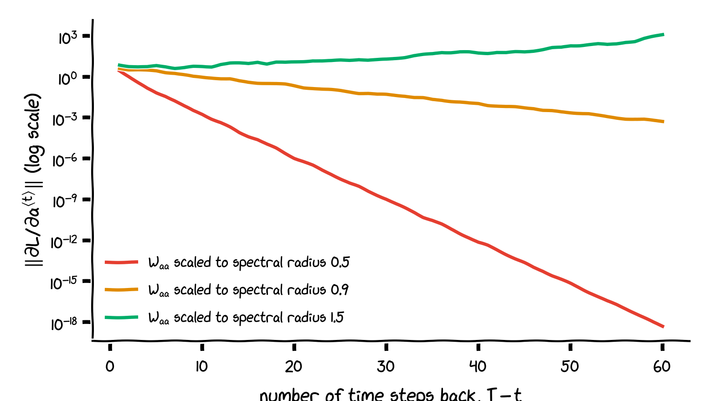
:::
::: {.column width="48%"}
A tanh RNN with 32 units; $\mathbf W_{aa}$ rescaled to different sizes (spectral radius $\rho$, the largest $|$eigenvalue$|$):

- $\rho = 0.5$: after 59 steps the gradient is about $10^{-19}$ times smaller: **vanishing**.
- $\rho = 0.9$: still a factor of about $10^{-4}$.
- $\rho = 1.5$: it grows about 170-fold: **exploding**.

Early words then have (almost) no influence on the weight updates.
:::
::::

## Exploding gradients: gradient clipping

Exploding gradients are easy to detect (very large values, `nan`) and easy to treat: if the gradient norm exceeds a threshold $c$, scale the whole gradient down,
$$
\mathbf g \leftarrow \frac{c}{\|\mathbf g\|}\,\mathbf g \qquad\text{if } \|\mathbf g\| > c .
$$
The direction stays the same; only the step length is limited.

```python
loss.backward()
torch.nn.utils.clip_grad_norm_(model.parameters(), max_norm=5.0)   # between backward() and step()
optimizer.step()
```

**Vanishing** gradients are the harder problem: there is nothing to rescale. They require a different architecture: the GRU and the LSTM.

# Gated recurrent unit (GRU)

## The idea: a memory cell with a gate

Recall the plain RNN unit, in the compact notation of part 9a:
$$
\mathbf a^{\langle t\rangle} = \tanh\big(\mathbf W_a\big[\mathbf a^{\langle t-1\rangle}, \mathbf x^{\langle t\rangle}\big] + \mathbf b_a\big),
\qquad
\hat{\mathbf y}^{\langle t\rangle} = \operatorname{softmax}\big(\mathbf W_y\mathbf a^{\langle t\rangle} + \mathbf b_y\big).
$$
It **overwrites** its memory at every step.

. . .

**GRU, simplified**: a memory cell $\mathbf c^{\langle t\rangle}$ (here $= \mathbf a^{\langle t\rangle}$) is only updated when an **update gate** $\Gamma_u$ says so:
$$
\begin{aligned}
\tilde{\mathbf c}^{\langle t\rangle} &= \tanh\big(\mathbf W_c\big[\mathbf c^{\langle t-1\rangle}, \mathbf x^{\langle t\rangle}\big] + \mathbf b_c\big) &&\text{candidate new memory}\\
\Gamma_u &= \sigma\big(\mathbf W_u\big[\mathbf c^{\langle t-1\rangle}, \mathbf x^{\langle t\rangle}\big] + \mathbf b_u\big) &&\text{update gate, entries in } (0, 1)\\
\mathbf c^{\langle t\rangle} &= \Gamma_u \odot \tilde{\mathbf c}^{\langle t\rangle} + (1 - \Gamma_u) \odot \mathbf c^{\langle t-1\rangle} &&\text{keep or replace, entry by entry}
\end{aligned}
$$

## How the gate helps

- In "The **cat**, which ... **was** full": at "cat", the gate opens ($\Gamma_u \approx 1$) and one entry of $\mathbf c$ stores "singular". Afterwards the gate stays closed ($\Gamma_u \approx 0$), so $\mathbf c^{\langle t\rangle} \approx \mathbf c^{\langle t-1\rangle}$ keeps the information until "was".
- The gate is a **sigmoid**, so it is differentiable and learned by gradient descent, like every other parameter.
- When $\Gamma_u \approx 0$, $\ \partial\mathbf c^{\langle t\rangle}/\partial\mathbf c^{\langle t-1\rangle} \approx \mathbf I$: the gradient passes through the step **unchanged** instead of being multiplied by a small Jacobian. This is what fixes vanishing gradients.
- $\mathbf c$, $\tilde{\mathbf c}$ and $\Gamma_u$ are vectors of the same size: each memory entry has its own gate.

## The full GRU

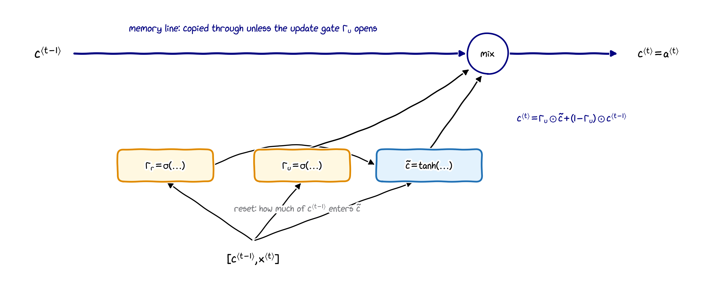{width="76%" fig-align="center"}

$$
\begin{aligned}
\Gamma_r &= \sigma\big(\mathbf W_r\big[\mathbf c^{\langle t-1\rangle}, \mathbf x^{\langle t\rangle}\big] + \mathbf b_r\big) &
\tilde{\mathbf c}^{\langle t\rangle} &= \tanh\big(\mathbf W_c\big[\Gamma_r \odot \mathbf c^{\langle t-1\rangle}, \mathbf x^{\langle t\rangle}\big] + \mathbf b_c\big)\\
\Gamma_u &= \sigma\big(\mathbf W_u\big[\mathbf c^{\langle t-1\rangle}, \mathbf x^{\langle t\rangle}\big] + \mathbf b_u\big) &
\mathbf c^{\langle t\rangle} &= \Gamma_u \odot \tilde{\mathbf c}^{\langle t\rangle} + (1 - \Gamma_u) \odot \mathbf c^{\langle t-1\rangle}, \quad \mathbf a^{\langle t\rangle} = \mathbf c^{\langle t\rangle}
\end{aligned}
$$

The **reset gate** $\Gamma_r$ decides how much of the old memory is used to compute the candidate (Cho et al., 2014).

# Long short-term memory (LSTM)

## The LSTM

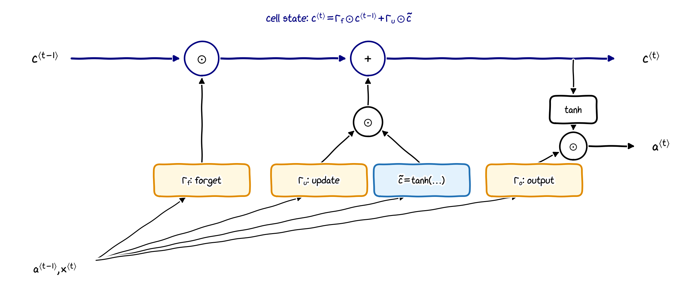{width="66%" fig-align="center"}

$$
\begin{aligned}
\Gamma_u &= \sigma\big(\mathbf W_u[\cdots] + \mathbf b_u\big), &
\Gamma_f &= \sigma\big(\mathbf W_f[\cdots] + \mathbf b_f\big), &
\Gamma_o &= \sigma\big(\mathbf W_o[\cdots] + \mathbf b_o\big),\\
\tilde{\mathbf c}^{\langle t\rangle} &= \tanh\big(\mathbf W_c[\cdots] + \mathbf b_c\big), &
\mathbf c^{\langle t\rangle} &= \Gamma_u \odot \tilde{\mathbf c}^{\langle t\rangle} + \Gamma_f \odot \mathbf c^{\langle t-1\rangle}, &
\mathbf a^{\langle t\rangle} &= \Gamma_o \odot \tanh\big(\mathbf c^{\langle t\rangle}\big),
\end{aligned}
$$
where $[\cdots] = \big[\mathbf a^{\langle t-1\rangle}, \mathbf x^{\langle t\rangle}\big]$ for all gates (Hochreiter and Schmidhuber, 1997).

## What is different from the GRU?

- **Two states**: the cell state $\mathbf c^{\langle t\rangle}$ (long-term memory) and the activation $\mathbf a^{\langle t\rangle}$ (what is passed on and used for predictions).
- **Separate update and forget gates**: the GRU uses $\Gamma_u$ and $1 - \Gamma_u$; the LSTM has independent gates $\Gamma_u$ and $\Gamma_f$, so it can keep the old memory **and** add new information.
- An **output gate** $\Gamma_o$ decides how much of the memory is revealed in $\mathbf a^{\langle t\rangle}$.

. . .

:::: {.columns}
::: {.column width="52%"}
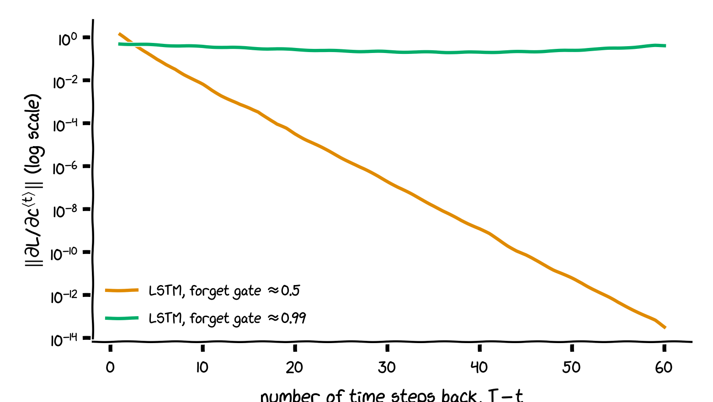{width="86%"}
:::
::: {.column width="48%"}
Along the cell state, $\ \partial\mathbf c^{\langle t\rangle}/\partial\mathbf c^{\langle t-1\rangle} \approx \operatorname{diag}(\Gamma_f)$.

An LSTM cell with 32 units: with forget gates $\approx 0.5$ the gradient shrinks by $10^{-14}$ over 59 steps; with forget gates $\approx 0.99$ it stays almost constant. The network can **learn** to keep its forget gates open for as long as it needs to remember.
:::
::::

## GRU or LSTM?

| | GRU | LSTM |
|:---|:---|:---|
| introduced | Cho et al., 2014 | Hochreiter and Schmidhuber, 1997 |
| gates | 2: update, reset | 3: update (input), forget, output |
| states | 1: $\mathbf c = \mathbf a$ | 2: $\mathbf c$ and $\mathbf a$ |
| parameters (27 inputs, 64 units) | $17{,}856$ ($3\times$ RNN) | $23{,}808$ ($4\times$ RNN) |
| in practice | simpler and faster | the long-standing default; slightly more flexible |

Neither is better on all problems: try both. A plain RNN of the same size has 5,952 parameters.

# RNNs in PyTorch

## Layers and cells

```python
from torch import nn

gru  = nn.GRU(input_size=27, hidden_size=64, batch_first=True)
lstm = nn.LSTM(input_size=27, hidden_size=64, batch_first=True)

X = torch.randn(32, 20, 27)      # (N, T, n_x)
out, h_n = gru(X)                # out: (32, 20, 64);  h_n: (1, 32, 64)
out, (h_n, c_n) = lstm(X)        # the LSTM also returns its final cell state

cell = nn.LSTMCell(27, 64)       # one time step at a time, e.g. for sampling
h0, c0 = torch.zeros(32, 64), torch.zeros(32, 64)
h, c = cell(X[:, 0], (h0, c0))
```

- `nn.RNN`, `nn.GRU`, `nn.LSTM` process **whole sequences**; `nn.RNNCell`, `nn.GRUCell`, `nn.LSTMCell` do **one step**, and you write the loop yourself.
- The documentation pages list the exact equations: <https://pytorch.org/docs/stable/nn.html#recurrent-layers>

## Translating the notation

| this lecture | PyTorch documentation |
|:---|:---|
| activation $\mathbf a^{\langle t\rangle}$ | hidden state $h_t$ |
| cell state $\mathbf c^{\langle t\rangle}$ | cell state $c_t$ |
| LSTM: $\Gamma_u$, $\Gamma_f$, $\Gamma_o$, $\tilde{\mathbf c}$ | $i_t$ (input gate), $f_t$, $o_t$, $g_t$ |
| GRU: $\Gamma_r$, $\tilde{\mathbf c}$ | $r_t$, $n_t$ |
| GRU: $\Gamma_u$ | $1 - z_t$ (careful!) |

- In PyTorch's GRU, $h_t = (1 - z_t) \odot n_t + z_t \odot h_{t-1}$: their "update gate" $z_t$ is the fraction **kept**, i.e. $1 - \Gamma_u$.
- PyTorch's GRU applies the reset gate after the matrix product, $n_t = \tanh(W_{in}x_t + b_{in} + r_t \odot (W_{hn}h_{t-1} + b_{hn}))$, a small variant of the original GRU.
- The gate weights are stacked in one matrix: `weight_ih` holds $(W_{ii}, W_{if}, W_{ig}, W_{io})$ for the LSTM. Hand-written equations with these conventions reproduce `GRUCell` and `LSTMCell` exactly.

# Bidirectional and deep RNNs

## Bidirectional RNNs

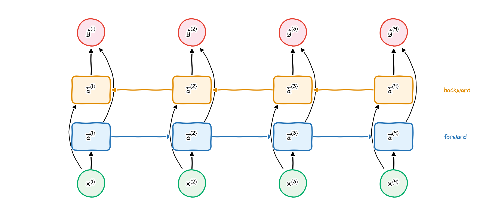{width="70%" fig-align="center"}

$$
\overrightarrow{\mathbf a}^{\langle t\rangle} = g\big(\overrightarrow{\mathbf W}\big[\overrightarrow{\mathbf a}^{\langle t-1\rangle}, \mathbf x^{\langle t\rangle}\big] + \overrightarrow{\mathbf b}\big),\qquad
\overleftarrow{\mathbf a}^{\langle t\rangle} = g\big(\overleftarrow{\mathbf W}\big[\overleftarrow{\mathbf a}^{\langle t+1\rangle}, \mathbf x^{\langle t\rangle}\big] + \overleftarrow{\mathbf b}\big),
$$
$$
\hat{\mathbf y}^{\langle t\rangle} = g\big(\mathbf W_y\big[\overrightarrow{\mathbf a}^{\langle t\rangle}, \overleftarrow{\mathbf a}^{\langle t\rangle}\big] + \mathbf b_y\big).
$$

## Bidirectional RNNs: remarks

- One RNN reads left to right, a second (with its own weights) right to left; each prediction uses **both**, i.e. the whole sentence. This solves "Teddy Roosevelt" versus "Teddy bears" (part 9a).
- The cells can be plain RNN, GRU or LSTM units; bidirectional LSTMs are a common choice for text.
- Drawback: the **whole** sequence is needed before any prediction, so it does not suit real-time tasks such as live speech recognition.
- PyTorch: `nn.LSTM(n_x, n_a, bidirectional=True)`; the output has $2n_a$ features per time step (both directions concatenated).

## Deep RNNs

:::: {.columns}
::: {.column width="55%"}
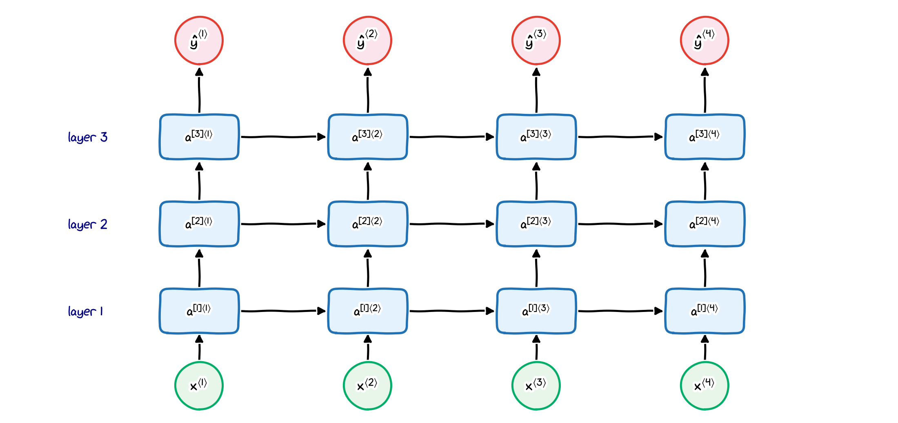
:::
::: {.column width="45%"}
Stack several recurrent layers; layer $l$ receives the activations of layer $l - 1$ as its input:
$$
\mathbf a^{[l]\langle t\rangle} = g\big(\mathbf W_a^{[l]}\big[\mathbf a^{[l]\langle t-1\rangle}, \mathbf a^{[l-1]\langle t\rangle}\big] + \mathbf b_a^{[l]}\big),
$$
with $\mathbf a^{[0]\langle t\rangle} = \mathbf x^{\langle t\rangle}$.

- Each layer has its own weights, shared across time.
- Typically 2 or 3 layers: each layer is already "deep in time".
- PyTorch: `nn.GRU(n_x, n_a, num_layers=3)`.
:::
::::

# Outlook

## Word embeddings

:::: {.columns}
::: {.column width="52%"}
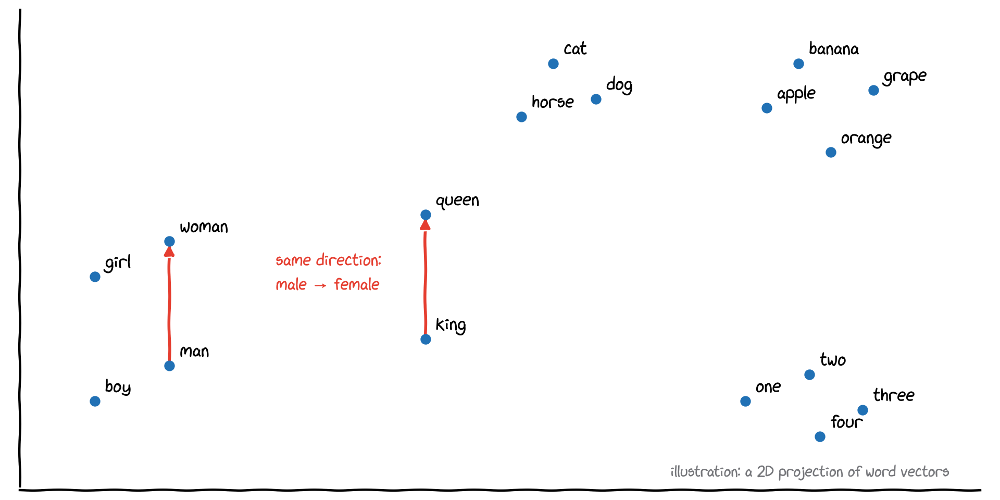
:::
::: {.column width="48%"}
- One-hot vectors treat all words as equally different: "apple" is as far from "orange" as from "king".
- **Word embeddings** represent each word by a learned dense vector, e.g. 300 numbers. Similar words get similar vectors.
- Directions can carry meaning: $\mathbf e_{\text{king}} - \mathbf e_{\text{man}} + \mathbf e_{\text{woman}} \approx \mathbf e_{\text{queen}}$.
- Learned from large text corpora (word2vec, GloVe), or as part of a model with `nn.Embedding(vocab_size, dim)`.
:::
::::

## Where to go from here

- **Sequence-to-sequence models**: an encoder RNN and a decoder RNN for translation and summarisation, with **beam search** for decoding and the **BLEU score** for evaluation.
- **Attention**: let the decoder look back at all encoder activations, instead of squeezing the sentence into one vector.
- **Transformers** (Vaswani et al., 2017, "Attention is all you need"): attention without recurrence. They process all positions in parallel and are the basis of today's large language models, which are language models in exactly the sense of part 9b.

**Further reading**

- C. Olah (2015), *Understanding LSTM networks*: <https://colah.github.io/posts/2015-08-Understanding-LSTMs/>
- A. Karpathy (2015), *The unreasonable effectiveness of recurrent neural networks*: <https://karpathy.github.io/2015/05/21/rnn-effectiveness/>
- S. Amidi, A. Amidi, *Recurrent neural networks cheatsheet* (Stanford CS 230): <https://stanford.edu/~shervine/teaching/cs-230/cheatsheet-recurrent-neural-networks>

## A word on learning from the literature

- Technical details will be forgotten; the understanding and the skill to **read** new material stay.
- Every source uses its own notation ($\mathbf a$ or $\mathbf h$, $\Gamma_u$ or $i_t$ or $z_t$): translate it into one you understand, and check with a small example, as we did with the PyTorch cells.
- If you would like to go further, for example in an MSc project using machine learning, you are welcome to discuss your ideas with me.

## Summary of part 9c

- Plain RNNs struggle with **long-range dependencies**: backpropagation through time multiplies many Jacobians, so gradients **vanish** or **explode**. Clipping fixes exploding gradients.
- **GRU**: a memory cell with update (and reset) gates, $\mathbf c^{\langle t\rangle} = \Gamma_u \odot \tilde{\mathbf c}^{\langle t\rangle} + (1 - \Gamma_u) \odot \mathbf c^{\langle t-1\rangle}$.
- **LSTM**: separate cell state and activation, with update, forget and output gates, $\mathbf c^{\langle t\rangle} = \Gamma_u \odot \tilde{\mathbf c}^{\langle t\rangle} + \Gamma_f \odot \mathbf c^{\langle t-1\rangle}$, $\ \mathbf a^{\langle t\rangle} = \Gamma_o \odot \tanh(\mathbf c^{\langle t\rangle})$.
- Gates let gradients pass through many steps nearly unchanged.
- **Bidirectional** RNNs use past and future context; **deep** RNNs stack recurrent layers.
- In PyTorch: `nn.GRU`, `nn.LSTM` (layers), `nn.GRUCell`, `nn.LSTMCell` (one step); watch the notation, especially $z_t = 1 - \Gamma_u$.

## Check your understanding: part 9c

1. Why does an RNN behave like a very deep network during backpropagation?
2. In the simplified GRU, what are $\mathbf c^{\langle t\rangle}$ for $\Gamma_u = \mathbf 0$ and for $\Gamma_u = \mathbf 1$?
3. In the LSTM, which gate settings let the cell keep its memory unchanged for many steps?
4. How many parameters does `nn.LSTM(100, 50)` have? (Use: 4 gates, each with input weights, recurrent weights and two biases.)
5. Why is a bidirectional RNN unsuitable for live speech recognition?

::: notes
1. Unrolled over $T$ time steps, the gradient passes through $T$ applications of the same layer; the Jacobians multiply.
2. $\Gamma_u = \mathbf 0$: $\mathbf c^{\langle t\rangle} = \mathbf c^{\langle t-1\rangle}$ (keep); $\Gamma_u = \mathbf 1$: $\mathbf c^{\langle t\rangle} = \tilde{\mathbf c}^{\langle t\rangle}$ (replace).
3. Forget gate $\Gamma_f \approx \mathbf 1$ and update gate $\Gamma_u \approx \mathbf 0$.
4. $4\cdot(50\cdot 100 + 50\cdot 50 + 50 + 50) = 4\cdot 7600 = 30{,}400$.
5. It needs the whole sequence, including the future, before it can make a prediction.
:::

# Wrapping up

## Lecture 9 at a glance

| topic | key formula or idea |
|:---|:---|
| RNN | $\mathbf a^{\langle t\rangle} = g(\mathbf W_{aa}\mathbf a^{\langle t-1\rangle} + \mathbf W_{ax}\mathbf x^{\langle t\rangle} + \mathbf b_a)$, $\ \hat{\mathbf y}^{\langle t\rangle} = g(\mathbf W_{ya}\mathbf a^{\langle t\rangle} + \mathbf b_y)$ |
| training | sum of per-step losses; backpropagation through time |
| language model | $P(y^{\langle 1\rangle}, \dots, y^{\langle T\rangle}) = \prod_t P(y^{\langle t\rangle} \mid y^{\langle 1\rangle}, \dots, y^{\langle t-1\rangle}) = e^{-L}$ |
| generation | sample from the softmax, feed back; temperature $\tau$ |
| GRU | $\mathbf c^{\langle t\rangle} = \Gamma_u \odot \tilde{\mathbf c}^{\langle t\rangle} + (1 - \Gamma_u) \odot \mathbf c^{\langle t-1\rangle}$ |
| LSTM | $\mathbf c^{\langle t\rangle} = \Gamma_u \odot \tilde{\mathbf c}^{\langle t\rangle} + \Gamma_f \odot \mathbf c^{\langle t-1\rangle}$, $\ \mathbf a^{\langle t\rangle} = \Gamma_o \odot \tanh(\mathbf c^{\langle t\rangle})$ |
| more context | bidirectional RNNs (past and future), deep RNNs (stacked layers) |

: {tbl-colwidths="[20,80]"}

## The course at a glance

| lecture | the main idea |
|:---|:---|
| 1 | learning from examples: regression and classification |
| 2 | a model, a cost function, and gradient descent to minimise it |
| 3 | probabilities for classes: sigmoid, softmax, cross-entropy |
| 4 | generalisation: regularisation and honest model selection |
| 5 | maximum margin and constrained optimisation: SVMs, KKT, kernels |
| 6 | PyTorch: tensors, autograd, the training loop |
| 7 | neural networks: layers, backpropagation, deep networks |
| 8 | convolutional networks: shared filters for images |
| 9 | recurrent networks: shared weights over time for sequences |

: {tbl-colwidths="[12,88]"}

The same recipe runs through every lecture: choose a **model**, define a **cost**, **minimise** it with gradients, and check that the result **generalises** to new data.
